# COMP0245: golden dataset experiments

This notebook starts from the frozen 300-target dataset and its 200 camera traces. It carries forward the three freshly trained baselines, iterations 34–36, as the starting point for the next experiments. The complete earlier notebook, `driving_v2_sensors.ipynb`, is preserved unchanged.

Re-running this notebook reads and plots saved results. It does not retrain models or run the simulator. Test results below are loaded from saved evaluations. The full data package is on university OneDrive; this repository contains its manifests and a small, explicitly labelled training preview. Use `GOLDEN_DATA_ROOT` for the location of the extracted package when running the training commands in `../arm/GOLDEN_DATA.md`.


```python
from pathlib import Path
import os, sys, json
import numpy as np
import pandas as pd
import matplotlib.pyplot as plt
from IPython.display import display, Markdown, HTML
sys.path.insert(0, str(Path('../arm').resolve()))
import report_golden as golden
from report_golden import MODELS, RESULTS
GOLDEN_DATA_ROOT = Path(os.environ['GOLDEN_DATA_ROOT']).expanduser() if os.environ.get('GOLDEN_DATA_ROOT') else None
print('Full dataset:', GOLDEN_DATA_ROOT if GOLDEN_DATA_ROOT else 'not configured; saved manifests, preview and results remain available')
from IPython.display import IFrame, HTML
import uuid

def lazy_player(url, height=810):
    """A 3D player that loads only when its button is pressed. Browsers keep only about 16 3D views (WebGL
    contexts) at once, so loading every player in the notebook together leaves some of them blank."""
    k = uuid.uuid4().hex[:8]
    return HTML(f"""<div><button onclick="var f=document.getElementById('player{k}');f.src='{url}';f.style.display='block';this.style.display='none'"
 style="padding:8px 14px;font-size:14px">Load the 3D player</button>
<iframe id="player{k}" style="display:none;width:100%;height:{height}px;border:0"></iframe></div>""")

```

    Full dataset: /media/nm/Fast Drive/comp0245-camera-11108/shared/COMP0245_Golden_300_2026-11-04


## Dataset and split

There are 100 training, 100 validation and 100 reserved test expert runs. Offline camera observations exist for training and validation. Test cameras were rendered live along each learned trajectory in ticket #11110, so expert test camera traces are not needed. Target IDs remain fixed across comparisons.


```python
split = golden.read(MODELS/'dataset_split.json')
manifest = golden.read(MODELS/'dataset_manifest.json')
audit = pd.DataFrame(golden.read(MODELS/'data_audit.json')['rows'])
assert all(len(set(v)) == 100 for v in split.values())
assert len(set().union(*map(set, split.values()))) == 300
display(pd.DataFrame([dict(split=k, expert_runs=len(v), offline_camera_runs=0 if k=='test' else len(v), role={'train':'fit weights and learned scaling','val':'choose epochs and run integration checks','test':'final evaluation only'}[k]) for k,v in split.items()]))
display(audit.groupby('split').agg(runs=('dot','count'),driving_rows=('drive_rows','sum'),arm_rows=('arm_rows','sum'),parked_tail_min=('parked_rows','min'),parked_tail_max=('parked_rows','max')))
print('Frozen split SHA256:', golden.read(MODELS/'data_audit.json')['split_sha256'])
```


<div>
<style scoped>
    .dataframe tbody tr th:only-of-type {
        vertical-align: middle;
    }

    .dataframe tbody tr th {
        vertical-align: top;
    }

    .dataframe thead th {
        text-align: right;
    }
</style>
<table border="1" class="dataframe">
  <thead>
    <tr style="text-align: right;">
      <th></th>
      <th>split</th>
      <th>expert_runs</th>
      <th>offline_camera_runs</th>
      <th>role</th>
    </tr>
  </thead>
  <tbody>
    <tr>
      <th>0</th>
      <td>train</td>
      <td>100</td>
      <td>100</td>
      <td>fit weights and learned scaling</td>
    </tr>
    <tr>
      <th>1</th>
      <td>val</td>
      <td>100</td>
      <td>100</td>
      <td>choose epochs and run integration checks</td>
    </tr>
    <tr>
      <th>2</th>
      <td>test</td>
      <td>100</td>
      <td>0</td>
      <td>final evaluation only</td>
    </tr>
  </tbody>
</table>
</div>


<div>
<style scoped>
    .dataframe tbody tr th:only-of-type {
        vertical-align: middle;
    }

    .dataframe tbody tr th {
        vertical-align: top;
    }

    .dataframe thead th {
        text-align: right;
    }
</style>
<table border="1" class="dataframe">
  <thead>
    <tr style="text-align: right;">
      <th></th>
      <th>runs</th>
      <th>driving_rows</th>
      <th>arm_rows</th>
      <th>parked_tail_min</th>
      <th>parked_tail_max</th>
    </tr>
    <tr>
      <th>split</th>
      <th></th>
      <th></th>
      <th></th>
      <th></th>
      <th></th>
    </tr>
  </thead>
  <tbody>
    <tr>
      <th>train</th>
      <td>100</td>
      <td>25928</td>
      <td>295084</td>
      <td>30</td>
      <td>100</td>
    </tr>
    <tr>
      <th>val</th>
      <td>100</td>
      <td>26428</td>
      <td>288818</td>
      <td>13</td>
      <td>100</td>
    </tr>
  </tbody>
</table>
</div>


    Frozen split SHA256: 286f578aec7e3ab0953592466e63014cc1dde7f467106fadf273b30762ac1abf


## Model inputs and training targets

Driving has 16 inputs: four accumulated encoder angles, four encoder speeds, four combinations of those readings, and camera-tracked range/sin bearing/cos bearing/visibility. Reaching has 17 inputs: seven arm encoder angles, seven encoder speeds and camera-tracked target xyz in the robot frame. Values become FP32 tensors. The camera runs at 30 Hz; its latest estimate is held between arm steps at 1 kHz.

Training targets are the expert wheel-speed and arm-torque commands, normalized time to PARK and normalized gripper distance for STOP. Simulator truth is permitted for labels and scoring; it is not fed into the learned policies.

The existing simulator retains its PD-plus-model-gravity arm hold while driving. After PARK, the learned torque network controls the arm, including the 0.5 s following STOP. That fixed pre-PARK holding controller is part of this baseline and is not a learned sensor-only arm controller. STOP does not freeze physics.


```python
preview = dict(np.load(MODELS/'training_preview.npz', allow_pickle=False))
wheel_names = [f'wheel_angle_{j}_rad' for j in range(1,5)] + [f'wheel_speed_{j}_rad_s' for j in range(1,5)] + ['mean_turn_rad','right_minus_left_turn_rad','mean_speed_rad_s','right_minus_left_speed_rad_s']
drive_names = wheel_names + ['tracked_range_m','tracked_bearing_sin','tracked_bearing_cos','visible']
arm_names = [f'arm_angle_{j}_rad' for j in range(1,8)] + [f'arm_speed_{j}_rad_s' for j in range(1,8)] + ['tracked_dot_x_m','tracked_dot_y_m','tracked_dot_z_m']
print('Preview only: training target', int(preview['dot']), '; five source rows per phase, not the whole dataset.')
display(pd.DataFrame(preview['driving_x'], columns=drive_names).assign(step=preview['drive_steps']).set_index('step'))
display(pd.DataFrame(preview['arm_x'], columns=arm_names).assign(step=preview['arm_steps']).set_index('step'))
print('Input types:', preview['driving_x'].dtype, preview['arm_x'].dtype)
```

    Preview only: training target 0 ; five source rows per phase, not the whole dataset.


<div>
<style scoped>
    .dataframe tbody tr th:only-of-type {
        vertical-align: middle;
    }

    .dataframe tbody tr th {
        vertical-align: top;
    }

    .dataframe thead th {
        text-align: right;
    }
</style>
<table border="1" class="dataframe">
  <thead>
    <tr style="text-align: right;">
      <th></th>
      <th>wheel_angle_1_rad</th>
      <th>wheel_angle_2_rad</th>
      <th>wheel_angle_3_rad</th>
      <th>wheel_angle_4_rad</th>
      <th>wheel_speed_1_rad_s</th>
      <th>wheel_speed_2_rad_s</th>
      <th>wheel_speed_3_rad_s</th>
      <th>wheel_speed_4_rad_s</th>
      <th>mean_turn_rad</th>
      <th>right_minus_left_turn_rad</th>
      <th>mean_speed_rad_s</th>
      <th>right_minus_left_speed_rad_s</th>
      <th>tracked_range_m</th>
      <th>tracked_bearing_sin</th>
      <th>tracked_bearing_cos</th>
      <th>visible</th>
    </tr>
    <tr>
      <th>step</th>
      <th></th>
      <th></th>
      <th></th>
      <th></th>
      <th></th>
      <th></th>
      <th></th>
      <th></th>
      <th></th>
      <th></th>
      <th></th>
      <th></th>
      <th></th>
      <th></th>
      <th></th>
      <th></th>
    </tr>
  </thead>
  <tbody>
    <tr>
      <th>0</th>
      <td>0.000000</td>
      <td>0.000000</td>
      <td>0.000000</td>
      <td>0.000000</td>
      <td>0.000000</td>
      <td>0.000000</td>
      <td>0.000000</td>
      <td>0.000000</td>
      <td>0.000000</td>
      <td>0.000000</td>
      <td>0.00000</td>
      <td>0.000000</td>
      <td>0.0</td>
      <td>0.0</td>
      <td>0.0</td>
      <td>0.0</td>
    </tr>
    <tr>
      <th>33</th>
      <td>-0.090505</td>
      <td>0.088971</td>
      <td>0.090505</td>
      <td>-0.092039</td>
      <td>-2.715146</td>
      <td>2.669127</td>
      <td>2.715146</td>
      <td>-2.761165</td>
      <td>-0.000767</td>
      <td>-0.181010</td>
      <td>-0.02301</td>
      <td>-5.430292</td>
      <td>0.0</td>
      <td>0.0</td>
      <td>0.0</td>
      <td>0.0</td>
    </tr>
    <tr>
      <th>67</th>
      <td>-0.181010</td>
      <td>0.179476</td>
      <td>0.185612</td>
      <td>-0.187146</td>
      <td>-2.715146</td>
      <td>2.715146</td>
      <td>2.853204</td>
      <td>-2.853204</td>
      <td>-0.000767</td>
      <td>-0.366621</td>
      <td>0.00000</td>
      <td>-5.568350</td>
      <td>0.0</td>
      <td>0.0</td>
      <td>0.0</td>
      <td>0.0</td>
    </tr>
    <tr>
      <th>100</th>
      <td>-0.268447</td>
      <td>0.266913</td>
      <td>0.277651</td>
      <td>-0.279184</td>
      <td>-2.623107</td>
      <td>2.623107</td>
      <td>2.761165</td>
      <td>-2.761165</td>
      <td>-0.000767</td>
      <td>-0.546097</td>
      <td>0.00000</td>
      <td>-5.384273</td>
      <td>0.0</td>
      <td>0.0</td>
      <td>0.0</td>
      <td>0.0</td>
    </tr>
    <tr>
      <th>133</th>
      <td>-0.354350</td>
      <td>0.352816</td>
      <td>0.369689</td>
      <td>-0.371223</td>
      <td>-2.577088</td>
      <td>2.577088</td>
      <td>2.761165</td>
      <td>-2.761165</td>
      <td>-0.000767</td>
      <td>-0.724039</td>
      <td>0.00000</td>
      <td>-5.338253</td>
      <td>0.0</td>
      <td>0.0</td>
      <td>0.0</td>
      <td>0.0</td>
    </tr>
  </tbody>
</table>
</div>


<div>
<style scoped>
    .dataframe tbody tr th:only-of-type {
        vertical-align: middle;
    }

    .dataframe tbody tr th {
        vertical-align: top;
    }

    .dataframe thead th {
        text-align: right;
    }
</style>
<table border="1" class="dataframe">
  <thead>
    <tr style="text-align: right;">
      <th></th>
      <th>arm_angle_1_rad</th>
      <th>arm_angle_2_rad</th>
      <th>arm_angle_3_rad</th>
      <th>arm_angle_4_rad</th>
      <th>arm_angle_5_rad</th>
      <th>arm_angle_6_rad</th>
      <th>arm_angle_7_rad</th>
      <th>arm_speed_1_rad_s</th>
      <th>arm_speed_2_rad_s</th>
      <th>arm_speed_3_rad_s</th>
      <th>arm_speed_4_rad_s</th>
      <th>arm_speed_5_rad_s</th>
      <th>arm_speed_6_rad_s</th>
      <th>arm_speed_7_rad_s</th>
      <th>tracked_dot_x_m</th>
      <th>tracked_dot_y_m</th>
      <th>tracked_dot_z_m</th>
    </tr>
    <tr>
      <th>step</th>
      <th></th>
      <th></th>
      <th></th>
      <th></th>
      <th></th>
      <th></th>
      <th></th>
      <th></th>
      <th></th>
      <th></th>
      <th></th>
      <th></th>
      <th></th>
      <th></th>
      <th></th>
      <th></th>
      <th></th>
    </tr>
  </thead>
  <tbody>
    <tr>
      <th>6230</th>
      <td>-0.014631</td>
      <td>1.515667</td>
      <td>0.000216</td>
      <td>1.014285</td>
      <td>-0.006637</td>
      <td>1.000131</td>
      <td>-0.001473</td>
      <td>-0.107379</td>
      <td>0.006818</td>
      <td>0.049428</td>
      <td>0.001704</td>
      <td>-0.081812</td>
      <td>0.000000</td>
      <td>0.029750</td>
      <td>0.42766</td>
      <td>-0.034332</td>
      <td>1.238958</td>
    </tr>
    <tr>
      <th>6231</th>
      <td>-0.014738</td>
      <td>1.515657</td>
      <td>0.000269</td>
      <td>1.014328</td>
      <td>-0.006721</td>
      <td>1.000200</td>
      <td>-0.001448</td>
      <td>-0.107379</td>
      <td>-0.010227</td>
      <td>0.052837</td>
      <td>0.042611</td>
      <td>-0.084291</td>
      <td>0.069417</td>
      <td>0.024792</td>
      <td>0.42766</td>
      <td>-0.034332</td>
      <td>1.238958</td>
    </tr>
    <tr>
      <th>6232</th>
      <td>-0.014849</td>
      <td>1.515638</td>
      <td>0.000320</td>
      <td>1.014396</td>
      <td>-0.006803</td>
      <td>1.000322</td>
      <td>-0.001423</td>
      <td>-0.110788</td>
      <td>-0.018749</td>
      <td>0.051133</td>
      <td>0.068177</td>
      <td>-0.081812</td>
      <td>0.121479</td>
      <td>0.024792</td>
      <td>0.42766</td>
      <td>-0.034332</td>
      <td>1.238958</td>
    </tr>
    <tr>
      <th>6233</th>
      <td>-0.014963</td>
      <td>1.515610</td>
      <td>0.000373</td>
      <td>1.014485</td>
      <td>-0.006885</td>
      <td>1.000483</td>
      <td>-0.001401</td>
      <td>-0.114196</td>
      <td>-0.027271</td>
      <td>0.052837</td>
      <td>0.088630</td>
      <td>-0.081812</td>
      <td>0.161145</td>
      <td>0.022312</td>
      <td>0.42619</td>
      <td>-0.038042</td>
      <td>1.239363</td>
    </tr>
    <tr>
      <th>6234</th>
      <td>-0.015081</td>
      <td>1.515576</td>
      <td>0.000424</td>
      <td>1.014587</td>
      <td>-0.006966</td>
      <td>1.000674</td>
      <td>-0.001376</td>
      <td>-0.117605</td>
      <td>-0.034088</td>
      <td>0.051133</td>
      <td>0.102265</td>
      <td>-0.081812</td>
      <td>0.190895</td>
      <td>0.024792</td>
      <td>0.42619</td>
      <td>-0.038042</td>
      <td>1.239363</td>
    </tr>
  </tbody>
</table>
</div>


    Input types: float32 float32


```python
display(pd.DataFrame(preview['driving_commands'], columns=[f'expert_wheel_{j}_rad_s' for j in range(1,5)]).assign(time_to_park_scaled=preview['driving_ttp'],step=preview['drive_steps']).set_index('step'))
display(pd.DataFrame(preview['arm_commands'], columns=[f'expert_torque_{j}_Nm' for j in range(1,8)]).assign(stop_distance_scaled=preview['arm_stop_target'],step=preview['arm_steps']).set_index('step'))
```


<div>
<style scoped>
    .dataframe tbody tr th:only-of-type {
        vertical-align: middle;
    }

    .dataframe tbody tr th {
        vertical-align: top;
    }

    .dataframe thead th {
        text-align: right;
    }
</style>
<table border="1" class="dataframe">
  <thead>
    <tr style="text-align: right;">
      <th></th>
      <th>expert_wheel_1_rad_s</th>
      <th>expert_wheel_2_rad_s</th>
      <th>expert_wheel_3_rad_s</th>
      <th>expert_wheel_4_rad_s</th>
      <th>time_to_park_scaled</th>
    </tr>
    <tr>
      <th>step</th>
      <th></th>
      <th></th>
      <th></th>
      <th></th>
      <th></th>
    </tr>
  </thead>
  <tbody>
    <tr>
      <th>0</th>
      <td>-3.0</td>
      <td>3.0</td>
      <td>3.0</td>
      <td>-3.0</td>
      <td>1.0</td>
    </tr>
    <tr>
      <th>33</th>
      <td>-3.0</td>
      <td>3.0</td>
      <td>3.0</td>
      <td>-3.0</td>
      <td>1.0</td>
    </tr>
    <tr>
      <th>67</th>
      <td>-3.0</td>
      <td>3.0</td>
      <td>3.0</td>
      <td>-3.0</td>
      <td>1.0</td>
    </tr>
    <tr>
      <th>100</th>
      <td>-3.0</td>
      <td>3.0</td>
      <td>3.0</td>
      <td>-3.0</td>
      <td>1.0</td>
    </tr>
    <tr>
      <th>133</th>
      <td>-3.0</td>
      <td>3.0</td>
      <td>3.0</td>
      <td>-3.0</td>
      <td>1.0</td>
    </tr>
  </tbody>
</table>
</div>


<div>
<style scoped>
    .dataframe tbody tr th:only-of-type {
        vertical-align: middle;
    }

    .dataframe tbody tr th {
        vertical-align: top;
    }

    .dataframe thead th {
        text-align: right;
    }
</style>
<table border="1" class="dataframe">
  <thead>
    <tr style="text-align: right;">
      <th></th>
      <th>expert_torque_1_Nm</th>
      <th>expert_torque_2_Nm</th>
      <th>expert_torque_3_Nm</th>
      <th>expert_torque_4_Nm</th>
      <th>expert_torque_5_Nm</th>
      <th>expert_torque_6_Nm</th>
      <th>expert_torque_7_Nm</th>
      <th>stop_distance_scaled</th>
    </tr>
    <tr>
      <th>step</th>
      <th></th>
      <th></th>
      <th></th>
      <th></th>
      <th></th>
      <th></th>
      <th></th>
      <th></th>
    </tr>
  </thead>
  <tbody>
    <tr>
      <th>6230</th>
      <td>5.316199</td>
      <td>28.082699</td>
      <td>-1.365561</td>
      <td>-6.598114</td>
      <td>3.302955</td>
      <td>22.673250</td>
      <td>-0.699793</td>
      <td>1.0</td>
    </tr>
    <tr>
      <th>6231</th>
      <td>5.320834</td>
      <td>28.591558</td>
      <td>-1.470603</td>
      <td>-7.839973</td>
      <td>3.385210</td>
      <td>20.551292</td>
      <td>-0.551579</td>
      <td>1.0</td>
    </tr>
    <tr>
      <th>6232</th>
      <td>5.459431</td>
      <td>28.937777</td>
      <td>-1.435724</td>
      <td>-8.689305</td>
      <td>3.328572</td>
      <td>19.007622</td>
      <td>-0.613395</td>
      <td>1.0</td>
    </tr>
    <tr>
      <th>6233</th>
      <td>5.542691</td>
      <td>29.200615</td>
      <td>-1.472973</td>
      <td>-9.291978</td>
      <td>3.338620</td>
      <td>17.821453</td>
      <td>-0.567547</td>
      <td>1.0</td>
    </tr>
    <tr>
      <th>6234</th>
      <td>5.643270</td>
      <td>29.394722</td>
      <td>-1.480658</td>
      <td>-9.713266</td>
      <td>3.327830</td>
      <td>16.905899</td>
      <td>-0.562102</td>
      <td>1.0</td>
    </tr>
  </tbody>
</table>
</div>


## Frozen models

Training finished under ticket 11109. Validation chose the checkpoints; ticket 11110 evaluates these unchanged models on the reserved test targets.


### Golden data: driving and reaching, three seeds (iterations 34 to 36)

#### Iterations 34 to 36: plan and expected results

Written before training. Ticket #11109 follows the 4 November roadmap: retrain the iteration 13 driving architecture and iteration 27 reaching architecture on 100 training runs, choose epochs on 100 validation runs, and reserve the 100 test runs for ticket #11110. Seeds 7, 1 and 2 are iterations 34, 35 and 36 respectively. Earlier notebook results stay unchanged.

Driving uses 16 encoder/camera inputs at 30 Hz, two 16-unit ReLU layers, four wheel-speed outputs and a separate time-to-PARK head. The target is seconds to the recorded PARK, clipped at 3 s and divided by 3; the PARK threshold remains 0.25 s. The loss is wheel-speed MSE plus normalized time-to-PARK MSE, with each run weighted equally. Include at most 100 available, real parked frames after PARK. Fit the six angle-feature scales on training only.

Reaching uses 17 inputs at 1 kHz: seven encoder angles, seven encoder speeds and camera/tracker xyz, held between camera frames. Its torque path has two 64-unit ReLU layers and seven torque outputs; the independent stop network is 17 -> 32 -> 16 -> 1. Preserve the inherited auxiliary distance loss when training the torque path; the independent stop network supplies runtime STOP. Both distance targets use the aligned expert distance, clipped at 0.25 m and divided by 0.25; STOP remains 10 mm. Each run has equal weight. Encoder resolutions, fixed input scales and runtime clipping remain unchanged.

Every network starts from fresh weights. Use FP32, Adam at 0.01, up to 300 epochs for driving/torques and 600 for independent stop. Select the lowest declared validation objective and restore that checkpoint. Any chunking accumulates the same full-batch gradient before one optimizer update. Validate exported NumPy predictions against PyTorch before simulation.

Expected result: validation losses should fall below their epoch-zero values, and the broader range of target heights should reduce the single-height behaviour seen in iteration 30. This is a hypothesis, not a claimed result. It is contradicted if validation does not improve, or if recorded validation reaches continue to converge to one height regardless of the camera estimate. A lower offline loss alone does not establish successful parking or reaching.

Use a fixed validation subset, selected before training, for integration smoke checks. The expert is only a recorded reference/ghost. Report every seed, camera visibility, PARK, STOP, distance at STOP and timeouts; never tune against the reserved test runs. There is no PPO, weight perturbation, new CNN, DART or DAgger in this experiment.

Training status: all three seeds trained on the GPU in 87.7 seconds including loading and export checks. Test trajectories were not opened during training. Final test evaluation is recorded below.


### Official iterations 34 to 36: frozen 100-target test plan

Ticket 11110 evaluates seeds 7, 1 and 2 from ticket 11109 without retraining. Each seed attempts all 100 reserved test targets. Training and validation chose every checkpoint; representative seed 7 was fixed before simulation outcomes.

Success requires PARK, STOP and a true gripper-to-dot distance of at most 10 mm at the exact STOP step. Closest approach and drift during the following 0.5 seconds are reported separately. Without STOP, the deadline is expert completion plus 4 seconds. No PARK, no STOP and numerical failures remain in the denominator.

Camera and driving updates run at 30 Hz, reaching torques and arm encoders at 1 kHz. Inputs use encoders and the rendered camera/tracker. The original native PD-plus-model-gravity arm hold remains during driving. Encoder quantisation, camera error, robot model and limits remain unchanged; no added noise or dynamics effects.

The smoke checks below found no successful 10 mm stops, so the expectation is weak final reaching performance. This evaluation measures that baseline honestly; no test outcomes will be used to change the model or deadline. All 300 attempts, per-seed Wilson intervals, training loss histories and test replays will be reported. The old validation-only MLflow entries are archived; the official test runs use iterations 34 to 36.


### Validation smoke checks

Ten predetermined validation targets per seed, used only to check integration. These are not official test results or numbered MLflow runs. The full saved records remain available; no validation animations are loaded here.


```python
smoke = json.loads((RESULTS / 'summary.json').read_text())
smoke_df = pd.DataFrame([{'seed': s, 'attempts': len(rs), 'PARK': sum(r['parked'] for r in rs), 'STOP': sum(r['stop_s'] is not None for r in rs), 'within_10mm_at_STOP': sum(r['parked'] and r['at_network_stop_mm'] is not None and r['at_network_stop_mm'] <= 10 for r in rs)} for s in (7, 1, 2) for rs in [[r for r in smoke if r['seed'] == s]]])
display(smoke_df)

```


<div>
<style scoped>
    .dataframe tbody tr th:only-of-type {
        vertical-align: middle;
    }

    .dataframe tbody tr th {
        vertical-align: top;
    }

    .dataframe thead th {
        text-align: right;
    }
</style>
<table border="1" class="dataframe">
  <thead>
    <tr style="text-align: right;">
      <th></th>
      <th>seed</th>
      <th>attempts</th>
      <th>PARK</th>
      <th>STOP</th>
      <th>within_10mm_at_STOP</th>
    </tr>
  </thead>
  <tbody>
    <tr>
      <th>0</th>
      <td>7</td>
      <td>10</td>
      <td>4</td>
      <td>4</td>
      <td>0</td>
    </tr>
    <tr>
      <th>1</th>
      <td>1</td>
      <td>10</td>
      <td>10</td>
      <td>7</td>
      <td>0</td>
    </tr>
    <tr>
      <th>2</th>
      <td>2</td>
      <td>10</td>
      <td>10</td>
      <td>9</td>
      <td>0</td>
    </tr>
  </tbody>
</table>
</div>


## Full test: 100 targets for each seed

The same 100 reserved targets are tested for seeds 7, 1 and 2. Each attempt starts from reset with learned driving and reaching. All attempted targets stay in the score, including missing PARK, missing STOP and execution failures. Training and validation chose the models before these outcomes. Seed 7 remains the representative.

The table reports the three seeds separately. They share targets, so the 300 attempts are not 300 independent target samples. Median parking error is conditional on PARK; median STOP distance is conditional on STOP. The success denominator is always 100.


```python
import report_test_golden as test_report
completion = golden.read(test_report.RESULTS / 'completion.json')
assert completion['all_accounted'] and completion['attempts'] == 300
scores = pd.DataFrame([test_report.score(s) for s in (7, 1, 2)]).set_index('seed')
display(scores.round(2))
print(f"Active simulation time: {completion['elapsed_s']/60:.1f} minutes across both execution segments; paused time excluded.")
print(f"Resumed segment: {completion['resumed_elapsed_s']/60:.1f} minutes, with {completion['restored']} earlier attempts retained.")

```


<div>
<style scoped>
    .dataframe tbody tr th:only-of-type {
        vertical-align: middle;
    }

    .dataframe tbody tr th {
        vertical-align: top;
    }

    .dataframe thead th {
        text-align: right;
    }
</style>
<table border="1" class="dataframe">
  <thead>
    <tr style="text-align: right;">
      <th></th>
      <th>attempts</th>
      <th>parked</th>
      <th>stopped</th>
      <th>success_10mm</th>
      <th>success_percent</th>
      <th>wilson95_low_percent</th>
      <th>wilson95_high_percent</th>
      <th>median_park_error_cm</th>
      <th>median_abs_heading_error_deg</th>
      <th>median_closest_mm</th>
      <th>median_stop_mm</th>
      <th>median_park_s</th>
      <th>median_stop_s</th>
      <th>timeouts</th>
      <th>execution_failures</th>
      <th>sum_case_wall_s</th>
      <th>median_case_wall_s</th>
    </tr>
    <tr>
      <th>seed</th>
      <th></th>
      <th></th>
      <th></th>
      <th></th>
      <th></th>
      <th></th>
      <th></th>
      <th></th>
      <th></th>
      <th></th>
      <th></th>
      <th></th>
      <th></th>
      <th></th>
      <th></th>
      <th></th>
      <th></th>
    </tr>
  </thead>
  <tbody>
    <tr>
      <th>7</th>
      <td>100</td>
      <td>47</td>
      <td>47</td>
      <td>0</td>
      <td>0.0</td>
      <td>0.0</td>
      <td>3.7</td>
      <td>27.30</td>
      <td>14.25</td>
      <td>295.83</td>
      <td>400.42</td>
      <td>5.00</td>
      <td>6.47</td>
      <td>53</td>
      <td>0</td>
      <td>1587.48</td>
      <td>17.31</td>
    </tr>
    <tr>
      <th>1</th>
      <td>100</td>
      <td>98</td>
      <td>60</td>
      <td>0</td>
      <td>0.0</td>
      <td>0.0</td>
      <td>3.7</td>
      <td>22.06</td>
      <td>10.39</td>
      <td>266.90</td>
      <td>558.78</td>
      <td>6.38</td>
      <td>8.38</td>
      <td>40</td>
      <td>0</td>
      <td>1735.64</td>
      <td>17.78</td>
    </tr>
    <tr>
      <th>2</th>
      <td>100</td>
      <td>96</td>
      <td>81</td>
      <td>0</td>
      <td>0.0</td>
      <td>0.0</td>
      <td>3.7</td>
      <td>28.58</td>
      <td>9.52</td>
      <td>301.97</td>
      <td>490.27</td>
      <td>7.07</td>
      <td>9.68</td>
      <td>19</td>
      <td>0</td>
      <td>1727.51</td>
      <td>17.79</td>
    </tr>
  </tbody>
</table>
</div>


    Active simulation time: 19.9 minutes across both execution segments; paused time excluded.
    Resumed segment: 11.4 minutes, with 65 earlier attempts retained.


### Rendering and execution checks

The full 256 × 256 fisheye RGB-D camera, five 192 × 192 faces, visibility/occlusion, 30 Hz camera/driving rate, 1 kHz physics/torque rate and all frozen policy settings were preserved. Constant fisheye pixel mappings are cached. During driving, the native controller advances between camera updates; Python also reads the state one tick before each camera update to preserve the exact arm encoder velocity at PARK. After PARK, arm feedback remains at every millisecond.

Before resuming the test, six predetermined validation cases compared full RGB/depth/segmentation hashes, policy input/output hashes, every recorded trajectory state and event metrics. All matched exactly. The first 65 attempts were kept; the remaining 235 used six workers with these checked changes.


```python
speed = golden.read(test_report.RESULTS / 'speed_parity.json')
assert speed['all_exact']
display(pd.DataFrame(speed['cases']).drop(columns=['counts']).round(3))
print('Full image and policy hashes are preserved in the speed-check evidence files.')

```


<div>
<style scoped>
    .dataframe tbody tr th:only-of-type {
        vertical-align: middle;
    }

    .dataframe tbody tr th {
        vertical-align: top;
    }

    .dataframe thead th {
        text-align: right;
    }
</style>
<table border="1" class="dataframe">
  <thead>
    <tr style="text-align: right;">
      <th></th>
      <th>seed</th>
      <th>dot</th>
      <th>reference_s</th>
      <th>fast_s</th>
      <th>exact_match</th>
    </tr>
  </thead>
  <tbody>
    <tr>
      <th>0</th>
      <td>7</td>
      <td>6</td>
      <td>26.239</td>
      <td>21.122</td>
      <td>True</td>
    </tr>
    <tr>
      <th>1</th>
      <td>7</td>
      <td>131</td>
      <td>26.955</td>
      <td>21.681</td>
      <td>True</td>
    </tr>
    <tr>
      <th>2</th>
      <td>1</td>
      <td>6</td>
      <td>22.436</td>
      <td>19.119</td>
      <td>True</td>
    </tr>
    <tr>
      <th>3</th>
      <td>1</td>
      <td>131</td>
      <td>20.822</td>
      <td>17.754</td>
      <td>True</td>
    </tr>
    <tr>
      <th>4</th>
      <td>2</td>
      <td>6</td>
      <td>26.777</td>
      <td>22.822</td>
      <td>True</td>
    </tr>
    <tr>
      <th>5</th>
      <td>2</td>
      <td>131</td>
      <td>22.626</td>
      <td>18.946</td>
      <td>True</td>
    </tr>
  </tbody>
</table>
</div>


    Full image and policy hashes are preserved in the speed-check evidence files.


### Iteration 34: golden data, seed 7, results

Official test evaluation of the frozen seed-7 models. The full table covers all 100 reserved targets. No retraining occurred during this evaluation.


```python
display(HTML('<div style="max-height:420px;overflow:auto">'+test_report.table(7).round(3).to_html()+'</div>'))

```


<div style="max-height:420px;overflow:auto"><table border="1" class="dataframe">
  <thead>
    <tr style="text-align: right;">
      <th></th>
      <th>status</th>
      <th>success</th>
      <th>parked</th>
      <th>park_s</th>
      <th>stop_s</th>
      <th>park_error_cm</th>
      <th>park_heading_error_deg</th>
      <th>at_stop_mm</th>
      <th>closest_mm</th>
      <th>end_mm</th>
      <th>post_stop_drift_mm</th>
      <th>post_park_base_drift_cm</th>
      <th>timed_out</th>
      <th>elapsed_s</th>
      <th>camera_visible_fraction</th>
      <th>target_bearing_deg</th>
      <th>target_range_m</th>
      <th>target_height_m</th>
    </tr>
    <tr>
      <th>dot</th>
      <th></th>
      <th></th>
      <th></th>
      <th></th>
      <th></th>
      <th></th>
      <th></th>
      <th></th>
      <th></th>
      <th></th>
      <th></th>
      <th></th>
      <th></th>
      <th></th>
      <th></th>
      <th></th>
      <th></th>
      <th></th>
    </tr>
  </thead>
  <tbody>
    <tr>
      <th>11</th>
      <td>stop_outside_10mm</td>
      <td>False</td>
      <td>True</td>
      <td>3.933</td>
      <td>6.730</td>
      <td>45.628</td>
      <td>-2.663</td>
      <td>635.350</td>
      <td>193.748</td>
      <td>608.699</td>
      <td>-26.651</td>
      <td>0.737</td>
      <td>False</td>
      <td>11.595</td>
      <td>1.000</td>
      <td>0.986</td>
      <td>1.042</td>
      <td>0.178</td>
    </tr>
    <tr>
      <th>17</th>
      <td>no_park_timeout</td>
      <td>False</td>
      <td>False</td>
      <td>NaN</td>
      <td>NaN</td>
      <td>NaN</td>
      <td>NaN</td>
      <td>NaN</td>
      <td>NaN</td>
      <td>3965.676</td>
      <td>NaN</td>
      <td>NaN</td>
      <td>True</td>
      <td>19.234</td>
      <td>0.000</td>
      <td>194.926</td>
      <td>1.095</td>
      <td>1.028</td>
    </tr>
    <tr>
      <th>33</th>
      <td>no_park_timeout</td>
      <td>False</td>
      <td>False</td>
      <td>NaN</td>
      <td>NaN</td>
      <td>NaN</td>
      <td>NaN</td>
      <td>NaN</td>
      <td>NaN</td>
      <td>3531.837</td>
      <td>NaN</td>
      <td>NaN</td>
      <td>True</td>
      <td>18.582</td>
      <td>0.000</td>
      <td>259.736</td>
      <td>1.504</td>
      <td>0.422</td>
    </tr>
    <tr>
      <th>35</th>
      <td>no_park_timeout</td>
      <td>False</td>
      <td>False</td>
      <td>NaN</td>
      <td>NaN</td>
      <td>NaN</td>
      <td>NaN</td>
      <td>NaN</td>
      <td>NaN</td>
      <td>3500.593</td>
      <td>NaN</td>
      <td>NaN</td>
      <td>True</td>
      <td>17.355</td>
      <td>0.000</td>
      <td>111.687</td>
      <td>1.257</td>
      <td>0.589</td>
    </tr>
    <tr>
      <th>40</th>
      <td>no_park_timeout</td>
      <td>False</td>
      <td>False</td>
      <td>NaN</td>
      <td>NaN</td>
      <td>NaN</td>
      <td>NaN</td>
      <td>NaN</td>
      <td>NaN</td>
      <td>3937.136</td>
      <td>NaN</td>
      <td>NaN</td>
      <td>True</td>
      <td>18.220</td>
      <td>0.000</td>
      <td>205.751</td>
      <td>1.041</td>
      <td>0.328</td>
    </tr>
    <tr>
      <th>43</th>
      <td>no_park_timeout</td>
      <td>False</td>
      <td>False</td>
      <td>NaN</td>
      <td>NaN</td>
      <td>NaN</td>
      <td>NaN</td>
      <td>NaN</td>
      <td>NaN</td>
      <td>3707.857</td>
      <td>NaN</td>
      <td>NaN</td>
      <td>True</td>
      <td>17.486</td>
      <td>0.000</td>
      <td>121.648</td>
      <td>1.333</td>
      <td>0.760</td>
    </tr>
    <tr>
      <th>44</th>
      <td>no_park_timeout</td>
      <td>False</td>
      <td>False</td>
      <td>NaN</td>
      <td>NaN</td>
      <td>NaN</td>
      <td>NaN</td>
      <td>NaN</td>
      <td>NaN</td>
      <td>4646.997</td>
      <td>NaN</td>
      <td>NaN</td>
      <td>True</td>
      <td>20.226</td>
      <td>0.000</td>
      <td>140.983</td>
      <td>1.684</td>
      <td>0.533</td>
    </tr>
    <tr>
      <th>48</th>
      <td>stop_outside_10mm</td>
      <td>False</td>
      <td>True</td>
      <td>7.833</td>
      <td>10.131</td>
      <td>40.860</td>
      <td>-1.425</td>
      <td>541.897</td>
      <td>380.975</td>
      <td>603.976</td>
      <td>62.079</td>
      <td>0.765</td>
      <td>False</td>
      <td>15.696</td>
      <td>0.881</td>
      <td>30.246</td>
      <td>1.110</td>
      <td>0.420</td>
    </tr>
    <tr>
      <th>52</th>
      <td>stop_outside_10mm</td>
      <td>False</td>
      <td>True</td>
      <td>4.200</td>
      <td>4.642</td>
      <td>15.491</td>
      <td>12.164</td>
      <td>318.579</td>
      <td>279.422</td>
      <td>303.079</td>
      <td>-15.501</td>
      <td>0.565</td>
      <td>False</td>
      <td>8.993</td>
      <td>0.735</td>
      <td>315.534</td>
      <td>1.244</td>
      <td>1.090</td>
    </tr>
    <tr>
      <th>56</th>
      <td>no_park_timeout</td>
      <td>False</td>
      <td>False</td>
      <td>NaN</td>
      <td>NaN</td>
      <td>NaN</td>
      <td>NaN</td>
      <td>NaN</td>
      <td>NaN</td>
      <td>4514.839</td>
      <td>NaN</td>
      <td>NaN</td>
      <td>True</td>
      <td>20.043</td>
      <td>0.000</td>
      <td>162.122</td>
      <td>1.265</td>
      <td>0.141</td>
    </tr>
    <tr>
      <th>65</th>
      <td>no_park_timeout</td>
      <td>False</td>
      <td>False</td>
      <td>NaN</td>
      <td>NaN</td>
      <td>NaN</td>
      <td>NaN</td>
      <td>NaN</td>
      <td>NaN</td>
      <td>4462.727</td>
      <td>NaN</td>
      <td>NaN</td>
      <td>True</td>
      <td>23.624</td>
      <td>0.000</td>
      <td>241.918</td>
      <td>1.929</td>
      <td>1.244</td>
    </tr>
    <tr>
      <th>83</th>
      <td>stop_outside_10mm</td>
      <td>False</td>
      <td>True</td>
      <td>5.233</td>
      <td>6.343</td>
      <td>70.216</td>
      <td>28.296</td>
      <td>713.131</td>
      <td>697.189</td>
      <td>812.425</td>
      <td>99.295</td>
      <td>0.100</td>
      <td>False</td>
      <td>11.916</td>
      <td>0.825</td>
      <td>282.883</td>
      <td>1.859</td>
      <td>1.211</td>
    </tr>
    <tr>
      <th>92</th>
      <td>stop_outside_10mm</td>
      <td>False</td>
      <td>True</td>
      <td>3.267</td>
      <td>5.688</td>
      <td>3.701</td>
      <td>6.603</td>
      <td>267.090</td>
      <td>122.192</td>
      <td>326.443</td>
      <td>59.353</td>
      <td>0.108</td>
      <td>False</td>
      <td>10.073</td>
      <td>0.871</td>
      <td>5.294</td>
      <td>1.286</td>
      <td>0.160</td>
    </tr>
    <tr>
      <th>97</th>
      <td>stop_outside_10mm</td>
      <td>False</td>
      <td>True</td>
      <td>2.333</td>
      <td>3.568</td>
      <td>65.010</td>
      <td>-11.589</td>
      <td>1093.694</td>
      <td>820.563</td>
      <td>1531.868</td>
      <td>438.175</td>
      <td>1.225</td>
      <td>False</td>
      <td>8.147</td>
      <td>1.000</td>
      <td>350.146</td>
      <td>1.870</td>
      <td>0.347</td>
    </tr>
    <tr>
      <th>98</th>
      <td>stop_outside_10mm</td>
      <td>False</td>
      <td>True</td>
      <td>4.400</td>
      <td>6.781</td>
      <td>13.010</td>
      <td>11.607</td>
      <td>255.932</td>
      <td>212.492</td>
      <td>437.343</td>
      <td>181.411</td>
      <td>0.453</td>
      <td>False</td>
      <td>11.766</td>
      <td>0.868</td>
      <td>320.377</td>
      <td>1.322</td>
      <td>0.998</td>
    </tr>
    <tr>
      <th>113</th>
      <td>stop_outside_10mm</td>
      <td>False</td>
      <td>True</td>
      <td>3.733</td>
      <td>4.522</td>
      <td>40.445</td>
      <td>7.719</td>
      <td>481.568</td>
      <td>437.897</td>
      <td>558.061</td>
      <td>76.493</td>
      <td>0.192</td>
      <td>False</td>
      <td>9.247</td>
      <td>0.901</td>
      <td>5.757</td>
      <td>1.744</td>
      <td>0.924</td>
    </tr>
    <tr>
      <th>136</th>
      <td>stop_outside_10mm</td>
      <td>False</td>
      <td>True</td>
      <td>5.467</td>
      <td>8.216</td>
      <td>40.127</td>
      <td>17.472</td>
      <td>276.122</td>
      <td>271.345</td>
      <td>297.873</td>
      <td>21.750</td>
      <td>0.693</td>
      <td>False</td>
      <td>13.444</td>
      <td>0.695</td>
      <td>294.524</td>
      <td>1.604</td>
      <td>0.771</td>
    </tr>
    <tr>
      <th>147</th>
      <td>stop_outside_10mm</td>
      <td>False</td>
      <td>True</td>
      <td>4.500</td>
      <td>6.443</td>
      <td>62.293</td>
      <td>21.531</td>
      <td>640.657</td>
      <td>585.983</td>
      <td>713.293</td>
      <td>72.635</td>
      <td>0.797</td>
      <td>False</td>
      <td>11.576</td>
      <td>0.689</td>
      <td>296.174</td>
      <td>1.539</td>
      <td>1.224</td>
    </tr>
    <tr>
      <th>148</th>
      <td>no_park_timeout</td>
      <td>False</td>
      <td>False</td>
      <td>NaN</td>
      <td>NaN</td>
      <td>NaN</td>
      <td>NaN</td>
      <td>NaN</td>
      <td>NaN</td>
      <td>3720.127</td>
      <td>NaN</td>
      <td>NaN</td>
      <td>True</td>
      <td>17.275</td>
      <td>0.000</td>
      <td>149.538</td>
      <td>1.010</td>
      <td>0.728</td>
    </tr>
    <tr>
      <th>154</th>
      <td>no_park_timeout</td>
      <td>False</td>
      <td>False</td>
      <td>NaN</td>
      <td>NaN</td>
      <td>NaN</td>
      <td>NaN</td>
      <td>NaN</td>
      <td>NaN</td>
      <td>3495.725</td>
      <td>NaN</td>
      <td>NaN</td>
      <td>True</td>
      <td>17.875</td>
      <td>0.000</td>
      <td>98.586</td>
      <td>1.606</td>
      <td>0.863</td>
    </tr>
    <tr>
      <th>162</th>
      <td>no_park_timeout</td>
      <td>False</td>
      <td>False</td>
      <td>NaN</td>
      <td>NaN</td>
      <td>NaN</td>
      <td>NaN</td>
      <td>NaN</td>
      <td>NaN</td>
      <td>4215.209</td>
      <td>NaN</td>
      <td>NaN</td>
      <td>True</td>
      <td>18.307</td>
      <td>0.000</td>
      <td>175.986</td>
      <td>1.287</td>
      <td>0.914</td>
    </tr>
    <tr>
      <th>196</th>
      <td>stop_outside_10mm</td>
      <td>False</td>
      <td>True</td>
      <td>3.600</td>
      <td>4.834</td>
      <td>30.367</td>
      <td>19.651</td>
      <td>364.474</td>
      <td>357.744</td>
      <td>357.034</td>
      <td>-7.440</td>
      <td>1.642</td>
      <td>False</td>
      <td>9.650</td>
      <td>0.963</td>
      <td>2.307</td>
      <td>1.860</td>
      <td>0.458</td>
    </tr>
    <tr>
      <th>221</th>
      <td>stop_outside_10mm</td>
      <td>False</td>
      <td>True</td>
      <td>7.467</td>
      <td>10.427</td>
      <td>18.475</td>
      <td>14.301</td>
      <td>404.747</td>
      <td>107.133</td>
      <td>439.010</td>
      <td>34.262</td>
      <td>1.789</td>
      <td>False</td>
      <td>15.619</td>
      <td>0.951</td>
      <td>45.865</td>
      <td>1.305</td>
      <td>0.343</td>
    </tr>
    <tr>
      <th>229</th>
      <td>no_park_timeout</td>
      <td>False</td>
      <td>False</td>
      <td>NaN</td>
      <td>NaN</td>
      <td>NaN</td>
      <td>NaN</td>
      <td>NaN</td>
      <td>NaN</td>
      <td>3815.317</td>
      <td>NaN</td>
      <td>NaN</td>
      <td>True</td>
      <td>17.688</td>
      <td>0.000</td>
      <td>114.486</td>
      <td>1.623</td>
      <td>0.727</td>
    </tr>
    <tr>
      <th>232</th>
      <td>no_park_timeout</td>
      <td>False</td>
      <td>False</td>
      <td>NaN</td>
      <td>NaN</td>
      <td>NaN</td>
      <td>NaN</td>
      <td>NaN</td>
      <td>NaN</td>
      <td>4364.150</td>
      <td>NaN</td>
      <td>NaN</td>
      <td>True</td>
      <td>18.765</td>
      <td>0.000</td>
      <td>182.689</td>
      <td>1.347</td>
      <td>0.544</td>
    </tr>
    <tr>
      <th>239</th>
      <td>stop_outside_10mm</td>
      <td>False</td>
      <td>True</td>
      <td>4.067</td>
      <td>4.390</td>
      <td>27.295</td>
      <td>2.472</td>
      <td>320.081</td>
      <td>295.834</td>
      <td>295.775</td>
      <td>-24.306</td>
      <td>0.277</td>
      <td>False</td>
      <td>8.332</td>
      <td>1.000</td>
      <td>355.930</td>
      <td>1.042</td>
      <td>0.572</td>
    </tr>
    <tr>
      <th>248</th>
      <td>stop_outside_10mm</td>
      <td>False</td>
      <td>True</td>
      <td>6.333</td>
      <td>8.167</td>
      <td>11.418</td>
      <td>10.463</td>
      <td>95.122</td>
      <td>27.773</td>
      <td>102.904</td>
      <td>7.782</td>
      <td>0.801</td>
      <td>False</td>
      <td>12.637</td>
      <td>0.742</td>
      <td>23.497</td>
      <td>1.075</td>
      <td>0.524</td>
    </tr>
    <tr>
      <th>260</th>
      <td>stop_outside_10mm</td>
      <td>False</td>
      <td>True</td>
      <td>5.000</td>
      <td>6.468</td>
      <td>67.676</td>
      <td>25.601</td>
      <td>667.030</td>
      <td>639.428</td>
      <td>748.087</td>
      <td>81.057</td>
      <td>0.168</td>
      <td>False</td>
      <td>12.022</td>
      <td>0.833</td>
      <td>287.711</td>
      <td>1.727</td>
      <td>1.233</td>
    </tr>
    <tr>
      <th>271</th>
      <td>stop_outside_10mm</td>
      <td>False</td>
      <td>True</td>
      <td>5.500</td>
      <td>8.540</td>
      <td>9.694</td>
      <td>10.813</td>
      <td>334.425</td>
      <td>22.242</td>
      <td>435.536</td>
      <td>101.111</td>
      <td>0.794</td>
      <td>False</td>
      <td>13.673</td>
      <td>0.864</td>
      <td>306.675</td>
      <td>1.003</td>
      <td>0.707</td>
    </tr>
    <tr>
      <th>274</th>
      <td>stop_outside_10mm</td>
      <td>False</td>
      <td>True</td>
      <td>4.733</td>
      <td>7.549</td>
      <td>32.121</td>
      <td>27.887</td>
      <td>436.910</td>
      <td>297.617</td>
      <td>525.597</td>
      <td>88.686</td>
      <td>1.557</td>
      <td>False</td>
      <td>13.172</td>
      <td>0.950</td>
      <td>295.597</td>
      <td>1.617</td>
      <td>0.356</td>
    </tr>
    <tr>
      <th>277</th>
      <td>no_park_timeout</td>
      <td>False</td>
      <td>False</td>
      <td>NaN</td>
      <td>NaN</td>
      <td>NaN</td>
      <td>NaN</td>
      <td>NaN</td>
      <td>NaN</td>
      <td>4844.563</td>
      <td>NaN</td>
      <td>NaN</td>
      <td>True</td>
      <td>20.763</td>
      <td>0.000</td>
      <td>152.678</td>
      <td>1.592</td>
      <td>0.326</td>
    </tr>
    <tr>
      <th>281</th>
      <td>no_park_timeout</td>
      <td>False</td>
      <td>False</td>
      <td>NaN</td>
      <td>NaN</td>
      <td>NaN</td>
      <td>NaN</td>
      <td>NaN</td>
      <td>NaN</td>
      <td>3358.381</td>
      <td>NaN</td>
      <td>NaN</td>
      <td>True</td>
      <td>18.753</td>
      <td>0.000</td>
      <td>271.241</td>
      <td>1.709</td>
      <td>0.986</td>
    </tr>
    <tr>
      <th>285</th>
      <td>no_park_timeout</td>
      <td>False</td>
      <td>False</td>
      <td>NaN</td>
      <td>NaN</td>
      <td>NaN</td>
      <td>NaN</td>
      <td>NaN</td>
      <td>NaN</td>
      <td>3661.652</td>
      <td>NaN</td>
      <td>NaN</td>
      <td>True</td>
      <td>18.054</td>
      <td>0.000</td>
      <td>252.565</td>
      <td>1.584</td>
      <td>0.583</td>
    </tr>
    <tr>
      <th>302</th>
      <td>stop_outside_10mm</td>
      <td>False</td>
      <td>True</td>
      <td>6.133</td>
      <td>7.440</td>
      <td>23.303</td>
      <td>10.285</td>
      <td>278.911</td>
      <td>276.718</td>
      <td>311.935</td>
      <td>33.024</td>
      <td>0.697</td>
      <td>False</td>
      <td>12.284</td>
      <td>0.950</td>
      <td>14.479</td>
      <td>1.582</td>
      <td>0.256</td>
    </tr>
    <tr>
      <th>306</th>
      <td>no_park_timeout</td>
      <td>False</td>
      <td>False</td>
      <td>NaN</td>
      <td>NaN</td>
      <td>NaN</td>
      <td>NaN</td>
      <td>NaN</td>
      <td>NaN</td>
      <td>4414.811</td>
      <td>NaN</td>
      <td>NaN</td>
      <td>True</td>
      <td>19.087</td>
      <td>0.000</td>
      <td>191.578</td>
      <td>1.459</td>
      <td>0.867</td>
    </tr>
    <tr>
      <th>311</th>
      <td>no_park_timeout</td>
      <td>False</td>
      <td>False</td>
      <td>NaN</td>
      <td>NaN</td>
      <td>NaN</td>
      <td>NaN</td>
      <td>NaN</td>
      <td>NaN</td>
      <td>4617.403</td>
      <td>NaN</td>
      <td>NaN</td>
      <td>True</td>
      <td>19.460</td>
      <td>0.000</td>
      <td>141.003</td>
      <td>1.883</td>
      <td>0.810</td>
    </tr>
    <tr>
      <th>315</th>
      <td>stop_outside_10mm</td>
      <td>False</td>
      <td>True</td>
      <td>4.167</td>
      <td>6.943</td>
      <td>29.707</td>
      <td>2.704</td>
      <td>532.388</td>
      <td>296.131</td>
      <td>556.447</td>
      <td>24.059</td>
      <td>1.221</td>
      <td>False</td>
      <td>11.647</td>
      <td>0.906</td>
      <td>45.849</td>
      <td>1.300</td>
      <td>0.448</td>
    </tr>
    <tr>
      <th>316</th>
      <td>no_park_timeout</td>
      <td>False</td>
      <td>False</td>
      <td>NaN</td>
      <td>NaN</td>
      <td>NaN</td>
      <td>NaN</td>
      <td>NaN</td>
      <td>NaN</td>
      <td>3316.393</td>
      <td>NaN</td>
      <td>NaN</td>
      <td>True</td>
      <td>17.307</td>
      <td>0.000</td>
      <td>261.404</td>
      <td>1.468</td>
      <td>0.625</td>
    </tr>
    <tr>
      <th>317</th>
      <td>no_park_timeout</td>
      <td>False</td>
      <td>False</td>
      <td>NaN</td>
      <td>NaN</td>
      <td>NaN</td>
      <td>NaN</td>
      <td>NaN</td>
      <td>NaN</td>
      <td>3378.281</td>
      <td>NaN</td>
      <td>NaN</td>
      <td>True</td>
      <td>17.430</td>
      <td>0.000</td>
      <td>100.830</td>
      <td>1.368</td>
      <td>0.857</td>
    </tr>
    <tr>
      <th>361</th>
      <td>no_park_timeout</td>
      <td>False</td>
      <td>False</td>
      <td>NaN</td>
      <td>NaN</td>
      <td>NaN</td>
      <td>NaN</td>
      <td>NaN</td>
      <td>NaN</td>
      <td>5022.715</td>
      <td>NaN</td>
      <td>NaN</td>
      <td>True</td>
      <td>21.273</td>
      <td>0.000</td>
      <td>210.594</td>
      <td>1.799</td>
      <td>1.088</td>
    </tr>
    <tr>
      <th>413</th>
      <td>no_park_timeout</td>
      <td>False</td>
      <td>False</td>
      <td>NaN</td>
      <td>NaN</td>
      <td>NaN</td>
      <td>NaN</td>
      <td>NaN</td>
      <td>NaN</td>
      <td>5193.206</td>
      <td>NaN</td>
      <td>NaN</td>
      <td>True</td>
      <td>21.660</td>
      <td>0.000</td>
      <td>206.840</td>
      <td>1.947</td>
      <td>0.616</td>
    </tr>
    <tr>
      <th>427</th>
      <td>no_park_timeout</td>
      <td>False</td>
      <td>False</td>
      <td>NaN</td>
      <td>NaN</td>
      <td>NaN</td>
      <td>NaN</td>
      <td>NaN</td>
      <td>NaN</td>
      <td>2986.129</td>
      <td>NaN</td>
      <td>NaN</td>
      <td>True</td>
      <td>17.178</td>
      <td>0.000</td>
      <td>273.775</td>
      <td>1.333</td>
      <td>0.798</td>
    </tr>
    <tr>
      <th>432</th>
      <td>no_park_timeout</td>
      <td>False</td>
      <td>False</td>
      <td>NaN</td>
      <td>NaN</td>
      <td>NaN</td>
      <td>NaN</td>
      <td>NaN</td>
      <td>NaN</td>
      <td>4017.492</td>
      <td>NaN</td>
      <td>NaN</td>
      <td>True</td>
      <td>19.687</td>
      <td>0.000</td>
      <td>249.834</td>
      <td>1.701</td>
      <td>1.054</td>
    </tr>
    <tr>
      <th>463</th>
      <td>no_park_timeout</td>
      <td>False</td>
      <td>False</td>
      <td>NaN</td>
      <td>NaN</td>
      <td>NaN</td>
      <td>NaN</td>
      <td>NaN</td>
      <td>NaN</td>
      <td>3594.234</td>
      <td>NaN</td>
      <td>NaN</td>
      <td>True</td>
      <td>17.307</td>
      <td>0.000</td>
      <td>229.062</td>
      <td>1.092</td>
      <td>0.806</td>
    </tr>
    <tr>
      <th>478</th>
      <td>no_park_timeout</td>
      <td>False</td>
      <td>False</td>
      <td>NaN</td>
      <td>NaN</td>
      <td>NaN</td>
      <td>NaN</td>
      <td>NaN</td>
      <td>NaN</td>
      <td>4163.150</td>
      <td>NaN</td>
      <td>NaN</td>
      <td>True</td>
      <td>20.140</td>
      <td>0.000</td>
      <td>105.867</td>
      <td>1.864</td>
      <td>0.485</td>
    </tr>
    <tr>
      <th>479</th>
      <td>no_park_timeout</td>
      <td>False</td>
      <td>False</td>
      <td>NaN</td>
      <td>NaN</td>
      <td>NaN</td>
      <td>NaN</td>
      <td>NaN</td>
      <td>NaN</td>
      <td>3708.920</td>
      <td>NaN</td>
      <td>NaN</td>
      <td>True</td>
      <td>18.690</td>
      <td>0.000</td>
      <td>99.764</td>
      <td>1.791</td>
      <td>0.844</td>
    </tr>
    <tr>
      <th>492</th>
      <td>no_park_timeout</td>
      <td>False</td>
      <td>False</td>
      <td>NaN</td>
      <td>NaN</td>
      <td>NaN</td>
      <td>NaN</td>
      <td>NaN</td>
      <td>NaN</td>
      <td>4104.979</td>
      <td>NaN</td>
      <td>NaN</td>
      <td>True</td>
      <td>18.461</td>
      <td>0.000</td>
      <td>196.470</td>
      <td>1.201</td>
      <td>0.521</td>
    </tr>
    <tr>
      <th>502</th>
      <td>stop_outside_10mm</td>
      <td>False</td>
      <td>True</td>
      <td>3.833</td>
      <td>5.248</td>
      <td>13.624</td>
      <td>7.975</td>
      <td>224.280</td>
      <td>217.304</td>
      <td>321.824</td>
      <td>97.544</td>
      <td>0.366</td>
      <td>False</td>
      <td>9.703</td>
      <td>0.618</td>
      <td>339.014</td>
      <td>1.012</td>
      <td>1.187</td>
    </tr>
    <tr>
      <th>534</th>
      <td>stop_outside_10mm</td>
      <td>False</td>
      <td>True</td>
      <td>7.633</td>
      <td>10.358</td>
      <td>9.850</td>
      <td>8.236</td>
      <td>400.418</td>
      <td>60.069</td>
      <td>449.822</td>
      <td>49.404</td>
      <td>0.636</td>
      <td>False</td>
      <td>15.481</td>
      <td>0.917</td>
      <td>54.826</td>
      <td>1.246</td>
      <td>0.365</td>
    </tr>
    <tr>
      <th>545</th>
      <td>stop_outside_10mm</td>
      <td>False</td>
      <td>True</td>
      <td>7.033</td>
      <td>10.410</td>
      <td>15.068</td>
      <td>13.256</td>
      <td>276.808</td>
      <td>158.463</td>
      <td>294.730</td>
      <td>17.921</td>
      <td>1.598</td>
      <td>False</td>
      <td>15.335</td>
      <td>0.750</td>
      <td>53.090</td>
      <td>1.164</td>
      <td>0.195</td>
    </tr>
    <tr>
      <th>554</th>
      <td>no_park_timeout</td>
      <td>False</td>
      <td>False</td>
      <td>NaN</td>
      <td>NaN</td>
      <td>NaN</td>
      <td>NaN</td>
      <td>NaN</td>
      <td>NaN</td>
      <td>4599.104</td>
      <td>NaN</td>
      <td>NaN</td>
      <td>True</td>
      <td>20.512</td>
      <td>0.000</td>
      <td>234.276</td>
      <td>1.908</td>
      <td>0.598</td>
    </tr>
    <tr>
      <th>571</th>
      <td>no_park_timeout</td>
      <td>False</td>
      <td>False</td>
      <td>NaN</td>
      <td>NaN</td>
      <td>NaN</td>
      <td>NaN</td>
      <td>NaN</td>
      <td>NaN</td>
      <td>4711.073</td>
      <td>NaN</td>
      <td>NaN</td>
      <td>True</td>
      <td>23.059</td>
      <td>0.000</td>
      <td>170.353</td>
      <td>1.680</td>
      <td>0.118</td>
    </tr>
    <tr>
      <th>585</th>
      <td>stop_outside_10mm</td>
      <td>False</td>
      <td>True</td>
      <td>5.567</td>
      <td>6.764</td>
      <td>29.880</td>
      <td>21.108</td>
      <td>292.903</td>
      <td>269.484</td>
      <td>340.754</td>
      <td>47.851</td>
      <td>0.564</td>
      <td>False</td>
      <td>11.568</td>
      <td>0.927</td>
      <td>286.405</td>
      <td>1.487</td>
      <td>0.490</td>
    </tr>
    <tr>
      <th>586</th>
      <td>no_park_timeout</td>
      <td>False</td>
      <td>False</td>
      <td>NaN</td>
      <td>NaN</td>
      <td>NaN</td>
      <td>NaN</td>
      <td>NaN</td>
      <td>NaN</td>
      <td>4919.444</td>
      <td>NaN</td>
      <td>NaN</td>
      <td>True</td>
      <td>20.655</td>
      <td>0.000</td>
      <td>211.872</td>
      <td>1.836</td>
      <td>0.605</td>
    </tr>
    <tr>
      <th>592</th>
      <td>stop_outside_10mm</td>
      <td>False</td>
      <td>True</td>
      <td>4.700</td>
      <td>5.847</td>
      <td>9.150</td>
      <td>14.554</td>
      <td>146.035</td>
      <td>142.101</td>
      <td>193.023</td>
      <td>46.988</td>
      <td>0.741</td>
      <td>False</td>
      <td>10.547</td>
      <td>0.963</td>
      <td>322.371</td>
      <td>1.328</td>
      <td>0.490</td>
    </tr>
    <tr>
      <th>599</th>
      <td>no_park_timeout</td>
      <td>False</td>
      <td>False</td>
      <td>NaN</td>
      <td>NaN</td>
      <td>NaN</td>
      <td>NaN</td>
      <td>NaN</td>
      <td>NaN</td>
      <td>3203.711</td>
      <td>NaN</td>
      <td>NaN</td>
      <td>True</td>
      <td>17.848</td>
      <td>0.000</td>
      <td>95.655</td>
      <td>1.198</td>
      <td>1.055</td>
    </tr>
    <tr>
      <th>600</th>
      <td>stop_outside_10mm</td>
      <td>False</td>
      <td>True</td>
      <td>3.300</td>
      <td>5.200</td>
      <td>20.727</td>
      <td>16.846</td>
      <td>466.381</td>
      <td>303.830</td>
      <td>432.921</td>
      <td>-33.461</td>
      <td>0.634</td>
      <td>False</td>
      <td>10.340</td>
      <td>0.947</td>
      <td>2.224</td>
      <td>1.599</td>
      <td>0.949</td>
    </tr>
    <tr>
      <th>605</th>
      <td>no_park_timeout</td>
      <td>False</td>
      <td>False</td>
      <td>NaN</td>
      <td>NaN</td>
      <td>NaN</td>
      <td>NaN</td>
      <td>NaN</td>
      <td>NaN</td>
      <td>4327.119</td>
      <td>NaN</td>
      <td>NaN</td>
      <td>True</td>
      <td>19.971</td>
      <td>0.000</td>
      <td>211.055</td>
      <td>1.454</td>
      <td>0.931</td>
    </tr>
    <tr>
      <th>628</th>
      <td>stop_outside_10mm</td>
      <td>False</td>
      <td>True</td>
      <td>4.800</td>
      <td>5.177</td>
      <td>8.054</td>
      <td>10.842</td>
      <td>126.024</td>
      <td>103.961</td>
      <td>105.290</td>
      <td>-20.734</td>
      <td>0.455</td>
      <td>False</td>
      <td>10.178</td>
      <td>0.883</td>
      <td>329.443</td>
      <td>1.406</td>
      <td>0.851</td>
    </tr>
    <tr>
      <th>632</th>
      <td>stop_outside_10mm</td>
      <td>False</td>
      <td>True</td>
      <td>3.667</td>
      <td>5.122</td>
      <td>45.535</td>
      <td>7.187</td>
      <td>591.270</td>
      <td>568.220</td>
      <td>821.053</td>
      <td>229.783</td>
      <td>0.543</td>
      <td>False</td>
      <td>10.282</td>
      <td>0.982</td>
      <td>9.084</td>
      <td>1.860</td>
      <td>0.260</td>
    </tr>
    <tr>
      <th>642</th>
      <td>stop_outside_10mm</td>
      <td>False</td>
      <td>True</td>
      <td>5.233</td>
      <td>5.318</td>
      <td>21.054</td>
      <td>14.253</td>
      <td>328.231</td>
      <td>274.876</td>
      <td>289.695</td>
      <td>-38.536</td>
      <td>0.336</td>
      <td>False</td>
      <td>9.826</td>
      <td>0.914</td>
      <td>290.290</td>
      <td>1.213</td>
      <td>1.007</td>
    </tr>
    <tr>
      <th>646</th>
      <td>stop_outside_10mm</td>
      <td>False</td>
      <td>True</td>
      <td>5.300</td>
      <td>6.005</td>
      <td>41.257</td>
      <td>30.052</td>
      <td>621.222</td>
      <td>552.434</td>
      <td>553.137</td>
      <td>-68.085</td>
      <td>0.803</td>
      <td>False</td>
      <td>11.565</td>
      <td>1.000</td>
      <td>284.236</td>
      <td>1.908</td>
      <td>0.283</td>
    </tr>
    <tr>
      <th>652</th>
      <td>stop_outside_10mm</td>
      <td>False</td>
      <td>True</td>
      <td>5.233</td>
      <td>5.666</td>
      <td>20.994</td>
      <td>14.488</td>
      <td>151.109</td>
      <td>151.109</td>
      <td>177.336</td>
      <td>26.227</td>
      <td>0.385</td>
      <td>False</td>
      <td>10.236</td>
      <td>0.822</td>
      <td>296.088</td>
      <td>1.203</td>
      <td>0.758</td>
    </tr>
    <tr>
      <th>653</th>
      <td>stop_outside_10mm</td>
      <td>False</td>
      <td>True</td>
      <td>7.733</td>
      <td>11.046</td>
      <td>29.057</td>
      <td>5.548</td>
      <td>793.174</td>
      <td>308.738</td>
      <td>823.067</td>
      <td>29.893</td>
      <td>1.462</td>
      <td>False</td>
      <td>17.196</td>
      <td>0.827</td>
      <td>62.349</td>
      <td>1.459</td>
      <td>0.495</td>
    </tr>
    <tr>
      <th>664</th>
      <td>stop_outside_10mm</td>
      <td>False</td>
      <td>True</td>
      <td>8.100</td>
      <td>8.722</td>
      <td>30.754</td>
      <td>10.459</td>
      <td>288.821</td>
      <td>218.370</td>
      <td>318.525</td>
      <td>29.704</td>
      <td>2.636</td>
      <td>False</td>
      <td>14.176</td>
      <td>0.892</td>
      <td>46.754</td>
      <td>1.577</td>
      <td>0.714</td>
    </tr>
    <tr>
      <th>669</th>
      <td>no_park_timeout</td>
      <td>False</td>
      <td>False</td>
      <td>NaN</td>
      <td>NaN</td>
      <td>NaN</td>
      <td>NaN</td>
      <td>NaN</td>
      <td>NaN</td>
      <td>4974.883</td>
      <td>NaN</td>
      <td>NaN</td>
      <td>True</td>
      <td>20.931</td>
      <td>0.000</td>
      <td>151.171</td>
      <td>1.985</td>
      <td>0.809</td>
    </tr>
    <tr>
      <th>671</th>
      <td>no_park_timeout</td>
      <td>False</td>
      <td>False</td>
      <td>NaN</td>
      <td>NaN</td>
      <td>NaN</td>
      <td>NaN</td>
      <td>NaN</td>
      <td>NaN</td>
      <td>5234.376</td>
      <td>NaN</td>
      <td>NaN</td>
      <td>True</td>
      <td>23.597</td>
      <td>0.000</td>
      <td>165.190</td>
      <td>1.908</td>
      <td>0.237</td>
    </tr>
    <tr>
      <th>683</th>
      <td>no_park_timeout</td>
      <td>False</td>
      <td>False</td>
      <td>NaN</td>
      <td>NaN</td>
      <td>NaN</td>
      <td>NaN</td>
      <td>NaN</td>
      <td>NaN</td>
      <td>3830.066</td>
      <td>NaN</td>
      <td>NaN</td>
      <td>True</td>
      <td>18.396</td>
      <td>0.000</td>
      <td>171.323</td>
      <td>1.029</td>
      <td>0.888</td>
    </tr>
    <tr>
      <th>693</th>
      <td>stop_outside_10mm</td>
      <td>False</td>
      <td>True</td>
      <td>5.400</td>
      <td>6.092</td>
      <td>14.760</td>
      <td>25.820</td>
      <td>578.815</td>
      <td>478.624</td>
      <td>478.491</td>
      <td>-100.324</td>
      <td>0.925</td>
      <td>False</td>
      <td>12.621</td>
      <td>1.000</td>
      <td>306.669</td>
      <td>1.844</td>
      <td>0.100</td>
    </tr>
    <tr>
      <th>700</th>
      <td>stop_outside_10mm</td>
      <td>False</td>
      <td>True</td>
      <td>4.533</td>
      <td>7.605</td>
      <td>20.650</td>
      <td>25.561</td>
      <td>1419.041</td>
      <td>181.351</td>
      <td>634.126</td>
      <td>-784.916</td>
      <td>129.160</td>
      <td>False</td>
      <td>14.746</td>
      <td>0.930</td>
      <td>301.391</td>
      <td>1.490</td>
      <td>0.177</td>
    </tr>
    <tr>
      <th>707</th>
      <td>stop_outside_10mm</td>
      <td>False</td>
      <td>True</td>
      <td>6.133</td>
      <td>7.418</td>
      <td>3.696</td>
      <td>-9.482</td>
      <td>233.617</td>
      <td>146.915</td>
      <td>554.440</td>
      <td>320.824</td>
      <td>1.058</td>
      <td>False</td>
      <td>14.004</td>
      <td>0.815</td>
      <td>71.872</td>
      <td>1.448</td>
      <td>1.118</td>
    </tr>
    <tr>
      <th>708</th>
      <td>no_park_timeout</td>
      <td>False</td>
      <td>False</td>
      <td>NaN</td>
      <td>NaN</td>
      <td>NaN</td>
      <td>NaN</td>
      <td>NaN</td>
      <td>NaN</td>
      <td>4261.790</td>
      <td>NaN</td>
      <td>NaN</td>
      <td>True</td>
      <td>19.301</td>
      <td>0.000</td>
      <td>202.171</td>
      <td>1.270</td>
      <td>0.428</td>
    </tr>
    <tr>
      <th>722</th>
      <td>no_park_timeout</td>
      <td>False</td>
      <td>False</td>
      <td>NaN</td>
      <td>NaN</td>
      <td>NaN</td>
      <td>NaN</td>
      <td>NaN</td>
      <td>NaN</td>
      <td>3789.396</td>
      <td>NaN</td>
      <td>NaN</td>
      <td>True</td>
      <td>19.415</td>
      <td>0.000</td>
      <td>97.634</td>
      <td>1.851</td>
      <td>0.642</td>
    </tr>
    <tr>
      <th>729</th>
      <td>no_park_timeout</td>
      <td>False</td>
      <td>False</td>
      <td>NaN</td>
      <td>NaN</td>
      <td>NaN</td>
      <td>NaN</td>
      <td>NaN</td>
      <td>NaN</td>
      <td>4494.045</td>
      <td>NaN</td>
      <td>NaN</td>
      <td>True</td>
      <td>20.714</td>
      <td>0.000</td>
      <td>142.205</td>
      <td>1.334</td>
      <td>1.196</td>
    </tr>
    <tr>
      <th>730</th>
      <td>stop_outside_10mm</td>
      <td>False</td>
      <td>True</td>
      <td>5.200</td>
      <td>5.830</td>
      <td>36.840</td>
      <td>29.821</td>
      <td>580.034</td>
      <td>505.806</td>
      <td>505.849</td>
      <td>-74.185</td>
      <td>0.645</td>
      <td>False</td>
      <td>11.781</td>
      <td>1.000</td>
      <td>284.406</td>
      <td>1.802</td>
      <td>0.311</td>
    </tr>
    <tr>
      <th>738</th>
      <td>stop_outside_10mm</td>
      <td>False</td>
      <td>True</td>
      <td>7.700</td>
      <td>9.838</td>
      <td>7.397</td>
      <td>0.488</td>
      <td>545.745</td>
      <td>439.361</td>
      <td>533.049</td>
      <td>-12.696</td>
      <td>0.490</td>
      <td>False</td>
      <td>15.793</td>
      <td>0.926</td>
      <td>65.761</td>
      <td>1.353</td>
      <td>0.151</td>
    </tr>
    <tr>
      <th>741</th>
      <td>no_park_timeout</td>
      <td>False</td>
      <td>False</td>
      <td>NaN</td>
      <td>NaN</td>
      <td>NaN</td>
      <td>NaN</td>
      <td>NaN</td>
      <td>NaN</td>
      <td>4986.190</td>
      <td>NaN</td>
      <td>NaN</td>
      <td>True</td>
      <td>20.785</td>
      <td>0.000</td>
      <td>203.672</td>
      <td>1.816</td>
      <td>0.636</td>
    </tr>
    <tr>
      <th>750</th>
      <td>no_park_timeout</td>
      <td>False</td>
      <td>False</td>
      <td>NaN</td>
      <td>NaN</td>
      <td>NaN</td>
      <td>NaN</td>
      <td>NaN</td>
      <td>NaN</td>
      <td>3141.486</td>
      <td>NaN</td>
      <td>NaN</td>
      <td>True</td>
      <td>17.707</td>
      <td>0.000</td>
      <td>89.023</td>
      <td>1.379</td>
      <td>0.809</td>
    </tr>
    <tr>
      <th>770</th>
      <td>no_park_timeout</td>
      <td>False</td>
      <td>False</td>
      <td>NaN</td>
      <td>NaN</td>
      <td>NaN</td>
      <td>NaN</td>
      <td>NaN</td>
      <td>NaN</td>
      <td>3613.004</td>
      <td>NaN</td>
      <td>NaN</td>
      <td>True</td>
      <td>18.388</td>
      <td>0.000</td>
      <td>106.447</td>
      <td>1.328</td>
      <td>0.328</td>
    </tr>
    <tr>
      <th>779</th>
      <td>stop_outside_10mm</td>
      <td>False</td>
      <td>True</td>
      <td>8.633</td>
      <td>9.816</td>
      <td>47.055</td>
      <td>1.057</td>
      <td>619.404</td>
      <td>540.681</td>
      <td>754.387</td>
      <td>134.983</td>
      <td>0.197</td>
      <td>False</td>
      <td>16.570</td>
      <td>0.935</td>
      <td>58.035</td>
      <td>1.948</td>
      <td>0.412</td>
    </tr>
    <tr>
      <th>806</th>
      <td>no_park_timeout</td>
      <td>False</td>
      <td>False</td>
      <td>NaN</td>
      <td>NaN</td>
      <td>NaN</td>
      <td>NaN</td>
      <td>NaN</td>
      <td>NaN</td>
      <td>3685.536</td>
      <td>NaN</td>
      <td>NaN</td>
      <td>True</td>
      <td>17.584</td>
      <td>0.000</td>
      <td>136.615</td>
      <td>1.082</td>
      <td>0.570</td>
    </tr>
    <tr>
      <th>834</th>
      <td>stop_outside_10mm</td>
      <td>False</td>
      <td>True</td>
      <td>7.300</td>
      <td>7.858</td>
      <td>12.497</td>
      <td>-6.306</td>
      <td>184.595</td>
      <td>182.428</td>
      <td>182.387</td>
      <td>-2.208</td>
      <td>0.700</td>
      <td>False</td>
      <td>13.052</td>
      <td>0.829</td>
      <td>64.921</td>
      <td>1.063</td>
      <td>0.606</td>
    </tr>
    <tr>
      <th>845</th>
      <td>stop_outside_10mm</td>
      <td>False</td>
      <td>True</td>
      <td>5.133</td>
      <td>5.737</td>
      <td>41.309</td>
      <td>29.037</td>
      <td>505.466</td>
      <td>466.165</td>
      <td>470.058</td>
      <td>-35.408</td>
      <td>1.184</td>
      <td>False</td>
      <td>11.360</td>
      <td>1.000</td>
      <td>291.427</td>
      <td>1.822</td>
      <td>0.507</td>
    </tr>
    <tr>
      <th>846</th>
      <td>stop_outside_10mm</td>
      <td>False</td>
      <td>True</td>
      <td>4.033</td>
      <td>4.033</td>
      <td>9.954</td>
      <td>14.416</td>
      <td>149.402</td>
      <td>144.650</td>
      <td>150.605</td>
      <td>1.204</td>
      <td>0.556</td>
      <td>False</td>
      <td>8.436</td>
      <td>0.875</td>
      <td>326.700</td>
      <td>1.179</td>
      <td>0.793</td>
    </tr>
    <tr>
      <th>848</th>
      <td>no_park_timeout</td>
      <td>False</td>
      <td>False</td>
      <td>NaN</td>
      <td>NaN</td>
      <td>NaN</td>
      <td>NaN</td>
      <td>NaN</td>
      <td>NaN</td>
      <td>4843.176</td>
      <td>NaN</td>
      <td>NaN</td>
      <td>True</td>
      <td>24.152</td>
      <td>0.004</td>
      <td>178.424</td>
      <td>1.954</td>
      <td>1.170</td>
    </tr>
    <tr>
      <th>854</th>
      <td>stop_outside_10mm</td>
      <td>False</td>
      <td>True</td>
      <td>4.933</td>
      <td>6.997</td>
      <td>26.356</td>
      <td>18.991</td>
      <td>549.657</td>
      <td>369.925</td>
      <td>578.666</td>
      <td>29.009</td>
      <td>0.466</td>
      <td>False</td>
      <td>13.594</td>
      <td>0.867</td>
      <td>308.366</td>
      <td>1.608</td>
      <td>1.083</td>
    </tr>
    <tr>
      <th>857</th>
      <td>no_park_timeout</td>
      <td>False</td>
      <td>False</td>
      <td>NaN</td>
      <td>NaN</td>
      <td>NaN</td>
      <td>NaN</td>
      <td>NaN</td>
      <td>NaN</td>
      <td>4124.028</td>
      <td>NaN</td>
      <td>NaN</td>
      <td>True</td>
      <td>20.115</td>
      <td>0.000</td>
      <td>108.369</td>
      <td>1.808</td>
      <td>0.998</td>
    </tr>
    <tr>
      <th>859</th>
      <td>no_park_timeout</td>
      <td>False</td>
      <td>False</td>
      <td>NaN</td>
      <td>NaN</td>
      <td>NaN</td>
      <td>NaN</td>
      <td>NaN</td>
      <td>NaN</td>
      <td>3147.458</td>
      <td>NaN</td>
      <td>NaN</td>
      <td>True</td>
      <td>17.361</td>
      <td>0.000</td>
      <td>90.489</td>
      <td>1.297</td>
      <td>0.433</td>
    </tr>
    <tr>
      <th>872</th>
      <td>no_park_timeout</td>
      <td>False</td>
      <td>False</td>
      <td>NaN</td>
      <td>NaN</td>
      <td>NaN</td>
      <td>NaN</td>
      <td>NaN</td>
      <td>NaN</td>
      <td>3481.719</td>
      <td>NaN</td>
      <td>NaN</td>
      <td>True</td>
      <td>19.418</td>
      <td>0.000</td>
      <td>87.534</td>
      <td>1.834</td>
      <td>0.910</td>
    </tr>
    <tr>
      <th>883</th>
      <td>stop_outside_10mm</td>
      <td>False</td>
      <td>True</td>
      <td>4.900</td>
      <td>6.121</td>
      <td>31.406</td>
      <td>23.373</td>
      <td>338.417</td>
      <td>311.745</td>
      <td>311.249</td>
      <td>-27.169</td>
      <td>0.817</td>
      <td>False</td>
      <td>12.046</td>
      <td>0.945</td>
      <td>303.273</td>
      <td>1.635</td>
      <td>0.549</td>
    </tr>
    <tr>
      <th>898</th>
      <td>no_park_timeout</td>
      <td>False</td>
      <td>False</td>
      <td>NaN</td>
      <td>NaN</td>
      <td>NaN</td>
      <td>NaN</td>
      <td>NaN</td>
      <td>NaN</td>
      <td>4175.048</td>
      <td>NaN</td>
      <td>NaN</td>
      <td>True</td>
      <td>19.036</td>
      <td>0.000</td>
      <td>209.701</td>
      <td>1.271</td>
      <td>1.065</td>
    </tr>
    <tr>
      <th>903</th>
      <td>no_park_timeout</td>
      <td>False</td>
      <td>False</td>
      <td>NaN</td>
      <td>NaN</td>
      <td>NaN</td>
      <td>NaN</td>
      <td>NaN</td>
      <td>NaN</td>
      <td>3643.007</td>
      <td>NaN</td>
      <td>NaN</td>
      <td>True</td>
      <td>17.740</td>
      <td>0.000</td>
      <td>121.161</td>
      <td>1.254</td>
      <td>0.577</td>
    </tr>
    <tr>
      <th>905</th>
      <td>no_park_timeout</td>
      <td>False</td>
      <td>False</td>
      <td>NaN</td>
      <td>NaN</td>
      <td>NaN</td>
      <td>NaN</td>
      <td>NaN</td>
      <td>NaN</td>
      <td>2932.866</td>
      <td>NaN</td>
      <td>NaN</td>
      <td>True</td>
      <td>17.402</td>
      <td>0.000</td>
      <td>274.941</td>
      <td>1.221</td>
      <td>0.957</td>
    </tr>
    <tr>
      <th>945</th>
      <td>no_park_timeout</td>
      <td>False</td>
      <td>False</td>
      <td>NaN</td>
      <td>NaN</td>
      <td>NaN</td>
      <td>NaN</td>
      <td>NaN</td>
      <td>NaN</td>
      <td>3547.571</td>
      <td>NaN</td>
      <td>NaN</td>
      <td>True</td>
      <td>17.425</td>
      <td>0.000</td>
      <td>128.462</td>
      <td>1.009</td>
      <td>0.975</td>
    </tr>
    <tr>
      <th>952</th>
      <td>no_park_timeout</td>
      <td>False</td>
      <td>False</td>
      <td>NaN</td>
      <td>NaN</td>
      <td>NaN</td>
      <td>NaN</td>
      <td>NaN</td>
      <td>NaN</td>
      <td>3463.304</td>
      <td>NaN</td>
      <td>NaN</td>
      <td>True</td>
      <td>17.388</td>
      <td>0.000</td>
      <td>245.295</td>
      <td>1.106</td>
      <td>0.332</td>
    </tr>
    <tr>
      <th>958</th>
      <td>stop_outside_10mm</td>
      <td>False</td>
      <td>True</td>
      <td>3.567</td>
      <td>4.703</td>
      <td>9.294</td>
      <td>14.438</td>
      <td>146.139</td>
      <td>141.140</td>
      <td>183.931</td>
      <td>37.792</td>
      <td>0.630</td>
      <td>False</td>
      <td>9.708</td>
      <td>0.955</td>
      <td>347.116</td>
      <td>1.181</td>
      <td>0.493</td>
    </tr>
    <tr>
      <th>981</th>
      <td>stop_outside_10mm</td>
      <td>False</td>
      <td>True</td>
      <td>4.667</td>
      <td>5.946</td>
      <td>34.656</td>
      <td>23.767</td>
      <td>365.482</td>
      <td>328.373</td>
      <td>330.735</td>
      <td>-34.747</td>
      <td>0.951</td>
      <td>False</td>
      <td>11.519</td>
      <td>0.887</td>
      <td>297.945</td>
      <td>1.569</td>
      <td>0.564</td>
    </tr>
    <tr>
      <th>985</th>
      <td>stop_outside_10mm</td>
      <td>False</td>
      <td>True</td>
      <td>4.667</td>
      <td>6.777</td>
      <td>54.534</td>
      <td>20.945</td>
      <td>600.675</td>
      <td>542.247</td>
      <td>639.453</td>
      <td>38.778</td>
      <td>0.697</td>
      <td>False</td>
      <td>13.031</td>
      <td>0.598</td>
      <td>284.446</td>
      <td>1.417</td>
      <td>1.210</td>
    </tr>
    <tr>
      <th>986</th>
      <td>no_park_timeout</td>
      <td>False</td>
      <td>False</td>
      <td>NaN</td>
      <td>NaN</td>
      <td>NaN</td>
      <td>NaN</td>
      <td>NaN</td>
      <td>NaN</td>
      <td>3473.798</td>
      <td>NaN</td>
      <td>NaN</td>
      <td>True</td>
      <td>17.995</td>
      <td>0.000</td>
      <td>98.931</td>
      <td>1.279</td>
      <td>0.179</td>
    </tr>
    <tr>
      <th>989</th>
      <td>stop_outside_10mm</td>
      <td>False</td>
      <td>True</td>
      <td>5.067</td>
      <td>7.783</td>
      <td>58.789</td>
      <td>25.412</td>
      <td>693.281</td>
      <td>597.844</td>
      <td>761.036</td>
      <td>67.755</td>
      <td>0.266</td>
      <td>False</td>
      <td>14.463</td>
      <td>0.839</td>
      <td>287.737</td>
      <td>1.749</td>
      <td>1.193</td>
    </tr>
  </tbody>
</table></div>


#### Iteration 34: training and validation losses

Every saved epoch is shown. Solid lines are training losses; dashed lines are validation losses. Vertical markers identify the selected checkpoint. These are the original training histories, not losses fitted to the test results.


```python
test_report.losses(7); plt.show()

```


#### Iteration 34: parking and reaching outcomes

All 100 outcomes are counted. Parking error is measured at the model and expert PARK events. Reaching is scored at the exact STOP step; closest approach is reported separately.


```python
test_report.outcomes(7); plt.show()

```


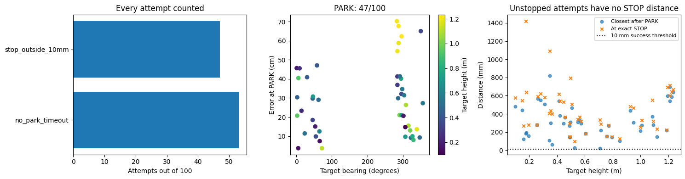


#### Iteration 34: stopping and drift

These plots distinguish reaching the dot, issuing STOP in the right place, and subsequent movement. The camera visibility fraction comes from the recorded detector. Missing event measurements are left blank, while their attempts remain failures in the overall score.


```python
test_report.stopping(7); plt.show()

```


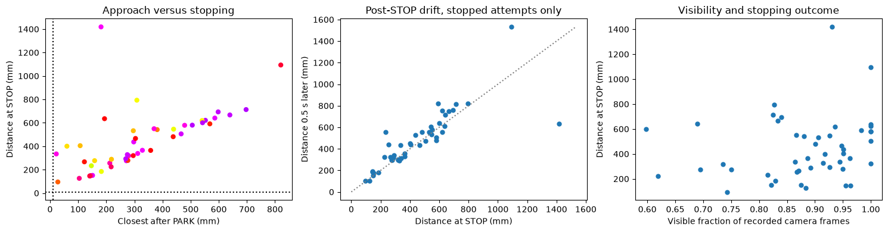


#### Iteration 34: predicted and actual distance over time

The first ten target IDs in the fixed test manifest are shown for readable traces, selected independently of outcomes. The table and player include all 100 targets. Actual distances are used for evaluation only; they are not network inputs.


```python
test_report.distances(7); plt.show()

```


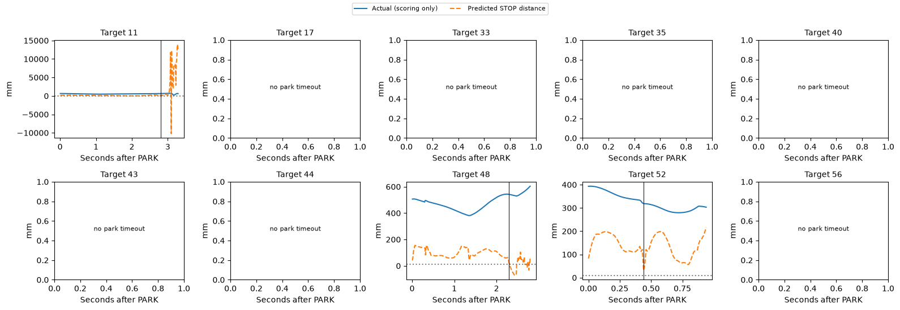


#### Iteration 34: all test replays

Select any of the 100 recorded test targets. The solid robot follows the learned policy; the ghost follows the recorded expert. The upper-right camera inset shows actual recorded images. Play, pause, restart and the time slider control playback. Camera images load as needed to limit browser memory.


```python
player_path = test_report.build_viewer(7)
player_url = test_report.preview_server() + '/' + player_path.name
display(lazy_player(player_url))
display(HTML(f'<a href="{player_url}" target="_blank">Open all 100 test replays in a separate tab</a>'))

```


<div><button onclick="var f=document.getElementById('player9d27662d');f.src='https://nm-linmint-mlflow.taile381c0.ts.net:8443/golden-replays/viewer_golden_seed7.html';f.style.display='block';this.style.display='none'"
 style="padding:8px 14px;font-size:14px">Load the 3D player</button>
<iframe id="player9d27662d" style="display:none;width:100%;height:810px;border:0"></iframe></div>


<a href="https://nm-linmint-mlflow.taile381c0.ts.net:8443/golden-replays/viewer_golden_seed7.html" target="_blank">Open all 100 test replays in a separate tab</a>


#### Iteration 34: reading the result


```python
display(Markdown(test_report.reading(7)))

```


Seed 7: 47/100 PARK, 47/100 STOP and 0/100 successful stops within 10 mm (Wilson 95% interval 0.0–3.7%). 0/100 came within 10 mm during reaching; passing through is not a successful stop. Median parking error was 27.3 cm among parked attempts; median distance at STOP was 400.4 mm among stopped attempts. 53 attempts timed out and 0 had execution/termination failures. These conditional medians exclude attempts without the relevant event; the success rate keeps all 100. This is a frozen baseline result, not a basis for selecting checkpoints. Representative seed 7 remains the validation-selected seed.


### Iteration 35: golden data, seed 1, results

Official test evaluation of the frozen seed-1 models. The full table covers all 100 reserved targets. No retraining occurred during this evaluation.


```python
display(HTML('<div style="max-height:420px;overflow:auto">'+test_report.table(1).round(3).to_html()+'</div>'))

```


<div style="max-height:420px;overflow:auto"><table border="1" class="dataframe">
  <thead>
    <tr style="text-align: right;">
      <th></th>
      <th>status</th>
      <th>success</th>
      <th>parked</th>
      <th>park_s</th>
      <th>stop_s</th>
      <th>park_error_cm</th>
      <th>park_heading_error_deg</th>
      <th>at_stop_mm</th>
      <th>closest_mm</th>
      <th>end_mm</th>
      <th>post_stop_drift_mm</th>
      <th>post_park_base_drift_cm</th>
      <th>timed_out</th>
      <th>elapsed_s</th>
      <th>camera_visible_fraction</th>
      <th>target_bearing_deg</th>
      <th>target_range_m</th>
      <th>target_height_m</th>
    </tr>
    <tr>
      <th>dot</th>
      <th></th>
      <th></th>
      <th></th>
      <th></th>
      <th></th>
      <th></th>
      <th></th>
      <th></th>
      <th></th>
      <th></th>
      <th></th>
      <th></th>
      <th></th>
      <th></th>
      <th></th>
      <th></th>
      <th></th>
      <th></th>
    </tr>
  </thead>
  <tbody>
    <tr>
      <th>11</th>
      <td>stop_outside_10mm</td>
      <td>False</td>
      <td>True</td>
      <td>2.633</td>
      <td>4.520</td>
      <td>22.572</td>
      <td>19.968</td>
      <td>410.563</td>
      <td>297.123</td>
      <td>408.689</td>
      <td>-1.874</td>
      <td>1.379</td>
      <td>False</td>
      <td>9.185</td>
      <td>0.987</td>
      <td>0.986</td>
      <td>1.042</td>
      <td>0.178</td>
    </tr>
    <tr>
      <th>17</th>
      <td>no_stop_timeout</td>
      <td>False</td>
      <td>True</td>
      <td>7.367</td>
      <td>NaN</td>
      <td>13.349</td>
      <td>16.599</td>
      <td>NaN</td>
      <td>236.275</td>
      <td>1128.734</td>
      <td>NaN</td>
      <td>3.943</td>
      <td>True</td>
      <td>19.052</td>
      <td>0.682</td>
      <td>194.926</td>
      <td>1.095</td>
      <td>1.028</td>
    </tr>
    <tr>
      <th>33</th>
      <td>stop_outside_10mm</td>
      <td>False</td>
      <td>True</td>
      <td>5.633</td>
      <td>9.069</td>
      <td>8.248</td>
      <td>13.004</td>
      <td>425.545</td>
      <td>96.087</td>
      <td>998.686</td>
      <td>573.141</td>
      <td>1.960</td>
      <td>False</td>
      <td>15.939</td>
      <td>0.906</td>
      <td>259.736</td>
      <td>1.504</td>
      <td>0.422</td>
    </tr>
    <tr>
      <th>35</th>
      <td>no_stop_timeout</td>
      <td>False</td>
      <td>True</td>
      <td>10.200</td>
      <td>NaN</td>
      <td>47.503</td>
      <td>6.454</td>
      <td>NaN</td>
      <td>468.500</td>
      <td>532.409</td>
      <td>NaN</td>
      <td>0.188</td>
      <td>True</td>
      <td>17.656</td>
      <td>0.508</td>
      <td>111.687</td>
      <td>1.257</td>
      <td>0.589</td>
    </tr>
    <tr>
      <th>40</th>
      <td>no_stop_timeout</td>
      <td>False</td>
      <td>True</td>
      <td>6.633</td>
      <td>NaN</td>
      <td>17.528</td>
      <td>20.830</td>
      <td>NaN</td>
      <td>267.001</td>
      <td>406.636</td>
      <td>NaN</td>
      <td>1.549</td>
      <td>True</td>
      <td>19.739</td>
      <td>0.779</td>
      <td>205.751</td>
      <td>1.041</td>
      <td>0.328</td>
    </tr>
    <tr>
      <th>43</th>
      <td>no_stop_timeout</td>
      <td>False</td>
      <td>True</td>
      <td>10.933</td>
      <td>NaN</td>
      <td>32.560</td>
      <td>10.031</td>
      <td>NaN</td>
      <td>351.155</td>
      <td>405.464</td>
      <td>NaN</td>
      <td>1.267</td>
      <td>True</td>
      <td>17.260</td>
      <td>0.519</td>
      <td>121.648</td>
      <td>1.333</td>
      <td>0.760</td>
    </tr>
    <tr>
      <th>44</th>
      <td>no_stop_timeout</td>
      <td>False</td>
      <td>True</td>
      <td>10.233</td>
      <td>NaN</td>
      <td>54.503</td>
      <td>8.700</td>
      <td>NaN</td>
      <td>613.677</td>
      <td>923.565</td>
      <td>NaN</td>
      <td>3.504</td>
      <td>True</td>
      <td>20.755</td>
      <td>0.655</td>
      <td>140.983</td>
      <td>1.684</td>
      <td>0.533</td>
    </tr>
    <tr>
      <th>48</th>
      <td>stop_outside_10mm</td>
      <td>False</td>
      <td>True</td>
      <td>4.300</td>
      <td>6.740</td>
      <td>14.262</td>
      <td>-1.163</td>
      <td>1014.756</td>
      <td>153.960</td>
      <td>1069.508</td>
      <td>54.752</td>
      <td>0.203</td>
      <td>False</td>
      <td>12.209</td>
      <td>0.789</td>
      <td>30.246</td>
      <td>1.110</td>
      <td>0.420</td>
    </tr>
    <tr>
      <th>52</th>
      <td>stop_outside_10mm</td>
      <td>False</td>
      <td>True</td>
      <td>6.333</td>
      <td>7.894</td>
      <td>32.439</td>
      <td>5.034</td>
      <td>89.635</td>
      <td>51.366</td>
      <td>60.204</td>
      <td>-29.431</td>
      <td>1.268</td>
      <td>False</td>
      <td>13.475</td>
      <td>0.937</td>
      <td>315.534</td>
      <td>1.244</td>
      <td>1.090</td>
    </tr>
    <tr>
      <th>56</th>
      <td>stop_outside_10mm</td>
      <td>False</td>
      <td>True</td>
      <td>10.133</td>
      <td>12.426</td>
      <td>42.903</td>
      <td>0.960</td>
      <td>667.558</td>
      <td>193.346</td>
      <td>191.312</td>
      <td>-476.246</td>
      <td>13.273</td>
      <td>False</td>
      <td>19.030</td>
      <td>0.461</td>
      <td>162.122</td>
      <td>1.265</td>
      <td>0.141</td>
    </tr>
    <tr>
      <th>65</th>
      <td>stop_outside_10mm</td>
      <td>False</td>
      <td>True</td>
      <td>7.933</td>
      <td>8.872</td>
      <td>45.133</td>
      <td>16.449</td>
      <td>334.288</td>
      <td>236.851</td>
      <td>1264.518</td>
      <td>930.230</td>
      <td>1.440</td>
      <td>False</td>
      <td>16.210</td>
      <td>0.706</td>
      <td>241.918</td>
      <td>1.929</td>
      <td>1.244</td>
    </tr>
    <tr>
      <th>83</th>
      <td>stop_outside_10mm</td>
      <td>False</td>
      <td>True</td>
      <td>6.067</td>
      <td>9.517</td>
      <td>33.280</td>
      <td>14.499</td>
      <td>1080.408</td>
      <td>340.934</td>
      <td>693.264</td>
      <td>-387.144</td>
      <td>1.723</td>
      <td>False</td>
      <td>17.201</td>
      <td>0.917</td>
      <td>282.883</td>
      <td>1.859</td>
      <td>1.211</td>
    </tr>
    <tr>
      <th>92</th>
      <td>stop_outside_10mm</td>
      <td>False</td>
      <td>True</td>
      <td>2.667</td>
      <td>4.713</td>
      <td>8.013</td>
      <td>17.212</td>
      <td>1143.829</td>
      <td>290.301</td>
      <td>1057.535</td>
      <td>-86.294</td>
      <td>4.583</td>
      <td>False</td>
      <td>9.917</td>
      <td>0.949</td>
      <td>5.294</td>
      <td>1.286</td>
      <td>0.160</td>
    </tr>
    <tr>
      <th>97</th>
      <td>stop_outside_10mm</td>
      <td>False</td>
      <td>True</td>
      <td>4.333</td>
      <td>5.700</td>
      <td>39.554</td>
      <td>5.668</td>
      <td>1207.094</td>
      <td>526.923</td>
      <td>1532.743</td>
      <td>325.649</td>
      <td>11.572</td>
      <td>False</td>
      <td>11.628</td>
      <td>0.989</td>
      <td>350.146</td>
      <td>1.870</td>
      <td>0.347</td>
    </tr>
    <tr>
      <th>98</th>
      <td>stop_outside_10mm</td>
      <td>False</td>
      <td>True</td>
      <td>6.200</td>
      <td>9.836</td>
      <td>21.550</td>
      <td>5.844</td>
      <td>358.085</td>
      <td>28.179</td>
      <td>914.496</td>
      <td>556.411</td>
      <td>1.280</td>
      <td>False</td>
      <td>16.484</td>
      <td>0.871</td>
      <td>320.377</td>
      <td>1.322</td>
      <td>0.998</td>
    </tr>
    <tr>
      <th>113</th>
      <td>stop_outside_10mm</td>
      <td>False</td>
      <td>True</td>
      <td>3.567</td>
      <td>6.086</td>
      <td>39.283</td>
      <td>-6.812</td>
      <td>942.463</td>
      <td>458.131</td>
      <td>1125.986</td>
      <td>183.522</td>
      <td>8.973</td>
      <td>False</td>
      <td>12.271</td>
      <td>0.838</td>
      <td>5.757</td>
      <td>1.744</td>
      <td>0.924</td>
    </tr>
    <tr>
      <th>136</th>
      <td>no_stop_timeout</td>
      <td>False</td>
      <td>True</td>
      <td>5.400</td>
      <td>NaN</td>
      <td>18.058</td>
      <td>17.271</td>
      <td>NaN</td>
      <td>236.022</td>
      <td>672.212</td>
      <td>NaN</td>
      <td>2.912</td>
      <td>True</td>
      <td>19.558</td>
      <td>1.000</td>
      <td>294.524</td>
      <td>1.604</td>
      <td>0.771</td>
    </tr>
    <tr>
      <th>147</th>
      <td>stop_outside_10mm</td>
      <td>False</td>
      <td>True</td>
      <td>6.033</td>
      <td>9.377</td>
      <td>20.724</td>
      <td>8.437</td>
      <td>968.066</td>
      <td>276.266</td>
      <td>891.917</td>
      <td>-76.149</td>
      <td>1.589</td>
      <td>False</td>
      <td>16.662</td>
      <td>0.889</td>
      <td>296.174</td>
      <td>1.539</td>
      <td>1.224</td>
    </tr>
    <tr>
      <th>148</th>
      <td>no_stop_timeout</td>
      <td>False</td>
      <td>True</td>
      <td>8.633</td>
      <td>NaN</td>
      <td>32.741</td>
      <td>5.515</td>
      <td>NaN</td>
      <td>287.619</td>
      <td>398.301</td>
      <td>NaN</td>
      <td>0.225</td>
      <td>True</td>
      <td>17.968</td>
      <td>0.619</td>
      <td>149.538</td>
      <td>1.010</td>
      <td>0.728</td>
    </tr>
    <tr>
      <th>154</th>
      <td>no_stop_timeout</td>
      <td>False</td>
      <td>True</td>
      <td>11.633</td>
      <td>NaN</td>
      <td>50.859</td>
      <td>17.645</td>
      <td>NaN</td>
      <td>627.859</td>
      <td>645.728</td>
      <td>NaN</td>
      <td>2.092</td>
      <td>True</td>
      <td>17.381</td>
      <td>0.412</td>
      <td>98.586</td>
      <td>1.606</td>
      <td>0.863</td>
    </tr>
    <tr>
      <th>162</th>
      <td>stop_outside_10mm</td>
      <td>False</td>
      <td>True</td>
      <td>8.833</td>
      <td>12.096</td>
      <td>8.309</td>
      <td>4.502</td>
      <td>1010.100</td>
      <td>48.129</td>
      <td>551.656</td>
      <td>-458.444</td>
      <td>4.154</td>
      <td>False</td>
      <td>19.074</td>
      <td>0.632</td>
      <td>175.986</td>
      <td>1.287</td>
      <td>0.914</td>
    </tr>
    <tr>
      <th>196</th>
      <td>stop_outside_10mm</td>
      <td>False</td>
      <td>True</td>
      <td>3.500</td>
      <td>5.985</td>
      <td>50.119</td>
      <td>-11.117</td>
      <td>1057.466</td>
      <td>606.357</td>
      <td>1446.117</td>
      <td>388.651</td>
      <td>5.904</td>
      <td>False</td>
      <td>11.813</td>
      <td>1.000</td>
      <td>2.307</td>
      <td>1.860</td>
      <td>0.458</td>
    </tr>
    <tr>
      <th>221</th>
      <td>stop_outside_10mm</td>
      <td>False</td>
      <td>True</td>
      <td>4.600</td>
      <td>8.698</td>
      <td>3.241</td>
      <td>-4.262</td>
      <td>731.388</td>
      <td>234.684</td>
      <td>886.812</td>
      <td>155.424</td>
      <td>4.042</td>
      <td>False</td>
      <td>15.697</td>
      <td>0.790</td>
      <td>45.865</td>
      <td>1.305</td>
      <td>0.343</td>
    </tr>
    <tr>
      <th>229</th>
      <td>no_stop_timeout</td>
      <td>False</td>
      <td>True</td>
      <td>11.067</td>
      <td>NaN</td>
      <td>53.136</td>
      <td>17.701</td>
      <td>NaN</td>
      <td>640.762</td>
      <td>660.874</td>
      <td>NaN</td>
      <td>2.105</td>
      <td>True</td>
      <td>18.356</td>
      <td>0.429</td>
      <td>114.486</td>
      <td>1.623</td>
      <td>0.727</td>
    </tr>
    <tr>
      <th>232</th>
      <td>no_stop_timeout</td>
      <td>False</td>
      <td>True</td>
      <td>9.600</td>
      <td>NaN</td>
      <td>28.900</td>
      <td>7.562</td>
      <td>NaN</td>
      <td>308.744</td>
      <td>461.106</td>
      <td>NaN</td>
      <td>2.400</td>
      <td>True</td>
      <td>20.593</td>
      <td>0.647</td>
      <td>182.689</td>
      <td>1.347</td>
      <td>0.544</td>
    </tr>
    <tr>
      <th>239</th>
      <td>stop_outside_10mm</td>
      <td>False</td>
      <td>True</td>
      <td>2.967</td>
      <td>4.255</td>
      <td>9.169</td>
      <td>21.659</td>
      <td>118.054</td>
      <td>58.410</td>
      <td>682.796</td>
      <td>564.741</td>
      <td>5.591</td>
      <td>False</td>
      <td>9.232</td>
      <td>0.762</td>
      <td>355.930</td>
      <td>1.042</td>
      <td>0.572</td>
    </tr>
    <tr>
      <th>248</th>
      <td>stop_outside_10mm</td>
      <td>False</td>
      <td>True</td>
      <td>3.633</td>
      <td>4.869</td>
      <td>9.776</td>
      <td>17.284</td>
      <td>136.071</td>
      <td>58.550</td>
      <td>455.097</td>
      <td>319.027</td>
      <td>4.028</td>
      <td>False</td>
      <td>10.217</td>
      <td>0.994</td>
      <td>23.497</td>
      <td>1.075</td>
      <td>0.524</td>
    </tr>
    <tr>
      <th>260</th>
      <td>stop_outside_10mm</td>
      <td>False</td>
      <td>True</td>
      <td>6.433</td>
      <td>8.649</td>
      <td>31.211</td>
      <td>-23.463</td>
      <td>944.515</td>
      <td>418.695</td>
      <td>1549.695</td>
      <td>605.180</td>
      <td>0.741</td>
      <td>False</td>
      <td>16.727</td>
      <td>0.665</td>
      <td>287.711</td>
      <td>1.727</td>
      <td>1.233</td>
    </tr>
    <tr>
      <th>271</th>
      <td>no_stop_timeout</td>
      <td>False</td>
      <td>True</td>
      <td>4.333</td>
      <td>NaN</td>
      <td>3.708</td>
      <td>15.912</td>
      <td>NaN</td>
      <td>87.766</td>
      <td>663.290</td>
      <td>NaN</td>
      <td>1.193</td>
      <td>True</td>
      <td>21.076</td>
      <td>0.964</td>
      <td>306.675</td>
      <td>1.003</td>
      <td>0.707</td>
    </tr>
    <tr>
      <th>274</th>
      <td>no_stop_timeout</td>
      <td>False</td>
      <td>True</td>
      <td>5.200</td>
      <td>NaN</td>
      <td>27.755</td>
      <td>19.578</td>
      <td>NaN</td>
      <td>412.607</td>
      <td>574.939</td>
      <td>NaN</td>
      <td>1.793</td>
      <td>True</td>
      <td>23.298</td>
      <td>0.886</td>
      <td>295.597</td>
      <td>1.617</td>
      <td>0.356</td>
    </tr>
    <tr>
      <th>277</th>
      <td>no_stop_timeout</td>
      <td>False</td>
      <td>True</td>
      <td>9.833</td>
      <td>NaN</td>
      <td>44.553</td>
      <td>6.538</td>
      <td>NaN</td>
      <td>632.711</td>
      <td>841.827</td>
      <td>NaN</td>
      <td>4.460</td>
      <td>True</td>
      <td>23.938</td>
      <td>0.696</td>
      <td>152.678</td>
      <td>1.592</td>
      <td>0.326</td>
    </tr>
    <tr>
      <th>281</th>
      <td>no_stop_timeout</td>
      <td>False</td>
      <td>True</td>
      <td>5.900</td>
      <td>NaN</td>
      <td>11.527</td>
      <td>16.356</td>
      <td>NaN</td>
      <td>241.678</td>
      <td>763.997</td>
      <td>NaN</td>
      <td>3.647</td>
      <td>True</td>
      <td>22.771</td>
      <td>0.930</td>
      <td>271.241</td>
      <td>1.709</td>
      <td>0.986</td>
    </tr>
    <tr>
      <th>285</th>
      <td>no_stop_timeout</td>
      <td>False</td>
      <td>True</td>
      <td>6.700</td>
      <td>NaN</td>
      <td>5.643</td>
      <td>9.327</td>
      <td>NaN</td>
      <td>126.804</td>
      <td>431.014</td>
      <td>NaN</td>
      <td>2.136</td>
      <td>True</td>
      <td>21.967</td>
      <td>0.794</td>
      <td>252.565</td>
      <td>1.584</td>
      <td>0.583</td>
    </tr>
    <tr>
      <th>302</th>
      <td>stop_outside_10mm</td>
      <td>False</td>
      <td>True</td>
      <td>3.333</td>
      <td>4.751</td>
      <td>23.591</td>
      <td>6.439</td>
      <td>1359.146</td>
      <td>433.851</td>
      <td>1415.887</td>
      <td>56.741</td>
      <td>6.961</td>
      <td>False</td>
      <td>11.542</td>
      <td>0.924</td>
      <td>14.479</td>
      <td>1.582</td>
      <td>0.256</td>
    </tr>
    <tr>
      <th>306</th>
      <td>no_stop_timeout</td>
      <td>False</td>
      <td>True</td>
      <td>8.700</td>
      <td>NaN</td>
      <td>38.098</td>
      <td>18.887</td>
      <td>NaN</td>
      <td>378.631</td>
      <td>498.969</td>
      <td>NaN</td>
      <td>2.906</td>
      <td>True</td>
      <td>21.499</td>
      <td>0.671</td>
      <td>191.578</td>
      <td>1.459</td>
      <td>0.867</td>
    </tr>
    <tr>
      <th>311</th>
      <td>no_stop_timeout</td>
      <td>False</td>
      <td>True</td>
      <td>11.633</td>
      <td>NaN</td>
      <td>16.714</td>
      <td>-20.281</td>
      <td>NaN</td>
      <td>113.610</td>
      <td>116.933</td>
      <td>NaN</td>
      <td>1.273</td>
      <td>True</td>
      <td>21.039</td>
      <td>0.269</td>
      <td>141.003</td>
      <td>1.883</td>
      <td>0.810</td>
    </tr>
    <tr>
      <th>315</th>
      <td>stop_outside_10mm</td>
      <td>False</td>
      <td>True</td>
      <td>4.600</td>
      <td>6.855</td>
      <td>6.143</td>
      <td>-5.396</td>
      <td>1106.184</td>
      <td>203.147</td>
      <td>1121.313</td>
      <td>15.129</td>
      <td>1.248</td>
      <td>False</td>
      <td>13.509</td>
      <td>0.851</td>
      <td>45.849</td>
      <td>1.300</td>
      <td>0.448</td>
    </tr>
    <tr>
      <th>316</th>
      <td>stop_outside_10mm</td>
      <td>False</td>
      <td>True</td>
      <td>5.467</td>
      <td>6.936</td>
      <td>12.156</td>
      <td>12.470</td>
      <td>193.135</td>
      <td>171.052</td>
      <td>179.606</td>
      <td>-13.529</td>
      <td>3.523</td>
      <td>False</td>
      <td>13.950</td>
      <td>0.884</td>
      <td>261.404</td>
      <td>1.468</td>
      <td>0.625</td>
    </tr>
    <tr>
      <th>317</th>
      <td>no_stop_timeout</td>
      <td>False</td>
      <td>True</td>
      <td>10.467</td>
      <td>NaN</td>
      <td>52.601</td>
      <td>5.404</td>
      <td>NaN</td>
      <td>529.519</td>
      <td>637.966</td>
      <td>NaN</td>
      <td>0.074</td>
      <td>True</td>
      <td>20.680</td>
      <td>0.478</td>
      <td>100.830</td>
      <td>1.368</td>
      <td>0.857</td>
    </tr>
    <tr>
      <th>361</th>
      <td>stop_outside_10mm</td>
      <td>False</td>
      <td>True</td>
      <td>8.233</td>
      <td>12.791</td>
      <td>20.068</td>
      <td>-10.532</td>
      <td>1020.527</td>
      <td>266.801</td>
      <td>573.280</td>
      <td>-447.247</td>
      <td>2.244</td>
      <td>False</td>
      <td>24.669</td>
      <td>0.742</td>
      <td>210.594</td>
      <td>1.799</td>
      <td>1.088</td>
    </tr>
    <tr>
      <th>413</th>
      <td>no_stop_timeout</td>
      <td>False</td>
      <td>True</td>
      <td>8.767</td>
      <td>NaN</td>
      <td>20.824</td>
      <td>2.345</td>
      <td>NaN</td>
      <td>224.641</td>
      <td>798.292</td>
      <td>NaN</td>
      <td>0.706</td>
      <td>True</td>
      <td>27.423</td>
      <td>0.728</td>
      <td>206.840</td>
      <td>1.947</td>
      <td>0.616</td>
    </tr>
    <tr>
      <th>427</th>
      <td>stop_outside_10mm</td>
      <td>False</td>
      <td>True</td>
      <td>4.600</td>
      <td>7.026</td>
      <td>26.304</td>
      <td>16.361</td>
      <td>384.698</td>
      <td>288.528</td>
      <td>426.356</td>
      <td>41.658</td>
      <td>3.357</td>
      <td>False</td>
      <td>16.040</td>
      <td>0.938</td>
      <td>273.775</td>
      <td>1.333</td>
      <td>0.798</td>
    </tr>
    <tr>
      <th>432</th>
      <td>stop_outside_10mm</td>
      <td>False</td>
      <td>True</td>
      <td>8.233</td>
      <td>10.009</td>
      <td>26.398</td>
      <td>-0.533</td>
      <td>39.822</td>
      <td>39.387</td>
      <td>74.764</td>
      <td>34.942</td>
      <td>0.544</td>
      <td>False</td>
      <td>19.635</td>
      <td>0.750</td>
      <td>249.834</td>
      <td>1.701</td>
      <td>1.054</td>
    </tr>
    <tr>
      <th>463</th>
      <td>stop_outside_10mm</td>
      <td>False</td>
      <td>True</td>
      <td>6.800</td>
      <td>7.010</td>
      <td>16.450</td>
      <td>2.461</td>
      <td>220.728</td>
      <td>178.052</td>
      <td>177.955</td>
      <td>-42.772</td>
      <td>1.377</td>
      <td>False</td>
      <td>16.341</td>
      <td>0.602</td>
      <td>229.062</td>
      <td>1.092</td>
      <td>0.806</td>
    </tr>
    <tr>
      <th>478</th>
      <td>no_stop_timeout</td>
      <td>False</td>
      <td>True</td>
      <td>11.867</td>
      <td>NaN</td>
      <td>37.438</td>
      <td>-3.934</td>
      <td>NaN</td>
      <td>422.147</td>
      <td>427.879</td>
      <td>NaN</td>
      <td>1.525</td>
      <td>True</td>
      <td>21.858</td>
      <td>0.561</td>
      <td>105.867</td>
      <td>1.864</td>
      <td>0.485</td>
    </tr>
    <tr>
      <th>479</th>
      <td>no_stop_timeout</td>
      <td>False</td>
      <td>True</td>
      <td>11.733</td>
      <td>NaN</td>
      <td>59.771</td>
      <td>16.320</td>
      <td>NaN</td>
      <td>704.596</td>
      <td>728.071</td>
      <td>NaN</td>
      <td>4.229</td>
      <td>True</td>
      <td>19.630</td>
      <td>0.383</td>
      <td>99.764</td>
      <td>1.791</td>
      <td>0.844</td>
    </tr>
    <tr>
      <th>492</th>
      <td>no_stop_timeout</td>
      <td>False</td>
      <td>True</td>
      <td>9.600</td>
      <td>NaN</td>
      <td>38.671</td>
      <td>3.376</td>
      <td>NaN</td>
      <td>442.244</td>
      <td>691.614</td>
      <td>NaN</td>
      <td>1.021</td>
      <td>True</td>
      <td>20.576</td>
      <td>0.625</td>
      <td>196.470</td>
      <td>1.201</td>
      <td>0.521</td>
    </tr>
    <tr>
      <th>502</th>
      <td>stop_outside_10mm</td>
      <td>False</td>
      <td>True</td>
      <td>3.633</td>
      <td>4.724</td>
      <td>15.021</td>
      <td>17.225</td>
      <td>245.918</td>
      <td>17.104</td>
      <td>2340.532</td>
      <td>2094.614</td>
      <td>130.284</td>
      <td>False</td>
      <td>10.674</td>
      <td>0.936</td>
      <td>339.014</td>
      <td>1.012</td>
      <td>1.187</td>
    </tr>
    <tr>
      <th>534</th>
      <td>stop_outside_10mm</td>
      <td>False</td>
      <td>True</td>
      <td>5.133</td>
      <td>8.097</td>
      <td>5.328</td>
      <td>-5.823</td>
      <td>557.615</td>
      <td>99.754</td>
      <td>266.095</td>
      <td>-291.520</td>
      <td>2.172</td>
      <td>False</td>
      <td>15.295</td>
      <td>0.868</td>
      <td>54.826</td>
      <td>1.246</td>
      <td>0.365</td>
    </tr>
    <tr>
      <th>545</th>
      <td>stop_outside_10mm</td>
      <td>False</td>
      <td>True</td>
      <td>5.233</td>
      <td>7.774</td>
      <td>18.790</td>
      <td>-2.910</td>
      <td>499.456</td>
      <td>269.444</td>
      <td>389.408</td>
      <td>-110.048</td>
      <td>0.127</td>
      <td>False</td>
      <td>14.118</td>
      <td>0.904</td>
      <td>53.090</td>
      <td>1.164</td>
      <td>0.195</td>
    </tr>
    <tr>
      <th>554</th>
      <td>stop_outside_10mm</td>
      <td>False</td>
      <td>True</td>
      <td>7.867</td>
      <td>9.455</td>
      <td>15.506</td>
      <td>7.041</td>
      <td>245.338</td>
      <td>200.672</td>
      <td>239.743</td>
      <td>-5.594</td>
      <td>0.674</td>
      <td>False</td>
      <td>18.039</td>
      <td>0.696</td>
      <td>234.276</td>
      <td>1.908</td>
      <td>0.598</td>
    </tr>
    <tr>
      <th>571</th>
      <td>no_stop_timeout</td>
      <td>False</td>
      <td>True</td>
      <td>9.600</td>
      <td>NaN</td>
      <td>8.613</td>
      <td>10.485</td>
      <td>NaN</td>
      <td>425.741</td>
      <td>628.467</td>
      <td>NaN</td>
      <td>0.181</td>
      <td>True</td>
      <td>26.281</td>
      <td>0.768</td>
      <td>170.353</td>
      <td>1.680</td>
      <td>0.118</td>
    </tr>
    <tr>
      <th>585</th>
      <td>stop_outside_10mm</td>
      <td>False</td>
      <td>True</td>
      <td>5.667</td>
      <td>8.489</td>
      <td>9.239</td>
      <td>12.255</td>
      <td>559.941</td>
      <td>176.850</td>
      <td>520.992</td>
      <td>-38.949</td>
      <td>0.795</td>
      <td>False</td>
      <td>16.405</td>
      <td>0.904</td>
      <td>286.405</td>
      <td>1.487</td>
      <td>0.490</td>
    </tr>
    <tr>
      <th>586</th>
      <td>no_stop_timeout</td>
      <td>False</td>
      <td>True</td>
      <td>8.433</td>
      <td>NaN</td>
      <td>16.773</td>
      <td>2.637</td>
      <td>NaN</td>
      <td>195.846</td>
      <td>745.915</td>
      <td>NaN</td>
      <td>0.580</td>
      <td>True</td>
      <td>23.367</td>
      <td>0.726</td>
      <td>211.872</td>
      <td>1.836</td>
      <td>0.605</td>
    </tr>
    <tr>
      <th>592</th>
      <td>stop_outside_10mm</td>
      <td>False</td>
      <td>True</td>
      <td>5.367</td>
      <td>8.300</td>
      <td>12.747</td>
      <td>10.291</td>
      <td>592.118</td>
      <td>216.146</td>
      <td>553.739</td>
      <td>-38.380</td>
      <td>1.560</td>
      <td>False</td>
      <td>15.860</td>
      <td>0.936</td>
      <td>322.371</td>
      <td>1.328</td>
      <td>0.490</td>
    </tr>
    <tr>
      <th>599</th>
      <td>no_stop_timeout</td>
      <td>False</td>
      <td>True</td>
      <td>10.767</td>
      <td>NaN</td>
      <td>43.042</td>
      <td>9.396</td>
      <td>NaN</td>
      <td>438.918</td>
      <td>438.028</td>
      <td>NaN</td>
      <td>0.135</td>
      <td>True</td>
      <td>16.966</td>
      <td>0.433</td>
      <td>95.655</td>
      <td>1.198</td>
      <td>1.055</td>
    </tr>
    <tr>
      <th>600</th>
      <td>stop_outside_10mm</td>
      <td>False</td>
      <td>True</td>
      <td>3.400</td>
      <td>5.365</td>
      <td>29.662</td>
      <td>-9.444</td>
      <td>1338.121</td>
      <td>400.182</td>
      <td>1192.527</td>
      <td>-145.595</td>
      <td>0.887</td>
      <td>False</td>
      <td>10.949</td>
      <td>0.778</td>
      <td>2.224</td>
      <td>1.599</td>
      <td>0.949</td>
    </tr>
    <tr>
      <th>605</th>
      <td>no_stop_timeout</td>
      <td>False</td>
      <td>True</td>
      <td>8.933</td>
      <td>NaN</td>
      <td>20.486</td>
      <td>0.329</td>
      <td>NaN</td>
      <td>42.155</td>
      <td>1117.817</td>
      <td>NaN</td>
      <td>2.563</td>
      <td>True</td>
      <td>20.296</td>
      <td>0.702</td>
      <td>211.055</td>
      <td>1.454</td>
      <td>0.931</td>
    </tr>
    <tr>
      <th>628</th>
      <td>stop_outside_10mm</td>
      <td>False</td>
      <td>True</td>
      <td>5.233</td>
      <td>8.980</td>
      <td>9.803</td>
      <td>11.316</td>
      <td>429.813</td>
      <td>91.822</td>
      <td>506.907</td>
      <td>77.094</td>
      <td>5.976</td>
      <td>False</td>
      <td>15.709</td>
      <td>0.912</td>
      <td>329.443</td>
      <td>1.406</td>
      <td>0.851</td>
    </tr>
    <tr>
      <th>632</th>
      <td>stop_outside_10mm</td>
      <td>False</td>
      <td>True</td>
      <td>3.367</td>
      <td>4.954</td>
      <td>37.237</td>
      <td>8.644</td>
      <td>1449.443</td>
      <td>551.067</td>
      <td>1237.173</td>
      <td>-212.270</td>
      <td>22.835</td>
      <td>False</td>
      <td>10.869</td>
      <td>0.988</td>
      <td>9.084</td>
      <td>1.860</td>
      <td>0.260</td>
    </tr>
    <tr>
      <th>642</th>
      <td>stop_outside_10mm</td>
      <td>False</td>
      <td>True</td>
      <td>4.200</td>
      <td>5.549</td>
      <td>17.753</td>
      <td>18.323</td>
      <td>179.176</td>
      <td>130.813</td>
      <td>776.876</td>
      <td>597.700</td>
      <td>3.745</td>
      <td>False</td>
      <td>10.909</td>
      <td>0.989</td>
      <td>290.290</td>
      <td>1.213</td>
      <td>1.007</td>
    </tr>
    <tr>
      <th>646</th>
      <td>no_stop_timeout</td>
      <td>False</td>
      <td>True</td>
      <td>5.900</td>
      <td>NaN</td>
      <td>29.727</td>
      <td>2.639</td>
      <td>NaN</td>
      <td>415.890</td>
      <td>737.007</td>
      <td>NaN</td>
      <td>0.823</td>
      <td>True</td>
      <td>23.566</td>
      <td>1.000</td>
      <td>284.236</td>
      <td>1.908</td>
      <td>0.283</td>
    </tr>
    <tr>
      <th>652</th>
      <td>stop_outside_10mm</td>
      <td>False</td>
      <td>True</td>
      <td>5.300</td>
      <td>5.300</td>
      <td>16.512</td>
      <td>2.797</td>
      <td>208.295</td>
      <td>206.732</td>
      <td>206.665</td>
      <td>-1.629</td>
      <td>1.287</td>
      <td>False</td>
      <td>10.205</td>
      <td>0.851</td>
      <td>296.088</td>
      <td>1.203</td>
      <td>0.758</td>
    </tr>
    <tr>
      <th>653</th>
      <td>stop_outside_10mm</td>
      <td>False</td>
      <td>True</td>
      <td>6.800</td>
      <td>10.651</td>
      <td>25.429</td>
      <td>0.946</td>
      <td>752.440</td>
      <td>307.039</td>
      <td>331.590</td>
      <td>-420.850</td>
      <td>5.228</td>
      <td>False</td>
      <td>18.563</td>
      <td>0.982</td>
      <td>62.349</td>
      <td>1.459</td>
      <td>0.495</td>
    </tr>
    <tr>
      <th>664</th>
      <td>stop_outside_10mm</td>
      <td>False</td>
      <td>True</td>
      <td>4.800</td>
      <td>7.369</td>
      <td>14.939</td>
      <td>19.345</td>
      <td>217.482</td>
      <td>184.913</td>
      <td>247.575</td>
      <td>30.094</td>
      <td>2.471</td>
      <td>False</td>
      <td>13.921</td>
      <td>0.958</td>
      <td>46.754</td>
      <td>1.577</td>
      <td>0.714</td>
    </tr>
    <tr>
      <th>669</th>
      <td>stop_outside_10mm</td>
      <td>False</td>
      <td>True</td>
      <td>11.267</td>
      <td>13.368</td>
      <td>23.236</td>
      <td>-16.125</td>
      <td>541.597</td>
      <td>215.070</td>
      <td>775.216</td>
      <td>233.619</td>
      <td>0.569</td>
      <td>False</td>
      <td>21.247</td>
      <td>0.317</td>
      <td>151.171</td>
      <td>1.985</td>
      <td>0.809</td>
    </tr>
    <tr>
      <th>671</th>
      <td>no_stop_timeout</td>
      <td>False</td>
      <td>True</td>
      <td>10.367</td>
      <td>NaN</td>
      <td>25.050</td>
      <td>14.368</td>
      <td>NaN</td>
      <td>474.414</td>
      <td>601.344</td>
      <td>NaN</td>
      <td>0.018</td>
      <td>True</td>
      <td>24.531</td>
      <td>0.751</td>
      <td>165.190</td>
      <td>1.908</td>
      <td>0.237</td>
    </tr>
    <tr>
      <th>683</th>
      <td>stop_outside_10mm</td>
      <td>False</td>
      <td>True</td>
      <td>7.833</td>
      <td>11.390</td>
      <td>29.266</td>
      <td>18.765</td>
      <td>407.519</td>
      <td>84.991</td>
      <td>638.616</td>
      <td>231.097</td>
      <td>0.370</td>
      <td>False</td>
      <td>18.330</td>
      <td>0.647</td>
      <td>171.323</td>
      <td>1.029</td>
      <td>0.888</td>
    </tr>
    <tr>
      <th>693</th>
      <td>stop_outside_10mm</td>
      <td>False</td>
      <td>True</td>
      <td>6.167</td>
      <td>14.013</td>
      <td>20.290</td>
      <td>13.533</td>
      <td>967.929</td>
      <td>531.489</td>
      <td>874.615</td>
      <td>-93.313</td>
      <td>0.526</td>
      <td>False</td>
      <td>23.437</td>
      <td>1.000</td>
      <td>306.669</td>
      <td>1.844</td>
      <td>0.100</td>
    </tr>
    <tr>
      <th>700</th>
      <td>stop_outside_10mm</td>
      <td>False</td>
      <td>True</td>
      <td>6.767</td>
      <td>9.406</td>
      <td>36.026</td>
      <td>6.389</td>
      <td>701.872</td>
      <td>342.359</td>
      <td>397.480</td>
      <td>-304.391</td>
      <td>39.092</td>
      <td>False</td>
      <td>16.099</td>
      <td>0.983</td>
      <td>301.391</td>
      <td>1.490</td>
      <td>0.177</td>
    </tr>
    <tr>
      <th>707</th>
      <td>stop_outside_10mm</td>
      <td>False</td>
      <td>True</td>
      <td>5.767</td>
      <td>8.461</td>
      <td>21.392</td>
      <td>-11.060</td>
      <td>1158.193</td>
      <td>428.606</td>
      <td>1632.553</td>
      <td>474.360</td>
      <td>2.002</td>
      <td>False</td>
      <td>15.097</td>
      <td>0.755</td>
      <td>71.872</td>
      <td>1.448</td>
      <td>1.118</td>
    </tr>
    <tr>
      <th>708</th>
      <td>stop_outside_10mm</td>
      <td>False</td>
      <td>True</td>
      <td>9.167</td>
      <td>12.140</td>
      <td>40.581</td>
      <td>5.518</td>
      <td>849.320</td>
      <td>470.204</td>
      <td>747.120</td>
      <td>-102.201</td>
      <td>0.405</td>
      <td>False</td>
      <td>19.728</td>
      <td>0.718</td>
      <td>202.171</td>
      <td>1.270</td>
      <td>0.428</td>
    </tr>
    <tr>
      <th>722</th>
      <td>no_stop_timeout</td>
      <td>False</td>
      <td>True</td>
      <td>11.933</td>
      <td>NaN</td>
      <td>35.946</td>
      <td>-16.054</td>
      <td>NaN</td>
      <td>319.472</td>
      <td>319.528</td>
      <td>NaN</td>
      <td>0.717</td>
      <td>True</td>
      <td>19.170</td>
      <td>0.490</td>
      <td>97.634</td>
      <td>1.851</td>
      <td>0.642</td>
    </tr>
    <tr>
      <th>729</th>
      <td>stop_outside_10mm</td>
      <td>False</td>
      <td>True</td>
      <td>9.200</td>
      <td>11.786</td>
      <td>48.125</td>
      <td>-22.811</td>
      <td>1250.716</td>
      <td>523.334</td>
      <td>1645.536</td>
      <td>394.819</td>
      <td>4.036</td>
      <td>False</td>
      <td>19.243</td>
      <td>0.417</td>
      <td>142.205</td>
      <td>1.334</td>
      <td>1.196</td>
    </tr>
    <tr>
      <th>730</th>
      <td>no_stop_timeout</td>
      <td>False</td>
      <td>True</td>
      <td>5.533</td>
      <td>NaN</td>
      <td>19.347</td>
      <td>19.533</td>
      <td>NaN</td>
      <td>337.507</td>
      <td>566.131</td>
      <td>NaN</td>
      <td>3.333</td>
      <td>True</td>
      <td>23.234</td>
      <td>1.000</td>
      <td>284.406</td>
      <td>1.802</td>
      <td>0.311</td>
    </tr>
    <tr>
      <th>738</th>
      <td>stop_outside_10mm</td>
      <td>False</td>
      <td>True</td>
      <td>5.600</td>
      <td>8.284</td>
      <td>4.569</td>
      <td>-10.866</td>
      <td>446.414</td>
      <td>192.882</td>
      <td>192.761</td>
      <td>-253.653</td>
      <td>2.818</td>
      <td>False</td>
      <td>14.656</td>
      <td>0.962</td>
      <td>65.761</td>
      <td>1.353</td>
      <td>0.151</td>
    </tr>
    <tr>
      <th>741</th>
      <td>stop_outside_10mm</td>
      <td>False</td>
      <td>True</td>
      <td>8.600</td>
      <td>10.384</td>
      <td>17.054</td>
      <td>-3.807</td>
      <td>234.254</td>
      <td>173.825</td>
      <td>213.395</td>
      <td>-20.859</td>
      <td>0.500</td>
      <td>False</td>
      <td>17.546</td>
      <td>0.633</td>
      <td>203.672</td>
      <td>1.816</td>
      <td>0.636</td>
    </tr>
    <tr>
      <th>750</th>
      <td>no_stop_timeout</td>
      <td>False</td>
      <td>True</td>
      <td>11.000</td>
      <td>NaN</td>
      <td>54.981</td>
      <td>7.760</td>
      <td>NaN</td>
      <td>548.202</td>
      <td>614.394</td>
      <td>NaN</td>
      <td>0.126</td>
      <td>True</td>
      <td>17.616</td>
      <td>0.442</td>
      <td>89.023</td>
      <td>1.379</td>
      <td>0.809</td>
    </tr>
    <tr>
      <th>770</th>
      <td>no_stop_timeout</td>
      <td>False</td>
      <td>True</td>
      <td>10.467</td>
      <td>NaN</td>
      <td>44.442</td>
      <td>5.775</td>
      <td>NaN</td>
      <td>535.572</td>
      <td>564.756</td>
      <td>NaN</td>
      <td>0.255</td>
      <td>True</td>
      <td>18.821</td>
      <td>0.521</td>
      <td>106.447</td>
      <td>1.328</td>
      <td>0.328</td>
    </tr>
    <tr>
      <th>779</th>
      <td>stop_outside_10mm</td>
      <td>False</td>
      <td>True</td>
      <td>4.733</td>
      <td>12.677</td>
      <td>53.216</td>
      <td>14.083</td>
      <td>923.817</td>
      <td>268.601</td>
      <td>461.365</td>
      <td>-462.452</td>
      <td>10.656</td>
      <td>False</td>
      <td>22.020</td>
      <td>0.990</td>
      <td>58.035</td>
      <td>1.948</td>
      <td>0.412</td>
    </tr>
    <tr>
      <th>806</th>
      <td>no_stop_timeout</td>
      <td>False</td>
      <td>True</td>
      <td>9.167</td>
      <td>NaN</td>
      <td>38.191</td>
      <td>5.784</td>
      <td>NaN</td>
      <td>354.188</td>
      <td>419.359</td>
      <td>NaN</td>
      <td>0.216</td>
      <td>True</td>
      <td>17.910</td>
      <td>0.583</td>
      <td>136.615</td>
      <td>1.082</td>
      <td>0.570</td>
    </tr>
    <tr>
      <th>834</th>
      <td>stop_outside_10mm</td>
      <td>False</td>
      <td>True</td>
      <td>5.400</td>
      <td>7.846</td>
      <td>2.843</td>
      <td>14.840</td>
      <td>940.893</td>
      <td>57.944</td>
      <td>468.138</td>
      <td>-472.754</td>
      <td>22.194</td>
      <td>False</td>
      <td>13.505</td>
      <td>0.849</td>
      <td>64.921</td>
      <td>1.063</td>
      <td>0.606</td>
    </tr>
    <tr>
      <th>845</th>
      <td>no_stop_timeout</td>
      <td>False</td>
      <td>True</td>
      <td>5.900</td>
      <td>NaN</td>
      <td>32.374</td>
      <td>3.418</td>
      <td>NaN</td>
      <td>372.248</td>
      <td>792.904</td>
      <td>NaN</td>
      <td>0.234</td>
      <td>True</td>
      <td>21.341</td>
      <td>1.000</td>
      <td>291.427</td>
      <td>1.822</td>
      <td>0.507</td>
    </tr>
    <tr>
      <th>846</th>
      <td>stop_outside_10mm</td>
      <td>False</td>
      <td>True</td>
      <td>4.267</td>
      <td>4.607</td>
      <td>2.983</td>
      <td>15.417</td>
      <td>185.903</td>
      <td>159.104</td>
      <td>159.067</td>
      <td>-26.836</td>
      <td>1.768</td>
      <td>False</td>
      <td>9.291</td>
      <td>1.000</td>
      <td>326.700</td>
      <td>1.179</td>
      <td>0.793</td>
    </tr>
    <tr>
      <th>848</th>
      <td>stop_outside_10mm</td>
      <td>False</td>
      <td>True</td>
      <td>10.200</td>
      <td>13.333</td>
      <td>30.318</td>
      <td>-13.922</td>
      <td>1092.141</td>
      <td>334.816</td>
      <td>1421.137</td>
      <td>328.996</td>
      <td>0.886</td>
      <td>False</td>
      <td>21.820</td>
      <td>0.458</td>
      <td>178.424</td>
      <td>1.954</td>
      <td>1.170</td>
    </tr>
    <tr>
      <th>854</th>
      <td>stop_outside_10mm</td>
      <td>False</td>
      <td>True</td>
      <td>5.833</td>
      <td>10.126</td>
      <td>5.288</td>
      <td>11.334</td>
      <td>1030.084</td>
      <td>227.126</td>
      <td>1172.152</td>
      <td>142.068</td>
      <td>2.814</td>
      <td>False</td>
      <td>17.901</td>
      <td>0.912</td>
      <td>308.366</td>
      <td>1.608</td>
      <td>1.083</td>
    </tr>
    <tr>
      <th>857</th>
      <td>no_park_timeout</td>
      <td>False</td>
      <td>False</td>
      <td>NaN</td>
      <td>NaN</td>
      <td>NaN</td>
      <td>NaN</td>
      <td>NaN</td>
      <td>NaN</td>
      <td>766.254</td>
      <td>NaN</td>
      <td>NaN</td>
      <td>True</td>
      <td>19.678</td>
      <td>0.270</td>
      <td>108.369</td>
      <td>1.808</td>
      <td>0.998</td>
    </tr>
    <tr>
      <th>859</th>
      <td>no_stop_timeout</td>
      <td>False</td>
      <td>True</td>
      <td>10.933</td>
      <td>NaN</td>
      <td>47.640</td>
      <td>8.862</td>
      <td>NaN</td>
      <td>525.946</td>
      <td>537.094</td>
      <td>NaN</td>
      <td>0.135</td>
      <td>True</td>
      <td>17.540</td>
      <td>0.444</td>
      <td>90.489</td>
      <td>1.297</td>
      <td>0.433</td>
    </tr>
    <tr>
      <th>872</th>
      <td>no_park_timeout</td>
      <td>False</td>
      <td>False</td>
      <td>NaN</td>
      <td>NaN</td>
      <td>NaN</td>
      <td>NaN</td>
      <td>NaN</td>
      <td>NaN</td>
      <td>370.202</td>
      <td>NaN</td>
      <td>NaN</td>
      <td>True</td>
      <td>18.859</td>
      <td>0.337</td>
      <td>87.534</td>
      <td>1.834</td>
      <td>0.910</td>
    </tr>
    <tr>
      <th>883</th>
      <td>no_stop_timeout</td>
      <td>False</td>
      <td>True</td>
      <td>5.867</td>
      <td>NaN</td>
      <td>7.412</td>
      <td>13.383</td>
      <td>NaN</td>
      <td>96.048</td>
      <td>521.329</td>
      <td>NaN</td>
      <td>2.792</td>
      <td>True</td>
      <td>19.895</td>
      <td>0.989</td>
      <td>303.273</td>
      <td>1.635</td>
      <td>0.549</td>
    </tr>
    <tr>
      <th>898</th>
      <td>stop_outside_10mm</td>
      <td>False</td>
      <td>True</td>
      <td>8.567</td>
      <td>11.138</td>
      <td>19.649</td>
      <td>4.251</td>
      <td>197.489</td>
      <td>52.428</td>
      <td>204.633</td>
      <td>7.143</td>
      <td>0.701</td>
      <td>False</td>
      <td>18.013</td>
      <td>0.686</td>
      <td>209.701</td>
      <td>1.271</td>
      <td>1.065</td>
    </tr>
    <tr>
      <th>903</th>
      <td>no_stop_timeout</td>
      <td>False</td>
      <td>True</td>
      <td>9.900</td>
      <td>NaN</td>
      <td>47.327</td>
      <td>4.266</td>
      <td>NaN</td>
      <td>461.030</td>
      <td>527.806</td>
      <td>NaN</td>
      <td>0.326</td>
      <td>True</td>
      <td>17.615</td>
      <td>0.539</td>
      <td>121.161</td>
      <td>1.254</td>
      <td>0.577</td>
    </tr>
    <tr>
      <th>905</th>
      <td>stop_outside_10mm</td>
      <td>False</td>
      <td>True</td>
      <td>4.467</td>
      <td>6.946</td>
      <td>19.620</td>
      <td>18.428</td>
      <td>229.110</td>
      <td>120.948</td>
      <td>1061.683</td>
      <td>832.574</td>
      <td>7.673</td>
      <td>False</td>
      <td>13.023</td>
      <td>0.844</td>
      <td>274.941</td>
      <td>1.221</td>
      <td>0.957</td>
    </tr>
    <tr>
      <th>945</th>
      <td>stop_outside_10mm</td>
      <td>False</td>
      <td>True</td>
      <td>9.367</td>
      <td>11.829</td>
      <td>32.388</td>
      <td>6.987</td>
      <td>385.197</td>
      <td>146.548</td>
      <td>597.528</td>
      <td>212.331</td>
      <td>0.214</td>
      <td>False</td>
      <td>18.069</td>
      <td>0.532</td>
      <td>128.462</td>
      <td>1.009</td>
      <td>0.975</td>
    </tr>
    <tr>
      <th>952</th>
      <td>stop_outside_10mm</td>
      <td>False</td>
      <td>True</td>
      <td>5.300</td>
      <td>7.111</td>
      <td>14.651</td>
      <td>19.742</td>
      <td>1012.085</td>
      <td>259.924</td>
      <td>1336.307</td>
      <td>324.223</td>
      <td>15.115</td>
      <td>False</td>
      <td>12.832</td>
      <td>0.795</td>
      <td>245.295</td>
      <td>1.106</td>
      <td>0.332</td>
    </tr>
    <tr>
      <th>958</th>
      <td>stop_outside_10mm</td>
      <td>False</td>
      <td>True</td>
      <td>3.400</td>
      <td>5.079</td>
      <td>6.708</td>
      <td>17.154</td>
      <td>957.586</td>
      <td>94.962</td>
      <td>1041.795</td>
      <td>84.209</td>
      <td>12.288</td>
      <td>False</td>
      <td>10.114</td>
      <td>0.994</td>
      <td>347.116</td>
      <td>1.181</td>
      <td>0.493</td>
    </tr>
    <tr>
      <th>981</th>
      <td>stop_outside_10mm</td>
      <td>False</td>
      <td>True</td>
      <td>6.100</td>
      <td>10.718</td>
      <td>3.342</td>
      <td>11.183</td>
      <td>404.377</td>
      <td>135.072</td>
      <td>486.184</td>
      <td>81.808</td>
      <td>1.993</td>
      <td>False</td>
      <td>18.183</td>
      <td>0.828</td>
      <td>297.945</td>
      <td>1.569</td>
      <td>0.564</td>
    </tr>
    <tr>
      <th>985</th>
      <td>stop_outside_10mm</td>
      <td>False</td>
      <td>True</td>
      <td>4.367</td>
      <td>5.455</td>
      <td>51.515</td>
      <td>16.932</td>
      <td>395.256</td>
      <td>240.849</td>
      <td>908.475</td>
      <td>513.219</td>
      <td>6.890</td>
      <td>False</td>
      <td>11.015</td>
      <td>0.966</td>
      <td>284.446</td>
      <td>1.417</td>
      <td>1.210</td>
    </tr>
    <tr>
      <th>986</th>
      <td>no_stop_timeout</td>
      <td>False</td>
      <td>True</td>
      <td>10.633</td>
      <td>NaN</td>
      <td>37.174</td>
      <td>7.919</td>
      <td>NaN</td>
      <td>578.386</td>
      <td>591.797</td>
      <td>NaN</td>
      <td>0.218</td>
      <td>True</td>
      <td>18.160</td>
      <td>0.504</td>
      <td>98.931</td>
      <td>1.279</td>
      <td>0.179</td>
    </tr>
    <tr>
      <th>989</th>
      <td>stop_outside_10mm</td>
      <td>False</td>
      <td>True</td>
      <td>6.800</td>
      <td>8.640</td>
      <td>6.425</td>
      <td>7.664</td>
      <td>196.010</td>
      <td>74.130</td>
      <td>464.900</td>
      <td>268.890</td>
      <td>3.258</td>
      <td>False</td>
      <td>15.378</td>
      <td>0.865</td>
      <td>287.737</td>
      <td>1.749</td>
      <td>1.193</td>
    </tr>
  </tbody>
</table></div>


#### Iteration 35: training and validation losses

Every saved epoch is shown. Solid lines are training losses; dashed lines are validation losses. Vertical markers identify the selected checkpoint. These are the original training histories, not losses fitted to the test results.


```python
test_report.losses(1); plt.show()

```


#### Iteration 35: parking and reaching outcomes

All 100 outcomes are counted. Parking error is measured at the model and expert PARK events. Reaching is scored at the exact STOP step; closest approach is reported separately.


```python
test_report.outcomes(1); plt.show()

```


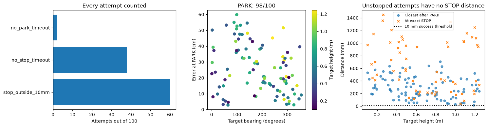


#### Iteration 35: stopping and drift

These plots distinguish reaching the dot, issuing STOP in the right place, and subsequent movement. The camera visibility fraction comes from the recorded detector. Missing event measurements are left blank, while their attempts remain failures in the overall score.


```python
test_report.stopping(1); plt.show()

```


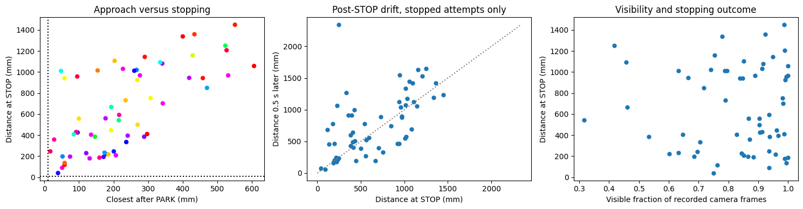


#### Iteration 35: predicted and actual distance over time

The first ten target IDs in the fixed test manifest are shown for readable traces, selected independently of outcomes. The table and player include all 100 targets. Actual distances are used for evaluation only; they are not network inputs.


```python
test_report.distances(1); plt.show()

```


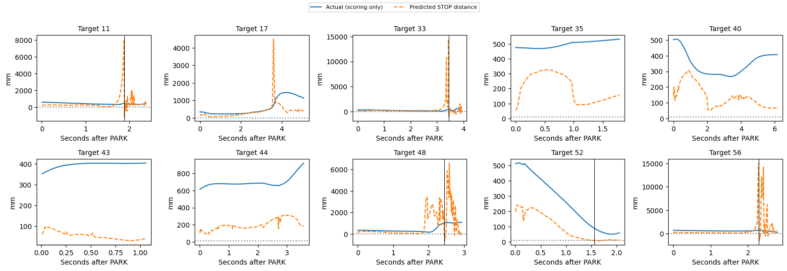


#### Iteration 35: all test replays

Select any of the 100 recorded test targets. The solid robot follows the learned policy; the ghost follows the recorded expert. The upper-right camera inset shows actual recorded images. Play, pause, restart and the time slider control playback. Camera images load as needed to limit browser memory.


```python
player_path = test_report.build_viewer(1)
player_url = test_report.preview_server() + '/' + player_path.name
display(lazy_player(player_url))
display(HTML(f'<a href="{player_url}" target="_blank">Open all 100 test replays in a separate tab</a>'))

```


<div><button onclick="var f=document.getElementById('playere4e247af');f.src='https://nm-linmint-mlflow.taile381c0.ts.net:8443/golden-replays/viewer_golden_seed1.html';f.style.display='block';this.style.display='none'"
 style="padding:8px 14px;font-size:14px">Load the 3D player</button>
<iframe id="playere4e247af" style="display:none;width:100%;height:810px;border:0"></iframe></div>


<a href="https://nm-linmint-mlflow.taile381c0.ts.net:8443/golden-replays/viewer_golden_seed1.html" target="_blank">Open all 100 test replays in a separate tab</a>


#### Iteration 35: reading the result


```python
display(Markdown(test_report.reading(1)))

```


Seed 1: 98/100 PARK, 60/100 STOP and 0/100 successful stops within 10 mm (Wilson 95% interval 0.0–3.7%). 0/100 came within 10 mm during reaching; passing through is not a successful stop. Median parking error was 22.1 cm among parked attempts; median distance at STOP was 558.8 mm among stopped attempts. 40 attempts timed out and 0 had execution/termination failures. These conditional medians exclude attempts without the relevant event; the success rate keeps all 100. This is a frozen baseline result, not a basis for selecting checkpoints. Representative seed 7 remains the validation-selected seed.


### Iteration 36: golden data, seed 2, results

Official test evaluation of the frozen seed-2 models. The full table covers all 100 reserved targets. No retraining occurred during this evaluation.


```python
display(HTML('<div style="max-height:420px;overflow:auto">'+test_report.table(2).round(3).to_html()+'</div>'))

```


<div style="max-height:420px;overflow:auto"><table border="1" class="dataframe">
  <thead>
    <tr style="text-align: right;">
      <th></th>
      <th>status</th>
      <th>success</th>
      <th>parked</th>
      <th>park_s</th>
      <th>stop_s</th>
      <th>park_error_cm</th>
      <th>park_heading_error_deg</th>
      <th>at_stop_mm</th>
      <th>closest_mm</th>
      <th>end_mm</th>
      <th>post_stop_drift_mm</th>
      <th>post_park_base_drift_cm</th>
      <th>timed_out</th>
      <th>elapsed_s</th>
      <th>camera_visible_fraction</th>
      <th>target_bearing_deg</th>
      <th>target_range_m</th>
      <th>target_height_m</th>
    </tr>
    <tr>
      <th>dot</th>
      <th></th>
      <th></th>
      <th></th>
      <th></th>
      <th></th>
      <th></th>
      <th></th>
      <th></th>
      <th></th>
      <th></th>
      <th></th>
      <th></th>
      <th></th>
      <th></th>
      <th></th>
      <th></th>
      <th></th>
      <th></th>
    </tr>
  </thead>
  <tbody>
    <tr>
      <th>11</th>
      <td>stop_outside_10mm</td>
      <td>False</td>
      <td>True</td>
      <td>2.367</td>
      <td>5.739</td>
      <td>9.183</td>
      <td>11.808</td>
      <td>1070.808</td>
      <td>112.180</td>
      <td>570.852</td>
      <td>-499.956</td>
      <td>1.283</td>
      <td>False</td>
      <td>10.854</td>
      <td>0.979</td>
      <td>0.986</td>
      <td>1.042</td>
      <td>0.178</td>
    </tr>
    <tr>
      <th>17</th>
      <td>stop_outside_10mm</td>
      <td>False</td>
      <td>True</td>
      <td>5.600</td>
      <td>9.050</td>
      <td>30.339</td>
      <td>13.945</td>
      <td>508.207</td>
      <td>413.005</td>
      <td>704.797</td>
      <td>196.590</td>
      <td>0.517</td>
      <td>False</td>
      <td>15.272</td>
      <td>0.686</td>
      <td>194.926</td>
      <td>1.095</td>
      <td>1.028</td>
    </tr>
    <tr>
      <th>33</th>
      <td>stop_outside_10mm</td>
      <td>False</td>
      <td>True</td>
      <td>7.133</td>
      <td>11.853</td>
      <td>36.225</td>
      <td>4.684</td>
      <td>534.683</td>
      <td>316.406</td>
      <td>596.024</td>
      <td>61.341</td>
      <td>7.996</td>
      <td>False</td>
      <td>18.962</td>
      <td>0.881</td>
      <td>259.736</td>
      <td>1.504</td>
      <td>0.422</td>
    </tr>
    <tr>
      <th>35</th>
      <td>stop_outside_10mm</td>
      <td>False</td>
      <td>True</td>
      <td>7.067</td>
      <td>10.145</td>
      <td>42.068</td>
      <td>7.128</td>
      <td>1626.615</td>
      <td>417.772</td>
      <td>1567.972</td>
      <td>-58.643</td>
      <td>1.031</td>
      <td>False</td>
      <td>16.718</td>
      <td>0.625</td>
      <td>111.687</td>
      <td>1.257</td>
      <td>0.589</td>
    </tr>
    <tr>
      <th>40</th>
      <td>stop_outside_10mm</td>
      <td>False</td>
      <td>True</td>
      <td>5.400</td>
      <td>7.739</td>
      <td>15.442</td>
      <td>11.870</td>
      <td>271.810</td>
      <td>63.110</td>
      <td>342.378</td>
      <td>70.567</td>
      <td>0.300</td>
      <td>False</td>
      <td>13.837</td>
      <td>0.629</td>
      <td>205.751</td>
      <td>1.041</td>
      <td>0.328</td>
    </tr>
    <tr>
      <th>43</th>
      <td>no_stop_timeout</td>
      <td>False</td>
      <td>True</td>
      <td>11.667</td>
      <td>NaN</td>
      <td>8.574</td>
      <td>-21.285</td>
      <td>NaN</td>
      <td>185.418</td>
      <td>185.326</td>
      <td>NaN</td>
      <td>0.139</td>
      <td>True</td>
      <td>17.397</td>
      <td>0.569</td>
      <td>121.648</td>
      <td>1.333</td>
      <td>0.760</td>
    </tr>
    <tr>
      <th>44</th>
      <td>stop_outside_10mm</td>
      <td>False</td>
      <td>True</td>
      <td>9.267</td>
      <td>12.695</td>
      <td>42.746</td>
      <td>-19.657</td>
      <td>1168.125</td>
      <td>462.752</td>
      <td>1459.010</td>
      <td>290.885</td>
      <td>0.282</td>
      <td>False</td>
      <td>20.155</td>
      <td>0.808</td>
      <td>140.983</td>
      <td>1.684</td>
      <td>0.533</td>
    </tr>
    <tr>
      <th>48</th>
      <td>stop_outside_10mm</td>
      <td>False</td>
      <td>True</td>
      <td>4.900</td>
      <td>5.665</td>
      <td>14.703</td>
      <td>-16.214</td>
      <td>273.143</td>
      <td>266.617</td>
      <td>319.793</td>
      <td>46.650</td>
      <td>1.525</td>
      <td>False</td>
      <td>10.342</td>
      <td>0.946</td>
      <td>30.246</td>
      <td>1.110</td>
      <td>0.420</td>
    </tr>
    <tr>
      <th>52</th>
      <td>stop_outside_10mm</td>
      <td>False</td>
      <td>True</td>
      <td>5.967</td>
      <td>9.637</td>
      <td>25.878</td>
      <td>5.426</td>
      <td>1497.788</td>
      <td>289.142</td>
      <td>1712.692</td>
      <td>214.904</td>
      <td>1.886</td>
      <td>False</td>
      <td>15.829</td>
      <td>0.649</td>
      <td>315.534</td>
      <td>1.244</td>
      <td>1.090</td>
    </tr>
    <tr>
      <th>56</th>
      <td>stop_outside_10mm</td>
      <td>False</td>
      <td>True</td>
      <td>6.100</td>
      <td>9.703</td>
      <td>28.439</td>
      <td>3.897</td>
      <td>894.909</td>
      <td>605.160</td>
      <td>940.085</td>
      <td>45.176</td>
      <td>5.966</td>
      <td>False</td>
      <td>16.534</td>
      <td>0.775</td>
      <td>162.122</td>
      <td>1.265</td>
      <td>0.141</td>
    </tr>
    <tr>
      <th>65</th>
      <td>stop_outside_10mm</td>
      <td>False</td>
      <td>True</td>
      <td>8.900</td>
      <td>11.003</td>
      <td>56.491</td>
      <td>-4.440</td>
      <td>1160.542</td>
      <td>388.842</td>
      <td>1194.312</td>
      <td>33.770</td>
      <td>0.554</td>
      <td>False</td>
      <td>18.608</td>
      <td>0.633</td>
      <td>241.918</td>
      <td>1.929</td>
      <td>1.244</td>
    </tr>
    <tr>
      <th>83</th>
      <td>stop_outside_10mm</td>
      <td>False</td>
      <td>True</td>
      <td>7.967</td>
      <td>9.551</td>
      <td>42.544</td>
      <td>-1.339</td>
      <td>250.158</td>
      <td>209.342</td>
      <td>324.093</td>
      <td>73.935</td>
      <td>0.471</td>
      <td>False</td>
      <td>16.296</td>
      <td>0.695</td>
      <td>282.883</td>
      <td>1.859</td>
      <td>1.211</td>
    </tr>
    <tr>
      <th>92</th>
      <td>stop_outside_10mm</td>
      <td>False</td>
      <td>True</td>
      <td>3.533</td>
      <td>6.385</td>
      <td>20.841</td>
      <td>-8.286</td>
      <td>1015.734</td>
      <td>259.141</td>
      <td>447.706</td>
      <td>-568.029</td>
      <td>13.381</td>
      <td>False</td>
      <td>12.225</td>
      <td>0.947</td>
      <td>5.294</td>
      <td>1.286</td>
      <td>0.160</td>
    </tr>
    <tr>
      <th>97</th>
      <td>stop_outside_10mm</td>
      <td>False</td>
      <td>True</td>
      <td>4.600</td>
      <td>10.247</td>
      <td>65.006</td>
      <td>9.197</td>
      <td>1862.346</td>
      <td>443.712</td>
      <td>1567.889</td>
      <td>-294.457</td>
      <td>6.414</td>
      <td>False</td>
      <td>17.546</td>
      <td>0.997</td>
      <td>350.146</td>
      <td>1.870</td>
      <td>0.347</td>
    </tr>
    <tr>
      <th>98</th>
      <td>stop_outside_10mm</td>
      <td>False</td>
      <td>True</td>
      <td>5.633</td>
      <td>8.893</td>
      <td>18.310</td>
      <td>16.370</td>
      <td>760.218</td>
      <td>305.719</td>
      <td>773.147</td>
      <td>12.929</td>
      <td>0.139</td>
      <td>False</td>
      <td>15.088</td>
      <td>0.837</td>
      <td>320.377</td>
      <td>1.322</td>
      <td>0.998</td>
    </tr>
    <tr>
      <th>113</th>
      <td>stop_outside_10mm</td>
      <td>False</td>
      <td>True</td>
      <td>2.667</td>
      <td>3.596</td>
      <td>55.234</td>
      <td>-6.596</td>
      <td>720.052</td>
      <td>583.576</td>
      <td>776.728</td>
      <td>56.675</td>
      <td>0.406</td>
      <td>False</td>
      <td>9.095</td>
      <td>0.732</td>
      <td>5.757</td>
      <td>1.744</td>
      <td>0.924</td>
    </tr>
    <tr>
      <th>136</th>
      <td>stop_outside_10mm</td>
      <td>False</td>
      <td>True</td>
      <td>6.033</td>
      <td>9.771</td>
      <td>53.456</td>
      <td>1.287</td>
      <td>1493.816</td>
      <td>515.748</td>
      <td>1803.029</td>
      <td>309.212</td>
      <td>1.138</td>
      <td>False</td>
      <td>16.402</td>
      <td>0.725</td>
      <td>294.524</td>
      <td>1.604</td>
      <td>0.771</td>
    </tr>
    <tr>
      <th>147</th>
      <td>stop_outside_10mm</td>
      <td>False</td>
      <td>True</td>
      <td>6.067</td>
      <td>13.573</td>
      <td>69.577</td>
      <td>7.965</td>
      <td>1252.099</td>
      <td>621.129</td>
      <td>1947.474</td>
      <td>695.376</td>
      <td>30.451</td>
      <td>False</td>
      <td>22.619</td>
      <td>0.868</td>
      <td>296.174</td>
      <td>1.539</td>
      <td>1.224</td>
    </tr>
    <tr>
      <th>148</th>
      <td>stop_outside_10mm</td>
      <td>False</td>
      <td>True</td>
      <td>8.933</td>
      <td>8.933</td>
      <td>32.669</td>
      <td>-8.286</td>
      <td>391.849</td>
      <td>343.927</td>
      <td>343.786</td>
      <td>-48.063</td>
      <td>0.216</td>
      <td>False</td>
      <td>14.317</td>
      <td>0.696</td>
      <td>149.538</td>
      <td>1.010</td>
      <td>0.728</td>
    </tr>
    <tr>
      <th>154</th>
      <td>no_park_timeout</td>
      <td>False</td>
      <td>False</td>
      <td>NaN</td>
      <td>NaN</td>
      <td>NaN</td>
      <td>NaN</td>
      <td>NaN</td>
      <td>NaN</td>
      <td>252.286</td>
      <td>NaN</td>
      <td>NaN</td>
      <td>True</td>
      <td>18.365</td>
      <td>0.541</td>
      <td>98.586</td>
      <td>1.606</td>
      <td>0.863</td>
    </tr>
    <tr>
      <th>162</th>
      <td>stop_outside_10mm</td>
      <td>False</td>
      <td>True</td>
      <td>11.833</td>
      <td>12.479</td>
      <td>20.636</td>
      <td>-12.809</td>
      <td>215.325</td>
      <td>137.437</td>
      <td>137.206</td>
      <td>-78.119</td>
      <td>0.252</td>
      <td>False</td>
      <td>19.837</td>
      <td>0.659</td>
      <td>175.986</td>
      <td>1.287</td>
      <td>0.914</td>
    </tr>
    <tr>
      <th>196</th>
      <td>stop_outside_10mm</td>
      <td>False</td>
      <td>True</td>
      <td>2.600</td>
      <td>5.534</td>
      <td>77.141</td>
      <td>-4.403</td>
      <td>1471.415</td>
      <td>825.896</td>
      <td>902.799</td>
      <td>-568.616</td>
      <td>0.775</td>
      <td>False</td>
      <td>12.943</td>
      <td>0.989</td>
      <td>2.307</td>
      <td>1.860</td>
      <td>0.458</td>
    </tr>
    <tr>
      <th>221</th>
      <td>stop_outside_10mm</td>
      <td>False</td>
      <td>True</td>
      <td>5.167</td>
      <td>8.546</td>
      <td>25.182</td>
      <td>-16.575</td>
      <td>132.683</td>
      <td>48.364</td>
      <td>374.403</td>
      <td>241.720</td>
      <td>2.283</td>
      <td>False</td>
      <td>15.962</td>
      <td>0.904</td>
      <td>45.865</td>
      <td>1.305</td>
      <td>0.343</td>
    </tr>
    <tr>
      <th>229</th>
      <td>no_stop_timeout</td>
      <td>False</td>
      <td>True</td>
      <td>9.533</td>
      <td>NaN</td>
      <td>50.529</td>
      <td>-21.665</td>
      <td>NaN</td>
      <td>514.372</td>
      <td>705.670</td>
      <td>NaN</td>
      <td>1.346</td>
      <td>True</td>
      <td>19.201</td>
      <td>0.532</td>
      <td>114.486</td>
      <td>1.623</td>
      <td>0.727</td>
    </tr>
    <tr>
      <th>232</th>
      <td>stop_outside_10mm</td>
      <td>False</td>
      <td>True</td>
      <td>10.633</td>
      <td>11.574</td>
      <td>0.765</td>
      <td>-10.842</td>
      <td>127.020</td>
      <td>119.901</td>
      <td>119.880</td>
      <td>-7.139</td>
      <td>0.243</td>
      <td>False</td>
      <td>17.905</td>
      <td>0.634</td>
      <td>182.689</td>
      <td>1.347</td>
      <td>0.544</td>
    </tr>
    <tr>
      <th>239</th>
      <td>stop_outside_10mm</td>
      <td>False</td>
      <td>True</td>
      <td>5.233</td>
      <td>8.800</td>
      <td>8.145</td>
      <td>14.273</td>
      <td>524.472</td>
      <td>46.194</td>
      <td>552.030</td>
      <td>27.558</td>
      <td>0.798</td>
      <td>False</td>
      <td>14.951</td>
      <td>0.774</td>
      <td>355.930</td>
      <td>1.042</td>
      <td>0.572</td>
    </tr>
    <tr>
      <th>248</th>
      <td>stop_outside_10mm</td>
      <td>False</td>
      <td>True</td>
      <td>8.633</td>
      <td>9.693</td>
      <td>12.638</td>
      <td>-18.813</td>
      <td>132.228</td>
      <td>121.761</td>
      <td>121.750</td>
      <td>-10.479</td>
      <td>0.502</td>
      <td>False</td>
      <td>15.181</td>
      <td>0.755</td>
      <td>23.497</td>
      <td>1.075</td>
      <td>0.524</td>
    </tr>
    <tr>
      <th>260</th>
      <td>stop_outside_10mm</td>
      <td>False</td>
      <td>True</td>
      <td>8.100</td>
      <td>9.541</td>
      <td>35.182</td>
      <td>-2.456</td>
      <td>447.899</td>
      <td>279.837</td>
      <td>957.284</td>
      <td>509.385</td>
      <td>0.232</td>
      <td>False</td>
      <td>16.366</td>
      <td>0.573</td>
      <td>287.711</td>
      <td>1.727</td>
      <td>1.233</td>
    </tr>
    <tr>
      <th>271</th>
      <td>stop_outside_10mm</td>
      <td>False</td>
      <td>True</td>
      <td>6.000</td>
      <td>6.000</td>
      <td>9.340</td>
      <td>7.439</td>
      <td>30.347</td>
      <td>28.997</td>
      <td>38.309</td>
      <td>7.962</td>
      <td>0.047</td>
      <td>False</td>
      <td>10.550</td>
      <td>0.887</td>
      <td>306.675</td>
      <td>1.003</td>
      <td>0.707</td>
    </tr>
    <tr>
      <th>274</th>
      <td>stop_outside_10mm</td>
      <td>False</td>
      <td>True</td>
      <td>6.300</td>
      <td>11.180</td>
      <td>30.601</td>
      <td>7.926</td>
      <td>233.867</td>
      <td>198.054</td>
      <td>198.032</td>
      <td>-35.836</td>
      <td>0.420</td>
      <td>False</td>
      <td>18.726</td>
      <td>0.832</td>
      <td>295.597</td>
      <td>1.617</td>
      <td>0.356</td>
    </tr>
    <tr>
      <th>277</th>
      <td>no_stop_timeout</td>
      <td>False</td>
      <td>True</td>
      <td>11.300</td>
      <td>NaN</td>
      <td>9.121</td>
      <td>-13.946</td>
      <td>NaN</td>
      <td>109.256</td>
      <td>1224.262</td>
      <td>NaN</td>
      <td>8.847</td>
      <td>True</td>
      <td>22.827</td>
      <td>0.809</td>
      <td>152.678</td>
      <td>1.592</td>
      <td>0.326</td>
    </tr>
    <tr>
      <th>281</th>
      <td>no_stop_timeout</td>
      <td>False</td>
      <td>True</td>
      <td>7.000</td>
      <td>NaN</td>
      <td>51.902</td>
      <td>1.975</td>
      <td>NaN</td>
      <td>568.035</td>
      <td>1381.370</td>
      <td>NaN</td>
      <td>22.584</td>
      <td>True</td>
      <td>21.663</td>
      <td>0.829</td>
      <td>271.241</td>
      <td>1.709</td>
      <td>0.986</td>
    </tr>
    <tr>
      <th>285</th>
      <td>stop_outside_10mm</td>
      <td>False</td>
      <td>True</td>
      <td>7.033</td>
      <td>8.453</td>
      <td>48.991</td>
      <td>0.374</td>
      <td>622.101</td>
      <td>503.971</td>
      <td>694.068</td>
      <td>71.967</td>
      <td>0.157</td>
      <td>False</td>
      <td>15.373</td>
      <td>0.900</td>
      <td>252.565</td>
      <td>1.584</td>
      <td>0.583</td>
    </tr>
    <tr>
      <th>302</th>
      <td>stop_outside_10mm</td>
      <td>False</td>
      <td>True</td>
      <td>5.733</td>
      <td>10.113</td>
      <td>28.190</td>
      <td>-14.373</td>
      <td>1588.549</td>
      <td>437.513</td>
      <td>1739.385</td>
      <td>150.836</td>
      <td>2.844</td>
      <td>False</td>
      <td>18.447</td>
      <td>0.987</td>
      <td>14.479</td>
      <td>1.582</td>
      <td>0.256</td>
    </tr>
    <tr>
      <th>306</th>
      <td>stop_outside_10mm</td>
      <td>False</td>
      <td>True</td>
      <td>10.833</td>
      <td>11.701</td>
      <td>7.047</td>
      <td>-9.539</td>
      <td>124.887</td>
      <td>106.586</td>
      <td>106.637</td>
      <td>-18.250</td>
      <td>0.356</td>
      <td>False</td>
      <td>19.431</td>
      <td>0.638</td>
      <td>191.578</td>
      <td>1.459</td>
      <td>0.867</td>
    </tr>
    <tr>
      <th>311</th>
      <td>stop_outside_10mm</td>
      <td>False</td>
      <td>True</td>
      <td>9.467</td>
      <td>11.666</td>
      <td>26.222</td>
      <td>-15.225</td>
      <td>148.609</td>
      <td>123.705</td>
      <td>133.686</td>
      <td>-14.923</td>
      <td>0.213</td>
      <td>False</td>
      <td>19.008</td>
      <td>0.619</td>
      <td>141.003</td>
      <td>1.883</td>
      <td>0.810</td>
    </tr>
    <tr>
      <th>315</th>
      <td>stop_outside_10mm</td>
      <td>False</td>
      <td>True</td>
      <td>5.233</td>
      <td>8.532</td>
      <td>29.564</td>
      <td>-15.208</td>
      <td>132.484</td>
      <td>128.864</td>
      <td>1046.330</td>
      <td>913.846</td>
      <td>4.209</td>
      <td>False</td>
      <td>14.464</td>
      <td>0.823</td>
      <td>45.849</td>
      <td>1.300</td>
      <td>0.448</td>
    </tr>
    <tr>
      <th>316</th>
      <td>stop_outside_10mm</td>
      <td>False</td>
      <td>True</td>
      <td>7.633</td>
      <td>7.883</td>
      <td>4.704</td>
      <td>-13.527</td>
      <td>213.407</td>
      <td>159.755</td>
      <td>159.649</td>
      <td>-53.757</td>
      <td>0.307</td>
      <td>False</td>
      <td>13.665</td>
      <td>0.603</td>
      <td>261.404</td>
      <td>1.468</td>
      <td>0.625</td>
    </tr>
    <tr>
      <th>317</th>
      <td>no_park_timeout</td>
      <td>False</td>
      <td>False</td>
      <td>NaN</td>
      <td>NaN</td>
      <td>NaN</td>
      <td>NaN</td>
      <td>NaN</td>
      <td>NaN</td>
      <td>231.539</td>
      <td>NaN</td>
      <td>NaN</td>
      <td>True</td>
      <td>17.166</td>
      <td>0.658</td>
      <td>100.830</td>
      <td>1.368</td>
      <td>0.857</td>
    </tr>
    <tr>
      <th>361</th>
      <td>stop_outside_10mm</td>
      <td>False</td>
      <td>True</td>
      <td>7.700</td>
      <td>8.847</td>
      <td>54.505</td>
      <td>-9.871</td>
      <td>482.717</td>
      <td>462.215</td>
      <td>462.199</td>
      <td>-20.518</td>
      <td>0.285</td>
      <td>False</td>
      <td>15.523</td>
      <td>0.769</td>
      <td>210.594</td>
      <td>1.799</td>
      <td>1.088</td>
    </tr>
    <tr>
      <th>413</th>
      <td>no_stop_timeout</td>
      <td>False</td>
      <td>True</td>
      <td>9.867</td>
      <td>NaN</td>
      <td>28.850</td>
      <td>-1.833</td>
      <td>NaN</td>
      <td>311.694</td>
      <td>1457.553</td>
      <td>NaN</td>
      <td>0.073</td>
      <td>True</td>
      <td>22.787</td>
      <td>0.798</td>
      <td>206.840</td>
      <td>1.947</td>
      <td>0.616</td>
    </tr>
    <tr>
      <th>427</th>
      <td>stop_outside_10mm</td>
      <td>False</td>
      <td>True</td>
      <td>6.933</td>
      <td>9.906</td>
      <td>28.844</td>
      <td>4.712</td>
      <td>1002.670</td>
      <td>289.507</td>
      <td>1049.957</td>
      <td>47.287</td>
      <td>0.198</td>
      <td>False</td>
      <td>16.341</td>
      <td>0.786</td>
      <td>273.775</td>
      <td>1.333</td>
      <td>0.798</td>
    </tr>
    <tr>
      <th>432</th>
      <td>stop_outside_10mm</td>
      <td>False</td>
      <td>True</td>
      <td>7.067</td>
      <td>8.170</td>
      <td>42.956</td>
      <td>-9.747</td>
      <td>400.830</td>
      <td>400.743</td>
      <td>408.204</td>
      <td>7.374</td>
      <td>0.626</td>
      <td>False</td>
      <td>14.399</td>
      <td>0.747</td>
      <td>249.834</td>
      <td>1.701</td>
      <td>1.054</td>
    </tr>
    <tr>
      <th>463</th>
      <td>stop_outside_10mm</td>
      <td>False</td>
      <td>True</td>
      <td>10.200</td>
      <td>10.263</td>
      <td>33.939</td>
      <td>-6.588</td>
      <td>412.220</td>
      <td>332.597</td>
      <td>332.418</td>
      <td>-79.803</td>
      <td>0.310</td>
      <td>False</td>
      <td>15.917</td>
      <td>0.737</td>
      <td>229.062</td>
      <td>1.092</td>
      <td>0.806</td>
    </tr>
    <tr>
      <th>478</th>
      <td>stop_outside_10mm</td>
      <td>False</td>
      <td>True</td>
      <td>9.833</td>
      <td>13.233</td>
      <td>54.249</td>
      <td>-18.917</td>
      <td>1218.225</td>
      <td>611.335</td>
      <td>1384.339</td>
      <td>166.114</td>
      <td>0.700</td>
      <td>False</td>
      <td>20.832</td>
      <td>0.769</td>
      <td>105.867</td>
      <td>1.864</td>
      <td>0.485</td>
    </tr>
    <tr>
      <th>479</th>
      <td>no_stop_timeout</td>
      <td>False</td>
      <td>True</td>
      <td>10.900</td>
      <td>NaN</td>
      <td>28.712</td>
      <td>-18.946</td>
      <td>NaN</td>
      <td>290.051</td>
      <td>289.952</td>
      <td>NaN</td>
      <td>0.109</td>
      <td>True</td>
      <td>18.584</td>
      <td>0.548</td>
      <td>99.764</td>
      <td>1.791</td>
      <td>0.844</td>
    </tr>
    <tr>
      <th>492</th>
      <td>no_stop_timeout</td>
      <td>False</td>
      <td>True</td>
      <td>8.833</td>
      <td>NaN</td>
      <td>6.929</td>
      <td>-12.319</td>
      <td>NaN</td>
      <td>153.207</td>
      <td>611.062</td>
      <td>NaN</td>
      <td>0.978</td>
      <td>True</td>
      <td>19.341</td>
      <td>0.850</td>
      <td>196.470</td>
      <td>1.201</td>
      <td>0.521</td>
    </tr>
    <tr>
      <th>502</th>
      <td>no_stop_timeout</td>
      <td>False</td>
      <td>True</td>
      <td>9.133</td>
      <td>NaN</td>
      <td>16.309</td>
      <td>-4.639</td>
      <td>NaN</td>
      <td>183.967</td>
      <td>679.516</td>
      <td>NaN</td>
      <td>1.597</td>
      <td>True</td>
      <td>17.321</td>
      <td>0.714</td>
      <td>339.014</td>
      <td>1.012</td>
      <td>1.187</td>
    </tr>
    <tr>
      <th>534</th>
      <td>stop_outside_10mm</td>
      <td>False</td>
      <td>True</td>
      <td>6.033</td>
      <td>7.084</td>
      <td>27.226</td>
      <td>-7.769</td>
      <td>412.590</td>
      <td>398.606</td>
      <td>474.034</td>
      <td>61.445</td>
      <td>0.288</td>
      <td>False</td>
      <td>12.374</td>
      <td>0.930</td>
      <td>54.826</td>
      <td>1.246</td>
      <td>0.365</td>
    </tr>
    <tr>
      <th>545</th>
      <td>stop_outside_10mm</td>
      <td>False</td>
      <td>True</td>
      <td>5.933</td>
      <td>11.016</td>
      <td>8.149</td>
      <td>10.383</td>
      <td>257.884</td>
      <td>137.102</td>
      <td>257.742</td>
      <td>-0.142</td>
      <td>6.405</td>
      <td>False</td>
      <td>18.010</td>
      <td>0.850</td>
      <td>53.090</td>
      <td>1.164</td>
      <td>0.195</td>
    </tr>
    <tr>
      <th>554</th>
      <td>stop_outside_10mm</td>
      <td>False</td>
      <td>True</td>
      <td>9.467</td>
      <td>13.643</td>
      <td>21.763</td>
      <td>-2.469</td>
      <td>1277.240</td>
      <td>244.077</td>
      <td>1482.544</td>
      <td>205.303</td>
      <td>3.090</td>
      <td>False</td>
      <td>22.260</td>
      <td>0.800</td>
      <td>234.276</td>
      <td>1.908</td>
      <td>0.598</td>
    </tr>
    <tr>
      <th>571</th>
      <td>stop_outside_10mm</td>
      <td>False</td>
      <td>True</td>
      <td>10.833</td>
      <td>12.876</td>
      <td>7.372</td>
      <td>-14.880</td>
      <td>218.079</td>
      <td>81.929</td>
      <td>144.067</td>
      <td>-74.011</td>
      <td>1.120</td>
      <td>False</td>
      <td>20.236</td>
      <td>0.828</td>
      <td>170.353</td>
      <td>1.680</td>
      <td>0.118</td>
    </tr>
    <tr>
      <th>585</th>
      <td>stop_outside_10mm</td>
      <td>False</td>
      <td>True</td>
      <td>5.900</td>
      <td>7.126</td>
      <td>46.214</td>
      <td>3.346</td>
      <td>542.370</td>
      <td>478.376</td>
      <td>598.208</td>
      <td>55.838</td>
      <td>0.058</td>
      <td>False</td>
      <td>12.695</td>
      <td>1.000</td>
      <td>286.405</td>
      <td>1.487</td>
      <td>0.490</td>
    </tr>
    <tr>
      <th>586</th>
      <td>stop_outside_10mm</td>
      <td>False</td>
      <td>True</td>
      <td>7.767</td>
      <td>11.089</td>
      <td>51.392</td>
      <td>-12.670</td>
      <td>1175.749</td>
      <td>543.911</td>
      <td>1353.728</td>
      <td>177.979</td>
      <td>0.356</td>
      <td>False</td>
      <td>18.410</td>
      <td>0.853</td>
      <td>211.872</td>
      <td>1.836</td>
      <td>0.605</td>
    </tr>
    <tr>
      <th>592</th>
      <td>stop_outside_10mm</td>
      <td>False</td>
      <td>True</td>
      <td>5.267</td>
      <td>6.870</td>
      <td>32.883</td>
      <td>2.473</td>
      <td>382.613</td>
      <td>317.944</td>
      <td>420.742</td>
      <td>38.129</td>
      <td>0.140</td>
      <td>False</td>
      <td>12.484</td>
      <td>1.000</td>
      <td>322.371</td>
      <td>1.328</td>
      <td>0.490</td>
    </tr>
    <tr>
      <th>599</th>
      <td>no_stop_timeout</td>
      <td>False</td>
      <td>True</td>
      <td>7.633</td>
      <td>NaN</td>
      <td>33.334</td>
      <td>13.376</td>
      <td>NaN</td>
      <td>426.568</td>
      <td>1086.435</td>
      <td>NaN</td>
      <td>1.866</td>
      <td>True</td>
      <td>17.939</td>
      <td>0.644</td>
      <td>95.655</td>
      <td>1.198</td>
      <td>1.055</td>
    </tr>
    <tr>
      <th>600</th>
      <td>stop_outside_10mm</td>
      <td>False</td>
      <td>True</td>
      <td>3.567</td>
      <td>4.600</td>
      <td>49.817</td>
      <td>-15.185</td>
      <td>585.370</td>
      <td>572.703</td>
      <td>681.455</td>
      <td>96.085</td>
      <td>1.088</td>
      <td>False</td>
      <td>9.661</td>
      <td>0.882</td>
      <td>2.224</td>
      <td>1.599</td>
      <td>0.949</td>
    </tr>
    <tr>
      <th>605</th>
      <td>stop_outside_10mm</td>
      <td>False</td>
      <td>True</td>
      <td>10.500</td>
      <td>11.721</td>
      <td>4.235</td>
      <td>-10.170</td>
      <td>88.786</td>
      <td>86.473</td>
      <td>115.620</td>
      <td>26.834</td>
      <td>0.479</td>
      <td>False</td>
      <td>21.643</td>
      <td>0.665</td>
      <td>211.055</td>
      <td>1.454</td>
      <td>0.931</td>
    </tr>
    <tr>
      <th>628</th>
      <td>stop_outside_10mm</td>
      <td>False</td>
      <td>True</td>
      <td>5.600</td>
      <td>8.680</td>
      <td>36.163</td>
      <td>0.830</td>
      <td>1143.278</td>
      <td>356.630</td>
      <td>1127.300</td>
      <td>-15.978</td>
      <td>0.485</td>
      <td>False</td>
      <td>17.776</td>
      <td>0.822</td>
      <td>329.443</td>
      <td>1.406</td>
      <td>0.851</td>
    </tr>
    <tr>
      <th>632</th>
      <td>stop_outside_10mm</td>
      <td>False</td>
      <td>True</td>
      <td>5.333</td>
      <td>7.920</td>
      <td>8.591</td>
      <td>9.510</td>
      <td>239.013</td>
      <td>5.347</td>
      <td>180.378</td>
      <td>-58.635</td>
      <td>0.543</td>
      <td>False</td>
      <td>17.972</td>
      <td>0.980</td>
      <td>9.084</td>
      <td>1.860</td>
      <td>0.260</td>
    </tr>
    <tr>
      <th>642</th>
      <td>stop_outside_10mm</td>
      <td>False</td>
      <td>True</td>
      <td>6.200</td>
      <td>9.253</td>
      <td>28.047</td>
      <td>9.136</td>
      <td>804.213</td>
      <td>337.719</td>
      <td>821.967</td>
      <td>17.754</td>
      <td>0.187</td>
      <td>False</td>
      <td>18.841</td>
      <td>0.700</td>
      <td>290.290</td>
      <td>1.213</td>
      <td>1.007</td>
    </tr>
    <tr>
      <th>646</th>
      <td>stop_outside_10mm</td>
      <td>False</td>
      <td>True</td>
      <td>6.333</td>
      <td>9.534</td>
      <td>54.620</td>
      <td>9.568</td>
      <td>1064.143</td>
      <td>760.621</td>
      <td>932.424</td>
      <td>-131.719</td>
      <td>1.394</td>
      <td>False</td>
      <td>19.921</td>
      <td>0.987</td>
      <td>284.236</td>
      <td>1.908</td>
      <td>0.283</td>
    </tr>
    <tr>
      <th>652</th>
      <td>stop_outside_10mm</td>
      <td>False</td>
      <td>True</td>
      <td>7.033</td>
      <td>7.407</td>
      <td>19.956</td>
      <td>-10.446</td>
      <td>267.549</td>
      <td>214.286</td>
      <td>256.042</td>
      <td>-11.507</td>
      <td>0.869</td>
      <td>False</td>
      <td>15.276</td>
      <td>0.840</td>
      <td>296.088</td>
      <td>1.203</td>
      <td>0.758</td>
    </tr>
    <tr>
      <th>653</th>
      <td>stop_outside_10mm</td>
      <td>False</td>
      <td>True</td>
      <td>5.067</td>
      <td>7.261</td>
      <td>45.337</td>
      <td>-15.471</td>
      <td>820.600</td>
      <td>507.332</td>
      <td>945.088</td>
      <td>124.488</td>
      <td>0.169</td>
      <td>False</td>
      <td>14.412</td>
      <td>0.880</td>
      <td>62.349</td>
      <td>1.459</td>
      <td>0.495</td>
    </tr>
    <tr>
      <th>664</th>
      <td>stop_outside_10mm</td>
      <td>False</td>
      <td>True</td>
      <td>4.467</td>
      <td>4.568</td>
      <td>51.868</td>
      <td>-0.981</td>
      <td>490.274</td>
      <td>486.820</td>
      <td>523.962</td>
      <td>33.688</td>
      <td>2.303</td>
      <td>False</td>
      <td>10.641</td>
      <td>0.778</td>
      <td>46.754</td>
      <td>1.577</td>
      <td>0.714</td>
    </tr>
    <tr>
      <th>669</th>
      <td>no_stop_timeout</td>
      <td>False</td>
      <td>True</td>
      <td>9.867</td>
      <td>NaN</td>
      <td>27.532</td>
      <td>-6.877</td>
      <td>NaN</td>
      <td>294.147</td>
      <td>449.530</td>
      <td>NaN</td>
      <td>0.096</td>
      <td>True</td>
      <td>22.657</td>
      <td>0.667</td>
      <td>151.171</td>
      <td>1.985</td>
      <td>0.809</td>
    </tr>
    <tr>
      <th>671</th>
      <td>stop_outside_10mm</td>
      <td>False</td>
      <td>True</td>
      <td>10.033</td>
      <td>15.450</td>
      <td>16.439</td>
      <td>-17.097</td>
      <td>1314.048</td>
      <td>444.807</td>
      <td>1504.948</td>
      <td>190.900</td>
      <td>0.449</td>
      <td>False</td>
      <td>26.326</td>
      <td>0.866</td>
      <td>165.190</td>
      <td>1.908</td>
      <td>0.237</td>
    </tr>
    <tr>
      <th>683</th>
      <td>stop_outside_10mm</td>
      <td>False</td>
      <td>True</td>
      <td>8.067</td>
      <td>8.176</td>
      <td>26.237</td>
      <td>-11.024</td>
      <td>380.090</td>
      <td>288.723</td>
      <td>288.812</td>
      <td>-91.279</td>
      <td>0.246</td>
      <td>False</td>
      <td>14.754</td>
      <td>0.513</td>
      <td>171.323</td>
      <td>1.029</td>
      <td>0.888</td>
    </tr>
    <tr>
      <th>693</th>
      <td>stop_outside_10mm</td>
      <td>False</td>
      <td>True</td>
      <td>6.733</td>
      <td>11.775</td>
      <td>15.792</td>
      <td>0.369</td>
      <td>1596.598</td>
      <td>291.252</td>
      <td>1807.189</td>
      <td>210.591</td>
      <td>90.075</td>
      <td>False</td>
      <td>20.719</td>
      <td>0.995</td>
      <td>306.669</td>
      <td>1.844</td>
      <td>0.100</td>
    </tr>
    <tr>
      <th>700</th>
      <td>stop_outside_10mm</td>
      <td>False</td>
      <td>True</td>
      <td>5.633</td>
      <td>9.188</td>
      <td>33.283</td>
      <td>2.059</td>
      <td>471.487</td>
      <td>455.023</td>
      <td>477.259</td>
      <td>5.772</td>
      <td>0.257</td>
      <td>False</td>
      <td>17.013</td>
      <td>0.959</td>
      <td>301.391</td>
      <td>1.490</td>
      <td>0.177</td>
    </tr>
    <tr>
      <th>707</th>
      <td>stop_outside_10mm</td>
      <td>False</td>
      <td>True</td>
      <td>6.100</td>
      <td>10.648</td>
      <td>46.389</td>
      <td>7.245</td>
      <td>1667.644</td>
      <td>533.106</td>
      <td>1705.035</td>
      <td>37.391</td>
      <td>10.717</td>
      <td>False</td>
      <td>20.384</td>
      <td>0.839</td>
      <td>71.872</td>
      <td>1.448</td>
      <td>1.118</td>
    </tr>
    <tr>
      <th>708</th>
      <td>no_stop_timeout</td>
      <td>False</td>
      <td>True</td>
      <td>11.100</td>
      <td>NaN</td>
      <td>28.713</td>
      <td>-7.936</td>
      <td>NaN</td>
      <td>334.510</td>
      <td>344.184</td>
      <td>NaN</td>
      <td>0.373</td>
      <td>True</td>
      <td>22.231</td>
      <td>0.781</td>
      <td>202.171</td>
      <td>1.270</td>
      <td>0.428</td>
    </tr>
    <tr>
      <th>722</th>
      <td>no_stop_timeout</td>
      <td>False</td>
      <td>True</td>
      <td>9.833</td>
      <td>NaN</td>
      <td>61.944</td>
      <td>-18.257</td>
      <td>NaN</td>
      <td>642.788</td>
      <td>1153.313</td>
      <td>NaN</td>
      <td>1.135</td>
      <td>True</td>
      <td>21.866</td>
      <td>0.668</td>
      <td>97.634</td>
      <td>1.851</td>
      <td>0.642</td>
    </tr>
    <tr>
      <th>729</th>
      <td>stop_outside_10mm</td>
      <td>False</td>
      <td>True</td>
      <td>6.567</td>
      <td>11.281</td>
      <td>66.609</td>
      <td>3.944</td>
      <td>1563.057</td>
      <td>624.776</td>
      <td>1614.352</td>
      <td>51.295</td>
      <td>11.368</td>
      <td>False</td>
      <td>22.333</td>
      <td>0.661</td>
      <td>142.205</td>
      <td>1.334</td>
      <td>1.196</td>
    </tr>
    <tr>
      <th>730</th>
      <td>stop_outside_10mm</td>
      <td>False</td>
      <td>True</td>
      <td>7.867</td>
      <td>9.997</td>
      <td>9.198</td>
      <td>-2.019</td>
      <td>74.880</td>
      <td>57.501</td>
      <td>74.792</td>
      <td>-0.088</td>
      <td>0.751</td>
      <td>False</td>
      <td>19.690</td>
      <td>1.000</td>
      <td>284.406</td>
      <td>1.802</td>
      <td>0.311</td>
    </tr>
    <tr>
      <th>738</th>
      <td>stop_outside_10mm</td>
      <td>False</td>
      <td>True</td>
      <td>6.100</td>
      <td>9.545</td>
      <td>25.279</td>
      <td>5.971</td>
      <td>661.197</td>
      <td>521.378</td>
      <td>709.008</td>
      <td>47.811</td>
      <td>14.627</td>
      <td>False</td>
      <td>18.213</td>
      <td>0.977</td>
      <td>65.761</td>
      <td>1.353</td>
      <td>0.151</td>
    </tr>
    <tr>
      <th>741</th>
      <td>no_stop_timeout</td>
      <td>False</td>
      <td>True</td>
      <td>12.533</td>
      <td>NaN</td>
      <td>6.752</td>
      <td>-1.398</td>
      <td>NaN</td>
      <td>139.931</td>
      <td>355.668</td>
      <td>NaN</td>
      <td>0.235</td>
      <td>True</td>
      <td>22.604</td>
      <td>0.789</td>
      <td>203.672</td>
      <td>1.816</td>
      <td>0.636</td>
    </tr>
    <tr>
      <th>750</th>
      <td>no_park_timeout</td>
      <td>False</td>
      <td>False</td>
      <td>NaN</td>
      <td>NaN</td>
      <td>NaN</td>
      <td>NaN</td>
      <td>NaN</td>
      <td>NaN</td>
      <td>147.096</td>
      <td>NaN</td>
      <td>NaN</td>
      <td>True</td>
      <td>17.936</td>
      <td>0.578</td>
      <td>89.023</td>
      <td>1.379</td>
      <td>0.809</td>
    </tr>
    <tr>
      <th>770</th>
      <td>stop_outside_10mm</td>
      <td>False</td>
      <td>True</td>
      <td>10.733</td>
      <td>12.676</td>
      <td>21.303</td>
      <td>-18.258</td>
      <td>347.580</td>
      <td>298.224</td>
      <td>406.049</td>
      <td>58.469</td>
      <td>1.149</td>
      <td>False</td>
      <td>20.230</td>
      <td>0.677</td>
      <td>106.447</td>
      <td>1.328</td>
      <td>0.328</td>
    </tr>
    <tr>
      <th>779</th>
      <td>stop_outside_10mm</td>
      <td>False</td>
      <td>True</td>
      <td>7.400</td>
      <td>10.517</td>
      <td>5.046</td>
      <td>2.173</td>
      <td>1389.778</td>
      <td>147.847</td>
      <td>1233.772</td>
      <td>-156.007</td>
      <td>68.321</td>
      <td>False</td>
      <td>19.593</td>
      <td>0.994</td>
      <td>58.035</td>
      <td>1.948</td>
      <td>0.412</td>
    </tr>
    <tr>
      <th>806</th>
      <td>stop_outside_10mm</td>
      <td>False</td>
      <td>True</td>
      <td>8.300</td>
      <td>8.305</td>
      <td>11.391</td>
      <td>-11.362</td>
      <td>260.364</td>
      <td>232.594</td>
      <td>243.431</td>
      <td>-16.933</td>
      <td>0.096</td>
      <td>False</td>
      <td>14.595</td>
      <td>0.340</td>
      <td>136.615</td>
      <td>1.082</td>
      <td>0.570</td>
    </tr>
    <tr>
      <th>834</th>
      <td>stop_outside_10mm</td>
      <td>False</td>
      <td>True</td>
      <td>7.300</td>
      <td>7.836</td>
      <td>10.503</td>
      <td>-4.702</td>
      <td>187.462</td>
      <td>158.288</td>
      <td>160.486</td>
      <td>-26.976</td>
      <td>0.859</td>
      <td>False</td>
      <td>13.577</td>
      <td>0.606</td>
      <td>64.921</td>
      <td>1.063</td>
      <td>0.606</td>
    </tr>
    <tr>
      <th>845</th>
      <td>no_stop_timeout</td>
      <td>False</td>
      <td>True</td>
      <td>7.633</td>
      <td>NaN</td>
      <td>15.234</td>
      <td>-1.273</td>
      <td>NaN</td>
      <td>167.635</td>
      <td>1195.012</td>
      <td>NaN</td>
      <td>5.541</td>
      <td>True</td>
      <td>22.280</td>
      <td>0.954</td>
      <td>291.427</td>
      <td>1.822</td>
      <td>0.507</td>
    </tr>
    <tr>
      <th>846</th>
      <td>stop_outside_10mm</td>
      <td>False</td>
      <td>True</td>
      <td>6.700</td>
      <td>6.737</td>
      <td>12.317</td>
      <td>-9.230</td>
      <td>211.390</td>
      <td>201.002</td>
      <td>227.540</td>
      <td>16.151</td>
      <td>1.007</td>
      <td>False</td>
      <td>12.222</td>
      <td>0.881</td>
      <td>326.700</td>
      <td>1.179</td>
      <td>0.793</td>
    </tr>
    <tr>
      <th>848</th>
      <td>stop_outside_10mm</td>
      <td>False</td>
      <td>True</td>
      <td>9.967</td>
      <td>10.982</td>
      <td>46.332</td>
      <td>-8.720</td>
      <td>461.380</td>
      <td>455.604</td>
      <td>568.229</td>
      <td>106.849</td>
      <td>0.234</td>
      <td>False</td>
      <td>19.798</td>
      <td>0.626</td>
      <td>178.424</td>
      <td>1.954</td>
      <td>1.170</td>
    </tr>
    <tr>
      <th>854</th>
      <td>stop_outside_10mm</td>
      <td>False</td>
      <td>True</td>
      <td>6.067</td>
      <td>9.683</td>
      <td>34.135</td>
      <td>10.698</td>
      <td>525.282</td>
      <td>461.498</td>
      <td>1053.116</td>
      <td>527.834</td>
      <td>0.099</td>
      <td>False</td>
      <td>17.813</td>
      <td>0.859</td>
      <td>308.366</td>
      <td>1.608</td>
      <td>1.083</td>
    </tr>
    <tr>
      <th>857</th>
      <td>stop_outside_10mm</td>
      <td>False</td>
      <td>True</td>
      <td>10.933</td>
      <td>12.177</td>
      <td>24.993</td>
      <td>-20.238</td>
      <td>425.497</td>
      <td>347.828</td>
      <td>608.523</td>
      <td>183.025</td>
      <td>0.425</td>
      <td>False</td>
      <td>19.887</td>
      <td>0.667</td>
      <td>108.369</td>
      <td>1.808</td>
      <td>0.998</td>
    </tr>
    <tr>
      <th>859</th>
      <td>no_park_timeout</td>
      <td>False</td>
      <td>False</td>
      <td>NaN</td>
      <td>NaN</td>
      <td>NaN</td>
      <td>NaN</td>
      <td>NaN</td>
      <td>NaN</td>
      <td>343.985</td>
      <td>NaN</td>
      <td>NaN</td>
      <td>True</td>
      <td>17.828</td>
      <td>0.708</td>
      <td>90.489</td>
      <td>1.297</td>
      <td>0.433</td>
    </tr>
    <tr>
      <th>872</th>
      <td>stop_outside_10mm</td>
      <td>False</td>
      <td>True</td>
      <td>9.833</td>
      <td>11.750</td>
      <td>35.201</td>
      <td>-19.016</td>
      <td>256.071</td>
      <td>255.268</td>
      <td>332.958</td>
      <td>76.886</td>
      <td>0.401</td>
      <td>False</td>
      <td>19.245</td>
      <td>0.500</td>
      <td>87.534</td>
      <td>1.834</td>
      <td>0.910</td>
    </tr>
    <tr>
      <th>883</th>
      <td>stop_outside_10mm</td>
      <td>False</td>
      <td>True</td>
      <td>8.100</td>
      <td>11.874</td>
      <td>9.555</td>
      <td>0.271</td>
      <td>981.817</td>
      <td>158.908</td>
      <td>1110.024</td>
      <td>128.206</td>
      <td>7.858</td>
      <td>False</td>
      <td>19.923</td>
      <td>0.809</td>
      <td>303.273</td>
      <td>1.635</td>
      <td>0.549</td>
    </tr>
    <tr>
      <th>898</th>
      <td>stop_outside_10mm</td>
      <td>False</td>
      <td>True</td>
      <td>10.067</td>
      <td>11.463</td>
      <td>5.139</td>
      <td>-10.441</td>
      <td>227.296</td>
      <td>110.831</td>
      <td>432.690</td>
      <td>205.394</td>
      <td>1.159</td>
      <td>False</td>
      <td>18.350</td>
      <td>0.554</td>
      <td>209.701</td>
      <td>1.271</td>
      <td>1.065</td>
    </tr>
    <tr>
      <th>903</th>
      <td>stop_outside_10mm</td>
      <td>False</td>
      <td>True</td>
      <td>6.900</td>
      <td>10.105</td>
      <td>39.600</td>
      <td>4.533</td>
      <td>1171.470</td>
      <td>386.526</td>
      <td>1152.429</td>
      <td>-19.040</td>
      <td>0.790</td>
      <td>False</td>
      <td>16.911</td>
      <td>0.649</td>
      <td>121.161</td>
      <td>1.254</td>
      <td>0.577</td>
    </tr>
    <tr>
      <th>905</th>
      <td>stop_outside_10mm</td>
      <td>False</td>
      <td>True</td>
      <td>11.200</td>
      <td>11.734</td>
      <td>30.505</td>
      <td>-4.871</td>
      <td>309.878</td>
      <td>183.153</td>
      <td>182.784</td>
      <td>-127.094</td>
      <td>0.300</td>
      <td>False</td>
      <td>17.670</td>
      <td>0.693</td>
      <td>274.941</td>
      <td>1.221</td>
      <td>0.957</td>
    </tr>
    <tr>
      <th>945</th>
      <td>stop_outside_10mm</td>
      <td>False</td>
      <td>True</td>
      <td>7.967</td>
      <td>9.156</td>
      <td>9.518</td>
      <td>-9.848</td>
      <td>88.457</td>
      <td>64.335</td>
      <td>100.160</td>
      <td>11.703</td>
      <td>0.357</td>
      <td>False</td>
      <td>14.913</td>
      <td>0.324</td>
      <td>128.462</td>
      <td>1.009</td>
      <td>0.975</td>
    </tr>
    <tr>
      <th>952</th>
      <td>stop_outside_10mm</td>
      <td>False</td>
      <td>True</td>
      <td>5.300</td>
      <td>7.742</td>
      <td>4.064</td>
      <td>-11.249</td>
      <td>440.253</td>
      <td>185.743</td>
      <td>579.511</td>
      <td>139.258</td>
      <td>2.523</td>
      <td>False</td>
      <td>13.513</td>
      <td>0.673</td>
      <td>245.295</td>
      <td>1.106</td>
      <td>0.332</td>
    </tr>
    <tr>
      <th>958</th>
      <td>stop_outside_10mm</td>
      <td>False</td>
      <td>True</td>
      <td>6.367</td>
      <td>7.609</td>
      <td>15.872</td>
      <td>-10.395</td>
      <td>214.209</td>
      <td>204.298</td>
      <td>247.317</td>
      <td>33.108</td>
      <td>1.131</td>
      <td>False</td>
      <td>12.196</td>
      <td>0.910</td>
      <td>347.116</td>
      <td>1.181</td>
      <td>0.493</td>
    </tr>
    <tr>
      <th>981</th>
      <td>stop_outside_10mm</td>
      <td>False</td>
      <td>True</td>
      <td>6.300</td>
      <td>9.785</td>
      <td>40.146</td>
      <td>7.550</td>
      <td>775.326</td>
      <td>418.291</td>
      <td>452.566</td>
      <td>-322.760</td>
      <td>0.161</td>
      <td>False</td>
      <td>15.480</td>
      <td>0.951</td>
      <td>297.945</td>
      <td>1.569</td>
      <td>0.564</td>
    </tr>
    <tr>
      <th>985</th>
      <td>no_stop_timeout</td>
      <td>False</td>
      <td>True</td>
      <td>6.700</td>
      <td>NaN</td>
      <td>51.251</td>
      <td>11.994</td>
      <td>NaN</td>
      <td>515.841</td>
      <td>1104.734</td>
      <td>NaN</td>
      <td>19.413</td>
      <td>True</td>
      <td>18.855</td>
      <td>0.775</td>
      <td>284.446</td>
      <td>1.417</td>
      <td>1.210</td>
    </tr>
    <tr>
      <th>986</th>
      <td>stop_outside_10mm</td>
      <td>False</td>
      <td>True</td>
      <td>7.367</td>
      <td>10.172</td>
      <td>28.733</td>
      <td>11.875</td>
      <td>1542.425</td>
      <td>683.237</td>
      <td>1563.652</td>
      <td>21.227</td>
      <td>2.213</td>
      <td>False</td>
      <td>14.665</td>
      <td>0.688</td>
      <td>98.931</td>
      <td>1.279</td>
      <td>0.179</td>
    </tr>
    <tr>
      <th>989</th>
      <td>stop_outside_10mm</td>
      <td>False</td>
      <td>True</td>
      <td>6.467</td>
      <td>14.211</td>
      <td>66.175</td>
      <td>10.087</td>
      <td>1383.712</td>
      <td>619.311</td>
      <td>1284.110</td>
      <td>-99.601</td>
      <td>24.350</td>
      <td>False</td>
      <td>19.519</td>
      <td>0.914</td>
      <td>287.737</td>
      <td>1.749</td>
      <td>1.193</td>
    </tr>
  </tbody>
</table></div>


#### Iteration 36: training and validation losses

Every saved epoch is shown. Solid lines are training losses; dashed lines are validation losses. Vertical markers identify the selected checkpoint. These are the original training histories, not losses fitted to the test results.


```python
test_report.losses(2); plt.show()

```


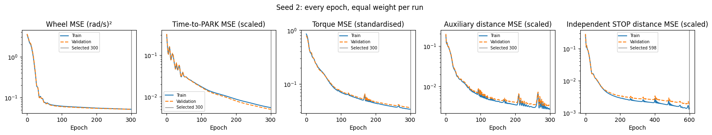


#### Iteration 36: parking and reaching outcomes

All 100 outcomes are counted. Parking error is measured at the model and expert PARK events. Reaching is scored at the exact STOP step; closest approach is reported separately.


```python
test_report.outcomes(2); plt.show()

```


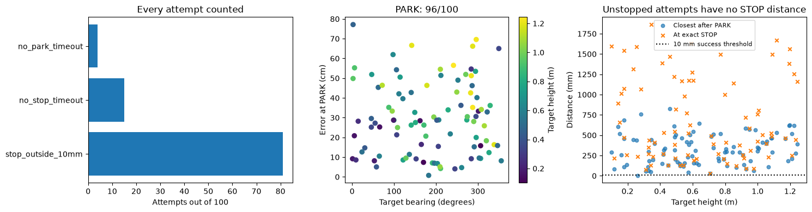


#### Iteration 36: stopping and drift

These plots distinguish reaching the dot, issuing STOP in the right place, and subsequent movement. The camera visibility fraction comes from the recorded detector. Missing event measurements are left blank, while their attempts remain failures in the overall score.


```python
test_report.stopping(2); plt.show()

```


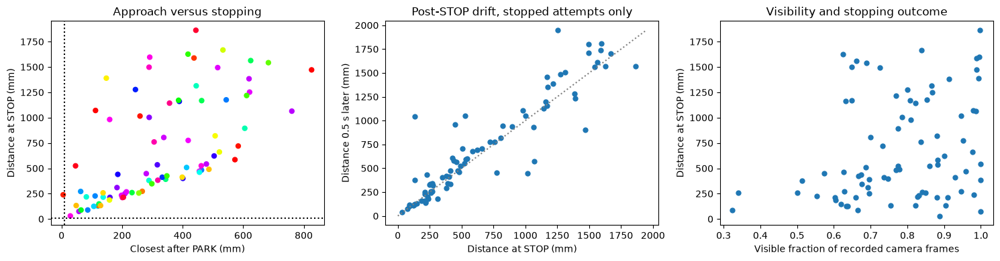


#### Iteration 36: predicted and actual distance over time

The first ten target IDs in the fixed test manifest are shown for readable traces, selected independently of outcomes. The table and player include all 100 targets. Actual distances are used for evaluation only; they are not network inputs.


```python
test_report.distances(2); plt.show()

```


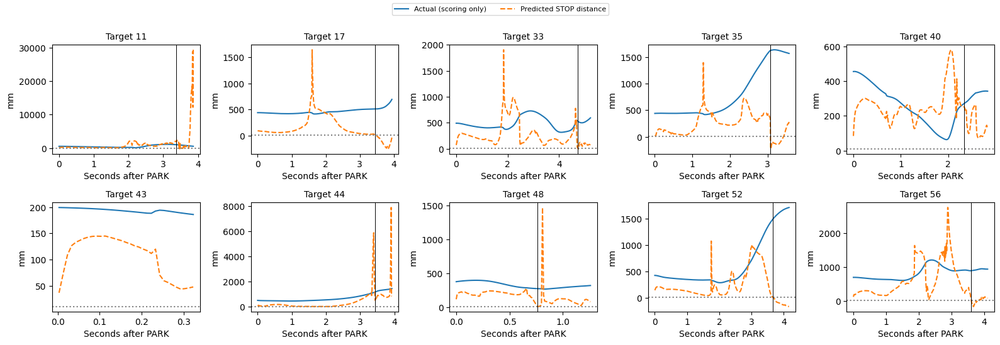


#### Iteration 36: all test replays

Select any of the 100 recorded test targets. The solid robot follows the learned policy; the ghost follows the recorded expert. The upper-right camera inset shows actual recorded images. Play, pause, restart and the time slider control playback. Camera images load as needed to limit browser memory.


```python
player_path = test_report.build_viewer(2)
player_url = test_report.preview_server() + '/' + player_path.name
display(lazy_player(player_url))
display(HTML(f'<a href="{player_url}" target="_blank">Open all 100 test replays in a separate tab</a>'))

```


<div><button onclick="var f=document.getElementById('player9361c13a');f.src='https://nm-linmint-mlflow.taile381c0.ts.net:8443/golden-replays/viewer_golden_seed2.html';f.style.display='block';this.style.display='none'"
 style="padding:8px 14px;font-size:14px">Load the 3D player</button>
<iframe id="player9361c13a" style="display:none;width:100%;height:810px;border:0"></iframe></div>


<a href="https://nm-linmint-mlflow.taile381c0.ts.net:8443/golden-replays/viewer_golden_seed2.html" target="_blank">Open all 100 test replays in a separate tab</a>


#### Iteration 36: reading the result


```python
display(Markdown(test_report.reading(2)))

```


Seed 2: 96/100 PARK, 81/100 STOP and 0/100 successful stops within 10 mm (Wilson 95% interval 0.0–3.7%). 1/100 came within 10 mm during reaching; passing through is not a successful stop. Median parking error was 28.6 cm among parked attempts; median distance at STOP was 490.3 mm among stopped attempts. 19 attempts timed out and 0 had execution/termination failures. These conditional medians exclude attempts without the relevant event; the success rate keeps all 100. This is a frozen baseline result, not a basis for selecting checkpoints. Representative seed 7 remains the validation-selected seed.


## Interpretation and next work

This completes the frozen baseline evaluation. Differences between seeds measure the variation from training on the same data. Future planned changes should be selected using training/validation, then evaluated on these same fixed test IDs. Test outcomes do not select a checkpoint or change a deadline.

The historical `driving_v2_sensors.ipynb` remains unchanged at 361 cells. Validation smoke checks are not official MLflow runs; iterations 34 to 36 contain the full tests and original training histories.


## Development iteration: camera height for driving

### Plan and expected results

Add one sensor input: tracked target height relative to the robot, in metres. Driving changes from 16 -> 16 -> 16 to 17 -> 16 -> 16, with the same four wheel-speed outputs and time-to-PARK head. All wheel-angle and speed inputs stay. Height comes from the existing camera/tracker, zero before first detection and held when temporarily hidden. There is no search rule or simulator-truth input.

Train only driving, from scratch with seed 7, on all 100 golden training runs; choose the checkpoint on all 100 validation runs. Keep FP32, Adam learning rate 0.01, 300 epochs, equal run weighting, existing angle scaling, wheel MSE and time-to-PARK MSE unchanged. Height stays in metres. The existing seed-7 reaching checkpoint is retained byte for byte.

Compare baseline and height models on the same six validation targets, selected before training by low/middle/high target height crossed with nearer/farther range. All are visible initially, so this checks approach and parking rather than unseen-target behaviour. Every episode starts normally and runs both learned networks through reaching. Full camera rendering, 30 Hz driving/camera, 1 kHz torque/physics and existing deadlines are unchanged. No camera videos or reserved-test evaluation are generated.

Prediction: lower median parking error, especially for low/high targets whose expert parking distance changes with height. Equal or worse paired parking error does not support improvement on this screen. Report every case, PARK/STOP counts, heading, closest reach and distance at STOP; six targets and one seed do not establish generalisation.

Frozen validation cases: 673, 506, 830, 720, 16, 333. Selection uses target metadata and initial visibility, never model outcomes. This is a development comparison, not an official test iteration or MLflow run.


### Camera-height experiment: saved configuration and checks


```python
H = Path('../arm/results/driving_height17')
height_config = json.loads((H/'config.json').read_text())
height_training = json.loads((H/'models/summary.json').read_text())
height_checks = json.loads((H/'checks.json').read_text())
assert height_checks['arm_checkpoint_unchanged'] and height_checks['old_input_scaling_unchanged']
display(pd.DataFrame(height_config['cases']).rename(columns={'dot':'validation_target'}))
print('Driving: 17 -> 16 -> 16; seed 7; selected epoch', height_training['driving']['selected_epoch'])
print('Reaching: existing seed-7 checkpoint unchanged. No test trajectories opened.')
print('Training including loading: %.2f s; optimiser/export stage: %.2f s' % (height_training['elapsed_s'], height_training['driving']['elapsed_s']))
print('Twelve full simulations: %.2f s' % json.loads((H/'results/completion.json').read_text())['elapsed_s'])
print('Checks:', height_checks['height_input_check'])
print('Baseline replay:', height_checks['baseline_dot506_parity'])
```


<div>
<style scoped>
    .dataframe tbody tr th:only-of-type {
        vertical-align: middle;
    }

    .dataframe tbody tr th {
        vertical-align: top;
    }

    .dataframe thead th {
        text-align: right;
    }
</style>
<table border="1" class="dataframe">
  <thead>
    <tr style="text-align: right;">
      <th></th>
      <th>validation_target</th>
      <th>range_m</th>
      <th>height_m</th>
      <th>initially_visible</th>
    </tr>
  </thead>
  <tbody>
    <tr>
      <th>0</th>
      <td>673</td>
      <td>1.274653</td>
      <td>0.234875</td>
      <td>True</td>
    </tr>
    <tr>
      <th>1</th>
      <td>506</td>
      <td>1.787443</td>
      <td>0.257822</td>
      <td>True</td>
    </tr>
    <tr>
      <th>2</th>
      <td>830</td>
      <td>1.352278</td>
      <td>0.896056</td>
      <td>True</td>
    </tr>
    <tr>
      <th>3</th>
      <td>720</td>
      <td>1.734537</td>
      <td>0.791538</td>
      <td>True</td>
    </tr>
    <tr>
      <th>4</th>
      <td>16</td>
      <td>1.148734</td>
      <td>1.127223</td>
      <td>True</td>
    </tr>
    <tr>
      <th>5</th>
      <td>333</td>
      <td>1.551641</td>
      <td>1.211776</td>
      <td>True</td>
    </tr>
  </tbody>
</table>
</div>


    Driving: 17 -> 16 -> 16; seed 7; selected epoch 300
    Reaching: existing seed-7 checkpoint unchanged. No test trajectories opened.
    Training including loading: 14.05 s; optimiser/export stage: 1.89 s
    Twelve full simulations: 43.67 s
    Checks: legacy input parity; causal zero before sighting; tracked height retained when hidden
    Baseline replay: exact PARK/STOP times, parking error, closest approach and STOP error match previous validation recording


### Training and validation loss: unchanged objectives


```python
fig, axes = plt.subplots(1, 2, figsize=(12, 3.5))
for label, directory, colour in [('Baseline', MODELS, 'tab:blue'), ('Camera height', H/'models', 'tab:orange')]:
    history = pd.DataFrame(json.loads((directory/'driving_seed7_history.json').read_text()))
    for axis, field, title in zip(axes, ['command', 'aux'], ['Wheel-command MSE', 'Time-to-PARK MSE (normalised by 3 s)']):
        axis.plot(history.epoch, history['train_'+field], color=colour, label=label+' training')
        axis.plot(history.epoch, history['val_'+field], color=colour, linestyle='--', label=label+' validation')
        axis.set(xlabel='Epoch', ylabel='Equal-run MSE', title=title, yscale='log')
        axis.grid(alpha=.2)
axes[0].legend(fontsize=8)
fig.tight_layout(); plt.show()
```


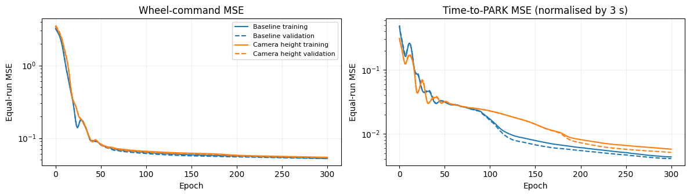


### Paired results: complete driving and reaching episodes


```python
height_rows = json.loads((H/'results/summary.json').read_text())
height_results = pd.DataFrame([dict(variant=r['variant'], dot=r['dot'], parked=r['parked'],
    park_cm=100*r['park_error_vs_expert_m'] if r['parked'] else np.nan,
    heading_deg=abs(np.degrees(r['park_heading_error_rad'])) if r['park_heading_error_rad'] is not None else np.nan,
    park_s=r['park_s'], stopped=r['stop_s'] is not None, closest_mm=r['min_mm'],
    at_stop_mm=r['at_network_stop_mm'], drift_mm=r['post_stop_drift_mm'], success=r['success']) for r in height_rows])
assert len(height_results)==12 and height_results.groupby('variant').size().eq(6).all()
height_pair = height_results.pivot(index='dot', columns='variant', values=['park_cm', 'heading_deg', 'closest_mm', 'at_stop_mm'])
display(height_pair.round(1))
height_score = height_results.groupby('variant').agg(attempts=('dot','size'), PARK=('parked','sum'), STOP=('stopped','sum'),
    median_park_cm=('park_cm','median'), median_heading_deg=('heading_deg','median'),
    median_closest_mm=('closest_mm','median'), median_at_STOP_mm=('at_stop_mm','median'), success_10mm=('success','sum'))
display(height_score.round(2))
```


<div>
<style scoped>
    .dataframe tbody tr th:only-of-type {
        vertical-align: middle;
    }

    .dataframe tbody tr th {
        vertical-align: top;
    }

    .dataframe thead tr th {
        text-align: left;
    }

    .dataframe thead tr:last-of-type th {
        text-align: right;
    }
</style>
<table border="1" class="dataframe">
  <thead>
    <tr>
      <th></th>
      <th colspan="2" halign="left">park_cm</th>
      <th colspan="2" halign="left">heading_deg</th>
      <th colspan="2" halign="left">closest_mm</th>
      <th colspan="2" halign="left">at_stop_mm</th>
    </tr>
    <tr>
      <th>variant</th>
      <th>baseline</th>
      <th>height</th>
      <th>baseline</th>
      <th>height</th>
      <th>baseline</th>
      <th>height</th>
      <th>baseline</th>
      <th>height</th>
    </tr>
    <tr>
      <th>dot</th>
      <th></th>
      <th></th>
      <th></th>
      <th></th>
      <th></th>
      <th></th>
      <th></th>
      <th></th>
    </tr>
  </thead>
  <tbody>
    <tr>
      <th>16</th>
      <td>21.0</td>
      <td>15.9</td>
      <td>11.5</td>
      <td>11.6</td>
      <td>289.9</td>
      <td>337.7</td>
      <td>317.1</td>
      <td>486.1</td>
    </tr>
    <tr>
      <th>333</th>
      <td>56.2</td>
      <td>60.0</td>
      <td>2.7</td>
      <td>8.6</td>
      <td>576.7</td>
      <td>577.9</td>
      <td>578.3</td>
      <td>619.6</td>
    </tr>
    <tr>
      <th>506</th>
      <td>42.3</td>
      <td>49.4</td>
      <td>0.5</td>
      <td>0.9</td>
      <td>577.7</td>
      <td>652.0</td>
      <td>662.5</td>
      <td>752.8</td>
    </tr>
    <tr>
      <th>673</th>
      <td>14.1</td>
      <td>12.1</td>
      <td>13.5</td>
      <td>14.3</td>
      <td>100.3</td>
      <td>519.9</td>
      <td>259.4</td>
      <td>793.2</td>
    </tr>
    <tr>
      <th>720</th>
      <td>61.0</td>
      <td>30.7</td>
      <td>2.7</td>
      <td>0.9</td>
      <td>596.9</td>
      <td>299.2</td>
      <td>623.5</td>
      <td>314.4</td>
    </tr>
    <tr>
      <th>830</th>
      <td>29.8</td>
      <td>14.2</td>
      <td>16.1</td>
      <td>18.6</td>
      <td>300.7</td>
      <td>249.4</td>
      <td>339.9</td>
      <td>279.7</td>
    </tr>
  </tbody>
</table>
</div>


<div>
<style scoped>
    .dataframe tbody tr th:only-of-type {
        vertical-align: middle;
    }

    .dataframe tbody tr th {
        vertical-align: top;
    }

    .dataframe thead th {
        text-align: right;
    }
</style>
<table border="1" class="dataframe">
  <thead>
    <tr style="text-align: right;">
      <th></th>
      <th>attempts</th>
      <th>PARK</th>
      <th>STOP</th>
      <th>median_park_cm</th>
      <th>median_heading_deg</th>
      <th>median_closest_mm</th>
      <th>median_at_STOP_mm</th>
      <th>success_10mm</th>
    </tr>
    <tr>
      <th>variant</th>
      <th></th>
      <th></th>
      <th></th>
      <th></th>
      <th></th>
      <th></th>
      <th></th>
      <th></th>
    </tr>
  </thead>
  <tbody>
    <tr>
      <th>baseline</th>
      <td>6</td>
      <td>6</td>
      <td>6</td>
      <td>36.04</td>
      <td>7.10</td>
      <td>438.71</td>
      <td>459.08</td>
      <td>0</td>
    </tr>
    <tr>
      <th>height</th>
      <td>6</td>
      <td>6</td>
      <td>6</td>
      <td>23.31</td>
      <td>10.06</td>
      <td>428.82</td>
      <td>552.86</td>
      <td>0</td>
    </tr>
  </tbody>
</table>
</div>


### Where height helped and where it did not


```python
fig, axes = plt.subplots(1, 2, figsize=(12, 3.8))
ids = height_config['validation_cases']; locations = np.arange(len(ids))
for offset, variant, colour in [(-.18,'baseline','tab:blue'),(.18,'height','tab:orange')]:
    data = height_results[height_results.variant==variant].set_index('dot').loc[ids]
    axes[0].bar(locations+offset, data.park_cm, width=.36, label=variant, color=colour)
    axes[1].bar(locations+offset, data.closest_mm, width=.36, label=variant, color=colour)
for ax in axes:
    ax.set_xticks(locations, ids); ax.set_xlabel('Fixed validation target'); ax.legend(); ax.grid(axis='y',alpha=.2)
axes[0].set(title='Parking error versus expert', ylabel='cm')
axes[1].set(title='Closest gripper approach after PARK', ylabel='mm')
fig.tight_layout(); plt.show()
```


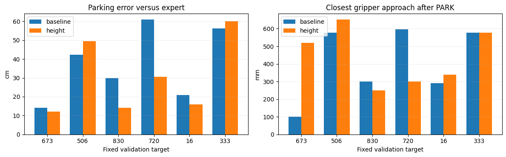


### Reading the result


```python
better = int((height_pair['park_cm']['height'] < height_pair['park_cm']['baseline']).sum())
before, after = height_score.loc['baseline'], height_score.loc['height']
display(Markdown(f"""Adding camera height improved parking on **{better}/6** validation targets. Median parking error fell from **{before.median_park_cm:.1f} cm to {after.median_park_cm:.1f} cm**, a {100*(1-after.median_park_cm/before.median_park_cm):.1f}% reduction. Both versions issued PARK and STOP in all six episodes.

The whole task remains unstable. Median closest gripper distance changed from **{before.median_closest_mm:.1f} mm to {after.median_closest_mm:.1f} mm**, while median distance at STOP worsened from **{before.median_at_STOP_mm:.1f} mm to {after.median_at_STOP_mm:.1f} mm**. Neither version succeeded within 10 mm. The reaching weights are identical, but they receive different parked states and subsequent sensor inputs.

The largest parking gains were on the two middle-height targets, rather than consistently on the high/low targets as predicted. Far low target 506 and far high target 333 became worse. This is partial support for the added input, not a clean explanation of the failure or evidence that the system is stable.

This is one seed and six selected validation targets, all initially visible. No conclusion about unseen-target acquisition or generalisation is justified. The extra input also changes random initialisation under the same seed, so additional seeds would be needed to establish a robust benefit. No changes were made to search behaviour, losses, wheel-speed inputs, physics, sensor rates or reaching weights. The reserved test set was not rerun.

The comparison is a development check without a new official MLflow entry. Original iterations 34–36 and their results remain unchanged."""))
```


Adding camera height improved parking on **4/6** validation targets. Median parking error fell from **36.0 cm to 23.3 cm**, a 35.3% reduction. Both versions issued PARK and STOP in all six episodes.

The whole task remains unstable. Median closest gripper distance changed from **438.7 mm to 428.8 mm**, while median distance at STOP worsened from **459.1 mm to 552.9 mm**. Neither version succeeded within 10 mm. The reaching weights are identical, but they receive different parked states and subsequent sensor inputs.

The largest parking gains were on the two middle-height targets, rather than consistently on the high/low targets as predicted. Far low target 506 and far high target 333 became worse. This is partial support for the added input, not a clean explanation of the failure or evidence that the system is stable.

This is one seed and six selected validation targets, all initially visible. No conclusion about unseen-target acquisition or generalisation is justified. The extra input also changes random initialisation under the same seed, so additional seeds would be needed to establish a robust benefit. No changes were made to search behaviour, losses, wheel-speed inputs, physics, sensor rates or reaching weights. The reserved test set was not rerun.

The comparison is a development check without a new official MLflow entry. Original iterations 34–36 and their results remain unchanged.


## Development iteration: height without wheel-speed inputs

Keep camera-derived height and remove only the six wheel-speed inputs (four individual speeds, mean speed, right-minus-left speed). The driving network becomes 11 -> 16 -> 16 with unchanged wheel-command and time-to-PARK outputs. The tracker still uses wheel encoder speeds. Retain accumulated wheel angles and their two combinations, camera range, bearing sine/cosine, visibility and height.

Train driving from scratch with seed 7 and the same 100 training/100 validation runs, 300 epochs, Adam 0.01, FP32, losses and scaling convention. Keep the reaching checkpoint unchanged. Compare with the saved 17-input height model on the same six initially visible validation targets: 673, 506, 830, 720, 16, 333. Run both complete systems from the normal start through reaching. No search rules, test-set evaluation, new official MLflow entry or camera videos.

Hypothesis: removing the speed shortcut may improve parking even if offline command loss rises. No improvement is assumed; equal/worse parking error would not support the change on this screen. Preserve the previous comparison and append the paired results. One seed and six targets remain a development check.


### No-speed comparison: inputs and execution


```python
from pathlib import Path
import json, hashlib
import numpy as np
import pandas as pd
import matplotlib.pyplot as plt
from IPython.display import display, Markdown
NS = Path('../arm/results/driving_height_no_speed11')
NS_BASE = Path('../arm/results/driving_height17')
ns_config = json.loads((NS/'config.json').read_text())
ns_training = json.loads((NS/'models/summary.json').read_text())
assert ns_config['validation_cases'] == json.loads((NS_BASE/'config.json').read_text())['validation_cases']
assert (NS/'models/reaching_seed7.npz').read_bytes() == (NS_BASE/'models/reaching_seed7.npz').read_bytes()
display(pd.DataFrame(ns_config['cases']))
print('11 inputs: six accumulated-angle features; camera range, sin/cos bearing, visibility, height.')
print('Wheel speeds remain in the tracker. Reaching weights unchanged. Seed 7, 300 epochs, same losses.')
print('Selected epoch:', ns_training['driving']['selected_epoch'])
print('Training including loading: %.2f s; 12 full simulations: %.2f s' % (ns_training['elapsed_s'], json.loads((NS/'results/completion.json').read_text())['elapsed_s']))
```


<div>
<style scoped>
    .dataframe tbody tr th:only-of-type {
        vertical-align: middle;
    }

    .dataframe tbody tr th {
        vertical-align: top;
    }

    .dataframe thead th {
        text-align: right;
    }
</style>
<table border="1" class="dataframe">
  <thead>
    <tr style="text-align: right;">
      <th></th>
      <th>dot</th>
      <th>range_m</th>
      <th>height_m</th>
      <th>initially_visible</th>
    </tr>
  </thead>
  <tbody>
    <tr>
      <th>0</th>
      <td>673</td>
      <td>1.274653</td>
      <td>0.234875</td>
      <td>True</td>
    </tr>
    <tr>
      <th>1</th>
      <td>506</td>
      <td>1.787443</td>
      <td>0.257822</td>
      <td>True</td>
    </tr>
    <tr>
      <th>2</th>
      <td>830</td>
      <td>1.352278</td>
      <td>0.896056</td>
      <td>True</td>
    </tr>
    <tr>
      <th>3</th>
      <td>720</td>
      <td>1.734537</td>
      <td>0.791538</td>
      <td>True</td>
    </tr>
    <tr>
      <th>4</th>
      <td>16</td>
      <td>1.148734</td>
      <td>1.127223</td>
      <td>True</td>
    </tr>
    <tr>
      <th>5</th>
      <td>333</td>
      <td>1.551641</td>
      <td>1.211776</td>
      <td>True</td>
    </tr>
  </tbody>
</table>
</div>


    11 inputs: six accumulated-angle features; camera range, sin/cos bearing, visibility, height.
    Wheel speeds remain in the tracker. Reaching weights unchanged. Seed 7, 300 epochs, same losses.
    Selected epoch: 299
    Training including loading: 11.89 s; 12 full simulations: 45.89 s


### No-speed comparison: losses


```python
fig, axes = plt.subplots(1, 2, figsize=(12, 3.5))
for label, directory, colour in [('Height with speeds', NS_BASE/'models', 'tab:blue'), ('Height without speeds', NS/'models', 'tab:orange')]:
    hist = pd.DataFrame(json.loads((directory/'driving_seed7_history.json').read_text()))
    for ax, field, title in zip(axes, ['command','aux'], ['Wheel-command MSE','Time-to-PARK MSE (normalised by 3 s)']):
        ax.plot(hist.epoch, hist['train_'+field], color=colour, label=label+' training')
        ax.plot(hist.epoch, hist['val_'+field], color=colour, linestyle='--', label=label+' validation')
        ax.set(title=title, xlabel='Epoch', ylabel='Equal-run MSE', yscale='log'); ax.grid(alpha=.2)
axes[0].legend(fontsize=8); fig.tight_layout(); plt.show()
```


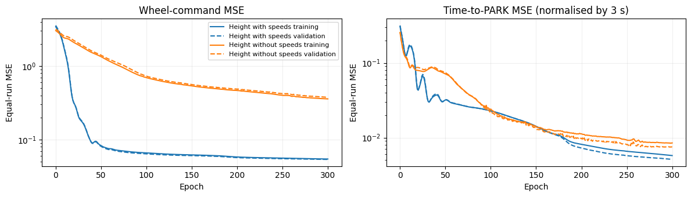


### No-speed comparison: six paired full runs


```python
ns_rows = json.loads((NS/'results/summary.json').read_text())
ns_results = pd.DataFrame([dict(variant=r['variant'], dot=r['dot'], parked=r['parked'],
    park_cm=100*r['park_error_vs_expert_m'] if r['parked'] else np.nan,
    heading_deg=abs(np.degrees(r['park_heading_error_rad'])) if r['park_heading_error_rad'] is not None else np.nan,
    park_s=r['park_s'], stopped=r['stop_s'] is not None, closest_mm=r['min_mm'],
    at_stop_mm=r['at_network_stop_mm'], success=r['success']) for r in ns_rows])
assert len(ns_results)==12 and ns_results.groupby('variant').size().eq(6).all()
ns_pairs=ns_results.pivot(index='dot',columns='variant',values=['park_cm','heading_deg','closest_mm','at_stop_mm'])
display(ns_pairs.round(1))
ns_scores=ns_results.groupby('variant').agg(attempts=('dot','size'),PARK=('parked','sum'),STOP=('stopped','sum'),
    median_park_cm=('park_cm','median'),median_heading_deg=('heading_deg','median'),
    median_closest_mm=('closest_mm','median'),median_at_STOP_mm=('at_stop_mm','median'),success_10mm=('success','sum'))
display(ns_scores.round(2))
```


<div>
<style scoped>
    .dataframe tbody tr th:only-of-type {
        vertical-align: middle;
    }

    .dataframe tbody tr th {
        vertical-align: top;
    }

    .dataframe thead tr th {
        text-align: left;
    }

    .dataframe thead tr:last-of-type th {
        text-align: right;
    }
</style>
<table border="1" class="dataframe">
  <thead>
    <tr>
      <th></th>
      <th colspan="2" halign="left">park_cm</th>
      <th colspan="2" halign="left">heading_deg</th>
      <th colspan="2" halign="left">closest_mm</th>
      <th colspan="2" halign="left">at_stop_mm</th>
    </tr>
    <tr>
      <th>variant</th>
      <th>baseline</th>
      <th>height_no_speed</th>
      <th>baseline</th>
      <th>height_no_speed</th>
      <th>baseline</th>
      <th>height_no_speed</th>
      <th>baseline</th>
      <th>height_no_speed</th>
    </tr>
    <tr>
      <th>dot</th>
      <th></th>
      <th></th>
      <th></th>
      <th></th>
      <th></th>
      <th></th>
      <th></th>
      <th></th>
    </tr>
  </thead>
  <tbody>
    <tr>
      <th>16</th>
      <td>15.9</td>
      <td>8.6</td>
      <td>11.6</td>
      <td>2.8</td>
      <td>337.7</td>
      <td>155.2</td>
      <td>486.1</td>
      <td>180.3</td>
    </tr>
    <tr>
      <th>333</th>
      <td>60.0</td>
      <td>19.3</td>
      <td>8.6</td>
      <td>1.2</td>
      <td>577.9</td>
      <td>213.5</td>
      <td>619.6</td>
      <td>219.3</td>
    </tr>
    <tr>
      <th>506</th>
      <td>49.4</td>
      <td>3.8</td>
      <td>0.9</td>
      <td>3.6</td>
      <td>652.0</td>
      <td>130.4</td>
      <td>752.8</td>
      <td>264.9</td>
    </tr>
    <tr>
      <th>673</th>
      <td>12.1</td>
      <td>3.8</td>
      <td>14.3</td>
      <td>1.4</td>
      <td>519.9</td>
      <td>163.5</td>
      <td>793.2</td>
      <td>280.2</td>
    </tr>
    <tr>
      <th>720</th>
      <td>30.7</td>
      <td>4.1</td>
      <td>0.9</td>
      <td>2.6</td>
      <td>299.2</td>
      <td>24.3</td>
      <td>314.4</td>
      <td>67.2</td>
    </tr>
    <tr>
      <th>830</th>
      <td>14.2</td>
      <td>4.8</td>
      <td>18.6</td>
      <td>1.2</td>
      <td>249.4</td>
      <td>30.2</td>
      <td>279.7</td>
      <td>1134.9</td>
    </tr>
  </tbody>
</table>
</div>


<div>
<style scoped>
    .dataframe tbody tr th:only-of-type {
        vertical-align: middle;
    }

    .dataframe tbody tr th {
        vertical-align: top;
    }

    .dataframe thead th {
        text-align: right;
    }
</style>
<table border="1" class="dataframe">
  <thead>
    <tr style="text-align: right;">
      <th></th>
      <th>attempts</th>
      <th>PARK</th>
      <th>STOP</th>
      <th>median_park_cm</th>
      <th>median_heading_deg</th>
      <th>median_closest_mm</th>
      <th>median_at_STOP_mm</th>
      <th>success_10mm</th>
    </tr>
    <tr>
      <th>variant</th>
      <th></th>
      <th></th>
      <th></th>
      <th></th>
      <th></th>
      <th></th>
      <th></th>
      <th></th>
    </tr>
  </thead>
  <tbody>
    <tr>
      <th>baseline</th>
      <td>6</td>
      <td>6</td>
      <td>6</td>
      <td>23.31</td>
      <td>10.06</td>
      <td>428.82</td>
      <td>552.86</td>
      <td>0</td>
    </tr>
    <tr>
      <th>height_no_speed</th>
      <td>6</td>
      <td>6</td>
      <td>6</td>
      <td>4.41</td>
      <td>2.00</td>
      <td>142.78</td>
      <td>242.11</td>
      <td>0</td>
    </tr>
  </tbody>
</table>
</div>


### No-speed comparison: parking and reaching


```python
fig, axes = plt.subplots(1, 2, figsize=(12, 3.8))
ns_ids=ns_config['validation_cases']; loc=np.arange(len(ns_ids))
for shift, variant, label in [(-.18,'baseline','Height with speeds'),(.18,'height_no_speed','Height without speeds')]:
    d=ns_results[ns_results.variant==variant].set_index('dot').loc[ns_ids]
    axes[0].bar(loc+shift,d.park_cm,width=.36,label=label)
    axes[1].bar(loc+shift,d.closest_mm,width=.36,label=label)
for ax in axes:
    ax.set_xticks(loc,ns_ids);ax.set_xlabel('Fixed validation target');ax.legend(fontsize=8);ax.grid(axis='y',alpha=.2)
axes[0].set(title='Parking error versus expert',ylabel='cm')
axes[1].set(title='Closest gripper approach after PARK',ylabel='mm')
fig.tight_layout();plt.show()
```


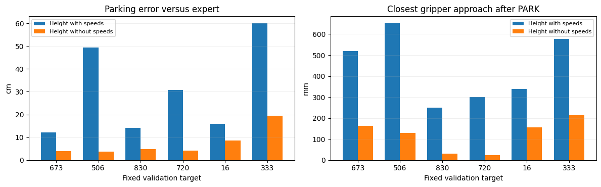


### No-speed comparison: reading the result


```python
ns_b=ns_scores.loc['baseline'];ns_c=ns_scores.loc['height_no_speed']
ns_better=int((ns_pairs['park_cm']['height_no_speed'] < ns_pairs['park_cm']['baseline']).sum())
ns_verdict='improved' if ns_c.median_park_cm < ns_b.median_park_cm else 'worsened'
display(Markdown(f"""Removing the six speed inputs **{ns_verdict} median parking error from {ns_b.median_park_cm:.1f} cm to {ns_c.median_park_cm:.1f} cm**. It improved {ns_better}/6 individual targets. PARK counts: {int(ns_b.PARK)}/6 with speeds and {int(ns_c.PARK)}/6 without. STOP counts: {int(ns_b.STOP)}/6 and {int(ns_c.STOP)}/6 respectively.

Median closest reach changed from **{ns_b.median_closest_mm:.1f} mm to {ns_c.median_closest_mm:.1f} mm**; median distance at STOP changed from **{ns_b.median_at_STOP_mm:.1f} mm to {ns_c.median_at_STOP_mm:.1f} mm**. Success within 10 mm: {int(ns_b.success_10mm)}/6 versus {int(ns_c.success_10mm)}/6. Missing PARK/STOP attempts remain in the counts; conditional medians omit undefined events.

This tests the feature-removal intervention, not a definitive causal diagnosis of speed copying. The architecture width, losses, training schedule and reaching weights are unchanged, but input size changes random initialisation under the same seed. One seed and six initially visible validation targets cannot establish generalisation or behaviour before first detection. No search rules, additional sensors, DART, DAgger or reserved-test evaluation were introduced. Encoder speeds are still used by the tracker.

These are development checks. Previous notebook cells and official iterations remain unchanged; no new official MLflow run was created."""))
```


Removing the six speed inputs **improved median parking error from 23.3 cm to 4.4 cm**. It improved 6/6 individual targets. PARK counts: 6/6 with speeds and 6/6 without. STOP counts: 6/6 and 6/6 respectively.

Median closest reach changed from **428.8 mm to 142.8 mm**; median distance at STOP changed from **552.9 mm to 242.1 mm**. Success within 10 mm: 0/6 versus 0/6. Missing PARK/STOP attempts remain in the counts; conditional medians omit undefined events.

This tests the feature-removal intervention, not a definitive causal diagnosis of speed copying. The architecture width, losses, training schedule and reaching weights are unchanged, but input size changes random initialisation under the same seed. One seed and six initially visible validation targets cannot establish generalisation or behaviour before first detection. No search rules, additional sensors, DART, DAgger or reserved-test evaluation were introduced. Encoder speeds are still used by the tracker.

These are development checks. Previous notebook cells and official iterations remain unchanged; no new official MLflow run was created.
