# golden_dataset: saved notebook reading view

[V2 overview](../README.md) · [Iteration index](../ITERATIONS.md) · [Original notebook](../driving_v2/golden_dataset.ipynb)

Generated from saved outputs without running cells. Code is collapsed. Interactive players remain in the original notebook; plots and tables appear below. Original notebook wording is preserved, including historical hypotheses and status notes.

Source SHA-256: `10c0dcfcfaed37ea56bbf8fb10bdae839fd0e72b2936c210fad5461be529f1a1`

## Contents
- [Iteration 41: Train arm torque control from reset with physical input scales](#cell-233)
- [Iteration 42: Frozen networks: add encoder noise](#cell-242)
- [Iteration 43: Retrain arm networks with standardised inputs](#cell-251)
- [Iteration 44: Frozen networks: encoder noise plus damping](#cell-260)
- [Iteration 45: Frozen networks: add elasticity to noise and damping](#cell-269)
- [Iteration 46: Frozen networks: add motor inertia to noise, damping and elasticity](#cell-278)
- [Iteration 47: Frozen networks: add 3 ms observation delay to the cumulative disturbances](#cell-287)
- [Iteration 48: Frozen networks unchanged: random starts with all five disturbances](#cell-296)
- [Iteration 49: Retrain driving and reaching on random starts; evaluate with all five disturbances](#cell-305)
- [Iteration 50: Frozen random-start-retrained networks: clean retention at original starts](#cell-314)

<a id="cell-233"></a>

### Iteration 41: Train arm torque control from reset with physical input scales

**What changed:** Learn arm torques from reset, including while driving. Removes the expert holding controller. Physical input scales; frozen iteration-40 driving.

**Type:** New training. Seed 7 only; 100 validation and 100 test targets, with both learned networks controlling the complete episode. No conventional arm holding controller or extra gravity compensation is active.

**Result:** test PARK 100/100, STOP 84/100, full success 0/100; validation full success 0/100. Median parking error is 5.47 cm among 100 parked attempts. Median STOP distance is 272.7 mm among 84 stopped attempts. 0 attempts did not PARK; 16 parked without STOP. Neither is silently discarded from success.

**Training provenance:** selected epochs: driving 299, torque 1198, STOP 593. The curves below belong to the actual checkpoint; frozen stress tests reuse their parent training histories and do not represent new training. Driving predicts four wheel speeds and time to PARK (trigger 0.25 s). The arm predicts seven torques; its STOP network predicts distance (trigger 10 mm). Command losses are MSE, with separate auxiliary MSE terms; run weights are equal. Saved configuration and histories give scaling and exact coefficients.

**Limits:** these test targets have been viewed in earlier experiments. This is a reused-test comparison, not an untouched final estimate. One seed cannot establish seed robustness. Success requires PARK, STOP and distance at STOP ≤10 mm. Closest approach and later drift are diagnostics, not substitutes for that criterion. The complete per-target table, pre-PARK arm analysis, all loss terms, STOP/drift plots and 100-replay player follow below.


<a id="cell-234"></a>

<details><summary>Code · original cell 234</summary>

```python
from pathlib import Path
import sys,json,uuid
import matplotlib.pyplot as plt
from IPython.display import display,Markdown,HTML
sys.path.insert(0,str(Path('../arm').resolve()))
import report_curriculum as overnight
def lazy_player(url,height=850):
    k=uuid.uuid4().hex[:8]
    return HTML(f"<div><button onclick=\"var f=document.getElementById('player{k}');f.src='{url}';f.style.display='block';this.style.display='none'\" style=\"padding:8px 14px\">Load the 3D player</button><iframe id=\"player{k}\" style=\"display:none;width:100%;height:{height}px;border:0\"></iframe></div>")

full_name='baseline'
display(overnight.build(full_name).round(3))
print('Validation and test are distinct. No fitting occurs in these analysis cells.')
```

</details>

<div>

<table border="1" class="dataframe">
  <thead>
    <tr style="text-align: right;">
      <th></th>
      <th>seed</th>
      <th>attempts</th>
      <th>parked</th>
      <th>stopped</th>
      <th>success_10mm</th>
      <th>success_percent</th>
      <th>wilson95_low_percent</th>
      <th>wilson95_high_percent</th>
      <th>median_park_error_cm</th>
      <th>median_abs_heading_error_deg</th>
      <th>median_closest_mm</th>
      <th>median_stop_mm</th>
      <th>median_park_s</th>
      <th>median_stop_s</th>
      <th>timeouts</th>
      <th>execution_failures</th>
      <th>sum_case_wall_s</th>
      <th>median_case_wall_s</th>
    </tr>
    <tr>
      <th>split</th>
      <th></th>
      <th></th>
      <th></th>
      <th></th>
      <th></th>
      <th></th>
      <th></th>
      <th></th>
      <th></th>
      <th></th>
      <th></th>
      <th></th>
      <th></th>
      <th></th>
      <th></th>
      <th></th>
      <th></th>
      <th></th>
    </tr>
  </thead>
  <tbody>
    <tr>
      <th>val</th>
      <td>7</td>
      <td>100</td>
      <td>100</td>
      <td>90</td>
      <td>0</td>
      <td>0.0</td>
      <td>0.0</td>
      <td>3.699</td>
      <td>5.540</td>
      <td>3.480</td>
      <td>210.965</td>
      <td>363.322</td>
      <td>7.767</td>
      <td>10.359</td>
      <td>10</td>
      <td>0</td>
      <td>2014.635</td>
      <td>20.845</td>
    </tr>
    <tr>
      <th>test</th>
      <td>7</td>
      <td>100</td>
      <td>100</td>
      <td>84</td>
      <td>0</td>
      <td>0.0</td>
      <td>0.0</td>
      <td>3.699</td>
      <td>5.466</td>
      <td>2.883</td>
      <td>184.482</td>
      <td>272.659</td>
      <td>7.267</td>
      <td>9.518</td>
      <td>16</td>
      <td>0</td>
      <td>2642.071</td>
      <td>27.080</td>
    </tr>
  </tbody>
</table>
</div>

```text
Validation and test are distinct. No fitting occurs in these analysis cells.

```


<a id="cell-235"></a>

<details><summary>Code · original cell 235</summary>

```python
full_config=json.loads((overnight.ROOT/full_name/'test/config.json').read_text())
display(full_config)
for kind in ('driving','torque','stop'):
    chosen=json.loads((overnight.models(full_name)/f'{kind}_seed7_summary.json').read_text())
    print(kind, 'selected epoch',chosen['selected_epoch'],'validation loss',chosen['selected_val_loss'])
```

</details>

```text
{'cases': [11,
  17,
  33,
  35,
  40,
  43,
  44,
  48,
  52,
  56,
  65,
  83,
  92,
  97,
  98,
  113,
  136,
  147,
  148,
  154,
  162,
  196,
  221,
  229,
  232,
  239,
  248,
  260,
  271,
  274,
  277,
  281,
  285,
  302,
  306,
  311,
  315,
  316,
  317,
  361,
  413,
  427,
  432,
  463,
  478,
  479,
  492,
  502,
  534,
  545,
  554,
  571,
  585,
  586,
  592,
  599,
  600,
  605,
  628,
  632,
  642,
  646,
  652,
  653,
  664,
  669,
  671,
  683,
  693,
  700,
  707,
  708,
  722,
  729,
  730,
  738,
  741,
  750,
  770,
  779,
  806,
  834,
  845,
  846,
  848,
  854,
  857,
  859,
  872,
  883,
  898,
  903,
  905,
  945,
  952,
  958,
  981,
  985,
  986,
  989],
 'split': 'test',
 'seed': 7,
 'jobs': 4,
 'models': '/media/nm/Fast Drive/comp0245-golden11109/overnight_20261105/baseline/models',
 'model_hashes': {'driving_seed7.npz': '458fc825c3d3c1e5d39d3630655eb872bb46f3ddc34e0a850ee4eb5da52a18c3',
  'reaching_seed7.npz': '774c961608ec707c4ec9124ea13a66c180dd06be777481c0434a3a6f152287da'},
 'native_hashes': {'/media/nm/Fast Drive/comp0245-golden11109/overnight_20261105/baseline/native/sensor_curriculum.cpp': '83db0e5b77ea5d9d8db71b72938c073603d4508d78328988c1404bd0825ae750',
  '/media/nm/Fast Drive/comp0245-golden11109/overnight_20261105/baseline/native/sensor_curriculum': '4fcac465ea0f2a92596a8b73a2dfa1b2f5a2183215f8c91412407f095f92cd35'},
 'source_hashes': {'full_run.py': '5663298c5a42fb8358fd3d33876239a1061a5a2aafd127fac045595af5381f14',
  'evaluate_curriculum.py': '695615a63867d151e6e7db73f2e5d003db850955e0f25f5b2abfa0dc0ff24817'},
 'split_sha256': '286f578aec7e3ab0953592466e63014cc1dde7f467106fadf273b30762ac1abf',
 'renderer': 'egl',
 'arm_control': 'learned from reset, 1 kHz, no PD hold or gravity addition',
 'selection': 'checkpoints frozen on offline validation; no fitting in evaluator',
 'test_reuse': 'existing targets previously evaluated; not a fresh blind test'}
```

```text
driving selected epoch 299 validation loss 0.38417819142341614
torque selected epoch 1198 validation loss 0.02170979417860508
stop selected epoch 593 validation loss 0.0030433654319494963

```


<a id="cell-236"></a>

<details><summary>Code · original cell 236</summary>

```python
overnight.losses(full_name);plt.show()
print('All training and validation epochs. Test scores are not training losses.')
```

</details>

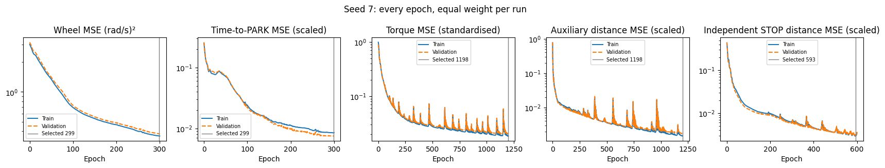

```text
All training and validation epochs. Test scores are not training losses.

```


<a id="cell-237"></a>

<details><summary>Code · original cell 237</summary>

```python
full_report=overnight.select(full_name)
full_report.outcomes(7);plt.show()
display(full_report.table(7).round(3))
```

</details>

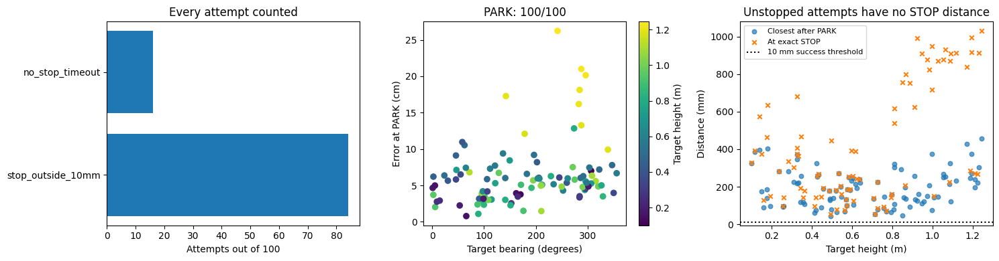

<div>

<table border="1" class="dataframe">
  <thead>
    <tr style="text-align: right;">
      <th></th>
      <th>status</th>
      <th>success</th>
      <th>parked</th>
      <th>park_s</th>
      <th>stop_s</th>
      <th>park_error_cm</th>
      <th>park_heading_error_deg</th>
      <th>at_stop_mm</th>
      <th>closest_mm</th>
      <th>end_mm</th>
      <th>post_stop_drift_mm</th>
      <th>post_park_base_drift_cm</th>
      <th>timed_out</th>
      <th>elapsed_s</th>
      <th>camera_visible_fraction</th>
      <th>target_bearing_deg</th>
      <th>target_range_m</th>
      <th>target_height_m</th>
    </tr>
    <tr>
      <th>dot</th>
      <th></th>
      <th></th>
      <th></th>
      <th></th>
      <th></th>
      <th></th>
      <th></th>
      <th></th>
      <th></th>
      <th></th>
      <th></th>
      <th></th>
      <th></th>
      <th></th>
      <th></th>
      <th></th>
      <th></th>
      <th></th>
    </tr>
  </thead>
  <tbody>
    <tr>
      <th>11</th>
      <td>stop_outside_10mm</td>
      <td>False</td>
      <td>True</td>
      <td>2.367</td>
      <td>9.390</td>
      <td>4.659</td>
      <td>5.756</td>
      <td>462.869</td>
      <td>140.451</td>
      <td>175.516</td>
      <td>-287.353</td>
      <td>2.609</td>
      <td>False</td>
      <td>18.002</td>
      <td>1.000</td>
      <td>0.986</td>
      <td>1.042</td>
      <td>0.178</td>
    </tr>
    <tr>
      <th>17</th>
      <td>stop_outside_10mm</td>
      <td>False</td>
      <td>True</td>
      <td>7.200</td>
      <td>10.257</td>
      <td>5.697</td>
      <td>-1.310</td>
      <td>871.741</td>
      <td>144.980</td>
      <td>933.348</td>
      <td>61.607</td>
      <td>0.800</td>
      <td>False</td>
      <td>20.128</td>
      <td>0.563</td>
      <td>194.926</td>
      <td>1.095</td>
      <td>1.028</td>
    </tr>
    <tr>
      <th>33</th>
      <td>no_stop_timeout</td>
      <td>False</td>
      <td>True</td>
      <td>7.933</td>
      <td>NaN</td>
      <td>5.371</td>
      <td>-2.922</td>
      <td>NaN</td>
      <td>326.069</td>
      <td>526.569</td>
      <td>NaN</td>
      <td>1.178</td>
      <td>True</td>
      <td>23.295</td>
      <td>0.844</td>
      <td>259.736</td>
      <td>1.504</td>
      <td>0.422</td>
    </tr>
    <tr>
      <th>35</th>
      <td>stop_outside_10mm</td>
      <td>False</td>
      <td>True</td>
      <td>9.000</td>
      <td>9.513</td>
      <td>7.301</td>
      <td>-5.080</td>
      <td>184.191</td>
      <td>183.045</td>
      <td>365.099</td>
      <td>180.908</td>
      <td>0.274</td>
      <td>False</td>
      <td>18.682</td>
      <td>0.412</td>
      <td>111.687</td>
      <td>1.257</td>
      <td>0.589</td>
    </tr>
    <tr>
      <th>40</th>
      <td>stop_outside_10mm</td>
      <td>False</td>
      <td>True</td>
      <td>6.667</td>
      <td>9.522</td>
      <td>6.046</td>
      <td>-3.826</td>
      <td>408.490</td>
      <td>219.166</td>
      <td>490.918</td>
      <td>82.428</td>
      <td>0.870</td>
      <td>False</td>
      <td>18.827</td>
      <td>0.522</td>
      <td>205.751</td>
      <td>1.041</td>
      <td>0.328</td>
    </tr>
    <tr>
      <th>...</th>
      <td>...</td>
      <td>...</td>
      <td>...</td>
      <td>...</td>
      <td>...</td>
      <td>...</td>
      <td>...</td>
      <td>...</td>
      <td>...</td>
      <td>...</td>
      <td>...</td>
      <td>...</td>
      <td>...</td>
      <td>...</td>
      <td>...</td>
      <td>...</td>
      <td>...</td>
      <td>...</td>
    </tr>
    <tr>
      <th>958</th>
      <td>stop_outside_10mm</td>
      <td>False</td>
      <td>True</td>
      <td>3.100</td>
      <td>5.734</td>
      <td>7.790</td>
      <td>-0.700</td>
      <td>55.732</td>
      <td>43.749</td>
      <td>51.406</td>
      <td>-4.326</td>
      <td>0.801</td>
      <td>False</td>
      <td>18.572</td>
      <td>0.957</td>
      <td>347.116</td>
      <td>1.181</td>
      <td>0.493</td>
    </tr>
    <tr>
      <th>981</th>
      <td>stop_outside_10mm</td>
      <td>False</td>
      <td>True</td>
      <td>5.767</td>
      <td>6.857</td>
      <td>5.376</td>
      <td>-1.345</td>
      <td>75.236</td>
      <td>67.657</td>
      <td>67.649</td>
      <td>-7.588</td>
      <td>0.372</td>
      <td>False</td>
      <td>20.523</td>
      <td>0.787</td>
      <td>297.945</td>
      <td>1.569</td>
      <td>0.564</td>
    </tr>
    <tr>
      <th>985</th>
      <td>stop_outside_10mm</td>
      <td>False</td>
      <td>True</td>
      <td>5.900</td>
      <td>8.304</td>
      <td>18.121</td>
      <td>-0.511</td>
      <td>273.016</td>
      <td>239.508</td>
      <td>350.240</td>
      <td>77.224</td>
      <td>0.717</td>
      <td>False</td>
      <td>23.401</td>
      <td>0.721</td>
      <td>284.446</td>
      <td>1.417</td>
      <td>1.210</td>
    </tr>
    <tr>
      <th>986</th>
      <td>stop_outside_10mm</td>
      <td>False</td>
      <td>True</td>
      <td>9.000</td>
      <td>11.054</td>
      <td>3.168</td>
      <td>-6.653</td>
      <td>634.866</td>
      <td>404.552</td>
      <td>724.094</td>
      <td>89.228</td>
      <td>0.427</td>
      <td>False</td>
      <td>27.199</td>
      <td>0.614</td>
      <td>98.931</td>
      <td>1.279</td>
      <td>0.179</td>
    </tr>
    <tr>
      <th>989</th>
      <td>stop_outside_10mm</td>
      <td>False</td>
      <td>True</td>
      <td>7.333</td>
      <td>11.899</td>
      <td>13.270</td>
      <td>0.793</td>
      <td>916.008</td>
      <td>271.612</td>
      <td>1421.708</td>
      <td>505.700</td>
      <td>1.226</td>
      <td>False</td>
      <td>27.860</td>
      <td>0.987</td>
      <td>287.737</td>
      <td>1.749</td>
      <td>1.193</td>
    </tr>
  </tbody>
</table>
<p>100 rows × 18 columns</p>
</div>


<a id="cell-238"></a>

<details><summary>Code · original cell 238</summary>

```python
overnight.holding(full_name);plt.show()
display(overnight.hold_table(full_name).round(4))
print('Learned torques are applied from reset. No expert holding or added gravity term.')
```

</details>

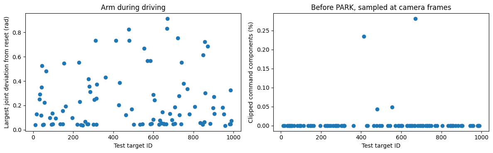

<div>

<table border="1" class="dataframe">
  <thead>
    <tr style="text-align: right;">
      <th></th>
      <th>status</th>
      <th>prepark_frames</th>
      <th>max_arm_deviation_rad</th>
      <th>maximum_command_Nm</th>
      <th>torque_clipped_fraction</th>
    </tr>
    <tr>
      <th>dot</th>
      <th></th>
      <th></th>
      <th></th>
      <th></th>
      <th></th>
    </tr>
  </thead>
  <tbody>
    <tr>
      <th>11</th>
      <td>stop_outside_10mm</td>
      <td>71</td>
      <td>0.0411</td>
      <td>18.9615</td>
      <td>0.0</td>
    </tr>
    <tr>
      <th>17</th>
      <td>stop_outside_10mm</td>
      <td>216</td>
      <td>0.1273</td>
      <td>19.9673</td>
      <td>0.0</td>
    </tr>
    <tr>
      <th>33</th>
      <td>no_stop_timeout</td>
      <td>238</td>
      <td>0.2511</td>
      <td>20.0724</td>
      <td>0.0</td>
    </tr>
    <tr>
      <th>35</th>
      <td>stop_outside_10mm</td>
      <td>270</td>
      <td>0.2909</td>
      <td>19.9673</td>
      <td>0.0</td>
    </tr>
    <tr>
      <th>40</th>
      <td>stop_outside_10mm</td>
      <td>200</td>
      <td>0.1185</td>
      <td>19.9673</td>
      <td>0.0</td>
    </tr>
    <tr>
      <th>...</th>
      <td>...</td>
      <td>...</td>
      <td>...</td>
      <td>...</td>
      <td>...</td>
    </tr>
    <tr>
      <th>958</th>
      <td>stop_outside_10mm</td>
      <td>93</td>
      <td>0.0341</td>
      <td>20.3467</td>
      <td>0.0</td>
    </tr>
    <tr>
      <th>981</th>
      <td>stop_outside_10mm</td>
      <td>173</td>
      <td>0.0467</td>
      <td>20.6663</td>
      <td>0.0</td>
    </tr>
    <tr>
      <th>985</th>
      <td>stop_outside_10mm</td>
      <td>177</td>
      <td>0.0486</td>
      <td>21.1418</td>
      <td>0.0</td>
    </tr>
    <tr>
      <th>986</th>
      <td>stop_outside_10mm</td>
      <td>270</td>
      <td>0.3252</td>
      <td>19.9673</td>
      <td>0.0</td>
    </tr>
    <tr>
      <th>989</th>
      <td>stop_outside_10mm</td>
      <td>220</td>
      <td>0.0759</td>
      <td>21.1890</td>
      <td>0.0</td>
    </tr>
  </tbody>
</table>
<p>100 rows × 5 columns</p>
</div>

```text
Learned torques are applied from reset. No expert holding or added gravity term.

```


<a id="cell-239"></a>

<details><summary>Code · original cell 239</summary>

```python
full_report=overnight.select(full_name)
full_report.stopping(7);plt.show()
full_report.distances(7);plt.show()
print('Closest approach, exact STOP, and 0.5-second drift are different measurements.')
```

</details>

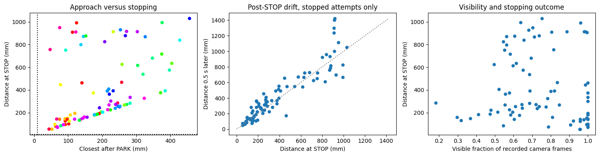

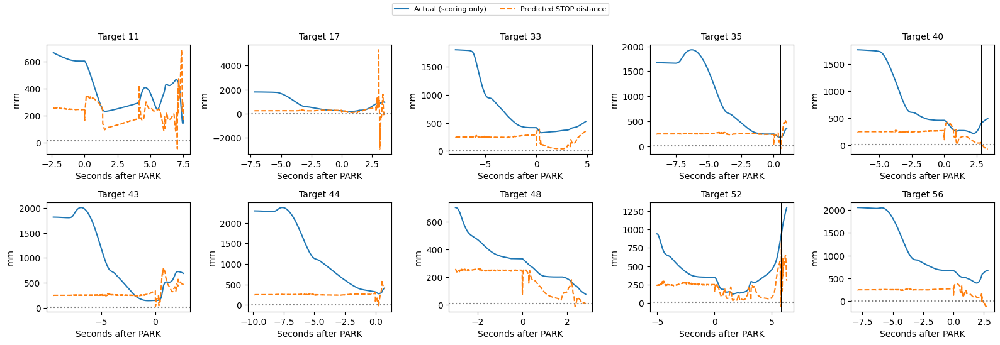

```text
Closest approach, exact STOP, and 0.5-second drift are different measurements.

```


<a id="cell-240"></a>

<details><summary>Code · original cell 240</summary>

```python
full_url=overnight.player_url(full_name)
display(lazy_player(full_url))
display(HTML(f'<a href="{full_url}" target="_blank">Open all 100 test replays</a>'))
print('Wheel encoder speeds, wheel commands, PARK and STOP values, applied arm torques, camera and ghost.')
```

</details>

[Interactive output: open original notebook, cell 240](../driving_v2/golden_dataset.ipynb).

[Interactive output: open original notebook, cell 240](../driving_v2/golden_dataset.ipynb).

```text
Wheel encoder speeds, wheel commands, PARK and STOP values, applied arm torques, camera and ghost.

```


<a id="cell-241"></a>

<details><summary>Code · original cell 241</summary>

```python
display(Markdown(overnight.reading(full_name)))
```

</details>

Both networks controlled the complete run, including learned arm torques before PARK. On validation, 100/100 parked and 0/100 met the full task criterion. On the frozen test comparison, 100/100 parked, 84/100 issued STOP, and 0/100 were within 10 mm at STOP. Median parking error among parked attempts was 5.5 cm; median distance at STOP among stopped attempts was 272.7 mm. Median maximum pre-PARK joint deviation was 0.131 rad. The 0.5 s after STOP is observed with learned torques still active, not a frozen simulation. These are previously viewed test targets and one seed; this is a frozen subsequent comparison, not an untouched estimate of generalisation. All timeouts and failures remain in the denominator.


<a id="cell-242"></a>

### Iteration 42: Frozen networks: add encoder noise

**What changed:** Add Gaussian encoder-angle noise, standard deviation 0.0001 rad, before quantisation and velocity estimation. Networks unchanged.

**Type:** Frozen-model stress test. Seed 7 only; 100 validation and 100 test targets, with both learned networks controlling the complete episode. No conventional arm holding controller or extra gravity compensation is active.

**Result:** test PARK 99/100, STOP 91/100, full success 0/100; validation full success 0/100. Median parking error is 6.17 cm among 99 parked attempts. Median STOP distance is 755.0 mm among 91 stopped attempts. 1 attempts did not PARK; 8 parked without STOP. Neither is silently discarded from success.

**Comparison with iteration 41 (baseline):** PARK count changes by -1; STOP by +7; successes by +0. On the same 99 targets parked by both, the median paired change in parking error is +0.10 cm. On the same 75 targets stopped by both, the median paired change at STOP is +208.2 mm. Negative changes mean smaller errors. These paired subsets exclude failures, so read them alongside the counts, not as overall success rates.

**Training provenance:** selected epochs: driving 299, torque 1198, STOP 593. The curves below belong to the actual checkpoint; frozen stress tests reuse their parent training histories and do not represent new training. Driving predicts four wheel speeds and time to PARK (trigger 0.25 s). The arm predicts seven torques; its STOP network predicts distance (trigger 10 mm). Command losses are MSE, with separate auxiliary MSE terms; run weights are equal. Saved configuration and histories give scaling and exact coefficients.

**Limits:** these test targets have been viewed in earlier experiments. This is a reused-test comparison, not an untouched final estimate. One seed cannot establish seed robustness. Success requires PARK, STOP and distance at STOP ≤10 mm. Closest approach and later drift are diagnostics, not substitutes for that criterion. The complete per-target table, pre-PARK arm analysis, all loss terms, STOP/drift plots and 100-replay player follow below.

**Interpretation:** this measures cumulative sensitivity of the original physical-scale model. It does not isolate the same effect on the standardised model. Differencing noisy angle readings can amplify velocity noise; this is a plausible mechanism, not a demonstrated sole cause.

#### Encoder trace audit

Validation target 6, seed 7 was replayed with the frozen evaluator, models, native binary and EGL renderer. Every retained value matched the original: 269 frames, 897 control-log rows, all event/outcome fields, and all 269 camera PNGs byte for byte. The observer added no random draws and changed no commands. It now records 8,967 arm captures and 269 wheel captures, with exact checks of both random streams, quantisation and consecutive-count velocity calculations.

These are newly recorded samples from a deterministic replay. The original logs retained joint states at 30 Hz, so their missing 1 kHz intermediate states cannot be independently compared. The wheel stream consumes 17 random draws per capture; preserving only four would change the run. Its original fixed 1/30 s velocity denominator is retained despite the alternating 33/34 ms capture intervals.

The course configuration calls the angle setting `joint_cov`, but passes `0.0001` as NumPy's normal-distribution standard deviation, in radians. The course also has separate velocity noise; this experiment instead derives sensor velocity from noisy encoder counts. The source excerpts and hashes are saved beside the trace.

The plots below show true angle (audit only), angle after noise, counted angle, encoder counts and the velocity derived from consecutive counts. Their time window is fixed to the first 200 ms; the histograms use the complete episode. The no-noise velocity comparison uses the same moving joint states, so it isolates the measurement effect without claiming how a separately controlled clean run would move. Arm velocity error has standard deviation 0.139–0.144 rad/s across joints; wheel velocity error is 0.014–0.017 rad/s. This verifies noise amplification in the inputs, but does not establish it as the sole cause of task failure.


<a id="cell-243"></a>

<details><summary>Code · original cell 243</summary>

```python
from pathlib import Path
import sys,json,uuid
import matplotlib.pyplot as plt
from IPython.display import display,Markdown,HTML
sys.path.insert(0,str(Path('../arm').resolve()))
import report_curriculum as overnight
def lazy_player(url,height=850):
    k=uuid.uuid4().hex[:8]
    return HTML(f"<div><button onclick=\"var f=document.getElementById('player{k}');f.src='{url}';f.style.display='block';this.style.display='none'\" style=\"padding:8px 14px\">Load the 3D player</button><iframe id=\"player{k}\" style=\"display:none;width:100%;height:{height}px;border:0\"></iframe></div>")

full_name='encoder_noise'
display(overnight.build(full_name).round(3))
print('Validation and test are distinct. No fitting occurs in these analysis cells.')
```

</details>

<div>

<table border="1" class="dataframe">
  <thead>
    <tr style="text-align: right;">
      <th></th>
      <th>seed</th>
      <th>attempts</th>
      <th>parked</th>
      <th>stopped</th>
      <th>success_10mm</th>
      <th>success_percent</th>
      <th>wilson95_low_percent</th>
      <th>wilson95_high_percent</th>
      <th>median_park_error_cm</th>
      <th>median_abs_heading_error_deg</th>
      <th>median_closest_mm</th>
      <th>median_stop_mm</th>
      <th>median_park_s</th>
      <th>median_stop_s</th>
      <th>timeouts</th>
      <th>execution_failures</th>
      <th>sum_case_wall_s</th>
      <th>median_case_wall_s</th>
    </tr>
    <tr>
      <th>split</th>
      <th></th>
      <th></th>
      <th></th>
      <th></th>
      <th></th>
      <th></th>
      <th></th>
      <th></th>
      <th></th>
      <th></th>
      <th></th>
      <th></th>
      <th></th>
      <th></th>
      <th></th>
      <th></th>
      <th></th>
      <th></th>
    </tr>
  </thead>
  <tbody>
    <tr>
      <th>val</th>
      <td>7</td>
      <td>100</td>
      <td>99</td>
      <td>90</td>
      <td>0</td>
      <td>0.0</td>
      <td>0.0</td>
      <td>3.699</td>
      <td>6.496</td>
      <td>4.762</td>
      <td>585.949</td>
      <td>739.557</td>
      <td>7.767</td>
      <td>7.703</td>
      <td>10</td>
      <td>0</td>
      <td>1989.981</td>
      <td>19.386</td>
    </tr>
    <tr>
      <th>test</th>
      <td>7</td>
      <td>100</td>
      <td>99</td>
      <td>91</td>
      <td>0</td>
      <td>0.0</td>
      <td>0.0</td>
      <td>3.699</td>
      <td>6.168</td>
      <td>3.639</td>
      <td>573.882</td>
      <td>755.035</td>
      <td>7.100</td>
      <td>7.100</td>
      <td>9</td>
      <td>0</td>
      <td>1915.524</td>
      <td>18.842</td>
    </tr>
  </tbody>
</table>
</div>

```text
Validation and test are distinct. No fitting occurs in these analysis cells.

```


<a id="cell-244"></a>

<details><summary>Code · original cell 244</summary>

```python
full_config=json.loads((overnight.ROOT/full_name/'test/config.json').read_text())
display(full_config)
for kind in ('driving','torque','stop'):
    chosen=json.loads((overnight.models(full_name)/f'{kind}_seed7_summary.json').read_text())
    print(kind, 'selected epoch',chosen['selected_epoch'],'validation loss',chosen['selected_val_loss'])

from recover_encoder_trace import plot as plot_encoder_trace
import pandas as pd
trace_dir=overnight.ROOT/'encoder_noise'/'encoder_trace_audit'
trace_summary=json.loads((trace_dir/'summary.json').read_text())
assert trace_summary['replay_output_exact'] and trace_summary['random_streams_exact']
assert trace_summary['count_and_velocity_equations_exact']
display(Markdown('**Recovered encoder trace: validation target 6, seed 7**'))
display(pd.DataFrame([{'sensor':name, 'captures':v['captures'],
    'angle_noise_sd_rad_min':min(v['angle_noise_sd_rad']),
    'angle_noise_sd_rad_max':max(v['angle_noise_sd_rad']),
    'velocity_error_sd_rad_s_min':min(v['velocity_error_sd_rad_s']),
    'velocity_error_sd_rad_s_max':max(v['velocity_error_sd_rad_s'])}
    for name,v in trace_summary['statistics'].items()]).set_index('sensor'))
print(trace_summary['provenance'])
plot_encoder_trace(trace_dir)
plt.show()

```

</details>

```text
{'cases': [11,
  17,
  33,
  35,
  40,
  43,
  44,
  48,
  52,
  56,
  65,
  83,
  92,
  97,
  98,
  113,
  136,
  147,
  148,
  154,
  162,
  196,
  221,
  229,
  232,
  239,
  248,
  260,
  271,
  274,
  277,
  281,
  285,
  302,
  306,
  311,
  315,
  316,
  317,
  361,
  413,
  427,
  432,
  463,
  478,
  479,
  492,
  502,
  534,
  545,
  554,
  571,
  585,
  586,
  592,
  599,
  600,
  605,
  628,
  632,
  642,
  646,
  652,
  653,
  664,
  669,
  671,
  683,
  693,
  700,
  707,
  708,
  722,
  729,
  730,
  738,
  741,
  750,
  770,
  779,
  806,
  834,
  845,
  846,
  848,
  854,
  857,
  859,
  872,
  883,
  898,
  903,
  905,
  945,
  952,
  958,
  981,
  985,
  986,
  989],
 'split': 'test',
 'seed': 7,
 'jobs': 4,
 'models': '/media/nm/Fast Drive/comp0245-golden11109/overnight_20261105/baseline/models',
 'condition': {'encoder_noise_sd': 0.0001, 'sensor_seed': 7},
 'model_hashes': {'driving_seed7.npz': '458fc825c3d3c1e5d39d3630655eb872bb46f3ddc34e0a850ee4eb5da52a18c3',
  'reaching_seed7.npz': '774c961608ec707c4ec9124ea13a66c180dd06be777481c0434a3a6f152287da'},
 'native_hashes': {'/media/nm/Fast Drive/comp0245-golden11109/overnight_20261105/ladder_runtime/native/sensor_curriculum.cpp': '8d4cc91c5a97aa7f31195187896d2d94ad570cffc5c5a30671de5e14aa7bb167',
  '/media/nm/Fast Drive/comp0245-golden11109/overnight_20261105/ladder_runtime/native/sensor_curriculum': '4ae5363bac9b2f93164fb65f6bd81c2811aff8400986ff0a83e474ca1ce0eece'},
 'source_hashes': {'full_run.py': 'c6da49f6cf9e934d24903222036f0d4d42c5a8a2c38de641f8e04612fc43b1e4',
  'evaluate_curriculum.py': '7fa3b64db19e7a39b0cb3a598945fee4695e3a0dce7d037d1eee1e73a85f132c',
  'curriculum_sensors.py': '8117d6a981b4e5dd37dbcf2f4c051e11e6be80dc414dd5beac3c30cbbd523520'},
 'split_sha256': '286f578aec7e3ab0953592466e63014cc1dde7f467106fadf273b30762ac1abf',
 'renderer': 'egl',
 'arm_control': 'learned from reset, 1 kHz, no PD hold or gravity addition',
 'selection': 'checkpoints frozen on offline validation; no fitting in evaluator',
 'test_reuse': 'existing targets previously evaluated; not a fresh blind test'}
```

```text
driving selected epoch 299 validation loss 0.38417819142341614
torque selected epoch 1198 validation loss 0.02170979417860508
stop selected epoch 593 validation loss 0.0030433654319494963

```

**Recovered encoder trace: validation target 6, seed 7**

<div>

<table border="1" class="dataframe">
  <thead>
    <tr style="text-align: right;">
      <th></th>
      <th>captures</th>
      <th>angle_noise_sd_rad_min</th>
      <th>angle_noise_sd_rad_max</th>
      <th>velocity_error_sd_rad_s_min</th>
      <th>velocity_error_sd_rad_s_max</th>
    </tr>
    <tr>
      <th>sensor</th>
      <th></th>
      <th></th>
      <th></th>
      <th></th>
      <th></th>
    </tr>
  </thead>
  <tbody>
    <tr>
      <th>arm</th>
      <td>8967</td>
      <td>0.000099</td>
      <td>0.000101</td>
      <td>0.139148</td>
      <td>0.144329</td>
    </tr>
    <tr>
      <th>wheel</th>
      <td>269</td>
      <td>0.000094</td>
      <td>0.000102</td>
      <td>0.014307</td>
      <td>0.016835</td>
    </tr>
  </tbody>
</table>
</div>

```text
New instrumented deterministic replay; every retained original value and camera PNG matches exactly. Original logs did not save 1 kHz joint states, so those intermediate states cannot be independently compared.

```

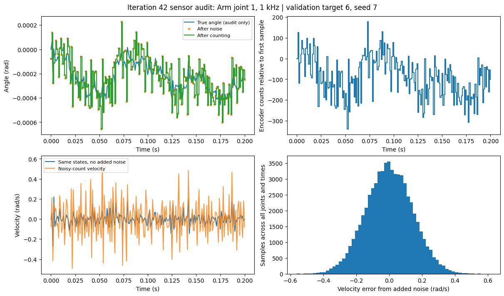

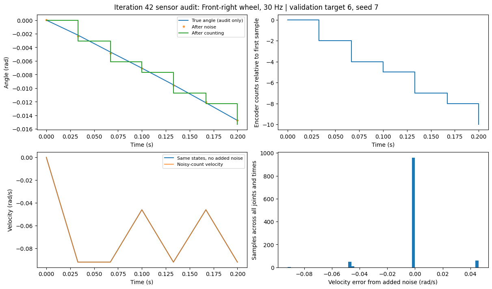


<a id="cell-245"></a>

<details><summary>Code · original cell 245</summary>

```python
overnight.losses(full_name);plt.show()
print('All training and validation epochs. Test scores are not training losses.')
```

</details>


```text
All training and validation epochs. Test scores are not training losses.

```


<a id="cell-246"></a>

<details><summary>Code · original cell 246</summary>

```python
full_report=overnight.select(full_name)
full_report.outcomes(7);plt.show()
display(full_report.table(7).round(3))
```

</details>

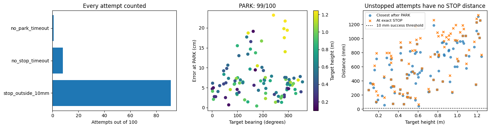

<div>

<table border="1" class="dataframe">
  <thead>
    <tr style="text-align: right;">
      <th></th>
      <th>status</th>
      <th>success</th>
      <th>parked</th>
      <th>park_s</th>
      <th>stop_s</th>
      <th>park_error_cm</th>
      <th>park_heading_error_deg</th>
      <th>at_stop_mm</th>
      <th>closest_mm</th>
      <th>end_mm</th>
      <th>post_stop_drift_mm</th>
      <th>post_park_base_drift_cm</th>
      <th>timed_out</th>
      <th>elapsed_s</th>
      <th>camera_visible_fraction</th>
      <th>target_bearing_deg</th>
      <th>target_range_m</th>
      <th>target_height_m</th>
    </tr>
    <tr>
      <th>dot</th>
      <th></th>
      <th></th>
      <th></th>
      <th></th>
      <th></th>
      <th></th>
      <th></th>
      <th></th>
      <th></th>
      <th></th>
      <th></th>
      <th></th>
      <th></th>
      <th></th>
      <th></th>
      <th></th>
      <th></th>
      <th></th>
    </tr>
  </thead>
  <tbody>
    <tr>
      <th>11</th>
      <td>stop_outside_10mm</td>
      <td>False</td>
      <td>True</td>
      <td>2.367</td>
      <td>8.346</td>
      <td>4.686</td>
      <td>5.708</td>
      <td>251.212</td>
      <td>96.937</td>
      <td>853.220</td>
      <td>602.008</td>
      <td>2.190</td>
      <td>False</td>
      <td>22.022</td>
      <td>0.992</td>
      <td>0.986</td>
      <td>1.042</td>
      <td>0.178</td>
    </tr>
    <tr>
      <th>17</th>
      <td>stop_outside_10mm</td>
      <td>False</td>
      <td>True</td>
      <td>8.033</td>
      <td>8.071</td>
      <td>16.703</td>
      <td>-0.202</td>
      <td>1091.867</td>
      <td>959.113</td>
      <td>959.040</td>
      <td>-132.827</td>
      <td>0.463</td>
      <td>False</td>
      <td>22.381</td>
      <td>0.647</td>
      <td>194.926</td>
      <td>1.095</td>
      <td>1.028</td>
    </tr>
    <tr>
      <th>33</th>
      <td>stop_outside_10mm</td>
      <td>False</td>
      <td>True</td>
      <td>7.800</td>
      <td>7.800</td>
      <td>1.573</td>
      <td>-6.854</td>
      <td>947.720</td>
      <td>791.190</td>
      <td>791.055</td>
      <td>-156.665</td>
      <td>0.394</td>
      <td>False</td>
      <td>22.863</td>
      <td>0.606</td>
      <td>259.736</td>
      <td>1.504</td>
      <td>0.422</td>
    </tr>
    <tr>
      <th>35</th>
      <td>stop_outside_10mm</td>
      <td>False</td>
      <td>True</td>
      <td>8.700</td>
      <td>8.730</td>
      <td>6.950</td>
      <td>-8.431</td>
      <td>920.991</td>
      <td>920.716</td>
      <td>1006.205</td>
      <td>85.214</td>
      <td>2.102</td>
      <td>False</td>
      <td>23.803</td>
      <td>0.502</td>
      <td>111.687</td>
      <td>1.257</td>
      <td>0.589</td>
    </tr>
    <tr>
      <th>40</th>
      <td>stop_outside_10mm</td>
      <td>False</td>
      <td>True</td>
      <td>6.600</td>
      <td>6.602</td>
      <td>7.000</td>
      <td>-9.528</td>
      <td>659.325</td>
      <td>306.387</td>
      <td>365.716</td>
      <td>-293.609</td>
      <td>8.939</td>
      <td>False</td>
      <td>19.859</td>
      <td>0.519</td>
      <td>205.751</td>
      <td>1.041</td>
      <td>0.328</td>
    </tr>
    <tr>
      <th>...</th>
      <td>...</td>
      <td>...</td>
      <td>...</td>
      <td>...</td>
      <td>...</td>
      <td>...</td>
      <td>...</td>
      <td>...</td>
      <td>...</td>
      <td>...</td>
      <td>...</td>
      <td>...</td>
      <td>...</td>
      <td>...</td>
      <td>...</td>
      <td>...</td>
      <td>...</td>
      <td>...</td>
    </tr>
    <tr>
      <th>958</th>
      <td>stop_outside_10mm</td>
      <td>False</td>
      <td>True</td>
      <td>3.067</td>
      <td>3.352</td>
      <td>7.792</td>
      <td>-0.587</td>
      <td>227.279</td>
      <td>222.631</td>
      <td>233.842</td>
      <td>6.564</td>
      <td>0.129</td>
      <td>False</td>
      <td>10.896</td>
      <td>0.957</td>
      <td>347.116</td>
      <td>1.181</td>
      <td>0.493</td>
    </tr>
    <tr>
      <th>981</th>
      <td>stop_outside_10mm</td>
      <td>False</td>
      <td>True</td>
      <td>5.833</td>
      <td>5.833</td>
      <td>6.126</td>
      <td>-1.317</td>
      <td>507.780</td>
      <td>507.780</td>
      <td>602.596</td>
      <td>94.816</td>
      <td>0.207</td>
      <td>False</td>
      <td>15.972</td>
      <td>0.884</td>
      <td>297.945</td>
      <td>1.569</td>
      <td>0.564</td>
    </tr>
    <tr>
      <th>985</th>
      <td>stop_outside_10mm</td>
      <td>False</td>
      <td>True</td>
      <td>6.700</td>
      <td>6.701</td>
      <td>17.530</td>
      <td>-1.062</td>
      <td>1068.990</td>
      <td>1068.871</td>
      <td>1141.826</td>
      <td>72.836</td>
      <td>0.090</td>
      <td>False</td>
      <td>16.745</td>
      <td>0.802</td>
      <td>284.446</td>
      <td>1.417</td>
      <td>1.210</td>
    </tr>
    <tr>
      <th>986</th>
      <td>stop_outside_10mm</td>
      <td>False</td>
      <td>True</td>
      <td>8.667</td>
      <td>8.667</td>
      <td>4.555</td>
      <td>-12.256</td>
      <td>792.843</td>
      <td>713.103</td>
      <td>746.990</td>
      <td>-45.853</td>
      <td>0.295</td>
      <td>False</td>
      <td>18.942</td>
      <td>0.476</td>
      <td>98.931</td>
      <td>1.279</td>
      <td>0.179</td>
    </tr>
    <tr>
      <th>989</th>
      <td>stop_outside_10mm</td>
      <td>False</td>
      <td>True</td>
      <td>7.100</td>
      <td>7.100</td>
      <td>14.014</td>
      <td>0.273</td>
      <td>1229.553</td>
      <td>1229.553</td>
      <td>1356.788</td>
      <td>127.235</td>
      <td>0.131</td>
      <td>False</td>
      <td>17.494</td>
      <td>0.868</td>
      <td>287.737</td>
      <td>1.749</td>
      <td>1.193</td>
    </tr>
  </tbody>
</table>
<p>100 rows × 18 columns</p>
</div>


<a id="cell-247"></a>

<details><summary>Code · original cell 247</summary>

```python
overnight.holding(full_name);plt.show()
display(overnight.hold_table(full_name).round(4))
print('Learned torques are applied from reset. No expert holding or added gravity term.')
```

</details>

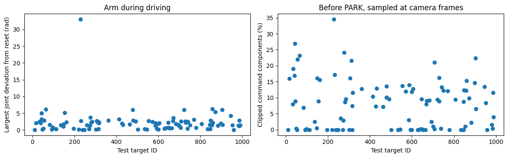

<div>

<table border="1" class="dataframe">
  <thead>
    <tr style="text-align: right;">
      <th></th>
      <th>status</th>
      <th>prepark_frames</th>
      <th>max_arm_deviation_rad</th>
      <th>maximum_command_Nm</th>
      <th>torque_clipped_fraction</th>
    </tr>
    <tr>
      <th>dot</th>
      <th></th>
      <th></th>
      <th></th>
      <th></th>
      <th></th>
    </tr>
  </thead>
  <tbody>
    <tr>
      <th>11</th>
      <td>stop_outside_10mm</td>
      <td>71</td>
      <td>0.1168</td>
      <td>24.2747</td>
      <td>0.0000</td>
    </tr>
    <tr>
      <th>17</th>
      <td>stop_outside_10mm</td>
      <td>241</td>
      <td>2.1164</td>
      <td>30.0000</td>
      <td>0.1600</td>
    </tr>
    <tr>
      <th>33</th>
      <td>stop_outside_10mm</td>
      <td>234</td>
      <td>2.4557</td>
      <td>30.0000</td>
      <td>0.0800</td>
    </tr>
    <tr>
      <th>35</th>
      <td>stop_outside_10mm</td>
      <td>261</td>
      <td>2.4698</td>
      <td>30.0000</td>
      <td>0.1910</td>
    </tr>
    <tr>
      <th>40</th>
      <td>stop_outside_10mm</td>
      <td>198</td>
      <td>2.0601</td>
      <td>30.0000</td>
      <td>0.1696</td>
    </tr>
    <tr>
      <th>...</th>
      <td>...</td>
      <td>...</td>
      <td>...</td>
      <td>...</td>
      <td>...</td>
    </tr>
    <tr>
      <th>958</th>
      <td>stop_outside_10mm</td>
      <td>92</td>
      <td>0.1050</td>
      <td>25.8603</td>
      <td>0.0000</td>
    </tr>
    <tr>
      <th>981</th>
      <td>stop_outside_10mm</td>
      <td>175</td>
      <td>1.3627</td>
      <td>30.0000</td>
      <td>0.0155</td>
    </tr>
    <tr>
      <th>985</th>
      <td>stop_outside_10mm</td>
      <td>201</td>
      <td>1.1469</td>
      <td>30.0000</td>
      <td>0.0036</td>
    </tr>
    <tr>
      <th>986</th>
      <td>stop_outside_10mm</td>
      <td>260</td>
      <td>2.8357</td>
      <td>30.0000</td>
      <td>0.1159</td>
    </tr>
    <tr>
      <th>989</th>
      <td>stop_outside_10mm</td>
      <td>213</td>
      <td>1.4432</td>
      <td>30.0000</td>
      <td>0.0396</td>
    </tr>
  </tbody>
</table>
<p>100 rows × 5 columns</p>
</div>

```text
Learned torques are applied from reset. No expert holding or added gravity term.

```


<a id="cell-248"></a>

<details><summary>Code · original cell 248</summary>

```python
full_report=overnight.select(full_name)
full_report.stopping(7);plt.show()
full_report.distances(7);plt.show()
print('Closest approach, exact STOP, and 0.5-second drift are different measurements.')
```

</details>

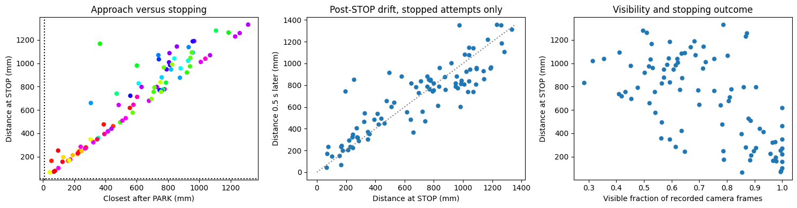

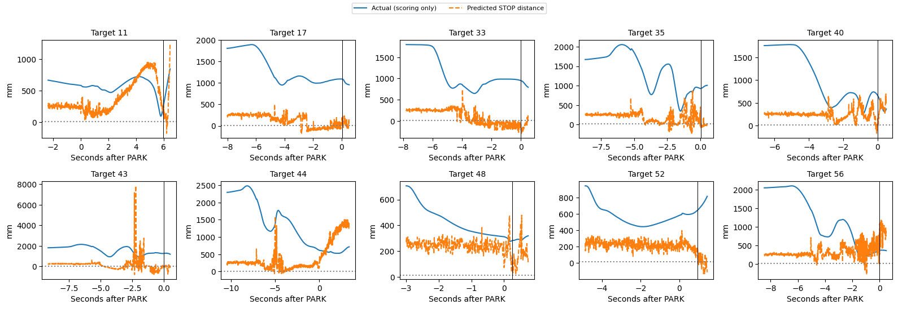

```text
Closest approach, exact STOP, and 0.5-second drift are different measurements.

```


<a id="cell-249"></a>

<details><summary>Code · original cell 249</summary>

```python
full_url=overnight.player_url(full_name)
display(lazy_player(full_url))
display(HTML(f'<a href="{full_url}" target="_blank">Open all 100 test replays</a>'))
print('Wheel encoder speeds, wheel commands, PARK and STOP values, applied arm torques, camera and ghost.')
```

</details>

[Interactive output: open original notebook, cell 249](../driving_v2/golden_dataset.ipynb).

[Interactive output: open original notebook, cell 249](../driving_v2/golden_dataset.ipynb).

```text
Wheel encoder speeds, wheel commands, PARK and STOP values, applied arm torques, camera and ghost.

```


<a id="cell-250"></a>

<details><summary>Code · original cell 250</summary>

```python
display(Markdown(overnight.reading(full_name)))
```

</details>

Both networks controlled the complete run, including learned arm torques before PARK. On validation, 99/100 parked and 0/100 met the full task criterion. On the frozen test comparison, 99/100 parked, 91/100 issued STOP, and 0/100 were within 10 mm at STOP. Median parking error among parked attempts was 6.2 cm; median distance at STOP among stopped attempts was 755.0 mm. Median maximum pre-PARK joint deviation was 1.719 rad. The 0.5 s after STOP is observed with learned torques still active, not a frozen simulation. These are previously viewed test targets and one seed; this is a frozen subsequent comparison, not an untouched estimate of generalisation. All timeouts and failures remain in the denominator.


<a id="cell-251"></a>

### Iteration 43: Retrain arm networks with standardised inputs

**What changed:** Standardise arm inputs using training-set means and standard deviations. Keep the driving checkpoint and training budgets unchanged.

**Type:** New training. Seed 7 only; 100 validation and 100 test targets, with both learned networks controlling the complete episode. No conventional arm holding controller or extra gravity compensation is active.

**Result:** test PARK 100/100, STOP 91/100, full success 0/100; validation full success 0/100. Median parking error is 5.35 cm among 100 parked attempts. Median STOP distance is 168.8 mm among 91 stopped attempts. 0 attempts did not PARK; 9 parked without STOP. Neither is silently discarded from success.

**Comparison with iteration 41 (baseline):** PARK count changes by +0; STOP by +7; successes by +0. On the same 100 targets parked by both, the median paired change in parking error is +0.02 cm. On the same 77 targets stopped by both, the median paired change at STOP is -63.5 mm. Negative changes mean smaller errors. These paired subsets exclude failures, so read them alongside the counts, not as overall success rates.

**Training provenance:** selected epochs: driving 299, torque 1200, STOP 600. The curves below belong to the actual checkpoint; frozen stress tests reuse their parent training histories and do not represent new training. Driving predicts four wheel speeds and time to PARK (trigger 0.25 s). The arm predicts seven torques; its STOP network predicts distance (trigger 10 mm). Command losses are MSE, with separate auxiliary MSE terms; run weights are equal. Saved configuration and histories give scaling and exact coefficients.

**Limits:** these test targets have been viewed in earlier experiments. This is a reused-test comparison, not an untouched final estimate. One seed cannot establish seed robustness. Success requires PARK, STOP and distance at STOP ≤10 mm. Closest approach and later drift are diagnostics, not substitutes for that criterion. The complete per-target table, pre-PARK arm analysis, all loss terms, STOP/drift plots and 100-replay player follow below.


<a id="cell-252"></a>

<details><summary>Code · original cell 252</summary>

```python
from pathlib import Path
import sys,json,uuid
import matplotlib.pyplot as plt
from IPython.display import display,Markdown,HTML
sys.path.insert(0,str(Path('../arm').resolve()))
import report_curriculum as overnight
def lazy_player(url,height=850):
    k=uuid.uuid4().hex[:8]
    return HTML(f"<div><button onclick=\"var f=document.getElementById('player{k}');f.src='{url}';f.style.display='block';this.style.display='none'\" style=\"padding:8px 14px\">Load the 3D player</button><iframe id=\"player{k}\" style=\"display:none;width:100%;height:{height}px;border:0\"></iframe></div>")

full_name='basics_standard'
display(overnight.build(full_name).round(3))
print('Validation and test are distinct. No fitting occurs in these analysis cells.')
```

</details>

<div>

<table border="1" class="dataframe">
  <thead>
    <tr style="text-align: right;">
      <th></th>
      <th>seed</th>
      <th>attempts</th>
      <th>parked</th>
      <th>stopped</th>
      <th>success_10mm</th>
      <th>success_percent</th>
      <th>wilson95_low_percent</th>
      <th>wilson95_high_percent</th>
      <th>median_park_error_cm</th>
      <th>median_abs_heading_error_deg</th>
      <th>median_closest_mm</th>
      <th>median_stop_mm</th>
      <th>median_park_s</th>
      <th>median_stop_s</th>
      <th>timeouts</th>
      <th>execution_failures</th>
      <th>sum_case_wall_s</th>
      <th>median_case_wall_s</th>
    </tr>
    <tr>
      <th>split</th>
      <th></th>
      <th></th>
      <th></th>
      <th></th>
      <th></th>
      <th></th>
      <th></th>
      <th></th>
      <th></th>
      <th></th>
      <th></th>
      <th></th>
      <th></th>
      <th></th>
      <th></th>
      <th></th>
      <th></th>
      <th></th>
    </tr>
  </thead>
  <tbody>
    <tr>
      <th>val</th>
      <td>7</td>
      <td>100</td>
      <td>100</td>
      <td>92</td>
      <td>0</td>
      <td>0.0</td>
      <td>0.0</td>
      <td>3.699</td>
      <td>5.541</td>
      <td>3.601</td>
      <td>92.042</td>
      <td>183.001</td>
      <td>7.866</td>
      <td>9.512</td>
      <td>8</td>
      <td>0</td>
      <td>2298.267</td>
      <td>23.767</td>
    </tr>
    <tr>
      <th>test</th>
      <td>7</td>
      <td>100</td>
      <td>100</td>
      <td>91</td>
      <td>0</td>
      <td>0.0</td>
      <td>0.0</td>
      <td>3.699</td>
      <td>5.348</td>
      <td>2.750</td>
      <td>75.066</td>
      <td>168.809</td>
      <td>7.334</td>
      <td>9.197</td>
      <td>9</td>
      <td>0</td>
      <td>2497.305</td>
      <td>24.989</td>
    </tr>
  </tbody>
</table>
</div>

```text
Validation and test are distinct. No fitting occurs in these analysis cells.

```


<a id="cell-253"></a>

<details><summary>Code · original cell 253</summary>

```python
full_config=json.loads((overnight.ROOT/full_name/'test/config.json').read_text())
display(full_config)
for kind in ('driving','torque','stop'):
    chosen=json.loads((overnight.models(full_name)/f'{kind}_seed7_summary.json').read_text())
    print(kind, 'selected epoch',chosen['selected_epoch'],'validation loss',chosen['selected_val_loss'])
```

</details>

```text
{'cases': [11,
  17,
  33,
  35,
  40,
  43,
  44,
  48,
  52,
  56,
  65,
  83,
  92,
  97,
  98,
  113,
  136,
  147,
  148,
  154,
  162,
  196,
  221,
  229,
  232,
  239,
  248,
  260,
  271,
  274,
  277,
  281,
  285,
  302,
  306,
  311,
  315,
  316,
  317,
  361,
  413,
  427,
  432,
  463,
  478,
  479,
  492,
  502,
  534,
  545,
  554,
  571,
  585,
  586,
  592,
  599,
  600,
  605,
  628,
  632,
  642,
  646,
  652,
  653,
  664,
  669,
  671,
  683,
  693,
  700,
  707,
  708,
  722,
  729,
  730,
  738,
  741,
  750,
  770,
  779,
  806,
  834,
  845,
  846,
  848,
  854,
  857,
  859,
  872,
  883,
  898,
  903,
  905,
  945,
  952,
  958,
  981,
  985,
  986,
  989],
 'split': 'test',
 'seed': 7,
 'jobs': 2,
 'models': '/media/nm/Fast Drive/comp0245-golden11109/overnight_20261105/basics_standard/models',
 'condition': {},
 'model_hashes': {'driving_seed7.npz': '458fc825c3d3c1e5d39d3630655eb872bb46f3ddc34e0a850ee4eb5da52a18c3',
  'reaching_seed7.npz': '6513ad9d528841e36806f11843be5d79f04e9f5f231be44d60385f3fae4569b3'},
 'native_hashes': {'/media/nm/Fast Drive/comp0245-golden11109/overnight_20261105/recovery_runtime/native/sensor_curriculum.cpp': '85a6236a4d1fdc0c9dc2d0e991e460cc150e12abb2e153c596f3c8b247ed60d6',
  '/media/nm/Fast Drive/comp0245-golden11109/overnight_20261105/recovery_runtime/native/sensor_curriculum': 'd589e24b3ac57a056801059812d64271bc83cc2d350c6a487509b6555b6ecf8d'},
 'source_hashes': {'full_run.py': 'a099cabfe4479cf25bd59665e16717b8634a7feeb1b647f1dc39df9bf674514d',
  'evaluate_curriculum.py': '7fa3b64db19e7a39b0cb3a598945fee4695e3a0dce7d037d1eee1e73a85f132c',
  'curriculum_sensors.py': '8117d6a981b4e5dd37dbcf2f4c051e11e6be80dc414dd5beac3c30cbbd523520'},
 'split_sha256': '286f578aec7e3ab0953592466e63014cc1dde7f467106fadf273b30762ac1abf',
 'renderer': 'egl',
 'arm_control': 'learned from reset, 1 kHz, no PD hold or gravity addition',
 'selection': 'checkpoints frozen on offline validation; no fitting in evaluator',
 'test_reuse': 'existing targets previously evaluated; not a fresh blind test'}
```

```text
driving selected epoch 299 validation loss 0.38417819142341614
torque selected epoch 1200 validation loss 0.012050625868141651
stop selected epoch 600 validation loss 0.0009144675568677485

```


<a id="cell-254"></a>

<details><summary>Code · original cell 254</summary>

```python
overnight.losses(full_name);plt.show()
print('All training and validation epochs. Test scores are not training losses.')
```

</details>

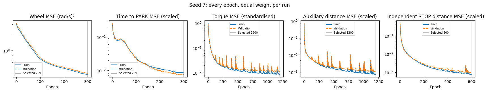

```text
All training and validation epochs. Test scores are not training losses.

```


<a id="cell-255"></a>

<details><summary>Code · original cell 255</summary>

```python
full_report=overnight.select(full_name)
full_report.outcomes(7);plt.show()
display(full_report.table(7).round(3))
```

</details>

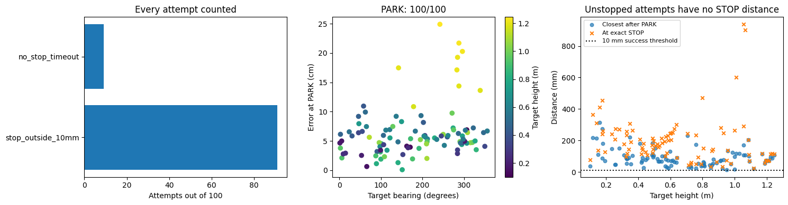

<div>

<table border="1" class="dataframe">
  <thead>
    <tr style="text-align: right;">
      <th></th>
      <th>status</th>
      <th>success</th>
      <th>parked</th>
      <th>park_s</th>
      <th>stop_s</th>
      <th>park_error_cm</th>
      <th>park_heading_error_deg</th>
      <th>at_stop_mm</th>
      <th>closest_mm</th>
      <th>end_mm</th>
      <th>post_stop_drift_mm</th>
      <th>post_park_base_drift_cm</th>
      <th>timed_out</th>
      <th>elapsed_s</th>
      <th>camera_visible_fraction</th>
      <th>target_bearing_deg</th>
      <th>target_range_m</th>
      <th>target_height_m</th>
    </tr>
    <tr>
      <th>dot</th>
      <th></th>
      <th></th>
      <th></th>
      <th></th>
      <th></th>
      <th></th>
      <th></th>
      <th></th>
      <th></th>
      <th></th>
      <th></th>
      <th></th>
      <th></th>
      <th></th>
      <th></th>
      <th></th>
      <th></th>
      <th></th>
    </tr>
  </thead>
  <tbody>
    <tr>
      <th>11</th>
      <td>stop_outside_10mm</td>
      <td>False</td>
      <td>True</td>
      <td>2.367</td>
      <td>6.845</td>
      <td>4.640</td>
      <td>5.665</td>
      <td>240.594</td>
      <td>87.492</td>
      <td>337.295</td>
      <td>96.700</td>
      <td>1.203</td>
      <td>False</td>
      <td>19.029</td>
      <td>1.000</td>
      <td>0.986</td>
      <td>1.042</td>
      <td>0.178</td>
    </tr>
    <tr>
      <th>17</th>
      <td>no_stop_timeout</td>
      <td>False</td>
      <td>True</td>
      <td>7.367</td>
      <td>NaN</td>
      <td>5.213</td>
      <td>-1.554</td>
      <td>NaN</td>
      <td>116.880</td>
      <td>952.665</td>
      <td>NaN</td>
      <td>1.775</td>
      <td>True</td>
      <td>30.219</td>
      <td>0.441</td>
      <td>194.926</td>
      <td>1.095</td>
      <td>1.028</td>
    </tr>
    <tr>
      <th>33</th>
      <td>stop_outside_10mm</td>
      <td>False</td>
      <td>True</td>
      <td>8.033</td>
      <td>9.486</td>
      <td>5.672</td>
      <td>-3.108</td>
      <td>154.870</td>
      <td>70.468</td>
      <td>480.751</td>
      <td>325.881</td>
      <td>1.204</td>
      <td>False</td>
      <td>25.025</td>
      <td>0.700</td>
      <td>259.736</td>
      <td>1.504</td>
      <td>0.422</td>
    </tr>
    <tr>
      <th>35</th>
      <td>stop_outside_10mm</td>
      <td>False</td>
      <td>True</td>
      <td>9.400</td>
      <td>11.272</td>
      <td>6.837</td>
      <td>-5.100</td>
      <td>201.537</td>
      <td>22.612</td>
      <td>289.100</td>
      <td>87.564</td>
      <td>0.401</td>
      <td>False</td>
      <td>28.497</td>
      <td>0.588</td>
      <td>111.687</td>
      <td>1.257</td>
      <td>0.589</td>
    </tr>
    <tr>
      <th>40</th>
      <td>stop_outside_10mm</td>
      <td>False</td>
      <td>True</td>
      <td>6.733</td>
      <td>9.420</td>
      <td>5.912</td>
      <td>-4.031</td>
      <td>255.983</td>
      <td>55.560</td>
      <td>574.586</td>
      <td>318.604</td>
      <td>0.807</td>
      <td>False</td>
      <td>24.243</td>
      <td>0.634</td>
      <td>205.751</td>
      <td>1.041</td>
      <td>0.328</td>
    </tr>
    <tr>
      <th>...</th>
      <td>...</td>
      <td>...</td>
      <td>...</td>
      <td>...</td>
      <td>...</td>
      <td>...</td>
      <td>...</td>
      <td>...</td>
      <td>...</td>
      <td>...</td>
      <td>...</td>
      <td>...</td>
      <td>...</td>
      <td>...</td>
      <td>...</td>
      <td>...</td>
      <td>...</td>
      <td>...</td>
    </tr>
    <tr>
      <th>958</th>
      <td>stop_outside_10mm</td>
      <td>False</td>
      <td>True</td>
      <td>3.367</td>
      <td>4.938</td>
      <td>6.412</td>
      <td>-0.606</td>
      <td>145.471</td>
      <td>93.386</td>
      <td>301.210</td>
      <td>155.739</td>
      <td>0.388</td>
      <td>False</td>
      <td>14.415</td>
      <td>0.762</td>
      <td>347.116</td>
      <td>1.181</td>
      <td>0.493</td>
    </tr>
    <tr>
      <th>981</th>
      <td>stop_outside_10mm</td>
      <td>False</td>
      <td>True</td>
      <td>5.900</td>
      <td>7.411</td>
      <td>5.296</td>
      <td>-1.577</td>
      <td>194.919</td>
      <td>101.065</td>
      <td>358.915</td>
      <td>163.997</td>
      <td>0.787</td>
      <td>False</td>
      <td>20.200</td>
      <td>0.824</td>
      <td>297.945</td>
      <td>1.569</td>
      <td>0.564</td>
    </tr>
    <tr>
      <th>985</th>
      <td>stop_outside_10mm</td>
      <td>False</td>
      <td>True</td>
      <td>5.700</td>
      <td>7.858</td>
      <td>19.259</td>
      <td>-0.446</td>
      <td>71.273</td>
      <td>71.159</td>
      <td>309.510</td>
      <td>238.236</td>
      <td>0.640</td>
      <td>False</td>
      <td>21.170</td>
      <td>0.904</td>
      <td>284.446</td>
      <td>1.417</td>
      <td>1.210</td>
    </tr>
    <tr>
      <th>986</th>
      <td>stop_outside_10mm</td>
      <td>False</td>
      <td>True</td>
      <td>9.067</td>
      <td>10.557</td>
      <td>3.398</td>
      <td>-6.726</td>
      <td>260.618</td>
      <td>180.724</td>
      <td>522.907</td>
      <td>262.288</td>
      <td>0.876</td>
      <td>False</td>
      <td>25.285</td>
      <td>0.524</td>
      <td>98.931</td>
      <td>1.279</td>
      <td>0.179</td>
    </tr>
    <tr>
      <th>989</th>
      <td>stop_outside_10mm</td>
      <td>False</td>
      <td>True</td>
      <td>7.067</td>
      <td>9.191</td>
      <td>14.361</td>
      <td>0.458</td>
      <td>69.634</td>
      <td>69.513</td>
      <td>76.334</td>
      <td>6.701</td>
      <td>0.580</td>
      <td>False</td>
      <td>24.564</td>
      <td>0.928</td>
      <td>287.737</td>
      <td>1.749</td>
      <td>1.193</td>
    </tr>
  </tbody>
</table>
<p>100 rows × 18 columns</p>
</div>


<a id="cell-256"></a>

<details><summary>Code · original cell 256</summary>

```python
overnight.holding(full_name);plt.show()
display(overnight.hold_table(full_name).round(4))
print('Learned torques are applied from reset. No expert holding or added gravity term.')
```

</details>

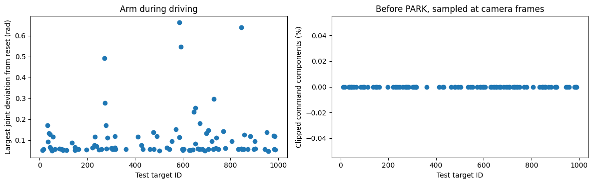

<div>

<table border="1" class="dataframe">
  <thead>
    <tr style="text-align: right;">
      <th></th>
      <th>status</th>
      <th>prepark_frames</th>
      <th>max_arm_deviation_rad</th>
      <th>maximum_command_Nm</th>
      <th>torque_clipped_fraction</th>
    </tr>
    <tr>
      <th>dot</th>
      <th></th>
      <th></th>
      <th></th>
      <th></th>
      <th></th>
    </tr>
  </thead>
  <tbody>
    <tr>
      <th>11</th>
      <td>stop_outside_10mm</td>
      <td>71</td>
      <td>0.0526</td>
      <td>19.6074</td>
      <td>0.0</td>
    </tr>
    <tr>
      <th>17</th>
      <td>no_stop_timeout</td>
      <td>221</td>
      <td>0.0554</td>
      <td>20.4179</td>
      <td>0.0</td>
    </tr>
    <tr>
      <th>33</th>
      <td>stop_outside_10mm</td>
      <td>241</td>
      <td>0.1711</td>
      <td>20.0103</td>
      <td>0.0</td>
    </tr>
    <tr>
      <th>35</th>
      <td>stop_outside_10mm</td>
      <td>282</td>
      <td>0.0907</td>
      <td>20.4179</td>
      <td>0.0</td>
    </tr>
    <tr>
      <th>40</th>
      <td>stop_outside_10mm</td>
      <td>202</td>
      <td>0.1324</td>
      <td>20.4179</td>
      <td>0.0</td>
    </tr>
    <tr>
      <th>...</th>
      <td>...</td>
      <td>...</td>
      <td>...</td>
      <td>...</td>
      <td>...</td>
    </tr>
    <tr>
      <th>958</th>
      <td>stop_outside_10mm</td>
      <td>101</td>
      <td>0.0471</td>
      <td>20.1291</td>
      <td>0.0</td>
    </tr>
    <tr>
      <th>981</th>
      <td>stop_outside_10mm</td>
      <td>177</td>
      <td>0.1204</td>
      <td>21.4012</td>
      <td>0.0</td>
    </tr>
    <tr>
      <th>985</th>
      <td>stop_outside_10mm</td>
      <td>171</td>
      <td>0.0552</td>
      <td>20.2967</td>
      <td>0.0</td>
    </tr>
    <tr>
      <th>986</th>
      <td>stop_outside_10mm</td>
      <td>272</td>
      <td>0.1175</td>
      <td>20.4179</td>
      <td>0.0</td>
    </tr>
    <tr>
      <th>989</th>
      <td>stop_outside_10mm</td>
      <td>212</td>
      <td>0.0549</td>
      <td>20.8545</td>
      <td>0.0</td>
    </tr>
  </tbody>
</table>
<p>100 rows × 5 columns</p>
</div>

```text
Learned torques are applied from reset. No expert holding or added gravity term.

```


<a id="cell-257"></a>

<details><summary>Code · original cell 257</summary>

```python
full_report=overnight.select(full_name)
full_report.stopping(7);plt.show()
full_report.distances(7);plt.show()
print('Closest approach, exact STOP, and 0.5-second drift are different measurements.')
```

</details>

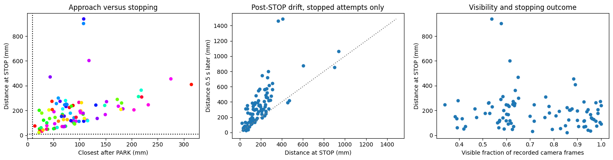

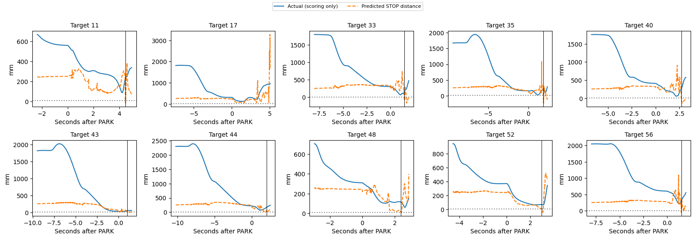

```text
Closest approach, exact STOP, and 0.5-second drift are different measurements.

```


<a id="cell-258"></a>

<details><summary>Code · original cell 258</summary>

```python
full_url=overnight.player_url(full_name)
display(lazy_player(full_url))
display(HTML(f'<a href="{full_url}" target="_blank">Open all 100 test replays</a>'))
print('Wheel encoder speeds, wheel commands, PARK and STOP values, applied arm torques, camera and ghost.')
```

</details>

[Interactive output: open original notebook, cell 258](../driving_v2/golden_dataset.ipynb).

[Interactive output: open original notebook, cell 258](../driving_v2/golden_dataset.ipynb).

```text
Wheel encoder speeds, wheel commands, PARK and STOP values, applied arm torques, camera and ghost.

```


<a id="cell-259"></a>

<details><summary>Code · original cell 259</summary>

```python
display(Markdown(overnight.reading(full_name)))
```

</details>

Both networks controlled the complete run, including learned arm torques before PARK. On validation, 100/100 parked and 0/100 met the full task criterion. On the frozen test comparison, 100/100 parked, 91/100 issued STOP, and 0/100 were within 10 mm at STOP. Median parking error among parked attempts was 5.3 cm; median distance at STOP among stopped attempts was 168.8 mm. Median maximum pre-PARK joint deviation was 0.059 rad. The 0.5 s after STOP is observed with learned torques still active, not a frozen simulation. These are previously viewed test targets and one seed; this is a frozen subsequent comparison, not an untouched estimate of generalisation. All timeouts and failures remain in the denominator.


<a id="cell-260"></a>

### Iteration 44: Frozen networks: encoder noise plus damping

**What changed:** Retain encoder noise and add the course motor damping term, c=1. Networks unchanged.

**Type:** Frozen-model stress test. Seed 7 only; 100 validation and 100 test targets, with both learned networks controlling the complete episode. No conventional arm holding controller or extra gravity compensation is active.

**Result:** test PARK 100/100, STOP 88/100, full success 0/100; validation full success 0/100. Median parking error is 6.25 cm among 100 parked attempts. Median STOP distance is 707.5 mm among 88 stopped attempts. 0 attempts did not PARK; 12 parked without STOP. Neither is silently discarded from success.

**Comparison with iteration 42 (encoder_noise):** PARK count changes by +1; STOP by -3; successes by +0. On the same 99 targets parked by both, the median paired change in parking error is +0.01 cm. On the same 84 targets stopped by both, the median paired change at STOP is -5.9 mm. Negative changes mean smaller errors. These paired subsets exclude failures, so read them alongside the counts, not as overall success rates.

**Training provenance:** selected epochs: driving 299, torque 1198, STOP 593. The curves below belong to the actual checkpoint; frozen stress tests reuse their parent training histories and do not represent new training. Driving predicts four wheel speeds and time to PARK (trigger 0.25 s). The arm predicts seven torques; its STOP network predicts distance (trigger 10 mm). Command losses are MSE, with separate auxiliary MSE terms; run weights are equal. Saved configuration and histories give scaling and exact coefficients.

**Limits:** these test targets have been viewed in earlier experiments. This is a reused-test comparison, not an untouched final estimate. One seed cannot establish seed robustness. Success requires PARK, STOP and distance at STOP ≤10 mm. Closest approach and later drift are diagnostics, not substitutes for that criterion. The complete per-target table, pre-PARK arm analysis, all loss terms, STOP/drift plots and 100-replay player follow below.

**Interpretation:** this measures cumulative sensitivity of the original physical-scale model. It does not isolate the same effect on the standardised model. Differencing noisy angle readings can amplify velocity noise; this is a plausible mechanism, not a demonstrated sole cause.


<a id="cell-261"></a>

<details><summary>Code · original cell 261</summary>

```python
from pathlib import Path
import sys,json,uuid
import matplotlib.pyplot as plt
from IPython.display import display,Markdown,HTML
sys.path.insert(0,str(Path('../arm').resolve()))
import report_curriculum as overnight
def lazy_player(url,height=850):
    k=uuid.uuid4().hex[:8]
    return HTML(f"<div><button onclick=\"var f=document.getElementById('player{k}');f.src='{url}';f.style.display='block';this.style.display='none'\" style=\"padding:8px 14px\">Load the 3D player</button><iframe id=\"player{k}\" style=\"display:none;width:100%;height:{height}px;border:0\"></iframe></div>")

full_name='damping'
display(overnight.build(full_name).round(3))
print('Validation and test are distinct. No fitting occurs in these analysis cells.')
```

</details>

<div>

<table border="1" class="dataframe">
  <thead>
    <tr style="text-align: right;">
      <th></th>
      <th>seed</th>
      <th>attempts</th>
      <th>parked</th>
      <th>stopped</th>
      <th>success_10mm</th>
      <th>success_percent</th>
      <th>wilson95_low_percent</th>
      <th>wilson95_high_percent</th>
      <th>median_park_error_cm</th>
      <th>median_abs_heading_error_deg</th>
      <th>median_closest_mm</th>
      <th>median_stop_mm</th>
      <th>median_park_s</th>
      <th>median_stop_s</th>
      <th>timeouts</th>
      <th>execution_failures</th>
      <th>sum_case_wall_s</th>
      <th>median_case_wall_s</th>
    </tr>
    <tr>
      <th>split</th>
      <th></th>
      <th></th>
      <th></th>
      <th></th>
      <th></th>
      <th></th>
      <th></th>
      <th></th>
      <th></th>
      <th></th>
      <th></th>
      <th></th>
      <th></th>
      <th></th>
      <th></th>
      <th></th>
      <th></th>
      <th></th>
    </tr>
  </thead>
  <tbody>
    <tr>
      <th>val</th>
      <td>7</td>
      <td>100</td>
      <td>98</td>
      <td>81</td>
      <td>0</td>
      <td>0.0</td>
      <td>0.0</td>
      <td>3.699</td>
      <td>6.658</td>
      <td>4.519</td>
      <td>536.344</td>
      <td>783.107</td>
      <td>7.950</td>
      <td>7.233</td>
      <td>19</td>
      <td>0</td>
      <td>2350.567</td>
      <td>22.481</td>
    </tr>
    <tr>
      <th>test</th>
      <td>7</td>
      <td>100</td>
      <td>100</td>
      <td>88</td>
      <td>0</td>
      <td>0.0</td>
      <td>0.0</td>
      <td>3.699</td>
      <td>6.252</td>
      <td>3.677</td>
      <td>556.158</td>
      <td>707.463</td>
      <td>7.216</td>
      <td>7.034</td>
      <td>12</td>
      <td>0</td>
      <td>2058.742</td>
      <td>20.273</td>
    </tr>
  </tbody>
</table>
</div>

```text
Validation and test are distinct. No fitting occurs in these analysis cells.

```


<a id="cell-262"></a>

<details><summary>Code · original cell 262</summary>

```python
full_config=json.loads((overnight.ROOT/full_name/'test/config.json').read_text())
display(full_config)
for kind in ('driving','torque','stop'):
    chosen=json.loads((overnight.models(full_name)/f'{kind}_seed7_summary.json').read_text())
    print(kind, 'selected epoch',chosen['selected_epoch'],'validation loss',chosen['selected_val_loss'])
```

</details>

```text
{'cases': [11,
  17,
  33,
  35,
  40,
  43,
  44,
  48,
  52,
  56,
  65,
  83,
  92,
  97,
  98,
  113,
  136,
  147,
  148,
  154,
  162,
  196,
  221,
  229,
  232,
  239,
  248,
  260,
  271,
  274,
  277,
  281,
  285,
  302,
  306,
  311,
  315,
  316,
  317,
  361,
  413,
  427,
  432,
  463,
  478,
  479,
  492,
  502,
  534,
  545,
  554,
  571,
  585,
  586,
  592,
  599,
  600,
  605,
  628,
  632,
  642,
  646,
  652,
  653,
  664,
  669,
  671,
  683,
  693,
  700,
  707,
  708,
  722,
  729,
  730,
  738,
  741,
  750,
  770,
  779,
  806,
  834,
  845,
  846,
  848,
  854,
  857,
  859,
  872,
  883,
  898,
  903,
  905,
  945,
  952,
  958,
  981,
  985,
  986,
  989],
 'split': 'test',
 'seed': 7,
 'jobs': 4,
 'models': '/media/nm/Fast Drive/comp0245-golden11109/overnight_20261105/baseline/models',
 'condition': {'encoder_noise_sd': 0.0001, 'sensor_seed': 7, 'damping': 1.0},
 'model_hashes': {'driving_seed7.npz': '458fc825c3d3c1e5d39d3630655eb872bb46f3ddc34e0a850ee4eb5da52a18c3',
  'reaching_seed7.npz': '774c961608ec707c4ec9124ea13a66c180dd06be777481c0434a3a6f152287da'},
 'native_hashes': {'/media/nm/Fast Drive/comp0245-golden11109/overnight_20261105/ladder_runtime/native/sensor_curriculum.cpp': '8d4cc91c5a97aa7f31195187896d2d94ad570cffc5c5a30671de5e14aa7bb167',
  '/media/nm/Fast Drive/comp0245-golden11109/overnight_20261105/ladder_runtime/native/sensor_curriculum': '4ae5363bac9b2f93164fb65f6bd81c2811aff8400986ff0a83e474ca1ce0eece'},
 'source_hashes': {'full_run.py': 'c6da49f6cf9e934d24903222036f0d4d42c5a8a2c38de641f8e04612fc43b1e4',
  'evaluate_curriculum.py': '7fa3b64db19e7a39b0cb3a598945fee4695e3a0dce7d037d1eee1e73a85f132c',
  'curriculum_sensors.py': '8117d6a981b4e5dd37dbcf2f4c051e11e6be80dc414dd5beac3c30cbbd523520'},
 'split_sha256': '286f578aec7e3ab0953592466e63014cc1dde7f467106fadf273b30762ac1abf',
 'renderer': 'egl',
 'arm_control': 'learned from reset, 1 kHz, no PD hold or gravity addition',
 'selection': 'checkpoints frozen on offline validation; no fitting in evaluator',
 'test_reuse': 'existing targets previously evaluated; not a fresh blind test'}
```

```text
driving selected epoch 299 validation loss 0.38417819142341614
torque selected epoch 1198 validation loss 0.02170979417860508
stop selected epoch 593 validation loss 0.0030433654319494963

```


<a id="cell-263"></a>

<details><summary>Code · original cell 263</summary>

```python
overnight.losses(full_name);plt.show()
print('All training and validation epochs. Test scores are not training losses.')
```

</details>


```text
All training and validation epochs. Test scores are not training losses.

```


<a id="cell-264"></a>

<details><summary>Code · original cell 264</summary>

```python
full_report=overnight.select(full_name)
full_report.outcomes(7);plt.show()
display(full_report.table(7).round(3))
```

</details>

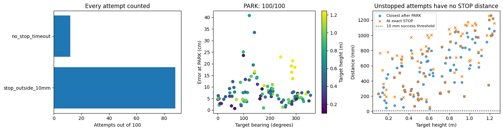

<div>

<table border="1" class="dataframe">
  <thead>
    <tr style="text-align: right;">
      <th></th>
      <th>status</th>
      <th>success</th>
      <th>parked</th>
      <th>park_s</th>
      <th>stop_s</th>
      <th>park_error_cm</th>
      <th>park_heading_error_deg</th>
      <th>at_stop_mm</th>
      <th>closest_mm</th>
      <th>end_mm</th>
      <th>post_stop_drift_mm</th>
      <th>post_park_base_drift_cm</th>
      <th>timed_out</th>
      <th>elapsed_s</th>
      <th>camera_visible_fraction</th>
      <th>target_bearing_deg</th>
      <th>target_range_m</th>
      <th>target_height_m</th>
    </tr>
    <tr>
      <th>dot</th>
      <th></th>
      <th></th>
      <th></th>
      <th></th>
      <th></th>
      <th></th>
      <th></th>
      <th></th>
      <th></th>
      <th></th>
      <th></th>
      <th></th>
      <th></th>
      <th></th>
      <th></th>
      <th></th>
      <th></th>
      <th></th>
    </tr>
  </thead>
  <tbody>
    <tr>
      <th>11</th>
      <td>stop_outside_10mm</td>
      <td>False</td>
      <td>True</td>
      <td>2.367</td>
      <td>8.478</td>
      <td>4.657</td>
      <td>5.680</td>
      <td>194.610</td>
      <td>114.879</td>
      <td>773.751</td>
      <td>579.141</td>
      <td>2.738</td>
      <td>False</td>
      <td>22.554</td>
      <td>0.989</td>
      <td>0.986</td>
      <td>1.042</td>
      <td>0.178</td>
    </tr>
    <tr>
      <th>17</th>
      <td>stop_outside_10mm</td>
      <td>False</td>
      <td>True</td>
      <td>7.667</td>
      <td>7.806</td>
      <td>8.482</td>
      <td>-1.876</td>
      <td>1127.098</td>
      <td>950.257</td>
      <td>950.248</td>
      <td>-176.850</td>
      <td>0.418</td>
      <td>False</td>
      <td>22.952</td>
      <td>0.632</td>
      <td>194.926</td>
      <td>1.095</td>
      <td>1.028</td>
    </tr>
    <tr>
      <th>33</th>
      <td>stop_outside_10mm</td>
      <td>False</td>
      <td>True</td>
      <td>7.833</td>
      <td>7.833</td>
      <td>1.331</td>
      <td>-6.420</td>
      <td>975.760</td>
      <td>800.622</td>
      <td>800.898</td>
      <td>-174.862</td>
      <td>0.526</td>
      <td>False</td>
      <td>23.085</td>
      <td>0.592</td>
      <td>259.736</td>
      <td>1.504</td>
      <td>0.422</td>
    </tr>
    <tr>
      <th>35</th>
      <td>stop_outside_10mm</td>
      <td>False</td>
      <td>True</td>
      <td>8.867</td>
      <td>8.870</td>
      <td>3.628</td>
      <td>-10.179</td>
      <td>791.955</td>
      <td>663.170</td>
      <td>663.094</td>
      <td>-128.861</td>
      <td>0.153</td>
      <td>False</td>
      <td>24.323</td>
      <td>0.504</td>
      <td>111.687</td>
      <td>1.257</td>
      <td>0.589</td>
    </tr>
    <tr>
      <th>40</th>
      <td>stop_outside_10mm</td>
      <td>False</td>
      <td>True</td>
      <td>6.900</td>
      <td>6.969</td>
      <td>5.800</td>
      <td>-7.839</td>
      <td>637.712</td>
      <td>599.381</td>
      <td>599.358</td>
      <td>-38.354</td>
      <td>0.440</td>
      <td>False</td>
      <td>17.585</td>
      <td>0.516</td>
      <td>205.751</td>
      <td>1.041</td>
      <td>0.328</td>
    </tr>
    <tr>
      <th>...</th>
      <td>...</td>
      <td>...</td>
      <td>...</td>
      <td>...</td>
      <td>...</td>
      <td>...</td>
      <td>...</td>
      <td>...</td>
      <td>...</td>
      <td>...</td>
      <td>...</td>
      <td>...</td>
      <td>...</td>
      <td>...</td>
      <td>...</td>
      <td>...</td>
      <td>...</td>
      <td>...</td>
    </tr>
    <tr>
      <th>958</th>
      <td>stop_outside_10mm</td>
      <td>False</td>
      <td>True</td>
      <td>3.067</td>
      <td>3.344</td>
      <td>7.763</td>
      <td>-0.684</td>
      <td>226.212</td>
      <td>215.886</td>
      <td>248.247</td>
      <td>22.035</td>
      <td>0.138</td>
      <td>False</td>
      <td>12.658</td>
      <td>0.974</td>
      <td>347.116</td>
      <td>1.181</td>
      <td>0.493</td>
    </tr>
    <tr>
      <th>981</th>
      <td>stop_outside_10mm</td>
      <td>False</td>
      <td>True</td>
      <td>5.933</td>
      <td>5.933</td>
      <td>5.826</td>
      <td>-1.269</td>
      <td>461.573</td>
      <td>461.573</td>
      <td>523.007</td>
      <td>61.433</td>
      <td>0.210</td>
      <td>False</td>
      <td>19.109</td>
      <td>0.917</td>
      <td>297.945</td>
      <td>1.569</td>
      <td>0.564</td>
    </tr>
    <tr>
      <th>985</th>
      <td>stop_outside_10mm</td>
      <td>False</td>
      <td>True</td>
      <td>6.300</td>
      <td>6.300</td>
      <td>16.321</td>
      <td>-1.338</td>
      <td>997.919</td>
      <td>997.919</td>
      <td>1054.756</td>
      <td>56.837</td>
      <td>0.186</td>
      <td>False</td>
      <td>19.545</td>
      <td>0.775</td>
      <td>284.446</td>
      <td>1.417</td>
      <td>1.210</td>
    </tr>
    <tr>
      <th>986</th>
      <td>no_stop_timeout</td>
      <td>False</td>
      <td>True</td>
      <td>9.633</td>
      <td>NaN</td>
      <td>23.569</td>
      <td>-12.121</td>
      <td>NaN</td>
      <td>434.339</td>
      <td>434.006</td>
      <td>NaN</td>
      <td>1.818</td>
      <td>True</td>
      <td>27.891</td>
      <td>0.606</td>
      <td>98.931</td>
      <td>1.279</td>
      <td>0.179</td>
    </tr>
    <tr>
      <th>989</th>
      <td>stop_outside_10mm</td>
      <td>False</td>
      <td>True</td>
      <td>7.233</td>
      <td>7.233</td>
      <td>13.578</td>
      <td>0.289</td>
      <td>1205.625</td>
      <td>1205.625</td>
      <td>1310.235</td>
      <td>104.610</td>
      <td>0.200</td>
      <td>False</td>
      <td>20.820</td>
      <td>0.866</td>
      <td>287.737</td>
      <td>1.749</td>
      <td>1.193</td>
    </tr>
  </tbody>
</table>
<p>100 rows × 18 columns</p>
</div>


<a id="cell-265"></a>

<details><summary>Code · original cell 265</summary>

```python
overnight.holding(full_name);plt.show()
display(overnight.hold_table(full_name).round(4))
print('Learned torques are applied from reset. No expert holding or added gravity term.')
```

</details>

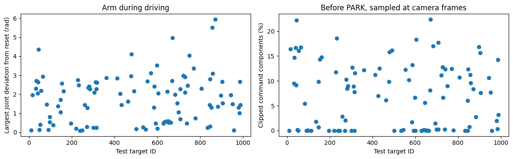

<div>

<table border="1" class="dataframe">
  <thead>
    <tr style="text-align: right;">
      <th></th>
      <th>status</th>
      <th>prepark_frames</th>
      <th>max_arm_deviation_rad</th>
      <th>maximum_command_Nm</th>
      <th>torque_clipped_fraction</th>
    </tr>
    <tr>
      <th>dot</th>
      <th></th>
      <th></th>
      <th></th>
      <th></th>
      <th></th>
    </tr>
  </thead>
  <tbody>
    <tr>
      <th>11</th>
      <td>stop_outside_10mm</td>
      <td>71</td>
      <td>0.1154</td>
      <td>24.3113</td>
      <td>0.0000</td>
    </tr>
    <tr>
      <th>17</th>
      <td>stop_outside_10mm</td>
      <td>230</td>
      <td>1.9589</td>
      <td>30.0000</td>
      <td>0.1640</td>
    </tr>
    <tr>
      <th>33</th>
      <td>stop_outside_10mm</td>
      <td>235</td>
      <td>2.3009</td>
      <td>30.0000</td>
      <td>0.0954</td>
    </tr>
    <tr>
      <th>35</th>
      <td>stop_outside_10mm</td>
      <td>266</td>
      <td>2.7182</td>
      <td>30.0000</td>
      <td>0.1466</td>
    </tr>
    <tr>
      <th>40</th>
      <td>stop_outside_10mm</td>
      <td>207</td>
      <td>2.0586</td>
      <td>30.0000</td>
      <td>0.1670</td>
    </tr>
    <tr>
      <th>...</th>
      <td>...</td>
      <td>...</td>
      <td>...</td>
      <td>...</td>
      <td>...</td>
    </tr>
    <tr>
      <th>958</th>
      <td>stop_outside_10mm</td>
      <td>92</td>
      <td>0.1043</td>
      <td>25.8326</td>
      <td>0.0000</td>
    </tr>
    <tr>
      <th>981</th>
      <td>stop_outside_10mm</td>
      <td>178</td>
      <td>1.3004</td>
      <td>30.0000</td>
      <td>0.0201</td>
    </tr>
    <tr>
      <th>985</th>
      <td>stop_outside_10mm</td>
      <td>189</td>
      <td>1.0129</td>
      <td>30.0000</td>
      <td>0.0030</td>
    </tr>
    <tr>
      <th>986</th>
      <td>no_stop_timeout</td>
      <td>289</td>
      <td>2.6727</td>
      <td>30.0000</td>
      <td>0.1429</td>
    </tr>
    <tr>
      <th>989</th>
      <td>stop_outside_10mm</td>
      <td>217</td>
      <td>1.4333</td>
      <td>30.0000</td>
      <td>0.0316</td>
    </tr>
  </tbody>
</table>
<p>100 rows × 5 columns</p>
</div>

```text
Learned torques are applied from reset. No expert holding or added gravity term.

```


<a id="cell-266"></a>

<details><summary>Code · original cell 266</summary>

```python
full_report=overnight.select(full_name)
full_report.stopping(7);plt.show()
full_report.distances(7);plt.show()
print('Closest approach, exact STOP, and 0.5-second drift are different measurements.')
```

</details>

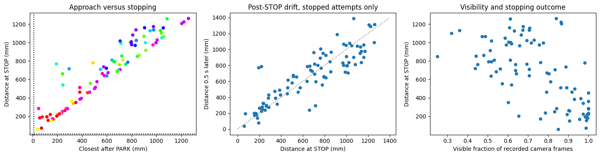

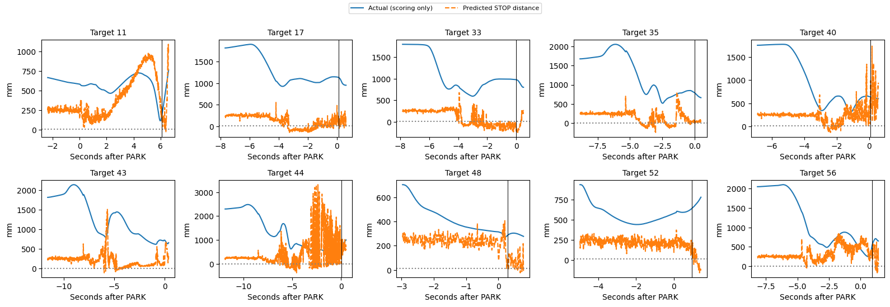

```text
Closest approach, exact STOP, and 0.5-second drift are different measurements.

```


<a id="cell-267"></a>

<details><summary>Code · original cell 267</summary>

```python
full_url=overnight.player_url(full_name)
display(lazy_player(full_url))
display(HTML(f'<a href="{full_url}" target="_blank">Open all 100 test replays</a>'))
print('Wheel encoder speeds, wheel commands, PARK and STOP values, applied arm torques, camera and ghost.')
```

</details>

[Interactive output: open original notebook, cell 267](../driving_v2/golden_dataset.ipynb).

[Interactive output: open original notebook, cell 267](../driving_v2/golden_dataset.ipynb).

```text
Wheel encoder speeds, wheel commands, PARK and STOP values, applied arm torques, camera and ghost.

```


<a id="cell-268"></a>

<details><summary>Code · original cell 268</summary>

```python
display(Markdown(overnight.reading(full_name)))
```

</details>

Both networks controlled the complete run, including learned arm torques before PARK. On validation, 98/100 parked and 0/100 met the full task criterion. On the frozen test comparison, 100/100 parked, 88/100 issued STOP, and 0/100 were within 10 mm at STOP. Median parking error among parked attempts was 6.3 cm; median distance at STOP among stopped attempts was 707.5 mm. Median maximum pre-PARK joint deviation was 1.826 rad. The 0.5 s after STOP is observed with learned torques still active, not a frozen simulation. These are previously viewed test targets and one seed; this is a frozen subsequent comparison, not an untouched estimate of generalisation. All timeouts and failures remain in the denominator.


<a id="cell-269"></a>

### Iteration 45: Frozen networks: add elasticity to noise and damping

**What changed:** Retain noise and damping; add the course elasticity term, k=1, towards zero joint angle. Networks unchanged.

**Type:** Frozen-model stress test. Seed 7 only; 100 validation and 100 test targets, with both learned networks controlling the complete episode. No conventional arm holding controller or extra gravity compensation is active.

**Result:** test PARK 99/100, STOP 93/100, full success 0/100; validation full success 0/100. Median parking error is 6.04 cm among 99 parked attempts. Median STOP distance is 790.5 mm among 93 stopped attempts. 1 attempts did not PARK; 6 parked without STOP. Neither is silently discarded from success.

**Comparison with iteration 44 (damping):** PARK count changes by -1; STOP by +5; successes by +0. On the same 99 targets parked by both, the median paired change in parking error is +0.02 cm. On the same 82 targets stopped by both, the median paired change at STOP is +53.1 mm. Negative changes mean smaller errors. These paired subsets exclude failures, so read them alongside the counts, not as overall success rates.

**Training provenance:** selected epochs: driving 299, torque 1198, STOP 593. The curves below belong to the actual checkpoint; frozen stress tests reuse their parent training histories and do not represent new training. Driving predicts four wheel speeds and time to PARK (trigger 0.25 s). The arm predicts seven torques; its STOP network predicts distance (trigger 10 mm). Command losses are MSE, with separate auxiliary MSE terms; run weights are equal. Saved configuration and histories give scaling and exact coefficients.

**Limits:** these test targets have been viewed in earlier experiments. This is a reused-test comparison, not an untouched final estimate. One seed cannot establish seed robustness. Success requires PARK, STOP and distance at STOP ≤10 mm. Closest approach and later drift are diagnostics, not substitutes for that criterion. The complete per-target table, pre-PARK arm analysis, all loss terms, STOP/drift plots and 100-replay player follow below.

**Interpretation:** this measures cumulative sensitivity of the original physical-scale model. It does not isolate the same effect on the standardised model. Differencing noisy angle readings can amplify velocity noise; this is a plausible mechanism, not a demonstrated sole cause.


<a id="cell-270"></a>

<details><summary>Code · original cell 270</summary>

```python
from pathlib import Path
import sys,json,uuid
import matplotlib.pyplot as plt
from IPython.display import display,Markdown,HTML
sys.path.insert(0,str(Path('../arm').resolve()))
import report_curriculum as overnight
def lazy_player(url,height=850):
    k=uuid.uuid4().hex[:8]
    return HTML(f"<div><button onclick=\"var f=document.getElementById('player{k}');f.src='{url}';f.style.display='block';this.style.display='none'\" style=\"padding:8px 14px\">Load the 3D player</button><iframe id=\"player{k}\" style=\"display:none;width:100%;height:{height}px;border:0\"></iframe></div>")

full_name='elasticity'
display(overnight.build(full_name).round(3))
print('Validation and test are distinct. No fitting occurs in these analysis cells.')
```

</details>

<div>

<table border="1" class="dataframe">
  <thead>
    <tr style="text-align: right;">
      <th></th>
      <th>seed</th>
      <th>attempts</th>
      <th>parked</th>
      <th>stopped</th>
      <th>success_10mm</th>
      <th>success_percent</th>
      <th>wilson95_low_percent</th>
      <th>wilson95_high_percent</th>
      <th>median_park_error_cm</th>
      <th>median_abs_heading_error_deg</th>
      <th>median_closest_mm</th>
      <th>median_stop_mm</th>
      <th>median_park_s</th>
      <th>median_stop_s</th>
      <th>timeouts</th>
      <th>execution_failures</th>
      <th>sum_case_wall_s</th>
      <th>median_case_wall_s</th>
    </tr>
    <tr>
      <th>split</th>
      <th></th>
      <th></th>
      <th></th>
      <th></th>
      <th></th>
      <th></th>
      <th></th>
      <th></th>
      <th></th>
      <th></th>
      <th></th>
      <th></th>
      <th></th>
      <th></th>
      <th></th>
      <th></th>
      <th></th>
      <th></th>
    </tr>
  </thead>
  <tbody>
    <tr>
      <th>val</th>
      <td>7</td>
      <td>100</td>
      <td>97</td>
      <td>93</td>
      <td>0</td>
      <td>0.0</td>
      <td>0.0</td>
      <td>3.699</td>
      <td>5.823</td>
      <td>4.409</td>
      <td>656.224</td>
      <td>811.281</td>
      <td>7.633</td>
      <td>7.79</td>
      <td>7</td>
      <td>0</td>
      <td>2502.376</td>
      <td>24.621</td>
    </tr>
    <tr>
      <th>test</th>
      <td>7</td>
      <td>100</td>
      <td>99</td>
      <td>93</td>
      <td>0</td>
      <td>0.0</td>
      <td>0.0</td>
      <td>3.699</td>
      <td>6.038</td>
      <td>4.068</td>
      <td>661.989</td>
      <td>790.486</td>
      <td>7.367</td>
      <td>7.50</td>
      <td>7</td>
      <td>0</td>
      <td>2277.586</td>
      <td>22.458</td>
    </tr>
  </tbody>
</table>
</div>

```text
Validation and test are distinct. No fitting occurs in these analysis cells.

```


<a id="cell-271"></a>

<details><summary>Code · original cell 271</summary>

```python
full_config=json.loads((overnight.ROOT/full_name/'test/config.json').read_text())
display(full_config)
for kind in ('driving','torque','stop'):
    chosen=json.loads((overnight.models(full_name)/f'{kind}_seed7_summary.json').read_text())
    print(kind, 'selected epoch',chosen['selected_epoch'],'validation loss',chosen['selected_val_loss'])
```

</details>

```text
{'cases': [11,
  17,
  33,
  35,
  40,
  43,
  44,
  48,
  52,
  56,
  65,
  83,
  92,
  97,
  98,
  113,
  136,
  147,
  148,
  154,
  162,
  196,
  221,
  229,
  232,
  239,
  248,
  260,
  271,
  274,
  277,
  281,
  285,
  302,
  306,
  311,
  315,
  316,
  317,
  361,
  413,
  427,
  432,
  463,
  478,
  479,
  492,
  502,
  534,
  545,
  554,
  571,
  585,
  586,
  592,
  599,
  600,
  605,
  628,
  632,
  642,
  646,
  652,
  653,
  664,
  669,
  671,
  683,
  693,
  700,
  707,
  708,
  722,
  729,
  730,
  738,
  741,
  750,
  770,
  779,
  806,
  834,
  845,
  846,
  848,
  854,
  857,
  859,
  872,
  883,
  898,
  903,
  905,
  945,
  952,
  958,
  981,
  985,
  986,
  989],
 'split': 'test',
 'seed': 7,
 'jobs': 4,
 'models': '/media/nm/Fast Drive/comp0245-golden11109/overnight_20261105/baseline/models',
 'condition': {'encoder_noise_sd': 0.0001,
  'sensor_seed': 7,
  'damping': 1.0,
  'elasticity': 1.0},
 'model_hashes': {'driving_seed7.npz': '458fc825c3d3c1e5d39d3630655eb872bb46f3ddc34e0a850ee4eb5da52a18c3',
  'reaching_seed7.npz': '774c961608ec707c4ec9124ea13a66c180dd06be777481c0434a3a6f152287da'},
 'native_hashes': {'/media/nm/Fast Drive/comp0245-golden11109/overnight_20261105/ladder_runtime/native/sensor_curriculum.cpp': '8d4cc91c5a97aa7f31195187896d2d94ad570cffc5c5a30671de5e14aa7bb167',
  '/media/nm/Fast Drive/comp0245-golden11109/overnight_20261105/ladder_runtime/native/sensor_curriculum': '4ae5363bac9b2f93164fb65f6bd81c2811aff8400986ff0a83e474ca1ce0eece'},
 'source_hashes': {'full_run.py': 'c6da49f6cf9e934d24903222036f0d4d42c5a8a2c38de641f8e04612fc43b1e4',
  'evaluate_curriculum.py': '7fa3b64db19e7a39b0cb3a598945fee4695e3a0dce7d037d1eee1e73a85f132c',
  'curriculum_sensors.py': '8117d6a981b4e5dd37dbcf2f4c051e11e6be80dc414dd5beac3c30cbbd523520'},
 'split_sha256': '286f578aec7e3ab0953592466e63014cc1dde7f467106fadf273b30762ac1abf',
 'renderer': 'egl',
 'arm_control': 'learned from reset, 1 kHz, no PD hold or gravity addition',
 'selection': 'checkpoints frozen on offline validation; no fitting in evaluator',
 'test_reuse': 'existing targets previously evaluated; not a fresh blind test'}
```

```text
driving selected epoch 299 validation loss 0.38417819142341614
torque selected epoch 1198 validation loss 0.02170979417860508
stop selected epoch 593 validation loss 0.0030433654319494963

```


<a id="cell-272"></a>

<details><summary>Code · original cell 272</summary>

```python
overnight.losses(full_name);plt.show()
print('All training and validation epochs. Test scores are not training losses.')
```

</details>


```text
All training and validation epochs. Test scores are not training losses.

```


<a id="cell-273"></a>

<details><summary>Code · original cell 273</summary>

```python
full_report=overnight.select(full_name)
full_report.outcomes(7);plt.show()
display(full_report.table(7).round(3))
```

</details>

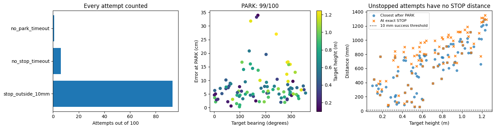

<div>

<table border="1" class="dataframe">
  <thead>
    <tr style="text-align: right;">
      <th></th>
      <th>status</th>
      <th>success</th>
      <th>parked</th>
      <th>park_s</th>
      <th>stop_s</th>
      <th>park_error_cm</th>
      <th>park_heading_error_deg</th>
      <th>at_stop_mm</th>
      <th>closest_mm</th>
      <th>end_mm</th>
      <th>post_stop_drift_mm</th>
      <th>post_park_base_drift_cm</th>
      <th>timed_out</th>
      <th>elapsed_s</th>
      <th>camera_visible_fraction</th>
      <th>target_bearing_deg</th>
      <th>target_range_m</th>
      <th>target_height_m</th>
    </tr>
    <tr>
      <th>dot</th>
      <th></th>
      <th></th>
      <th></th>
      <th></th>
      <th></th>
      <th></th>
      <th></th>
      <th></th>
      <th></th>
      <th></th>
      <th></th>
      <th></th>
      <th></th>
      <th></th>
      <th></th>
      <th></th>
      <th></th>
      <th></th>
    </tr>
  </thead>
  <tbody>
    <tr>
      <th>11</th>
      <td>stop_outside_10mm</td>
      <td>False</td>
      <td>True</td>
      <td>2.367</td>
      <td>2.738</td>
      <td>4.632</td>
      <td>5.582</td>
      <td>422.783</td>
      <td>377.713</td>
      <td>377.494</td>
      <td>-45.289</td>
      <td>0.170</td>
      <td>False</td>
      <td>12.559</td>
      <td>1.000</td>
      <td>0.986</td>
      <td>1.042</td>
      <td>0.178</td>
    </tr>
    <tr>
      <th>17</th>
      <td>stop_outside_10mm</td>
      <td>False</td>
      <td>True</td>
      <td>7.500</td>
      <td>7.500</td>
      <td>2.141</td>
      <td>-2.193</td>
      <td>1145.812</td>
      <td>882.513</td>
      <td>881.387</td>
      <td>-264.425</td>
      <td>0.150</td>
      <td>False</td>
      <td>24.429</td>
      <td>0.571</td>
      <td>194.926</td>
      <td>1.095</td>
      <td>1.028</td>
    </tr>
    <tr>
      <th>33</th>
      <td>stop_outside_10mm</td>
      <td>False</td>
      <td>True</td>
      <td>7.833</td>
      <td>7.833</td>
      <td>1.981</td>
      <td>-5.628</td>
      <td>903.781</td>
      <td>760.411</td>
      <td>760.101</td>
      <td>-143.679</td>
      <td>0.107</td>
      <td>False</td>
      <td>25.850</td>
      <td>0.608</td>
      <td>259.736</td>
      <td>1.504</td>
      <td>0.422</td>
    </tr>
    <tr>
      <th>35</th>
      <td>stop_outside_10mm</td>
      <td>False</td>
      <td>True</td>
      <td>8.900</td>
      <td>8.900</td>
      <td>3.258</td>
      <td>-11.948</td>
      <td>724.444</td>
      <td>712.919</td>
      <td>1296.956</td>
      <td>572.512</td>
      <td>1.499</td>
      <td>False</td>
      <td>28.047</td>
      <td>0.468</td>
      <td>111.687</td>
      <td>1.257</td>
      <td>0.589</td>
    </tr>
    <tr>
      <th>40</th>
      <td>stop_outside_10mm</td>
      <td>False</td>
      <td>True</td>
      <td>7.067</td>
      <td>8.535</td>
      <td>5.319</td>
      <td>-10.125</td>
      <td>842.283</td>
      <td>199.619</td>
      <td>578.942</td>
      <td>-263.341</td>
      <td>1.129</td>
      <td>False</td>
      <td>27.627</td>
      <td>0.625</td>
      <td>205.751</td>
      <td>1.041</td>
      <td>0.328</td>
    </tr>
    <tr>
      <th>...</th>
      <td>...</td>
      <td>...</td>
      <td>...</td>
      <td>...</td>
      <td>...</td>
      <td>...</td>
      <td>...</td>
      <td>...</td>
      <td>...</td>
      <td>...</td>
      <td>...</td>
      <td>...</td>
      <td>...</td>
      <td>...</td>
      <td>...</td>
      <td>...</td>
      <td>...</td>
      <td>...</td>
    </tr>
    <tr>
      <th>958</th>
      <td>stop_outside_10mm</td>
      <td>False</td>
      <td>True</td>
      <td>3.167</td>
      <td>3.227</td>
      <td>7.952</td>
      <td>-0.573</td>
      <td>126.242</td>
      <td>123.016</td>
      <td>142.653</td>
      <td>16.412</td>
      <td>0.179</td>
      <td>False</td>
      <td>10.636</td>
      <td>0.688</td>
      <td>347.116</td>
      <td>1.181</td>
      <td>0.493</td>
    </tr>
    <tr>
      <th>981</th>
      <td>stop_outside_10mm</td>
      <td>False</td>
      <td>True</td>
      <td>5.633</td>
      <td>5.633</td>
      <td>7.264</td>
      <td>-1.101</td>
      <td>715.486</td>
      <td>478.347</td>
      <td>477.399</td>
      <td>-238.087</td>
      <td>0.348</td>
      <td>False</td>
      <td>16.028</td>
      <td>0.636</td>
      <td>297.945</td>
      <td>1.569</td>
      <td>0.564</td>
    </tr>
    <tr>
      <th>985</th>
      <td>stop_outside_10mm</td>
      <td>False</td>
      <td>True</td>
      <td>6.633</td>
      <td>6.633</td>
      <td>16.662</td>
      <td>-0.918</td>
      <td>1264.916</td>
      <td>1264.916</td>
      <td>1296.360</td>
      <td>31.444</td>
      <td>0.031</td>
      <td>False</td>
      <td>17.511</td>
      <td>0.836</td>
      <td>284.446</td>
      <td>1.417</td>
      <td>1.210</td>
    </tr>
    <tr>
      <th>986</th>
      <td>stop_outside_10mm</td>
      <td>False</td>
      <td>True</td>
      <td>9.267</td>
      <td>9.267</td>
      <td>7.693</td>
      <td>-8.932</td>
      <td>767.129</td>
      <td>767.129</td>
      <td>789.331</td>
      <td>22.202</td>
      <td>0.077</td>
      <td>False</td>
      <td>21.416</td>
      <td>0.522</td>
      <td>98.931</td>
      <td>1.279</td>
      <td>0.179</td>
    </tr>
    <tr>
      <th>989</th>
      <td>stop_outside_10mm</td>
      <td>False</td>
      <td>True</td>
      <td>8.267</td>
      <td>8.267</td>
      <td>9.642</td>
      <td>-0.928</td>
      <td>1317.455</td>
      <td>1013.730</td>
      <td>1012.765</td>
      <td>-304.689</td>
      <td>0.102</td>
      <td>False</td>
      <td>18.849</td>
      <td>0.806</td>
      <td>287.737</td>
      <td>1.749</td>
      <td>1.193</td>
    </tr>
  </tbody>
</table>
<p>100 rows × 18 columns</p>
</div>


<a id="cell-274"></a>

<details><summary>Code · original cell 274</summary>

```python
overnight.holding(full_name);plt.show()
display(overnight.hold_table(full_name).round(4))
print('Learned torques are applied from reset. No expert holding or added gravity term.')
```

</details>

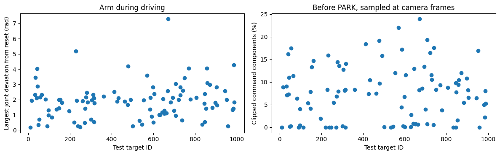

<div>

<table border="1" class="dataframe">
  <thead>
    <tr style="text-align: right;">
      <th></th>
      <th>status</th>
      <th>prepark_frames</th>
      <th>max_arm_deviation_rad</th>
      <th>maximum_command_Nm</th>
      <th>torque_clipped_fraction</th>
    </tr>
    <tr>
      <th>dot</th>
      <th></th>
      <th></th>
      <th></th>
      <th></th>
      <th></th>
    </tr>
  </thead>
  <tbody>
    <tr>
      <th>11</th>
      <td>stop_outside_10mm</td>
      <td>71</td>
      <td>0.1836</td>
      <td>25.6739</td>
      <td>0.0000</td>
    </tr>
    <tr>
      <th>17</th>
      <td>stop_outside_10mm</td>
      <td>225</td>
      <td>1.9381</td>
      <td>30.0000</td>
      <td>0.0889</td>
    </tr>
    <tr>
      <th>33</th>
      <td>stop_outside_10mm</td>
      <td>235</td>
      <td>2.3327</td>
      <td>30.0000</td>
      <td>0.0906</td>
    </tr>
    <tr>
      <th>35</th>
      <td>stop_outside_10mm</td>
      <td>267</td>
      <td>3.4424</td>
      <td>30.0000</td>
      <td>0.0712</td>
    </tr>
    <tr>
      <th>40</th>
      <td>stop_outside_10mm</td>
      <td>212</td>
      <td>2.1018</td>
      <td>30.0000</td>
      <td>0.1617</td>
    </tr>
    <tr>
      <th>...</th>
      <td>...</td>
      <td>...</td>
      <td>...</td>
      <td>...</td>
      <td>...</td>
    </tr>
    <tr>
      <th>958</th>
      <td>stop_outside_10mm</td>
      <td>95</td>
      <td>0.2711</td>
      <td>27.0872</td>
      <td>0.0000</td>
    </tr>
    <tr>
      <th>981</th>
      <td>stop_outside_10mm</td>
      <td>169</td>
      <td>1.3446</td>
      <td>30.0000</td>
      <td>0.0499</td>
    </tr>
    <tr>
      <th>985</th>
      <td>stop_outside_10mm</td>
      <td>199</td>
      <td>1.4292</td>
      <td>30.0000</td>
      <td>0.0223</td>
    </tr>
    <tr>
      <th>986</th>
      <td>stop_outside_10mm</td>
      <td>278</td>
      <td>4.2881</td>
      <td>30.0000</td>
      <td>0.0802</td>
    </tr>
    <tr>
      <th>989</th>
      <td>stop_outside_10mm</td>
      <td>248</td>
      <td>1.8260</td>
      <td>30.0000</td>
      <td>0.0530</td>
    </tr>
  </tbody>
</table>
<p>100 rows × 5 columns</p>
</div>

```text
Learned torques are applied from reset. No expert holding or added gravity term.

```


<a id="cell-275"></a>

<details><summary>Code · original cell 275</summary>

```python
full_report=overnight.select(full_name)
full_report.stopping(7);plt.show()
full_report.distances(7);plt.show()
print('Closest approach, exact STOP, and 0.5-second drift are different measurements.')
```

</details>

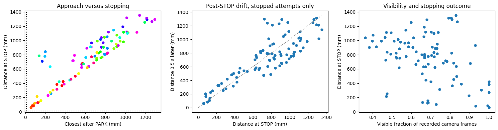

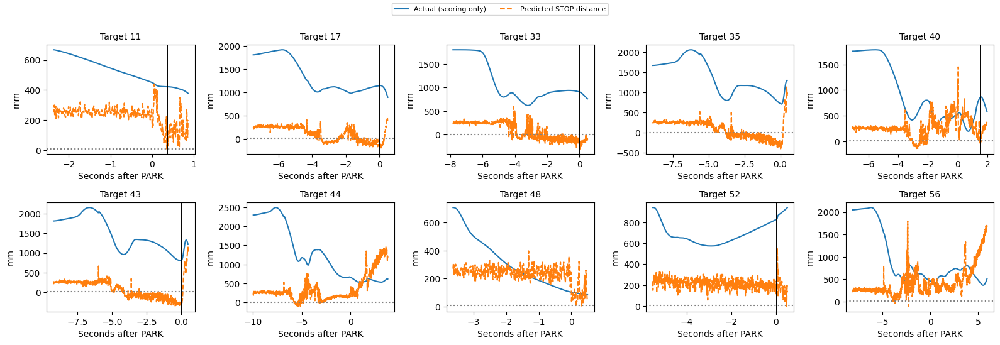

```text
Closest approach, exact STOP, and 0.5-second drift are different measurements.

```


<a id="cell-276"></a>

<details><summary>Code · original cell 276</summary>

```python
full_url=overnight.player_url(full_name)
display(lazy_player(full_url))
display(HTML(f'<a href="{full_url}" target="_blank">Open all 100 test replays</a>'))
print('Wheel encoder speeds, wheel commands, PARK and STOP values, applied arm torques, camera and ghost.')
```

</details>

[Interactive output: open original notebook, cell 276](../driving_v2/golden_dataset.ipynb).

[Interactive output: open original notebook, cell 276](../driving_v2/golden_dataset.ipynb).

```text
Wheel encoder speeds, wheel commands, PARK and STOP values, applied arm torques, camera and ghost.

```


<a id="cell-277"></a>

<details><summary>Code · original cell 277</summary>

```python
display(Markdown(overnight.reading(full_name)))
```

</details>

Both networks controlled the complete run, including learned arm torques before PARK. On validation, 97/100 parked and 0/100 met the full task criterion. On the frozen test comparison, 99/100 parked, 93/100 issued STOP, and 0/100 were within 10 mm at STOP. Median parking error among parked attempts was 6.0 cm; median distance at STOP among stopped attempts was 790.5 mm. Median maximum pre-PARK joint deviation was 1.902 rad. The 0.5 s after STOP is observed with learned torques still active, not a frozen simulation. These are previously viewed test targets and one seed; this is a frozen subsequent comparison, not an untouched estimate of generalisation. All timeouts and failures remain in the denominator.


<a id="cell-278"></a>

### Iteration 46: Frozen networks: add motor inertia to noise, damping and elasticity

**What changed:** Retain previous effects; add motor inertia J=0.001 kg m² using the previous acceleration. Networks unchanged.

**Type:** Frozen-model stress test. Seed 7 only; 100 validation and 100 test targets, with both learned networks controlling the complete episode. No conventional arm holding controller or extra gravity compensation is active.

**Result:** test PARK 100/100, STOP 94/100, full success 0/100; validation full success 0/100. Median parking error is 7.17 cm among 100 parked attempts. Median STOP distance is 779.3 mm among 94 stopped attempts. 0 attempts did not PARK; 6 parked without STOP. Neither is silently discarded from success.

**Comparison with iteration 45 (elasticity):** PARK count changes by +1; STOP by +1; successes by +0. On the same 99 targets parked by both, the median paired change in parking error is +0.08 cm. On the same 89 targets stopped by both, the median paired change at STOP is +0.3 mm. Negative changes mean smaller errors. These paired subsets exclude failures, so read them alongside the counts, not as overall success rates.

**Training provenance:** selected epochs: driving 299, torque 1198, STOP 593. The curves below belong to the actual checkpoint; frozen stress tests reuse their parent training histories and do not represent new training. Driving predicts four wheel speeds and time to PARK (trigger 0.25 s). The arm predicts seven torques; its STOP network predicts distance (trigger 10 mm). Command losses are MSE, with separate auxiliary MSE terms; run weights are equal. Saved configuration and histories give scaling and exact coefficients.

**Limits:** these test targets have been viewed in earlier experiments. This is a reused-test comparison, not an untouched final estimate. One seed cannot establish seed robustness. Success requires PARK, STOP and distance at STOP ≤10 mm. Closest approach and later drift are diagnostics, not substitutes for that criterion. The complete per-target table, pre-PARK arm analysis, all loss terms, STOP/drift plots and 100-replay player follow below.

**Interpretation:** this measures cumulative sensitivity of the original physical-scale model. It does not isolate the same effect on the standardised model. Differencing noisy angle readings can amplify velocity noise; this is a plausible mechanism, not a demonstrated sole cause.


<a id="cell-279"></a>

<details><summary>Code · original cell 279</summary>

```python
from pathlib import Path
import sys,json,uuid
import matplotlib.pyplot as plt
from IPython.display import display,Markdown,HTML
sys.path.insert(0,str(Path('../arm').resolve()))
import report_curriculum as overnight
def lazy_player(url,height=850):
    k=uuid.uuid4().hex[:8]
    return HTML(f"<div><button onclick=\"var f=document.getElementById('player{k}');f.src='{url}';f.style.display='block';this.style.display='none'\" style=\"padding:8px 14px\">Load the 3D player</button><iframe id=\"player{k}\" style=\"display:none;width:100%;height:{height}px;border:0\"></iframe></div>")

full_name='inertia'
display(overnight.build(full_name).round(3))
print('Validation and test are distinct. No fitting occurs in these analysis cells.')
```

</details>

<div>

<table border="1" class="dataframe">
  <thead>
    <tr style="text-align: right;">
      <th></th>
      <th>seed</th>
      <th>attempts</th>
      <th>parked</th>
      <th>stopped</th>
      <th>success_10mm</th>
      <th>success_percent</th>
      <th>wilson95_low_percent</th>
      <th>wilson95_high_percent</th>
      <th>median_park_error_cm</th>
      <th>median_abs_heading_error_deg</th>
      <th>median_closest_mm</th>
      <th>median_stop_mm</th>
      <th>median_park_s</th>
      <th>median_stop_s</th>
      <th>timeouts</th>
      <th>execution_failures</th>
      <th>sum_case_wall_s</th>
      <th>median_case_wall_s</th>
    </tr>
    <tr>
      <th>split</th>
      <th></th>
      <th></th>
      <th></th>
      <th></th>
      <th></th>
      <th></th>
      <th></th>
      <th></th>
      <th></th>
      <th></th>
      <th></th>
      <th></th>
      <th></th>
      <th></th>
      <th></th>
      <th></th>
      <th></th>
      <th></th>
    </tr>
  </thead>
  <tbody>
    <tr>
      <th>val</th>
      <td>7</td>
      <td>100</td>
      <td>96</td>
      <td>95</td>
      <td>0</td>
      <td>0.0</td>
      <td>0.0</td>
      <td>3.699</td>
      <td>7.085</td>
      <td>4.274</td>
      <td>687.507</td>
      <td>758.513</td>
      <td>7.95</td>
      <td>8.234</td>
      <td>5</td>
      <td>0</td>
      <td>2022.241</td>
      <td>20.748</td>
    </tr>
    <tr>
      <th>test</th>
      <td>7</td>
      <td>100</td>
      <td>100</td>
      <td>94</td>
      <td>0</td>
      <td>0.0</td>
      <td>0.0</td>
      <td>3.699</td>
      <td>7.171</td>
      <td>4.115</td>
      <td>640.595</td>
      <td>779.273</td>
      <td>7.45</td>
      <td>7.417</td>
      <td>6</td>
      <td>0</td>
      <td>1828.372</td>
      <td>18.207</td>
    </tr>
  </tbody>
</table>
</div>

```text
Validation and test are distinct. No fitting occurs in these analysis cells.

```


<a id="cell-280"></a>

<details><summary>Code · original cell 280</summary>

```python
full_config=json.loads((overnight.ROOT/full_name/'test/config.json').read_text())
display(full_config)
for kind in ('driving','torque','stop'):
    chosen=json.loads((overnight.models(full_name)/f'{kind}_seed7_summary.json').read_text())
    print(kind, 'selected epoch',chosen['selected_epoch'],'validation loss',chosen['selected_val_loss'])
```

</details>

```text
{'cases': [11,
  17,
  33,
  35,
  40,
  43,
  44,
  48,
  52,
  56,
  65,
  83,
  92,
  97,
  98,
  113,
  136,
  147,
  148,
  154,
  162,
  196,
  221,
  229,
  232,
  239,
  248,
  260,
  271,
  274,
  277,
  281,
  285,
  302,
  306,
  311,
  315,
  316,
  317,
  361,
  413,
  427,
  432,
  463,
  478,
  479,
  492,
  502,
  534,
  545,
  554,
  571,
  585,
  586,
  592,
  599,
  600,
  605,
  628,
  632,
  642,
  646,
  652,
  653,
  664,
  669,
  671,
  683,
  693,
  700,
  707,
  708,
  722,
  729,
  730,
  738,
  741,
  750,
  770,
  779,
  806,
  834,
  845,
  846,
  848,
  854,
  857,
  859,
  872,
  883,
  898,
  903,
  905,
  945,
  952,
  958,
  981,
  985,
  986,
  989],
 'split': 'test',
 'seed': 7,
 'jobs': 4,
 'models': '/media/nm/Fast Drive/comp0245-golden11109/overnight_20261105/baseline/models',
 'condition': {'encoder_noise_sd': 0.0001,
  'sensor_seed': 7,
  'damping': 1.0,
  'elasticity': 1.0,
  'inertia': 0.001},
 'model_hashes': {'driving_seed7.npz': '458fc825c3d3c1e5d39d3630655eb872bb46f3ddc34e0a850ee4eb5da52a18c3',
  'reaching_seed7.npz': '774c961608ec707c4ec9124ea13a66c180dd06be777481c0434a3a6f152287da'},
 'native_hashes': {'/media/nm/Fast Drive/comp0245-golden11109/overnight_20261105/ladder_runtime/native/sensor_curriculum.cpp': '8d4cc91c5a97aa7f31195187896d2d94ad570cffc5c5a30671de5e14aa7bb167',
  '/media/nm/Fast Drive/comp0245-golden11109/overnight_20261105/ladder_runtime/native/sensor_curriculum': '4ae5363bac9b2f93164fb65f6bd81c2811aff8400986ff0a83e474ca1ce0eece'},
 'source_hashes': {'full_run.py': 'c6da49f6cf9e934d24903222036f0d4d42c5a8a2c38de641f8e04612fc43b1e4',
  'evaluate_curriculum.py': '7fa3b64db19e7a39b0cb3a598945fee4695e3a0dce7d037d1eee1e73a85f132c',
  'curriculum_sensors.py': '8117d6a981b4e5dd37dbcf2f4c051e11e6be80dc414dd5beac3c30cbbd523520'},
 'split_sha256': '286f578aec7e3ab0953592466e63014cc1dde7f467106fadf273b30762ac1abf',
 'renderer': 'egl',
 'arm_control': 'learned from reset, 1 kHz, no PD hold or gravity addition',
 'selection': 'checkpoints frozen on offline validation; no fitting in evaluator',
 'test_reuse': 'existing targets previously evaluated; not a fresh blind test'}
```

```text
driving selected epoch 299 validation loss 0.38417819142341614
torque selected epoch 1198 validation loss 0.02170979417860508
stop selected epoch 593 validation loss 0.0030433654319494963

```


<a id="cell-281"></a>

<details><summary>Code · original cell 281</summary>

```python
overnight.losses(full_name);plt.show()
print('All training and validation epochs. Test scores are not training losses.')
```

</details>


```text
All training and validation epochs. Test scores are not training losses.

```


<a id="cell-282"></a>

<details><summary>Code · original cell 282</summary>

```python
full_report=overnight.select(full_name)
full_report.outcomes(7);plt.show()
display(full_report.table(7).round(3))
```

</details>

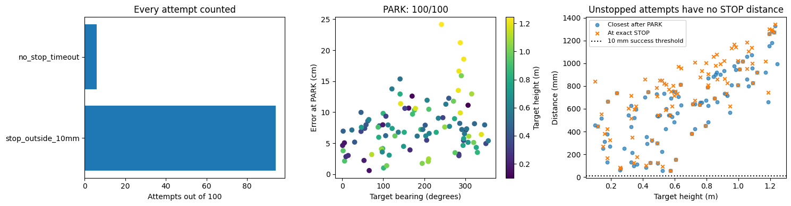

<div>

<table border="1" class="dataframe">
  <thead>
    <tr style="text-align: right;">
      <th></th>
      <th>status</th>
      <th>success</th>
      <th>parked</th>
      <th>park_s</th>
      <th>stop_s</th>
      <th>park_error_cm</th>
      <th>park_heading_error_deg</th>
      <th>at_stop_mm</th>
      <th>closest_mm</th>
      <th>end_mm</th>
      <th>post_stop_drift_mm</th>
      <th>post_park_base_drift_cm</th>
      <th>timed_out</th>
      <th>elapsed_s</th>
      <th>camera_visible_fraction</th>
      <th>target_bearing_deg</th>
      <th>target_range_m</th>
      <th>target_height_m</th>
    </tr>
    <tr>
      <th>dot</th>
      <th></th>
      <th></th>
      <th></th>
      <th></th>
      <th></th>
      <th></th>
      <th></th>
      <th></th>
      <th></th>
      <th></th>
      <th></th>
      <th></th>
      <th></th>
      <th></th>
      <th></th>
      <th></th>
      <th></th>
      <th></th>
    </tr>
  </thead>
  <tbody>
    <tr>
      <th>11</th>
      <td>stop_outside_10mm</td>
      <td>False</td>
      <td>True</td>
      <td>2.367</td>
      <td>2.738</td>
      <td>4.633</td>
      <td>5.582</td>
      <td>421.797</td>
      <td>375.383</td>
      <td>375.163</td>
      <td>-46.634</td>
      <td>0.170</td>
      <td>False</td>
      <td>8.766</td>
      <td>1.000</td>
      <td>0.986</td>
      <td>1.042</td>
      <td>0.178</td>
    </tr>
    <tr>
      <th>17</th>
      <td>stop_outside_10mm</td>
      <td>False</td>
      <td>True</td>
      <td>7.400</td>
      <td>7.401</td>
      <td>1.736</td>
      <td>-6.266</td>
      <td>1018.806</td>
      <td>1018.140</td>
      <td>1021.705</td>
      <td>2.898</td>
      <td>0.069</td>
      <td>False</td>
      <td>17.856</td>
      <td>0.496</td>
      <td>194.926</td>
      <td>1.095</td>
      <td>1.028</td>
    </tr>
    <tr>
      <th>33</th>
      <td>no_stop_timeout</td>
      <td>False</td>
      <td>True</td>
      <td>8.267</td>
      <td>NaN</td>
      <td>12.250</td>
      <td>-1.887</td>
      <td>NaN</td>
      <td>352.056</td>
      <td>398.734</td>
      <td>NaN</td>
      <td>0.813</td>
      <td>True</td>
      <td>27.038</td>
      <td>0.779</td>
      <td>259.736</td>
      <td>1.504</td>
      <td>0.422</td>
    </tr>
    <tr>
      <th>35</th>
      <td>stop_outside_10mm</td>
      <td>False</td>
      <td>True</td>
      <td>9.133</td>
      <td>9.133</td>
      <td>7.938</td>
      <td>-8.112</td>
      <td>803.497</td>
      <td>753.743</td>
      <td>942.625</td>
      <td>139.128</td>
      <td>1.616</td>
      <td>False</td>
      <td>20.828</td>
      <td>0.533</td>
      <td>111.687</td>
      <td>1.257</td>
      <td>0.589</td>
    </tr>
    <tr>
      <th>40</th>
      <td>no_stop_timeout</td>
      <td>False</td>
      <td>True</td>
      <td>6.867</td>
      <td>NaN</td>
      <td>5.479</td>
      <td>-10.248</td>
      <td>NaN</td>
      <td>130.754</td>
      <td>620.239</td>
      <td>NaN</td>
      <td>3.790</td>
      <td>True</td>
      <td>25.403</td>
      <td>0.680</td>
      <td>205.751</td>
      <td>1.041</td>
      <td>0.328</td>
    </tr>
    <tr>
      <th>...</th>
      <td>...</td>
      <td>...</td>
      <td>...</td>
      <td>...</td>
      <td>...</td>
      <td>...</td>
      <td>...</td>
      <td>...</td>
      <td>...</td>
      <td>...</td>
      <td>...</td>
      <td>...</td>
      <td>...</td>
      <td>...</td>
      <td>...</td>
      <td>...</td>
      <td>...</td>
      <td>...</td>
    </tr>
    <tr>
      <th>958</th>
      <td>stop_outside_10mm</td>
      <td>False</td>
      <td>True</td>
      <td>3.167</td>
      <td>3.227</td>
      <td>7.949</td>
      <td>-0.527</td>
      <td>126.347</td>
      <td>123.227</td>
      <td>139.898</td>
      <td>13.551</td>
      <td>0.138</td>
      <td>False</td>
      <td>9.989</td>
      <td>0.679</td>
      <td>347.116</td>
      <td>1.181</td>
      <td>0.493</td>
    </tr>
    <tr>
      <th>981</th>
      <td>stop_outside_10mm</td>
      <td>False</td>
      <td>True</td>
      <td>5.700</td>
      <td>5.700</td>
      <td>6.531</td>
      <td>-1.115</td>
      <td>772.103</td>
      <td>544.340</td>
      <td>543.262</td>
      <td>-228.841</td>
      <td>0.182</td>
      <td>False</td>
      <td>14.720</td>
      <td>0.683</td>
      <td>297.945</td>
      <td>1.569</td>
      <td>0.564</td>
    </tr>
    <tr>
      <th>985</th>
      <td>stop_outside_10mm</td>
      <td>False</td>
      <td>True</td>
      <td>6.633</td>
      <td>6.633</td>
      <td>16.622</td>
      <td>-0.972</td>
      <td>1282.742</td>
      <td>1282.742</td>
      <td>1291.207</td>
      <td>8.465</td>
      <td>0.433</td>
      <td>False</td>
      <td>16.110</td>
      <td>0.841</td>
      <td>284.446</td>
      <td>1.417</td>
      <td>1.210</td>
    </tr>
    <tr>
      <th>986</th>
      <td>stop_outside_10mm</td>
      <td>False</td>
      <td>True</td>
      <td>9.233</td>
      <td>9.233</td>
      <td>7.964</td>
      <td>-9.083</td>
      <td>665.891</td>
      <td>665.713</td>
      <td>929.823</td>
      <td>263.931</td>
      <td>1.435</td>
      <td>False</td>
      <td>19.557</td>
      <td>0.524</td>
      <td>98.931</td>
      <td>1.279</td>
      <td>0.179</td>
    </tr>
    <tr>
      <th>989</th>
      <td>stop_outside_10mm</td>
      <td>False</td>
      <td>True</td>
      <td>8.367</td>
      <td>8.367</td>
      <td>9.892</td>
      <td>-0.911</td>
      <td>1300.665</td>
      <td>1154.547</td>
      <td>1154.169</td>
      <td>-146.495</td>
      <td>0.056</td>
      <td>False</td>
      <td>18.697</td>
      <td>0.808</td>
      <td>287.737</td>
      <td>1.749</td>
      <td>1.193</td>
    </tr>
  </tbody>
</table>
<p>100 rows × 18 columns</p>
</div>


<a id="cell-283"></a>

<details><summary>Code · original cell 283</summary>

```python
overnight.holding(full_name);plt.show()
display(overnight.hold_table(full_name).round(4))
print('Learned torques are applied from reset. No expert holding or added gravity term.')
```

</details>

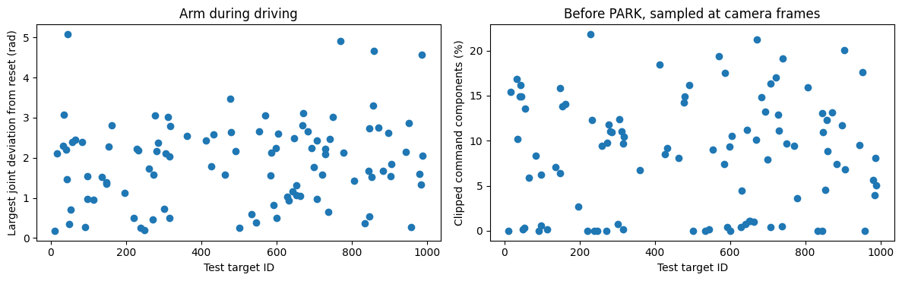

<div>

<table border="1" class="dataframe">
  <thead>
    <tr style="text-align: right;">
      <th></th>
      <th>status</th>
      <th>prepark_frames</th>
      <th>max_arm_deviation_rad</th>
      <th>maximum_command_Nm</th>
      <th>torque_clipped_fraction</th>
    </tr>
    <tr>
      <th>dot</th>
      <th></th>
      <th></th>
      <th></th>
      <th></th>
      <th></th>
    </tr>
  </thead>
  <tbody>
    <tr>
      <th>11</th>
      <td>stop_outside_10mm</td>
      <td>71</td>
      <td>0.1835</td>
      <td>25.7323</td>
      <td>0.0000</td>
    </tr>
    <tr>
      <th>17</th>
      <td>stop_outside_10mm</td>
      <td>222</td>
      <td>2.1115</td>
      <td>30.0000</td>
      <td>0.1538</td>
    </tr>
    <tr>
      <th>33</th>
      <td>no_stop_timeout</td>
      <td>248</td>
      <td>2.3016</td>
      <td>30.0000</td>
      <td>0.1688</td>
    </tr>
    <tr>
      <th>35</th>
      <td>stop_outside_10mm</td>
      <td>274</td>
      <td>3.0755</td>
      <td>30.0000</td>
      <td>0.1022</td>
    </tr>
    <tr>
      <th>40</th>
      <td>no_stop_timeout</td>
      <td>206</td>
      <td>2.2036</td>
      <td>30.0000</td>
      <td>0.1491</td>
    </tr>
    <tr>
      <th>...</th>
      <td>...</td>
      <td>...</td>
      <td>...</td>
      <td>...</td>
      <td>...</td>
    </tr>
    <tr>
      <th>958</th>
      <td>stop_outside_10mm</td>
      <td>95</td>
      <td>0.2711</td>
      <td>27.3328</td>
      <td>0.0000</td>
    </tr>
    <tr>
      <th>981</th>
      <td>stop_outside_10mm</td>
      <td>171</td>
      <td>1.6059</td>
      <td>30.0000</td>
      <td>0.0560</td>
    </tr>
    <tr>
      <th>985</th>
      <td>stop_outside_10mm</td>
      <td>199</td>
      <td>1.3400</td>
      <td>30.0000</td>
      <td>0.0395</td>
    </tr>
    <tr>
      <th>986</th>
      <td>stop_outside_10mm</td>
      <td>277</td>
      <td>4.5595</td>
      <td>30.0000</td>
      <td>0.0805</td>
    </tr>
    <tr>
      <th>989</th>
      <td>stop_outside_10mm</td>
      <td>251</td>
      <td>2.0616</td>
      <td>30.0000</td>
      <td>0.0507</td>
    </tr>
  </tbody>
</table>
<p>100 rows × 5 columns</p>
</div>

```text
Learned torques are applied from reset. No expert holding or added gravity term.

```


<a id="cell-284"></a>

<details><summary>Code · original cell 284</summary>

```python
full_report=overnight.select(full_name)
full_report.stopping(7);plt.show()
full_report.distances(7);plt.show()
print('Closest approach, exact STOP, and 0.5-second drift are different measurements.')
```

</details>

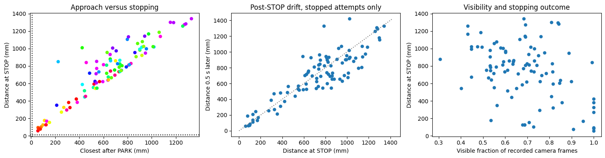

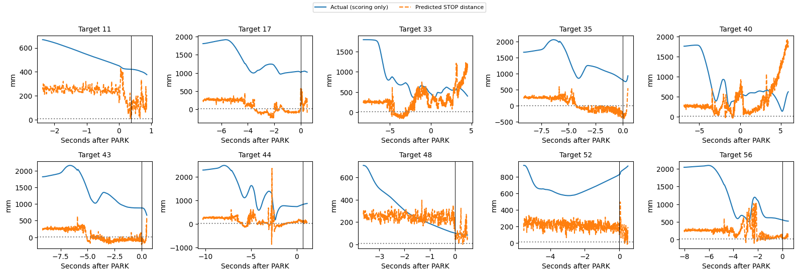

```text
Closest approach, exact STOP, and 0.5-second drift are different measurements.

```


<a id="cell-285"></a>

<details><summary>Code · original cell 285</summary>

```python
full_url=overnight.player_url(full_name)
display(lazy_player(full_url))
display(HTML(f'<a href="{full_url}" target="_blank">Open all 100 test replays</a>'))
print('Wheel encoder speeds, wheel commands, PARK and STOP values, applied arm torques, camera and ghost.')
```

</details>

[Interactive output: open original notebook, cell 285](../driving_v2/golden_dataset.ipynb).

[Interactive output: open original notebook, cell 285](../driving_v2/golden_dataset.ipynb).

```text
Wheel encoder speeds, wheel commands, PARK and STOP values, applied arm torques, camera and ghost.

```


<a id="cell-286"></a>

<details><summary>Code · original cell 286</summary>

```python
display(Markdown(overnight.reading(full_name)))
```

</details>

Both networks controlled the complete run, including learned arm torques before PARK. On validation, 96/100 parked and 0/100 met the full task criterion. On the frozen test comparison, 100/100 parked, 94/100 issued STOP, and 0/100 were within 10 mm at STOP. Median parking error among parked attempts was 7.2 cm; median distance at STOP among stopped attempts was 779.3 mm. Median maximum pre-PARK joint deviation was 2.046 rad. The 0.5 s after STOP is observed with learned torques still active, not a frozen simulation. These are previously viewed test targets and one seed; this is a frozen subsequent comparison, not an untouched estimate of generalisation. All timeouts and failures remain in the denominator.


<a id="cell-287"></a>

### Iteration 47: Frozen networks: add 3 ms observation delay to the cumulative disturbances

**What changed:** Add a causal 3 ms observation delay to noise, damping, elasticity and inertia. Networks unchanged.

**Type:** Frozen-model stress test. Seed 7 only; 100 validation and 100 test targets, with both learned networks controlling the complete episode. No conventional arm holding controller or extra gravity compensation is active.

**Result:** test PARK 91/100, STOP 91/100, full success 0/100; validation full success 0/100. Median parking error is 7.15 cm among 91 parked attempts. Median STOP distance is 825.9 mm among 91 stopped attempts. 9 attempts did not PARK; 0 parked without STOP. Neither is silently discarded from success.

**Comparison with iteration 46 (inertia):** PARK count changes by -9; STOP by -3; successes by +0. On the same 91 targets parked by both, the median paired change in parking error is -0.03 cm. On the same 86 targets stopped by both, the median paired change at STOP is +107.7 mm. Negative changes mean smaller errors. These paired subsets exclude failures, so read them alongside the counts, not as overall success rates.

**Training provenance:** selected epochs: driving 299, torque 1198, STOP 593. The curves below belong to the actual checkpoint; frozen stress tests reuse their parent training histories and do not represent new training. Driving predicts four wheel speeds and time to PARK (trigger 0.25 s). The arm predicts seven torques; its STOP network predicts distance (trigger 10 mm). Command losses are MSE, with separate auxiliary MSE terms; run weights are equal. Saved configuration and histories give scaling and exact coefficients.

**Limits:** these test targets have been viewed in earlier experiments. This is a reused-test comparison, not an untouched final estimate. One seed cannot establish seed robustness. Success requires PARK, STOP and distance at STOP ≤10 mm. Closest approach and later drift are diagnostics, not substitutes for that criterion. The complete per-target table, pre-PARK arm analysis, all loss terms, STOP/drift plots and 100-replay player follow below.

**Interpretation:** this measures cumulative sensitivity of the original physical-scale model. It does not isolate the same effect on the standardised model. Differencing noisy angle readings can amplify velocity noise; this is a plausible mechanism, not a demonstrated sole cause.


<a id="cell-288"></a>

<details><summary>Code · original cell 288</summary>

```python
from pathlib import Path
import sys,json,uuid
import matplotlib.pyplot as plt
from IPython.display import display,Markdown,HTML
sys.path.insert(0,str(Path('../arm').resolve()))
import report_curriculum as overnight
def lazy_player(url,height=850):
    k=uuid.uuid4().hex[:8]
    return HTML(f"<div><button onclick=\"var f=document.getElementById('player{k}');f.src='{url}';f.style.display='block';this.style.display='none'\" style=\"padding:8px 14px\">Load the 3D player</button><iframe id=\"player{k}\" style=\"display:none;width:100%;height:{height}px;border:0\"></iframe></div>")

full_name='delay'
display(overnight.build(full_name).round(3))
print('Validation and test are distinct. No fitting occurs in these analysis cells.')
```

</details>

<div>

<table border="1" class="dataframe">
  <thead>
    <tr style="text-align: right;">
      <th></th>
      <th>seed</th>
      <th>attempts</th>
      <th>parked</th>
      <th>stopped</th>
      <th>success_10mm</th>
      <th>success_percent</th>
      <th>wilson95_low_percent</th>
      <th>wilson95_high_percent</th>
      <th>median_park_error_cm</th>
      <th>median_abs_heading_error_deg</th>
      <th>median_closest_mm</th>
      <th>median_stop_mm</th>
      <th>median_park_s</th>
      <th>median_stop_s</th>
      <th>timeouts</th>
      <th>execution_failures</th>
      <th>sum_case_wall_s</th>
      <th>median_case_wall_s</th>
    </tr>
    <tr>
      <th>split</th>
      <th></th>
      <th></th>
      <th></th>
      <th></th>
      <th></th>
      <th></th>
      <th></th>
      <th></th>
      <th></th>
      <th></th>
      <th></th>
      <th></th>
      <th></th>
      <th></th>
      <th></th>
      <th></th>
      <th></th>
      <th></th>
    </tr>
  </thead>
  <tbody>
    <tr>
      <th>val</th>
      <td>7</td>
      <td>100</td>
      <td>89</td>
      <td>89</td>
      <td>0</td>
      <td>0.0</td>
      <td>0.0</td>
      <td>3.699</td>
      <td>6.035</td>
      <td>4.780</td>
      <td>761.874</td>
      <td>855.075</td>
      <td>8.1</td>
      <td>8.1</td>
      <td>11</td>
      <td>0</td>
      <td>1967.990</td>
      <td>19.984</td>
    </tr>
    <tr>
      <th>test</th>
      <td>7</td>
      <td>100</td>
      <td>91</td>
      <td>91</td>
      <td>0</td>
      <td>0.0</td>
      <td>0.0</td>
      <td>3.699</td>
      <td>7.151</td>
      <td>4.857</td>
      <td>764.127</td>
      <td>825.933</td>
      <td>7.7</td>
      <td>7.7</td>
      <td>9</td>
      <td>0</td>
      <td>1747.371</td>
      <td>17.663</td>
    </tr>
  </tbody>
</table>
</div>

```text
Validation and test are distinct. No fitting occurs in these analysis cells.

```


<a id="cell-289"></a>

<details><summary>Code · original cell 289</summary>

```python
full_config=json.loads((overnight.ROOT/full_name/'test/config.json').read_text())
display(full_config)
for kind in ('driving','torque','stop'):
    chosen=json.loads((overnight.models(full_name)/f'{kind}_seed7_summary.json').read_text())
    print(kind, 'selected epoch',chosen['selected_epoch'],'validation loss',chosen['selected_val_loss'])
```

</details>

```text
{'cases': [11,
  17,
  33,
  35,
  40,
  43,
  44,
  48,
  52,
  56,
  65,
  83,
  92,
  97,
  98,
  113,
  136,
  147,
  148,
  154,
  162,
  196,
  221,
  229,
  232,
  239,
  248,
  260,
  271,
  274,
  277,
  281,
  285,
  302,
  306,
  311,
  315,
  316,
  317,
  361,
  413,
  427,
  432,
  463,
  478,
  479,
  492,
  502,
  534,
  545,
  554,
  571,
  585,
  586,
  592,
  599,
  600,
  605,
  628,
  632,
  642,
  646,
  652,
  653,
  664,
  669,
  671,
  683,
  693,
  700,
  707,
  708,
  722,
  729,
  730,
  738,
  741,
  750,
  770,
  779,
  806,
  834,
  845,
  846,
  848,
  854,
  857,
  859,
  872,
  883,
  898,
  903,
  905,
  945,
  952,
  958,
  981,
  985,
  986,
  989],
 'split': 'test',
 'seed': 7,
 'jobs': 4,
 'models': '/media/nm/Fast Drive/comp0245-golden11109/overnight_20261105/baseline/models',
 'condition': {'encoder_noise_sd': 0.0001,
  'sensor_seed': 7,
  'damping': 1.0,
  'elasticity': 1.0,
  'inertia': 0.001,
  'delay_ms': 3},
 'model_hashes': {'driving_seed7.npz': '458fc825c3d3c1e5d39d3630655eb872bb46f3ddc34e0a850ee4eb5da52a18c3',
  'reaching_seed7.npz': '774c961608ec707c4ec9124ea13a66c180dd06be777481c0434a3a6f152287da'},
 'native_hashes': {'/media/nm/Fast Drive/comp0245-golden11109/overnight_20261105/ladder_runtime/native/sensor_curriculum.cpp': '8d4cc91c5a97aa7f31195187896d2d94ad570cffc5c5a30671de5e14aa7bb167',
  '/media/nm/Fast Drive/comp0245-golden11109/overnight_20261105/ladder_runtime/native/sensor_curriculum': '4ae5363bac9b2f93164fb65f6bd81c2811aff8400986ff0a83e474ca1ce0eece'},
 'source_hashes': {'full_run.py': 'c6da49f6cf9e934d24903222036f0d4d42c5a8a2c38de641f8e04612fc43b1e4',
  'evaluate_curriculum.py': '7fa3b64db19e7a39b0cb3a598945fee4695e3a0dce7d037d1eee1e73a85f132c',
  'curriculum_sensors.py': '8117d6a981b4e5dd37dbcf2f4c051e11e6be80dc414dd5beac3c30cbbd523520'},
 'split_sha256': '286f578aec7e3ab0953592466e63014cc1dde7f467106fadf273b30762ac1abf',
 'renderer': 'egl',
 'arm_control': 'learned from reset, 1 kHz, no PD hold or gravity addition',
 'selection': 'checkpoints frozen on offline validation; no fitting in evaluator',
 'test_reuse': 'existing targets previously evaluated; not a fresh blind test'}
```

```text
driving selected epoch 299 validation loss 0.38417819142341614
torque selected epoch 1198 validation loss 0.02170979417860508
stop selected epoch 593 validation loss 0.0030433654319494963

```


<a id="cell-290"></a>

<details><summary>Code · original cell 290</summary>

```python
overnight.losses(full_name);plt.show()
print('All training and validation epochs. Test scores are not training losses.')
```

</details>


```text
All training and validation epochs. Test scores are not training losses.

```


<a id="cell-291"></a>

<details><summary>Code · original cell 291</summary>

```python
full_report=overnight.select(full_name)
full_report.outcomes(7);plt.show()
display(full_report.table(7).round(3))
```

</details>

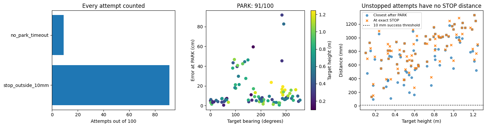

<div>

<table border="1" class="dataframe">
  <thead>
    <tr style="text-align: right;">
      <th></th>
      <th>status</th>
      <th>success</th>
      <th>parked</th>
      <th>park_s</th>
      <th>stop_s</th>
      <th>park_error_cm</th>
      <th>park_heading_error_deg</th>
      <th>at_stop_mm</th>
      <th>closest_mm</th>
      <th>end_mm</th>
      <th>post_stop_drift_mm</th>
      <th>post_park_base_drift_cm</th>
      <th>timed_out</th>
      <th>elapsed_s</th>
      <th>camera_visible_fraction</th>
      <th>target_bearing_deg</th>
      <th>target_range_m</th>
      <th>target_height_m</th>
    </tr>
    <tr>
      <th>dot</th>
      <th></th>
      <th></th>
      <th></th>
      <th></th>
      <th></th>
      <th></th>
      <th></th>
      <th></th>
      <th></th>
      <th></th>
      <th></th>
      <th></th>
      <th></th>
      <th></th>
      <th></th>
      <th></th>
      <th></th>
      <th></th>
    </tr>
  </thead>
  <tbody>
    <tr>
      <th>11</th>
      <td>stop_outside_10mm</td>
      <td>False</td>
      <td>True</td>
      <td>2.433</td>
      <td>2.435</td>
      <td>4.913</td>
      <td>6.043</td>
      <td>154.143</td>
      <td>96.519</td>
      <td>157.377</td>
      <td>3.234</td>
      <td>0.134</td>
      <td>False</td>
      <td>8.389</td>
      <td>0.989</td>
      <td>0.986</td>
      <td>1.042</td>
      <td>0.178</td>
    </tr>
    <tr>
      <th>17</th>
      <td>stop_outside_10mm</td>
      <td>False</td>
      <td>True</td>
      <td>8.100</td>
      <td>8.100</td>
      <td>3.879</td>
      <td>-4.631</td>
      <td>1045.656</td>
      <td>1001.483</td>
      <td>1001.699</td>
      <td>-43.957</td>
      <td>2.545</td>
      <td>False</td>
      <td>18.269</td>
      <td>0.543</td>
      <td>194.926</td>
      <td>1.095</td>
      <td>1.028</td>
    </tr>
    <tr>
      <th>33</th>
      <td>no_park_timeout</td>
      <td>False</td>
      <td>False</td>
      <td>NaN</td>
      <td>NaN</td>
      <td>NaN</td>
      <td>NaN</td>
      <td>NaN</td>
      <td>NaN</td>
      <td>851.955</td>
      <td>NaN</td>
      <td>NaN</td>
      <td>True</td>
      <td>25.308</td>
      <td>0.677</td>
      <td>259.736</td>
      <td>1.504</td>
      <td>0.422</td>
    </tr>
    <tr>
      <th>35</th>
      <td>stop_outside_10mm</td>
      <td>False</td>
      <td>True</td>
      <td>10.000</td>
      <td>10.000</td>
      <td>29.716</td>
      <td>-17.534</td>
      <td>906.591</td>
      <td>811.880</td>
      <td>811.414</td>
      <td>-95.177</td>
      <td>1.527</td>
      <td>False</td>
      <td>21.339</td>
      <td>0.575</td>
      <td>111.687</td>
      <td>1.257</td>
      <td>0.589</td>
    </tr>
    <tr>
      <th>40</th>
      <td>stop_outside_10mm</td>
      <td>False</td>
      <td>True</td>
      <td>7.367</td>
      <td>7.367</td>
      <td>8.016</td>
      <td>-9.830</td>
      <td>812.263</td>
      <td>812.263</td>
      <td>964.419</td>
      <td>152.156</td>
      <td>1.108</td>
      <td>False</td>
      <td>16.124</td>
      <td>0.504</td>
      <td>205.751</td>
      <td>1.041</td>
      <td>0.328</td>
    </tr>
    <tr>
      <th>...</th>
      <td>...</td>
      <td>...</td>
      <td>...</td>
      <td>...</td>
      <td>...</td>
      <td>...</td>
      <td>...</td>
      <td>...</td>
      <td>...</td>
      <td>...</td>
      <td>...</td>
      <td>...</td>
      <td>...</td>
      <td>...</td>
      <td>...</td>
      <td>...</td>
      <td>...</td>
      <td>...</td>
    </tr>
    <tr>
      <th>958</th>
      <td>stop_outside_10mm</td>
      <td>False</td>
      <td>True</td>
      <td>2.733</td>
      <td>2.733</td>
      <td>9.638</td>
      <td>-1.334</td>
      <td>380.111</td>
      <td>380.111</td>
      <td>541.323</td>
      <td>161.212</td>
      <td>0.209</td>
      <td>False</td>
      <td>8.187</td>
      <td>0.701</td>
      <td>347.116</td>
      <td>1.181</td>
      <td>0.493</td>
    </tr>
    <tr>
      <th>981</th>
      <td>stop_outside_10mm</td>
      <td>False</td>
      <td>True</td>
      <td>6.300</td>
      <td>6.321</td>
      <td>6.228</td>
      <td>-2.214</td>
      <td>593.729</td>
      <td>582.983</td>
      <td>806.628</td>
      <td>212.899</td>
      <td>0.194</td>
      <td>False</td>
      <td>14.588</td>
      <td>0.995</td>
      <td>297.945</td>
      <td>1.569</td>
      <td>0.564</td>
    </tr>
    <tr>
      <th>985</th>
      <td>stop_outside_10mm</td>
      <td>False</td>
      <td>True</td>
      <td>6.400</td>
      <td>6.400</td>
      <td>16.480</td>
      <td>-0.808</td>
      <td>1331.258</td>
      <td>1330.480</td>
      <td>1355.932</td>
      <td>24.674</td>
      <td>0.179</td>
      <td>False</td>
      <td>14.310</td>
      <td>0.638</td>
      <td>284.446</td>
      <td>1.417</td>
      <td>1.210</td>
    </tr>
    <tr>
      <th>986</th>
      <td>no_park_timeout</td>
      <td>False</td>
      <td>False</td>
      <td>NaN</td>
      <td>NaN</td>
      <td>NaN</td>
      <td>NaN</td>
      <td>NaN</td>
      <td>NaN</td>
      <td>1143.368</td>
      <td>NaN</td>
      <td>NaN</td>
      <td>True</td>
      <td>21.094</td>
      <td>0.546</td>
      <td>98.931</td>
      <td>1.279</td>
      <td>0.179</td>
    </tr>
    <tr>
      <th>989</th>
      <td>stop_outside_10mm</td>
      <td>False</td>
      <td>True</td>
      <td>7.700</td>
      <td>7.700</td>
      <td>10.721</td>
      <td>-0.226</td>
      <td>834.956</td>
      <td>800.582</td>
      <td>830.229</td>
      <td>-4.727</td>
      <td>0.099</td>
      <td>False</td>
      <td>16.097</td>
      <td>0.996</td>
      <td>287.737</td>
      <td>1.749</td>
      <td>1.193</td>
    </tr>
  </tbody>
</table>
<p>100 rows × 18 columns</p>
</div>


<a id="cell-292"></a>

<details><summary>Code · original cell 292</summary>

```python
overnight.holding(full_name);plt.show()
display(overnight.hold_table(full_name).round(4))
print('Learned torques are applied from reset. No expert holding or added gravity term.')
```

</details>

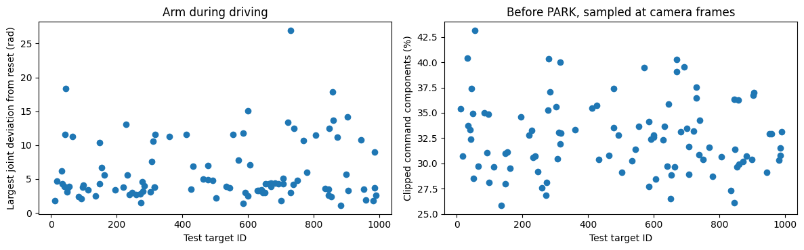

<div>

<table border="1" class="dataframe">
  <thead>
    <tr style="text-align: right;">
      <th></th>
      <th>status</th>
      <th>prepark_frames</th>
      <th>max_arm_deviation_rad</th>
      <th>maximum_command_Nm</th>
      <th>torque_clipped_fraction</th>
    </tr>
    <tr>
      <th>dot</th>
      <th></th>
      <th></th>
      <th></th>
      <th></th>
      <th></th>
    </tr>
  </thead>
  <tbody>
    <tr>
      <th>11</th>
      <td>stop_outside_10mm</td>
      <td>73</td>
      <td>1.7971</td>
      <td>30.0</td>
      <td>0.3542</td>
    </tr>
    <tr>
      <th>17</th>
      <td>stop_outside_10mm</td>
      <td>243</td>
      <td>4.6838</td>
      <td>30.0</td>
      <td>0.3075</td>
    </tr>
    <tr>
      <th>33</th>
      <td>no_park_timeout</td>
      <td>384</td>
      <td>6.2378</td>
      <td>30.0</td>
      <td>0.4040</td>
    </tr>
    <tr>
      <th>35</th>
      <td>stop_outside_10mm</td>
      <td>300</td>
      <td>4.3411</td>
      <td>30.0</td>
      <td>0.3371</td>
    </tr>
    <tr>
      <th>40</th>
      <td>stop_outside_10mm</td>
      <td>221</td>
      <td>3.8640</td>
      <td>30.0</td>
      <td>0.3335</td>
    </tr>
    <tr>
      <th>...</th>
      <td>...</td>
      <td>...</td>
      <td>...</td>
      <td>...</td>
      <td>...</td>
    </tr>
    <tr>
      <th>958</th>
      <td>stop_outside_10mm</td>
      <td>82</td>
      <td>1.8907</td>
      <td>30.0</td>
      <td>0.3293</td>
    </tr>
    <tr>
      <th>981</th>
      <td>stop_outside_10mm</td>
      <td>189</td>
      <td>1.8048</td>
      <td>30.0</td>
      <td>0.3031</td>
    </tr>
    <tr>
      <th>985</th>
      <td>stop_outside_10mm</td>
      <td>192</td>
      <td>3.6812</td>
      <td>30.0</td>
      <td>0.3155</td>
    </tr>
    <tr>
      <th>986</th>
      <td>no_park_timeout</td>
      <td>383</td>
      <td>9.0238</td>
      <td>30.0</td>
      <td>0.3077</td>
    </tr>
    <tr>
      <th>989</th>
      <td>stop_outside_10mm</td>
      <td>231</td>
      <td>2.6425</td>
      <td>30.0</td>
      <td>0.3315</td>
    </tr>
  </tbody>
</table>
<p>100 rows × 5 columns</p>
</div>

```text
Learned torques are applied from reset. No expert holding or added gravity term.

```


<a id="cell-293"></a>

<details><summary>Code · original cell 293</summary>

```python
full_report=overnight.select(full_name)
full_report.stopping(7);plt.show()
full_report.distances(7);plt.show()
print('Closest approach, exact STOP, and 0.5-second drift are different measurements.')
```

</details>

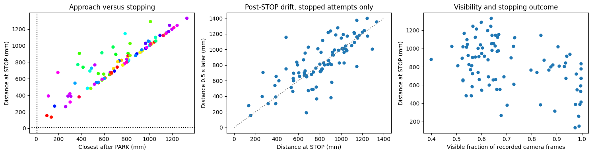

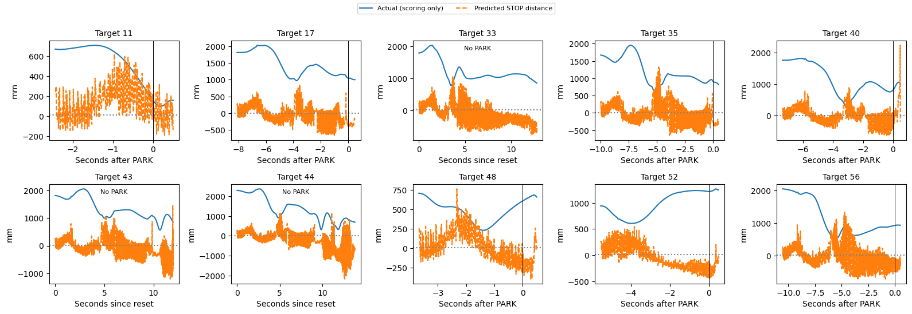

```text
Closest approach, exact STOP, and 0.5-second drift are different measurements.

```


<a id="cell-294"></a>

<details><summary>Code · original cell 294</summary>

```python
full_url=overnight.player_url(full_name)
display(lazy_player(full_url))
display(HTML(f'<a href="{full_url}" target="_blank">Open all 100 test replays</a>'))
print('Wheel encoder speeds, wheel commands, PARK and STOP values, applied arm torques, camera and ghost.')
```

</details>

[Interactive output: open original notebook, cell 294](../driving_v2/golden_dataset.ipynb).

[Interactive output: open original notebook, cell 294](../driving_v2/golden_dataset.ipynb).

```text
Wheel encoder speeds, wheel commands, PARK and STOP values, applied arm torques, camera and ghost.

```


<a id="cell-295"></a>

<details><summary>Code · original cell 295</summary>

```python
display(Markdown(overnight.reading(full_name)))
```

</details>

Both networks controlled the complete run, including learned arm torques before PARK. On validation, 89/100 parked and 0/100 met the full task criterion. On the frozen test comparison, 91/100 parked, 91/100 issued STOP, and 0/100 were within 10 mm at STOP. Median parking error among parked attempts was 7.2 cm; median distance at STOP among stopped attempts was 825.9 mm. Median maximum pre-PARK joint deviation was 4.235 rad. The 0.5 s after STOP is observed with learned torques still active, not a frozen simulation. These are previously viewed test targets and one seed; this is a frozen subsequent comparison, not an untouched estimate of generalisation. All timeouts and failures remain in the denominator.


<a id="cell-296"></a>

### Iteration 48: Frozen networks unchanged: random starts with all five disturbances

**What changed:** Retain all five disturbances and randomise starting x/y within ±0.15 m and heading within ±30 degrees. Networks unchanged.

**Type:** Frozen-model stress test. Seed 7 only; 100 validation and 100 test targets, with both learned networks controlling the complete episode. No conventional arm holding controller or extra gravity compensation is active.

**Result:** test PARK 89/100, STOP 89/100, full success 0/100; validation full success 0/100. Median parking error is 7.80 cm among 89 parked attempts. Median STOP distance is 899.3 mm among 89 stopped attempts. 11 attempts did not PARK; 0 parked without STOP. Neither is silently discarded from success.

**Comparison with iteration 47 (delay):** PARK count changes by -2; STOP by -2; successes by +0. On the same 81 targets parked by both, the median paired change in parking error is +0.22 cm. On the same 81 targets stopped by both, the median paired change at STOP is -4.1 mm. Negative changes mean smaller errors. These paired subsets exclude failures, so read them alongside the counts, not as overall success rates.

**Training provenance:** selected epochs: driving 299, torque 1198, STOP 593. The curves below belong to the actual checkpoint; frozen stress tests reuse their parent training histories and do not represent new training. Driving predicts four wheel speeds and time to PARK (trigger 0.25 s). The arm predicts seven torques; its STOP network predicts distance (trigger 10 mm). Command losses are MSE, with separate auxiliary MSE terms; run weights are equal. Saved configuration and histories give scaling and exact coefficients.

**Limits:** these test targets have been viewed in earlier experiments. This is a reused-test comparison, not an untouched final estimate. One seed cannot establish seed robustness. Success requires PARK, STOP and distance at STOP ≤10 mm. Closest approach and later drift are diagnostics, not substitutes for that criterion. The complete per-target table, pre-PARK arm analysis, all loss terms, STOP/drift plots and 100-replay player follow below.


<a id="cell-297"></a>

<details><summary>Code · original cell 297</summary>

```python
from pathlib import Path
import sys,json,uuid
import matplotlib.pyplot as plt
from IPython.display import display,Markdown,HTML
sys.path.insert(0,str(Path('../arm').resolve()))
import report_curriculum as overnight
def lazy_player(url,height=850):
    k=uuid.uuid4().hex[:8]
    return HTML(f"<div><button onclick=\"var f=document.getElementById('player{k}');f.src='{url}';f.style.display='block';this.style.display='none'\" style=\"padding:8px 14px\">Load the 3D player</button><iframe id=\"player{k}\" style=\"display:none;width:100%;height:{height}px;border:0\"></iframe></div>")

full_name='random_start_fixed'
display(overnight.build(full_name).round(3))
print('Validation and test are distinct. No fitting occurs in these analysis cells.')
```

</details>

<div>

<table border="1" class="dataframe">
  <thead>
    <tr style="text-align: right;">
      <th></th>
      <th>seed</th>
      <th>attempts</th>
      <th>parked</th>
      <th>stopped</th>
      <th>success_10mm</th>
      <th>success_percent</th>
      <th>wilson95_low_percent</th>
      <th>wilson95_high_percent</th>
      <th>median_park_error_cm</th>
      <th>median_abs_heading_error_deg</th>
      <th>median_closest_mm</th>
      <th>median_stop_mm</th>
      <th>median_park_s</th>
      <th>median_stop_s</th>
      <th>timeouts</th>
      <th>execution_failures</th>
      <th>sum_case_wall_s</th>
      <th>median_case_wall_s</th>
    </tr>
    <tr>
      <th>split</th>
      <th></th>
      <th></th>
      <th></th>
      <th></th>
      <th></th>
      <th></th>
      <th></th>
      <th></th>
      <th></th>
      <th></th>
      <th></th>
      <th></th>
      <th></th>
      <th></th>
      <th></th>
      <th></th>
      <th></th>
      <th></th>
    </tr>
  </thead>
  <tbody>
    <tr>
      <th>val</th>
      <td>7</td>
      <td>100</td>
      <td>88</td>
      <td>88</td>
      <td>0</td>
      <td>0.0</td>
      <td>0.0</td>
      <td>3.699</td>
      <td>8.133</td>
      <td>5.436</td>
      <td>902.168</td>
      <td>943.167</td>
      <td>7.350</td>
      <td>7.517</td>
      <td>12</td>
      <td>0</td>
      <td>1743.807</td>
      <td>17.345</td>
    </tr>
    <tr>
      <th>test</th>
      <td>7</td>
      <td>100</td>
      <td>89</td>
      <td>89</td>
      <td>0</td>
      <td>0.0</td>
      <td>0.0</td>
      <td>3.699</td>
      <td>7.802</td>
      <td>4.998</td>
      <td>860.135</td>
      <td>899.348</td>
      <td>7.133</td>
      <td>7.233</td>
      <td>11</td>
      <td>0</td>
      <td>1699.217</td>
      <td>17.154</td>
    </tr>
  </tbody>
</table>
</div>

```text
Validation and test are distinct. No fitting occurs in these analysis cells.

```


<a id="cell-298"></a>

<details><summary>Code · original cell 298</summary>

```python
full_config=json.loads((overnight.ROOT/full_name/'test/config.json').read_text())
display(full_config)
for kind in ('driving','torque','stop'):
    chosen=json.loads((overnight.models(full_name)/f'{kind}_seed7_summary.json').read_text())
    print(kind, 'selected epoch',chosen['selected_epoch'],'validation loss',chosen['selected_val_loss'])
```

</details>

```text
{'cases': [11,
  17,
  33,
  35,
  40,
  43,
  44,
  48,
  52,
  56,
  65,
  83,
  92,
  97,
  98,
  113,
  136,
  147,
  148,
  154,
  162,
  196,
  221,
  229,
  232,
  239,
  248,
  260,
  271,
  274,
  277,
  281,
  285,
  302,
  306,
  311,
  315,
  316,
  317,
  361,
  413,
  427,
  432,
  463,
  478,
  479,
  492,
  502,
  534,
  545,
  554,
  571,
  585,
  586,
  592,
  599,
  600,
  605,
  628,
  632,
  642,
  646,
  652,
  653,
  664,
  669,
  671,
  683,
  693,
  700,
  707,
  708,
  722,
  729,
  730,
  738,
  741,
  750,
  770,
  779,
  806,
  834,
  845,
  846,
  848,
  854,
  857,
  859,
  872,
  883,
  898,
  903,
  905,
  945,
  952,
  958,
  981,
  985,
  986,
  989],
 'split': 'test',
 'seed': 7,
 'jobs': 4,
 'models': '/media/nm/Fast Drive/comp0245-golden11109/overnight_20261105/baseline/models',
 'condition': {'encoder_noise_sd': 0.0001,
  'sensor_seed': 7,
  'damping': 1.0,
  'elasticity': 1.0,
  'inertia': 0.001,
  'delay_ms': 3},
 'model_hashes': {'driving_seed7.npz': '458fc825c3d3c1e5d39d3630655eb872bb46f3ddc34e0a850ee4eb5da52a18c3',
  'reaching_seed7.npz': '774c961608ec707c4ec9124ea13a66c180dd06be777481c0434a3a6f152287da'},
 'native_hashes': {'/media/nm/Fast Drive/comp0245-golden11109/overnight_20261105/recovery_runtime/native/sensor_curriculum.cpp': '85a6236a4d1fdc0c9dc2d0e991e460cc150e12abb2e153c596f3c8b247ed60d6',
  '/media/nm/Fast Drive/comp0245-golden11109/overnight_20261105/recovery_runtime/native/sensor_curriculum': 'd589e24b3ac57a056801059812d64271bc83cc2d350c6a487509b6555b6ecf8d'},
 'source_hashes': {'full_run.py': 'a099cabfe4479cf25bd59665e16717b8634a7feeb1b647f1dc39df9bf674514d',
  'evaluate_curriculum.py': '7fa3b64db19e7a39b0cb3a598945fee4695e3a0dce7d037d1eee1e73a85f132c',
  'curriculum_sensors.py': '8117d6a981b4e5dd37dbcf2f4c051e11e6be80dc414dd5beac3c30cbbd523520'},
 'split_sha256': '286f578aec7e3ab0953592466e63014cc1dde7f467106fadf273b30762ac1abf',
 'renderer': 'egl',
 'arm_control': 'learned from reset, 1 kHz, no PD hold or gravity addition',
 'selection': 'checkpoints frozen on offline validation; no fitting in evaluator',
 'test_reuse': 'existing targets previously evaluated; not a fresh blind test'}
```

```text
driving selected epoch 299 validation loss 0.38417819142341614
torque selected epoch 1198 validation loss 0.02170979417860508
stop selected epoch 593 validation loss 0.0030433654319494963

```


<a id="cell-299"></a>

<details><summary>Code · original cell 299</summary>

```python
overnight.losses(full_name);plt.show()
print('All training and validation epochs. Test scores are not training losses.')
```

</details>


```text
All training and validation epochs. Test scores are not training losses.

```


<a id="cell-300"></a>

<details><summary>Code · original cell 300</summary>

```python
full_report=overnight.select(full_name)
full_report.outcomes(7);plt.show()
display(full_report.table(7).round(3))
```

</details>

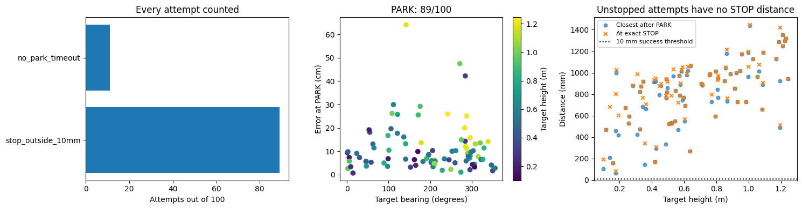

<div>

<table border="1" class="dataframe">
  <thead>
    <tr style="text-align: right;">
      <th></th>
      <th>status</th>
      <th>success</th>
      <th>parked</th>
      <th>park_s</th>
      <th>stop_s</th>
      <th>park_error_cm</th>
      <th>park_heading_error_deg</th>
      <th>at_stop_mm</th>
      <th>closest_mm</th>
      <th>end_mm</th>
      <th>post_stop_drift_mm</th>
      <th>post_park_base_drift_cm</th>
      <th>timed_out</th>
      <th>elapsed_s</th>
      <th>camera_visible_fraction</th>
      <th>target_bearing_deg</th>
      <th>target_range_m</th>
      <th>target_height_m</th>
    </tr>
    <tr>
      <th>dot</th>
      <th></th>
      <th></th>
      <th></th>
      <th></th>
      <th></th>
      <th></th>
      <th></th>
      <th></th>
      <th></th>
      <th></th>
      <th></th>
      <th></th>
      <th></th>
      <th></th>
      <th></th>
      <th></th>
      <th></th>
      <th></th>
    </tr>
  </thead>
  <tbody>
    <tr>
      <th>11</th>
      <td>stop_outside_10mm</td>
      <td>False</td>
      <td>True</td>
      <td>2.667</td>
      <td>2.670</td>
      <td>9.423</td>
      <td>3.331</td>
      <td>83.839</td>
      <td>64.928</td>
      <td>163.196</td>
      <td>79.356</td>
      <td>0.176</td>
      <td>False</td>
      <td>7.864</td>
      <td>0.958</td>
      <td>0.986</td>
      <td>1.042</td>
      <td>0.178</td>
    </tr>
    <tr>
      <th>17</th>
      <td>stop_outside_10mm</td>
      <td>False</td>
      <td>True</td>
      <td>7.233</td>
      <td>7.233</td>
      <td>7.920</td>
      <td>1.520</td>
      <td>1128.853</td>
      <td>1128.853</td>
      <td>1235.051</td>
      <td>106.197</td>
      <td>1.210</td>
      <td>False</td>
      <td>16.187</td>
      <td>0.565</td>
      <td>194.926</td>
      <td>1.095</td>
      <td>1.028</td>
    </tr>
    <tr>
      <th>33</th>
      <td>stop_outside_10mm</td>
      <td>False</td>
      <td>True</td>
      <td>8.200</td>
      <td>8.200</td>
      <td>5.052</td>
      <td>-2.888</td>
      <td>948.115</td>
      <td>919.029</td>
      <td>918.840</td>
      <td>-29.276</td>
      <td>0.850</td>
      <td>False</td>
      <td>17.918</td>
      <td>0.636</td>
      <td>259.736</td>
      <td>1.504</td>
      <td>0.422</td>
    </tr>
    <tr>
      <th>35</th>
      <td>stop_outside_10mm</td>
      <td>False</td>
      <td>True</td>
      <td>10.500</td>
      <td>10.502</td>
      <td>29.935</td>
      <td>-18.010</td>
      <td>1053.418</td>
      <td>742.640</td>
      <td>741.610</td>
      <td>-311.807</td>
      <td>2.978</td>
      <td>False</td>
      <td>20.879</td>
      <td>0.553</td>
      <td>111.687</td>
      <td>1.257</td>
      <td>0.589</td>
    </tr>
    <tr>
      <th>40</th>
      <td>stop_outside_10mm</td>
      <td>False</td>
      <td>True</td>
      <td>6.867</td>
      <td>6.867</td>
      <td>10.306</td>
      <td>-12.952</td>
      <td>820.610</td>
      <td>820.610</td>
      <td>944.449</td>
      <td>123.840</td>
      <td>1.508</td>
      <td>False</td>
      <td>15.088</td>
      <td>0.579</td>
      <td>205.751</td>
      <td>1.041</td>
      <td>0.328</td>
    </tr>
    <tr>
      <th>...</th>
      <td>...</td>
      <td>...</td>
      <td>...</td>
      <td>...</td>
      <td>...</td>
      <td>...</td>
      <td>...</td>
      <td>...</td>
      <td>...</td>
      <td>...</td>
      <td>...</td>
      <td>...</td>
      <td>...</td>
      <td>...</td>
      <td>...</td>
      <td>...</td>
      <td>...</td>
      <td>...</td>
    </tr>
    <tr>
      <th>958</th>
      <td>stop_outside_10mm</td>
      <td>False</td>
      <td>True</td>
      <td>4.500</td>
      <td>4.500</td>
      <td>4.084</td>
      <td>-8.216</td>
      <td>817.961</td>
      <td>817.948</td>
      <td>845.684</td>
      <td>27.724</td>
      <td>0.234</td>
      <td>False</td>
      <td>11.119</td>
      <td>0.873</td>
      <td>347.116</td>
      <td>1.181</td>
      <td>0.493</td>
    </tr>
    <tr>
      <th>981</th>
      <td>stop_outside_10mm</td>
      <td>False</td>
      <td>True</td>
      <td>6.367</td>
      <td>6.985</td>
      <td>9.673</td>
      <td>0.350</td>
      <td>725.233</td>
      <td>470.191</td>
      <td>866.586</td>
      <td>141.353</td>
      <td>0.513</td>
      <td>False</td>
      <td>15.730</td>
      <td>0.996</td>
      <td>297.945</td>
      <td>1.569</td>
      <td>0.564</td>
    </tr>
    <tr>
      <th>985</th>
      <td>stop_outside_10mm</td>
      <td>False</td>
      <td>True</td>
      <td>6.800</td>
      <td>6.800</td>
      <td>12.109</td>
      <td>-0.642</td>
      <td>1251.472</td>
      <td>1249.535</td>
      <td>1408.945</td>
      <td>157.474</td>
      <td>0.151</td>
      <td>False</td>
      <td>14.865</td>
      <td>0.589</td>
      <td>284.446</td>
      <td>1.417</td>
      <td>1.210</td>
    </tr>
    <tr>
      <th>986</th>
      <td>stop_outside_10mm</td>
      <td>False</td>
      <td>True</td>
      <td>9.100</td>
      <td>9.100</td>
      <td>6.817</td>
      <td>-17.175</td>
      <td>1028.843</td>
      <td>995.294</td>
      <td>994.647</td>
      <td>-34.196</td>
      <td>0.133</td>
      <td>False</td>
      <td>17.408</td>
      <td>0.465</td>
      <td>98.931</td>
      <td>1.279</td>
      <td>0.179</td>
    </tr>
    <tr>
      <th>989</th>
      <td>stop_outside_10mm</td>
      <td>False</td>
      <td>True</td>
      <td>6.933</td>
      <td>6.933</td>
      <td>11.202</td>
      <td>1.951</td>
      <td>515.071</td>
      <td>488.372</td>
      <td>569.645</td>
      <td>54.574</td>
      <td>0.048</td>
      <td>False</td>
      <td>15.233</td>
      <td>0.767</td>
      <td>287.737</td>
      <td>1.749</td>
      <td>1.193</td>
    </tr>
  </tbody>
</table>
<p>100 rows × 18 columns</p>
</div>


<a id="cell-301"></a>

<details><summary>Code · original cell 301</summary>

```python
overnight.holding(full_name);plt.show()
display(overnight.hold_table(full_name).round(4))
print('Learned torques are applied from reset. No expert holding or added gravity term.')
```

</details>

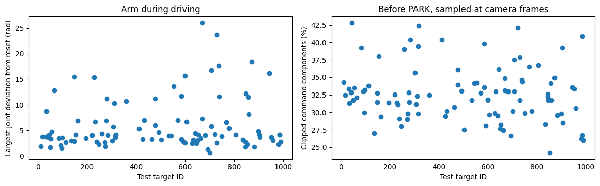

<div>

<table border="1" class="dataframe">
  <thead>
    <tr style="text-align: right;">
      <th></th>
      <th>status</th>
      <th>prepark_frames</th>
      <th>max_arm_deviation_rad</th>
      <th>maximum_command_Nm</th>
      <th>torque_clipped_fraction</th>
    </tr>
    <tr>
      <th>dot</th>
      <th></th>
      <th></th>
      <th></th>
      <th></th>
      <th></th>
    </tr>
  </thead>
  <tbody>
    <tr>
      <th>11</th>
      <td>stop_outside_10mm</td>
      <td>80</td>
      <td>1.8559</td>
      <td>30.0</td>
      <td>0.3429</td>
    </tr>
    <tr>
      <th>17</th>
      <td>stop_outside_10mm</td>
      <td>217</td>
      <td>3.7390</td>
      <td>30.0</td>
      <td>0.3246</td>
    </tr>
    <tr>
      <th>33</th>
      <td>stop_outside_10mm</td>
      <td>246</td>
      <td>3.6985</td>
      <td>30.0</td>
      <td>0.3333</td>
    </tr>
    <tr>
      <th>35</th>
      <td>stop_outside_10mm</td>
      <td>315</td>
      <td>8.7945</td>
      <td>30.0</td>
      <td>0.3134</td>
    </tr>
    <tr>
      <th>40</th>
      <td>stop_outside_10mm</td>
      <td>206</td>
      <td>3.6533</td>
      <td>30.0</td>
      <td>0.3280</td>
    </tr>
    <tr>
      <th>...</th>
      <td>...</td>
      <td>...</td>
      <td>...</td>
      <td>...</td>
      <td>...</td>
    </tr>
    <tr>
      <th>958</th>
      <td>stop_outside_10mm</td>
      <td>135</td>
      <td>3.0450</td>
      <td>30.0</td>
      <td>0.3058</td>
    </tr>
    <tr>
      <th>981</th>
      <td>stop_outside_10mm</td>
      <td>191</td>
      <td>2.2247</td>
      <td>30.0</td>
      <td>0.2618</td>
    </tr>
    <tr>
      <th>985</th>
      <td>stop_outside_10mm</td>
      <td>204</td>
      <td>4.1781</td>
      <td>30.0</td>
      <td>0.2675</td>
    </tr>
    <tr>
      <th>986</th>
      <td>stop_outside_10mm</td>
      <td>273</td>
      <td>4.1152</td>
      <td>30.0</td>
      <td>0.4087</td>
    </tr>
    <tr>
      <th>989</th>
      <td>stop_outside_10mm</td>
      <td>208</td>
      <td>2.7147</td>
      <td>30.0</td>
      <td>0.2603</td>
    </tr>
  </tbody>
</table>
<p>100 rows × 5 columns</p>
</div>

```text
Learned torques are applied from reset. No expert holding or added gravity term.

```


<a id="cell-302"></a>

<details><summary>Code · original cell 302</summary>

```python
full_report=overnight.select(full_name)
full_report.stopping(7);plt.show()
full_report.distances(7);plt.show()
print('Closest approach, exact STOP, and 0.5-second drift are different measurements.')
```

</details>

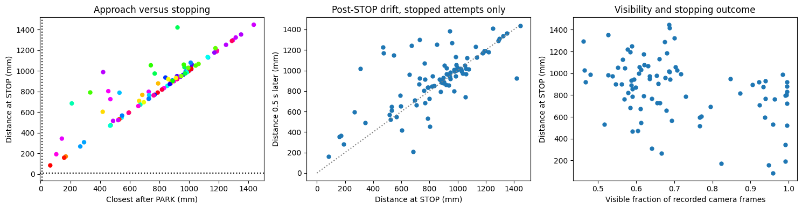

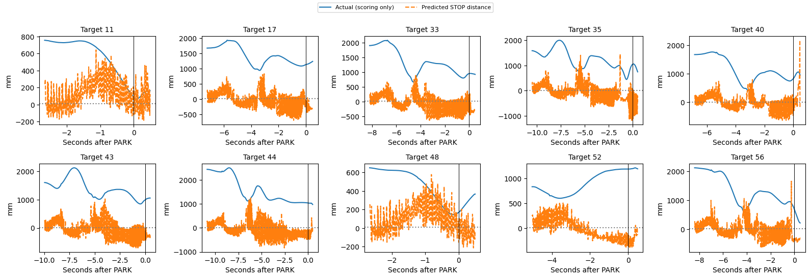

```text
Closest approach, exact STOP, and 0.5-second drift are different measurements.

```


<a id="cell-303"></a>

<details><summary>Code · original cell 303</summary>

```python
full_url=overnight.player_url(full_name)
display(lazy_player(full_url))
display(HTML(f'<a href="{full_url}" target="_blank">Open all 100 test replays</a>'))
print('Wheel encoder speeds, wheel commands, PARK and STOP values, applied arm torques, camera and ghost.')
```

</details>

[Interactive output: open original notebook, cell 303](../driving_v2/golden_dataset.ipynb).

[Interactive output: open original notebook, cell 303](../driving_v2/golden_dataset.ipynb).

```text
Wheel encoder speeds, wheel commands, PARK and STOP values, applied arm torques, camera and ghost.

```


<a id="cell-304"></a>

<details><summary>Code · original cell 304</summary>

```python
display(Markdown(overnight.reading(full_name)))
```

</details>

Both networks controlled the complete run, including learned arm torques before PARK. On validation, 88/100 parked and 0/100 met the full task criterion. On the frozen test comparison, 89/100 parked, 89/100 issued STOP, and 0/100 were within 10 mm at STOP. Median parking error among parked attempts was 7.8 cm; median distance at STOP among stopped attempts was 899.3 mm. Median maximum pre-PARK joint deviation was 4.059 rad. The 0.5 s after STOP is observed with learned torques still active, not a frozen simulation. These are previously viewed test targets and one seed; this is a frozen subsequent comparison, not an untouched estimate of generalisation. All timeouts and failures remain in the denominator.


<a id="cell-305"></a>

### Iteration 49: Retrain driving and reaching on random starts; evaluate with all five disturbances

**What changed:** Retrain driving and reaching on random-start expert data with physical input scales. Evaluate with random starts and all five disturbances. The expert retains its original world-origin parking convention.

**Type:** New training. Seed 7 only; 100 validation and 100 test targets, with both learned networks controlling the complete episode. No conventional arm holding controller or extra gravity compensation is active.

**Result:** test PARK 85/100, STOP 85/100, full success 0/100; validation full success 0/100. Median parking error is 29.51 cm among 85 parked attempts. Median STOP distance is 801.3 mm among 85 stopped attempts. 15 attempts did not PARK; 0 parked without STOP. Neither is silently discarded from success.

**Comparison with iteration 48 (random_start_fixed):** PARK count changes by -4; STOP by -4; successes by +0. On the same 75 targets parked by both, the median paired change in parking error is +13.79 cm. On the same 75 targets stopped by both, the median paired change at STOP is -91.7 mm. Negative changes mean smaller errors. These paired subsets exclude failures, so read them alongside the counts, not as overall success rates.

**Training provenance:** selected epochs: driving 300, torque 1174, STOP 599. The curves below belong to the actual checkpoint; frozen stress tests reuse their parent training histories and do not represent new training. Driving predicts four wheel speeds and time to PARK (trigger 0.25 s). The arm predicts seven torques; its STOP network predicts distance (trigger 10 mm). Command losses are MSE, with separate auxiliary MSE terms; run weights are equal. Saved configuration and histories give scaling and exact coefficients.

**Limits:** these test targets have been viewed in earlier experiments. This is a reused-test comparison, not an untouched final estimate. One seed cannot establish seed robustness. Success requires PARK, STOP and distance at STOP ≤10 mm. Closest approach and later drift are diagnostics, not substitutes for that criterion. The complete per-target table, pre-PARK arm analysis, all loss terms, STOP/drift plots and 100-replay player follow below.


<a id="cell-306"></a>

<details><summary>Code · original cell 306</summary>

```python
from pathlib import Path
import sys,json,uuid
import matplotlib.pyplot as plt
from IPython.display import display,Markdown,HTML
sys.path.insert(0,str(Path('../arm').resolve()))
import report_curriculum as overnight
def lazy_player(url,height=850):
    k=uuid.uuid4().hex[:8]
    return HTML(f"<div><button onclick=\"var f=document.getElementById('player{k}');f.src='{url}';f.style.display='block';this.style.display='none'\" style=\"padding:8px 14px\">Load the 3D player</button><iframe id=\"player{k}\" style=\"display:none;width:100%;height:{height}px;border:0\"></iframe></div>")

full_name='random_start_retrained'
display(overnight.build(full_name).round(3))
print('Validation and test are distinct. No fitting occurs in these analysis cells.')
```

</details>

<div>

<table border="1" class="dataframe">
  <thead>
    <tr style="text-align: right;">
      <th></th>
      <th>seed</th>
      <th>attempts</th>
      <th>parked</th>
      <th>stopped</th>
      <th>success_10mm</th>
      <th>success_percent</th>
      <th>wilson95_low_percent</th>
      <th>wilson95_high_percent</th>
      <th>median_park_error_cm</th>
      <th>median_abs_heading_error_deg</th>
      <th>median_closest_mm</th>
      <th>median_stop_mm</th>
      <th>median_park_s</th>
      <th>median_stop_s</th>
      <th>timeouts</th>
      <th>execution_failures</th>
      <th>sum_case_wall_s</th>
      <th>median_case_wall_s</th>
    </tr>
    <tr>
      <th>split</th>
      <th></th>
      <th></th>
      <th></th>
      <th></th>
      <th></th>
      <th></th>
      <th></th>
      <th></th>
      <th></th>
      <th></th>
      <th></th>
      <th></th>
      <th></th>
      <th></th>
      <th></th>
      <th></th>
      <th></th>
      <th></th>
    </tr>
  </thead>
  <tbody>
    <tr>
      <th>val</th>
      <td>7</td>
      <td>100</td>
      <td>84</td>
      <td>84</td>
      <td>0</td>
      <td>0.0</td>
      <td>0.0</td>
      <td>3.699</td>
      <td>28.237</td>
      <td>13.550</td>
      <td>784.274</td>
      <td>791.139</td>
      <td>7.25</td>
      <td>7.25</td>
      <td>16</td>
      <td>0</td>
      <td>1813.999</td>
      <td>17.539</td>
    </tr>
    <tr>
      <th>test</th>
      <td>7</td>
      <td>100</td>
      <td>85</td>
      <td>85</td>
      <td>0</td>
      <td>0.0</td>
      <td>0.0</td>
      <td>3.699</td>
      <td>29.506</td>
      <td>11.479</td>
      <td>801.259</td>
      <td>801.259</td>
      <td>6.90</td>
      <td>6.90</td>
      <td>15</td>
      <td>0</td>
      <td>1742.808</td>
      <td>16.227</td>
    </tr>
  </tbody>
</table>
</div>

```text
Validation and test are distinct. No fitting occurs in these analysis cells.

```


<a id="cell-307"></a>

<details><summary>Code · original cell 307</summary>

```python
full_config=json.loads((overnight.ROOT/full_name/'test/config.json').read_text())
display(full_config)
for kind in ('driving','torque','stop'):
    chosen=json.loads((overnight.models(full_name)/f'{kind}_seed7_summary.json').read_text())
    print(kind, 'selected epoch',chosen['selected_epoch'],'validation loss',chosen['selected_val_loss'])
```

</details>

```text
{'cases': [11,
  17,
  33,
  35,
  40,
  43,
  44,
  48,
  52,
  56,
  65,
  83,
  92,
  97,
  98,
  113,
  136,
  147,
  148,
  154,
  162,
  196,
  221,
  229,
  232,
  239,
  248,
  260,
  271,
  274,
  277,
  281,
  285,
  302,
  306,
  311,
  315,
  316,
  317,
  361,
  413,
  427,
  432,
  463,
  478,
  479,
  492,
  502,
  534,
  545,
  554,
  571,
  585,
  586,
  592,
  599,
  600,
  605,
  628,
  632,
  642,
  646,
  652,
  653,
  664,
  669,
  671,
  683,
  693,
  700,
  707,
  708,
  722,
  729,
  730,
  738,
  741,
  750,
  770,
  779,
  806,
  834,
  845,
  846,
  848,
  854,
  857,
  859,
  872,
  883,
  898,
  903,
  905,
  945,
  952,
  958,
  981,
  985,
  986,
  989],
 'split': 'test',
 'seed': 7,
 'jobs': 4,
 'models': '/media/nm/Fast Drive/comp0245-golden11109/overnight_20261105/random_start_retrained/models',
 'condition': {'encoder_noise_sd': 0.0001,
  'sensor_seed': 7,
  'damping': 1.0,
  'elasticity': 1.0,
  'inertia': 0.001,
  'delay_ms': 3},
 'model_hashes': {'driving_seed7.npz': 'ed9013ef41e693f38d066efa5af9bff74b9e7d5860d7800b9b7b5c8aa7717f3a',
  'reaching_seed7.npz': '675d534a224a4540c2ebbdf51ba250dcb053244465dfc505db502623488fbfcb'},
 'native_hashes': {'/media/nm/Fast Drive/comp0245-golden11109/overnight_20261105/recovery_runtime/native/sensor_curriculum.cpp': '85a6236a4d1fdc0c9dc2d0e991e460cc150e12abb2e153c596f3c8b247ed60d6',
  '/media/nm/Fast Drive/comp0245-golden11109/overnight_20261105/recovery_runtime/native/sensor_curriculum': 'd589e24b3ac57a056801059812d64271bc83cc2d350c6a487509b6555b6ecf8d'},
 'source_hashes': {'full_run.py': 'a099cabfe4479cf25bd59665e16717b8634a7feeb1b647f1dc39df9bf674514d',
  'evaluate_curriculum.py': '7fa3b64db19e7a39b0cb3a598945fee4695e3a0dce7d037d1eee1e73a85f132c',
  'curriculum_sensors.py': '8117d6a981b4e5dd37dbcf2f4c051e11e6be80dc414dd5beac3c30cbbd523520'},
 'split_sha256': '286f578aec7e3ab0953592466e63014cc1dde7f467106fadf273b30762ac1abf',
 'renderer': 'egl',
 'arm_control': 'learned from reset, 1 kHz, no PD hold or gravity addition',
 'selection': 'checkpoints frozen on offline validation; no fitting in evaluator',
 'test_reuse': 'existing targets previously evaluated; not a fresh blind test'}
```

```text
driving selected epoch 300 validation loss 0.3958594799041748
torque selected epoch 1174 validation loss 0.02058526501059532
stop selected epoch 599 validation loss 0.0036304721143096685

```


<a id="cell-308"></a>

<details><summary>Code · original cell 308</summary>

```python
overnight.losses(full_name);plt.show()
print('All training and validation epochs. Test scores are not training losses.')
```

</details>

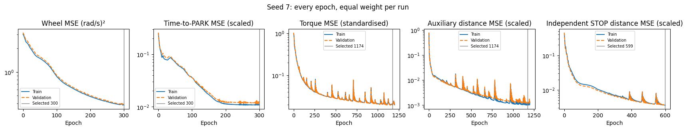

```text
All training and validation epochs. Test scores are not training losses.

```


<a id="cell-309"></a>

<details><summary>Code · original cell 309</summary>

```python
full_report=overnight.select(full_name)
full_report.outcomes(7);plt.show()
display(full_report.table(7).round(3))
```

</details>

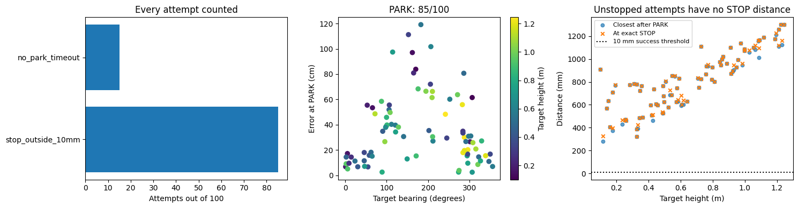

<div>

<table border="1" class="dataframe">
  <thead>
    <tr style="text-align: right;">
      <th></th>
      <th>status</th>
      <th>success</th>
      <th>parked</th>
      <th>park_s</th>
      <th>stop_s</th>
      <th>park_error_cm</th>
      <th>park_heading_error_deg</th>
      <th>at_stop_mm</th>
      <th>closest_mm</th>
      <th>end_mm</th>
      <th>post_stop_drift_mm</th>
      <th>post_park_base_drift_cm</th>
      <th>timed_out</th>
      <th>elapsed_s</th>
      <th>camera_visible_fraction</th>
      <th>target_bearing_deg</th>
      <th>target_range_m</th>
      <th>target_height_m</th>
    </tr>
    <tr>
      <th>dot</th>
      <th></th>
      <th></th>
      <th></th>
      <th></th>
      <th></th>
      <th></th>
      <th></th>
      <th></th>
      <th></th>
      <th></th>
      <th></th>
      <th></th>
      <th></th>
      <th></th>
      <th></th>
      <th></th>
      <th></th>
      <th></th>
    </tr>
  </thead>
  <tbody>
    <tr>
      <th>11</th>
      <td>stop_outside_10mm</td>
      <td>False</td>
      <td>True</td>
      <td>4.067</td>
      <td>4.067</td>
      <td>6.847</td>
      <td>0.955</td>
      <td>398.755</td>
      <td>372.529</td>
      <td>372.513</td>
      <td>-26.242</td>
      <td>0.069</td>
      <td>False</td>
      <td>10.415</td>
      <td>0.934</td>
      <td>0.986</td>
      <td>1.042</td>
      <td>0.178</td>
    </tr>
    <tr>
      <th>17</th>
      <td>stop_outside_10mm</td>
      <td>False</td>
      <td>True</td>
      <td>7.400</td>
      <td>7.400</td>
      <td>66.478</td>
      <td>30.830</td>
      <td>1080.087</td>
      <td>1057.548</td>
      <td>1057.462</td>
      <td>-22.625</td>
      <td>0.333</td>
      <td>False</td>
      <td>16.287</td>
      <td>0.118</td>
      <td>194.926</td>
      <td>1.095</td>
      <td>1.028</td>
    </tr>
    <tr>
      <th>33</th>
      <td>no_park_timeout</td>
      <td>False</td>
      <td>False</td>
      <td>NaN</td>
      <td>NaN</td>
      <td>NaN</td>
      <td>NaN</td>
      <td>NaN</td>
      <td>NaN</td>
      <td>615.446</td>
      <td>NaN</td>
      <td>NaN</td>
      <td>True</td>
      <td>24.164</td>
      <td>0.598</td>
      <td>259.736</td>
      <td>1.504</td>
      <td>0.422</td>
    </tr>
    <tr>
      <th>35</th>
      <td>stop_outside_10mm</td>
      <td>False</td>
      <td>True</td>
      <td>6.067</td>
      <td>6.067</td>
      <td>40.333</td>
      <td>14.054</td>
      <td>829.472</td>
      <td>829.383</td>
      <td>861.089</td>
      <td>31.618</td>
      <td>4.619</td>
      <td>False</td>
      <td>14.350</td>
      <td>0.711</td>
      <td>111.687</td>
      <td>1.257</td>
      <td>0.589</td>
    </tr>
    <tr>
      <th>40</th>
      <td>stop_outside_10mm</td>
      <td>False</td>
      <td>True</td>
      <td>9.000</td>
      <td>9.000</td>
      <td>72.050</td>
      <td>34.995</td>
      <td>387.879</td>
      <td>385.614</td>
      <td>415.848</td>
      <td>27.969</td>
      <td>6.223</td>
      <td>False</td>
      <td>18.607</td>
      <td>0.505</td>
      <td>205.751</td>
      <td>1.041</td>
      <td>0.328</td>
    </tr>
    <tr>
      <th>...</th>
      <td>...</td>
      <td>...</td>
      <td>...</td>
      <td>...</td>
      <td>...</td>
      <td>...</td>
      <td>...</td>
      <td>...</td>
      <td>...</td>
      <td>...</td>
      <td>...</td>
      <td>...</td>
      <td>...</td>
      <td>...</td>
      <td>...</td>
      <td>...</td>
      <td>...</td>
      <td>...</td>
    </tr>
    <tr>
      <th>958</th>
      <td>stop_outside_10mm</td>
      <td>False</td>
      <td>True</td>
      <td>5.200</td>
      <td>5.200</td>
      <td>11.015</td>
      <td>-4.511</td>
      <td>676.862</td>
      <td>676.698</td>
      <td>698.931</td>
      <td>22.069</td>
      <td>0.328</td>
      <td>False</td>
      <td>12.250</td>
      <td>0.836</td>
      <td>347.116</td>
      <td>1.181</td>
      <td>0.493</td>
    </tr>
    <tr>
      <th>981</th>
      <td>stop_outside_10mm</td>
      <td>False</td>
      <td>True</td>
      <td>7.067</td>
      <td>7.067</td>
      <td>30.929</td>
      <td>9.812</td>
      <td>851.983</td>
      <td>851.153</td>
      <td>855.070</td>
      <td>3.087</td>
      <td>0.365</td>
      <td>False</td>
      <td>15.848</td>
      <td>0.762</td>
      <td>297.945</td>
      <td>1.569</td>
      <td>0.564</td>
    </tr>
    <tr>
      <th>985</th>
      <td>stop_outside_10mm</td>
      <td>False</td>
      <td>True</td>
      <td>6.100</td>
      <td>6.100</td>
      <td>17.976</td>
      <td>2.903</td>
      <td>1260.139</td>
      <td>1260.076</td>
      <td>1268.029</td>
      <td>7.890</td>
      <td>0.034</td>
      <td>False</td>
      <td>14.422</td>
      <td>0.909</td>
      <td>284.446</td>
      <td>1.417</td>
      <td>1.210</td>
    </tr>
    <tr>
      <th>986</th>
      <td>no_park_timeout</td>
      <td>False</td>
      <td>False</td>
      <td>NaN</td>
      <td>NaN</td>
      <td>NaN</td>
      <td>NaN</td>
      <td>NaN</td>
      <td>NaN</td>
      <td>1271.828</td>
      <td>NaN</td>
      <td>NaN</td>
      <td>True</td>
      <td>24.391</td>
      <td>0.869</td>
      <td>98.931</td>
      <td>1.279</td>
      <td>0.179</td>
    </tr>
    <tr>
      <th>989</th>
      <td>stop_outside_10mm</td>
      <td>False</td>
      <td>True</td>
      <td>7.000</td>
      <td>7.000</td>
      <td>19.636</td>
      <td>6.112</td>
      <td>1229.046</td>
      <td>1215.001</td>
      <td>1215.025</td>
      <td>-14.021</td>
      <td>0.284</td>
      <td>False</td>
      <td>15.642</td>
      <td>0.929</td>
      <td>287.737</td>
      <td>1.749</td>
      <td>1.193</td>
    </tr>
  </tbody>
</table>
<p>100 rows × 18 columns</p>
</div>


<a id="cell-310"></a>

<details><summary>Code · original cell 310</summary>

```python
overnight.holding(full_name);plt.show()
display(overnight.hold_table(full_name).round(4))
print('Learned torques are applied from reset. No expert holding or added gravity term.')
```

</details>

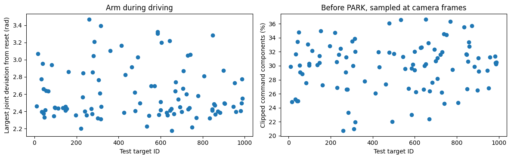

<div>

<table border="1" class="dataframe">
  <thead>
    <tr style="text-align: right;">
      <th></th>
      <th>status</th>
      <th>prepark_frames</th>
      <th>max_arm_deviation_rad</th>
      <th>maximum_command_Nm</th>
      <th>torque_clipped_fraction</th>
    </tr>
    <tr>
      <th>dot</th>
      <th></th>
      <th></th>
      <th></th>
      <th></th>
      <th></th>
    </tr>
  </thead>
  <tbody>
    <tr>
      <th>11</th>
      <td>stop_outside_10mm</td>
      <td>122</td>
      <td>2.4592</td>
      <td>30.0</td>
      <td>0.2986</td>
    </tr>
    <tr>
      <th>17</th>
      <td>stop_outside_10mm</td>
      <td>222</td>
      <td>3.0674</td>
      <td>30.0</td>
      <td>0.2484</td>
    </tr>
    <tr>
      <th>33</th>
      <td>no_park_timeout</td>
      <td>381</td>
      <td>2.7762</td>
      <td>30.0</td>
      <td>0.2520</td>
    </tr>
    <tr>
      <th>35</th>
      <td>stop_outside_10mm</td>
      <td>182</td>
      <td>2.3965</td>
      <td>30.0</td>
      <td>0.3163</td>
    </tr>
    <tr>
      <th>40</th>
      <td>stop_outside_10mm</td>
      <td>270</td>
      <td>2.9540</td>
      <td>30.0</td>
      <td>0.2497</td>
    </tr>
    <tr>
      <th>...</th>
      <td>...</td>
      <td>...</td>
      <td>...</td>
      <td>...</td>
      <td>...</td>
    </tr>
    <tr>
      <th>958</th>
      <td>stop_outside_10mm</td>
      <td>156</td>
      <td>2.3955</td>
      <td>30.0</td>
      <td>0.3123</td>
    </tr>
    <tr>
      <th>981</th>
      <td>stop_outside_10mm</td>
      <td>212</td>
      <td>2.4076</td>
      <td>30.0</td>
      <td>0.3133</td>
    </tr>
    <tr>
      <th>985</th>
      <td>stop_outside_10mm</td>
      <td>183</td>
      <td>2.4949</td>
      <td>30.0</td>
      <td>0.3044</td>
    </tr>
    <tr>
      <th>986</th>
      <td>no_park_timeout</td>
      <td>413</td>
      <td>2.7752</td>
      <td>30.0</td>
      <td>0.3023</td>
    </tr>
    <tr>
      <th>989</th>
      <td>stop_outside_10mm</td>
      <td>210</td>
      <td>2.5519</td>
      <td>30.0</td>
      <td>0.3048</td>
    </tr>
  </tbody>
</table>
<p>100 rows × 5 columns</p>
</div>

```text
Learned torques are applied from reset. No expert holding or added gravity term.

```


<a id="cell-311"></a>

<details><summary>Code · original cell 311</summary>

```python
full_report=overnight.select(full_name)
full_report.stopping(7);plt.show()
full_report.distances(7);plt.show()
print('Closest approach, exact STOP, and 0.5-second drift are different measurements.')
```

</details>

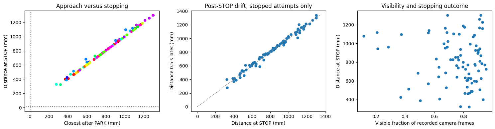

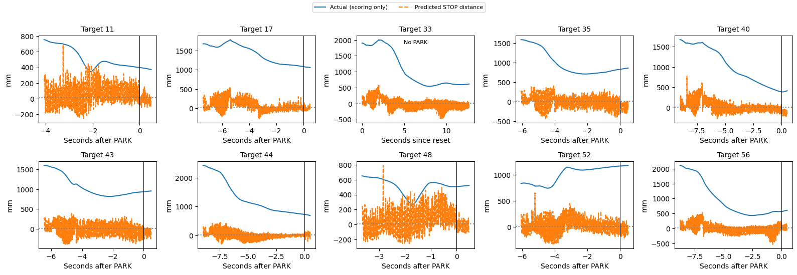

```text
Closest approach, exact STOP, and 0.5-second drift are different measurements.

```


<a id="cell-312"></a>

<details><summary>Code · original cell 312</summary>

```python
full_url=overnight.player_url(full_name)
display(lazy_player(full_url))
display(HTML(f'<a href="{full_url}" target="_blank">Open all 100 test replays</a>'))
print('Wheel encoder speeds, wheel commands, PARK and STOP values, applied arm torques, camera and ghost.')
```

</details>

[Interactive output: open original notebook, cell 312](../driving_v2/golden_dataset.ipynb).

[Interactive output: open original notebook, cell 312](../driving_v2/golden_dataset.ipynb).

```text
Wheel encoder speeds, wheel commands, PARK and STOP values, applied arm torques, camera and ghost.

```


<a id="cell-313"></a>

<details><summary>Code · original cell 313</summary>

```python
display(Markdown(overnight.reading(full_name)))
```

</details>

Both networks controlled the complete run, including learned arm torques before PARK. On validation, 84/100 parked and 0/100 met the full task criterion. On the frozen test comparison, 85/100 parked, 85/100 issued STOP, and 0/100 were within 10 mm at STOP. Median parking error among parked attempts was 29.5 cm; median distance at STOP among stopped attempts was 801.3 mm. Median maximum pre-PARK joint deviation was 2.477 rad. The 0.5 s after STOP is observed with learned torques still active, not a frozen simulation. These are previously viewed test targets and one seed; this is a frozen subsequent comparison, not an untouched estimate of generalisation. All timeouts and failures remain in the denominator.


<a id="cell-314"></a>

### Iteration 50: Frozen random-start-retrained networks: clean retention at original starts

**What changed:** Use exactly the random-start-retrained networks, but restore original starts and clean physics. This changes the evaluation condition, not the weights.

**Type:** Retention test. Seed 7 only; 100 validation and 100 test targets, with both learned networks controlling the complete episode. No conventional arm holding controller or extra gravity compensation is active.

**Result:** test PARK 100/100, STOP 93/100, full success 0/100; validation full success 0/100. Median parking error is 5.86 cm among 100 parked attempts. Median STOP distance is 806.5 mm among 93 stopped attempts. 0 attempts did not PARK; 7 parked without STOP. Neither is silently discarded from success.

**Comparison with iteration 49 (random_start_retrained):** PARK count changes by +15; STOP by +8; successes by +0. On the same 85 targets parked by both, the median paired change in parking error is -22.60 cm. On the same 80 targets stopped by both, the median paired change at STOP is -131.5 mm. Negative changes mean smaller errors. These paired subsets exclude failures, so read them alongside the counts, not as overall success rates.

**Training provenance:** selected epochs: driving 300, torque 1174, STOP 599. The curves below belong to the actual checkpoint; frozen stress tests reuse their parent training histories and do not represent new training. Driving predicts four wheel speeds and time to PARK (trigger 0.25 s). The arm predicts seven torques; its STOP network predicts distance (trigger 10 mm). Command losses are MSE, with separate auxiliary MSE terms; run weights are equal. Saved configuration and histories give scaling and exact coefficients.

**Limits:** these test targets have been viewed in earlier experiments. This is a reused-test comparison, not an untouched final estimate. One seed cannot establish seed robustness. Success requires PARK, STOP and distance at STOP ≤10 mm. Closest approach and later drift are diagnostics, not substitutes for that criterion. The complete per-target table, pre-PARK arm analysis, all loss terms, STOP/drift plots and 100-replay player follow below.


<a id="cell-315"></a>

<details><summary>Code · original cell 315</summary>

```python
from pathlib import Path
import sys,json,uuid
import matplotlib.pyplot as plt
from IPython.display import display,Markdown,HTML
sys.path.insert(0,str(Path('../arm').resolve()))
import report_curriculum as overnight
def lazy_player(url,height=850):
    k=uuid.uuid4().hex[:8]
    return HTML(f"<div><button onclick=\"var f=document.getElementById('player{k}');f.src='{url}';f.style.display='block';this.style.display='none'\" style=\"padding:8px 14px\">Load the 3D player</button><iframe id=\"player{k}\" style=\"display:none;width:100%;height:{height}px;border:0\"></iframe></div>")

full_name='random_start_retention'
display(overnight.build(full_name).round(3))
print('Validation and test are distinct. No fitting occurs in these analysis cells.')
```

</details>

<div>

<table border="1" class="dataframe">
  <thead>
    <tr style="text-align: right;">
      <th></th>
      <th>seed</th>
      <th>attempts</th>
      <th>parked</th>
      <th>stopped</th>
      <th>success_10mm</th>
      <th>success_percent</th>
      <th>wilson95_low_percent</th>
      <th>wilson95_high_percent</th>
      <th>median_park_error_cm</th>
      <th>median_abs_heading_error_deg</th>
      <th>median_closest_mm</th>
      <th>median_stop_mm</th>
      <th>median_park_s</th>
      <th>median_stop_s</th>
      <th>timeouts</th>
      <th>execution_failures</th>
      <th>sum_case_wall_s</th>
      <th>median_case_wall_s</th>
    </tr>
    <tr>
      <th>split</th>
      <th></th>
      <th></th>
      <th></th>
      <th></th>
      <th></th>
      <th></th>
      <th></th>
      <th></th>
      <th></th>
      <th></th>
      <th></th>
      <th></th>
      <th></th>
      <th></th>
      <th></th>
      <th></th>
      <th></th>
      <th></th>
    </tr>
  </thead>
  <tbody>
    <tr>
      <th>val</th>
      <td>7</td>
      <td>100</td>
      <td>100</td>
      <td>89</td>
      <td>0</td>
      <td>0.0</td>
      <td>0.0</td>
      <td>3.699</td>
      <td>5.791</td>
      <td>3.962</td>
      <td>192.346</td>
      <td>811.110</td>
      <td>7.100</td>
      <td>10.399</td>
      <td>11</td>
      <td>0</td>
      <td>2036.738</td>
      <td>20.541</td>
    </tr>
    <tr>
      <th>test</th>
      <td>7</td>
      <td>100</td>
      <td>100</td>
      <td>93</td>
      <td>0</td>
      <td>0.0</td>
      <td>0.0</td>
      <td>3.699</td>
      <td>5.863</td>
      <td>3.659</td>
      <td>158.465</td>
      <td>806.548</td>
      <td>6.383</td>
      <td>9.733</td>
      <td>7</td>
      <td>0</td>
      <td>1861.097</td>
      <td>18.995</td>
    </tr>
  </tbody>
</table>
</div>

```text
Validation and test are distinct. No fitting occurs in these analysis cells.

```


<a id="cell-316"></a>

<details><summary>Code · original cell 316</summary>

```python
full_config=json.loads((overnight.ROOT/full_name/'test/config.json').read_text())
display(full_config)
for kind in ('driving','torque','stop'):
    chosen=json.loads((overnight.models(full_name)/f'{kind}_seed7_summary.json').read_text())
    print(kind, 'selected epoch',chosen['selected_epoch'],'validation loss',chosen['selected_val_loss'])
```

</details>

```text
{'cases': [11,
  17,
  33,
  35,
  40,
  43,
  44,
  48,
  52,
  56,
  65,
  83,
  92,
  97,
  98,
  113,
  136,
  147,
  148,
  154,
  162,
  196,
  221,
  229,
  232,
  239,
  248,
  260,
  271,
  274,
  277,
  281,
  285,
  302,
  306,
  311,
  315,
  316,
  317,
  361,
  413,
  427,
  432,
  463,
  478,
  479,
  492,
  502,
  534,
  545,
  554,
  571,
  585,
  586,
  592,
  599,
  600,
  605,
  628,
  632,
  642,
  646,
  652,
  653,
  664,
  669,
  671,
  683,
  693,
  700,
  707,
  708,
  722,
  729,
  730,
  738,
  741,
  750,
  770,
  779,
  806,
  834,
  845,
  846,
  848,
  854,
  857,
  859,
  872,
  883,
  898,
  903,
  905,
  945,
  952,
  958,
  981,
  985,
  986,
  989],
 'split': 'test',
 'seed': 7,
 'jobs': 4,
 'models': '/media/nm/Fast Drive/comp0245-golden11109/overnight_20261105/random_start_retrained/models',
 'condition': {},
 'model_hashes': {'driving_seed7.npz': 'ed9013ef41e693f38d066efa5af9bff74b9e7d5860d7800b9b7b5c8aa7717f3a',
  'reaching_seed7.npz': '675d534a224a4540c2ebbdf51ba250dcb053244465dfc505db502623488fbfcb'},
 'native_hashes': {'/media/nm/Fast Drive/comp0245-golden11109/overnight_20261105/recovery_runtime/native/sensor_curriculum.cpp': '85a6236a4d1fdc0c9dc2d0e991e460cc150e12abb2e153c596f3c8b247ed60d6',
  '/media/nm/Fast Drive/comp0245-golden11109/overnight_20261105/recovery_runtime/native/sensor_curriculum': 'd589e24b3ac57a056801059812d64271bc83cc2d350c6a487509b6555b6ecf8d'},
 'source_hashes': {'full_run.py': 'a099cabfe4479cf25bd59665e16717b8634a7feeb1b647f1dc39df9bf674514d',
  'evaluate_curriculum.py': '7fa3b64db19e7a39b0cb3a598945fee4695e3a0dce7d037d1eee1e73a85f132c',
  'curriculum_sensors.py': '8117d6a981b4e5dd37dbcf2f4c051e11e6be80dc414dd5beac3c30cbbd523520'},
 'split_sha256': '286f578aec7e3ab0953592466e63014cc1dde7f467106fadf273b30762ac1abf',
 'renderer': 'egl',
 'arm_control': 'learned from reset, 1 kHz, no PD hold or gravity addition',
 'selection': 'checkpoints frozen on offline validation; no fitting in evaluator',
 'test_reuse': 'existing targets previously evaluated; not a fresh blind test'}
```

```text
driving selected epoch 300 validation loss 0.3958594799041748
torque selected epoch 1174 validation loss 0.02058526501059532
stop selected epoch 599 validation loss 0.0036304721143096685

```


<a id="cell-317"></a>

<details><summary>Code · original cell 317</summary>

```python
overnight.losses(full_name);plt.show()
print('All training and validation epochs. Test scores are not training losses.')
```

</details>


```text
All training and validation epochs. Test scores are not training losses.

```


<a id="cell-318"></a>

<details><summary>Code · original cell 318</summary>

```python
full_report=overnight.select(full_name)
full_report.outcomes(7);plt.show()
display(full_report.table(7).round(3))
```

</details>

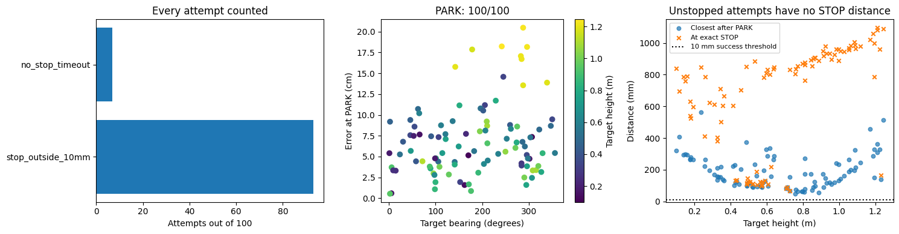

<div>

<table border="1" class="dataframe">
  <thead>
    <tr style="text-align: right;">
      <th></th>
      <th>status</th>
      <th>success</th>
      <th>parked</th>
      <th>park_s</th>
      <th>stop_s</th>
      <th>park_error_cm</th>
      <th>park_heading_error_deg</th>
      <th>at_stop_mm</th>
      <th>closest_mm</th>
      <th>end_mm</th>
      <th>post_stop_drift_mm</th>
      <th>post_park_base_drift_cm</th>
      <th>timed_out</th>
      <th>elapsed_s</th>
      <th>camera_visible_fraction</th>
      <th>target_bearing_deg</th>
      <th>target_range_m</th>
      <th>target_height_m</th>
    </tr>
    <tr>
      <th>dot</th>
      <th></th>
      <th></th>
      <th></th>
      <th></th>
      <th></th>
      <th></th>
      <th></th>
      <th></th>
      <th></th>
      <th></th>
      <th></th>
      <th></th>
      <th></th>
      <th></th>
      <th></th>
      <th></th>
      <th></th>
      <th></th>
    </tr>
  </thead>
  <tbody>
    <tr>
      <th>11</th>
      <td>stop_outside_10mm</td>
      <td>False</td>
      <td>True</td>
      <td>4.400</td>
      <td>11.592</td>
      <td>5.410</td>
      <td>-1.222</td>
      <td>630.116</td>
      <td>264.357</td>
      <td>1100.814</td>
      <td>470.698</td>
      <td>0.332</td>
      <td>False</td>
      <td>20.036</td>
      <td>0.950</td>
      <td>0.986</td>
      <td>1.042</td>
      <td>0.178</td>
    </tr>
    <tr>
      <th>17</th>
      <td>stop_outside_10mm</td>
      <td>False</td>
      <td>True</td>
      <td>6.733</td>
      <td>9.730</td>
      <td>8.030</td>
      <td>5.081</td>
      <td>946.638</td>
      <td>161.840</td>
      <td>1020.886</td>
      <td>74.249</td>
      <td>1.637</td>
      <td>False</td>
      <td>18.552</td>
      <td>0.704</td>
      <td>194.926</td>
      <td>1.095</td>
      <td>1.028</td>
    </tr>
    <tr>
      <th>33</th>
      <td>no_stop_timeout</td>
      <td>False</td>
      <td>True</td>
      <td>8.833</td>
      <td>NaN</td>
      <td>8.794</td>
      <td>9.761</td>
      <td>NaN</td>
      <td>228.787</td>
      <td>398.917</td>
      <td>NaN</td>
      <td>0.993</td>
      <td>True</td>
      <td>22.519</td>
      <td>0.635</td>
      <td>259.736</td>
      <td>1.504</td>
      <td>0.422</td>
    </tr>
    <tr>
      <th>35</th>
      <td>stop_outside_10mm</td>
      <td>False</td>
      <td>True</td>
      <td>6.000</td>
      <td>7.117</td>
      <td>8.753</td>
      <td>4.026</td>
      <td>132.545</td>
      <td>128.161</td>
      <td>152.371</td>
      <td>19.826</td>
      <td>0.381</td>
      <td>False</td>
      <td>15.087</td>
      <td>0.795</td>
      <td>111.687</td>
      <td>1.257</td>
      <td>0.589</td>
    </tr>
    <tr>
      <th>40</th>
      <td>no_stop_timeout</td>
      <td>False</td>
      <td>True</td>
      <td>6.333</td>
      <td>NaN</td>
      <td>11.180</td>
      <td>3.915</td>
      <td>NaN</td>
      <td>133.467</td>
      <td>277.611</td>
      <td>NaN</td>
      <td>1.413</td>
      <td>True</td>
      <td>21.928</td>
      <td>0.815</td>
      <td>205.751</td>
      <td>1.041</td>
      <td>0.328</td>
    </tr>
    <tr>
      <th>...</th>
      <td>...</td>
      <td>...</td>
      <td>...</td>
      <td>...</td>
      <td>...</td>
      <td>...</td>
      <td>...</td>
      <td>...</td>
      <td>...</td>
      <td>...</td>
      <td>...</td>
      <td>...</td>
      <td>...</td>
      <td>...</td>
      <td>...</td>
      <td>...</td>
      <td>...</td>
      <td>...</td>
    </tr>
    <tr>
      <th>958</th>
      <td>stop_outside_10mm</td>
      <td>False</td>
      <td>True</td>
      <td>4.333</td>
      <td>5.359</td>
      <td>8.686</td>
      <td>-0.059</td>
      <td>147.059</td>
      <td>110.696</td>
      <td>110.628</td>
      <td>-36.431</td>
      <td>0.112</td>
      <td>False</td>
      <td>11.592</td>
      <td>0.949</td>
      <td>347.116</td>
      <td>1.181</td>
      <td>0.493</td>
    </tr>
    <tr>
      <th>981</th>
      <td>stop_outside_10mm</td>
      <td>False</td>
      <td>True</td>
      <td>6.100</td>
      <td>8.170</td>
      <td>4.776</td>
      <td>-1.348</td>
      <td>122.149</td>
      <td>95.459</td>
      <td>141.354</td>
      <td>19.206</td>
      <td>0.341</td>
      <td>False</td>
      <td>16.549</td>
      <td>0.789</td>
      <td>297.945</td>
      <td>1.569</td>
      <td>0.564</td>
    </tr>
    <tr>
      <th>985</th>
      <td>stop_outside_10mm</td>
      <td>False</td>
      <td>True</td>
      <td>6.167</td>
      <td>10.232</td>
      <td>16.705</td>
      <td>-3.113</td>
      <td>1096.628</td>
      <td>310.650</td>
      <td>1067.705</td>
      <td>-28.923</td>
      <td>0.978</td>
      <td>False</td>
      <td>19.220</td>
      <td>0.888</td>
      <td>284.446</td>
      <td>1.417</td>
      <td>1.210</td>
    </tr>
    <tr>
      <th>986</th>
      <td>stop_outside_10mm</td>
      <td>False</td>
      <td>True</td>
      <td>5.600</td>
      <td>8.943</td>
      <td>4.783</td>
      <td>3.699</td>
      <td>523.398</td>
      <td>280.479</td>
      <td>890.961</td>
      <td>367.563</td>
      <td>2.898</td>
      <td>False</td>
      <td>16.446</td>
      <td>0.901</td>
      <td>98.931</td>
      <td>1.279</td>
      <td>0.179</td>
    </tr>
    <tr>
      <th>989</th>
      <td>stop_outside_10mm</td>
      <td>False</td>
      <td>True</td>
      <td>7.133</td>
      <td>11.064</td>
      <td>13.553</td>
      <td>-3.707</td>
      <td>786.733</td>
      <td>149.926</td>
      <td>1168.258</td>
      <td>381.525</td>
      <td>1.507</td>
      <td>False</td>
      <td>21.039</td>
      <td>0.896</td>
      <td>287.737</td>
      <td>1.749</td>
      <td>1.193</td>
    </tr>
  </tbody>
</table>
<p>100 rows × 18 columns</p>
</div>


<a id="cell-319"></a>

<details><summary>Code · original cell 319</summary>

```python
overnight.holding(full_name);plt.show()
display(overnight.hold_table(full_name).round(4))
print('Learned torques are applied from reset. No expert holding or added gravity term.')
```

</details>

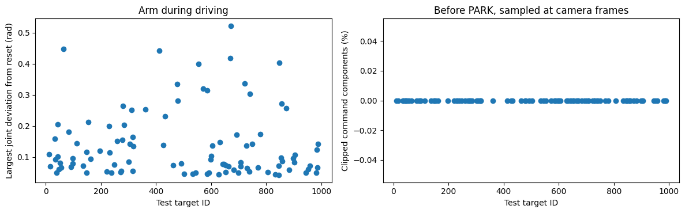

<div>

<table border="1" class="dataframe">
  <thead>
    <tr style="text-align: right;">
      <th></th>
      <th>status</th>
      <th>prepark_frames</th>
      <th>max_arm_deviation_rad</th>
      <th>maximum_command_Nm</th>
      <th>torque_clipped_fraction</th>
    </tr>
    <tr>
      <th>dot</th>
      <th></th>
      <th></th>
      <th></th>
      <th></th>
      <th></th>
    </tr>
  </thead>
  <tbody>
    <tr>
      <th>11</th>
      <td>stop_outside_10mm</td>
      <td>132</td>
      <td>0.1086</td>
      <td>18.7070</td>
      <td>0.0</td>
    </tr>
    <tr>
      <th>17</th>
      <td>stop_outside_10mm</td>
      <td>202</td>
      <td>0.0696</td>
      <td>20.3866</td>
      <td>0.0</td>
    </tr>
    <tr>
      <th>33</th>
      <td>no_stop_timeout</td>
      <td>265</td>
      <td>0.1579</td>
      <td>20.3866</td>
      <td>0.0</td>
    </tr>
    <tr>
      <th>35</th>
      <td>stop_outside_10mm</td>
      <td>180</td>
      <td>0.0919</td>
      <td>20.5393</td>
      <td>0.0</td>
    </tr>
    <tr>
      <th>40</th>
      <td>no_stop_timeout</td>
      <td>190</td>
      <td>0.0495</td>
      <td>20.3866</td>
      <td>0.0</td>
    </tr>
    <tr>
      <th>...</th>
      <td>...</td>
      <td>...</td>
      <td>...</td>
      <td>...</td>
      <td>...</td>
    </tr>
    <tr>
      <th>958</th>
      <td>stop_outside_10mm</td>
      <td>130</td>
      <td>0.0711</td>
      <td>19.6246</td>
      <td>0.0</td>
    </tr>
    <tr>
      <th>981</th>
      <td>stop_outside_10mm</td>
      <td>183</td>
      <td>0.0497</td>
      <td>20.1613</td>
      <td>0.0</td>
    </tr>
    <tr>
      <th>985</th>
      <td>stop_outside_10mm</td>
      <td>185</td>
      <td>0.1227</td>
      <td>19.7177</td>
      <td>0.0</td>
    </tr>
    <tr>
      <th>986</th>
      <td>stop_outside_10mm</td>
      <td>168</td>
      <td>0.0661</td>
      <td>20.6192</td>
      <td>0.0</td>
    </tr>
    <tr>
      <th>989</th>
      <td>stop_outside_10mm</td>
      <td>214</td>
      <td>0.1419</td>
      <td>19.9300</td>
      <td>0.0</td>
    </tr>
  </tbody>
</table>
<p>100 rows × 5 columns</p>
</div>

```text
Learned torques are applied from reset. No expert holding or added gravity term.

```


<a id="cell-320"></a>

<details><summary>Code · original cell 320</summary>

```python
full_report=overnight.select(full_name)
full_report.stopping(7);plt.show()
full_report.distances(7);plt.show()
print('Closest approach, exact STOP, and 0.5-second drift are different measurements.')
```

</details>

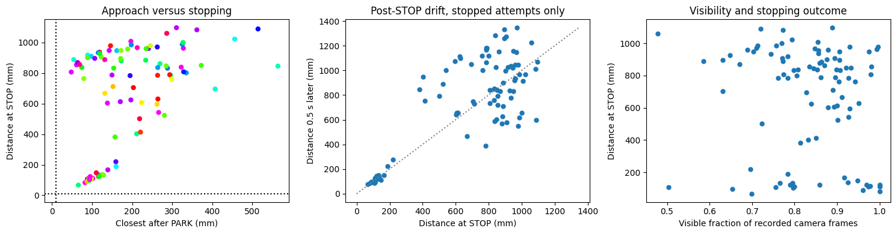

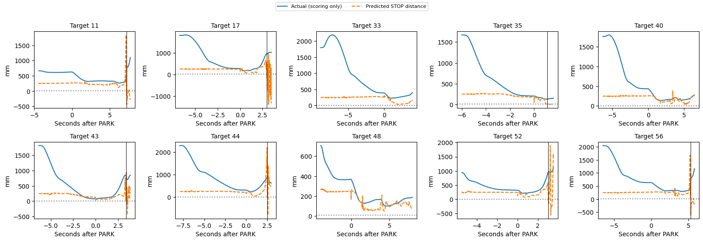

```text
Closest approach, exact STOP, and 0.5-second drift are different measurements.

```


<a id="cell-321"></a>

<details><summary>Code · original cell 321</summary>

```python
full_url=overnight.player_url(full_name)
display(lazy_player(full_url))
display(HTML(f'<a href="{full_url}" target="_blank">Open all 100 test replays</a>'))
print('Wheel encoder speeds, wheel commands, PARK and STOP values, applied arm torques, camera and ghost.')
```

</details>

[Interactive output: open original notebook, cell 321](../driving_v2/golden_dataset.ipynb).

[Interactive output: open original notebook, cell 321](../driving_v2/golden_dataset.ipynb).

```text
Wheel encoder speeds, wheel commands, PARK and STOP values, applied arm torques, camera and ghost.

```


<a id="cell-322"></a>

<details><summary>Code · original cell 322</summary>

```python
display(Markdown(overnight.reading(full_name)))
```

</details>

Both networks controlled the complete run, including learned arm torques before PARK. On validation, 100/100 parked and 0/100 met the full task criterion. On the frozen test comparison, 100/100 parked, 93/100 issued STOP, and 0/100 were within 10 mm at STOP. Median parking error among parked attempts was 5.9 cm; median distance at STOP among stopped attempts was 806.5 mm. Median maximum pre-PARK joint deviation was 0.093 rad. The 0.5 s after STOP is observed with learned torques still active, not a frozen simulation. These are previously viewed test targets and one seed; this is a frozen subsequent comparison, not an untouched estimate of generalisation. All timeouts and failures remain in the denominator.
