# golden_dataset: saved notebook reading view

[V2 overview](../README.md) · [Iteration index](../ITERATIONS.md) · [Original notebook](../driving_v2/golden_dataset.ipynb)

Generated from saved outputs without running cells. Code is collapsed. Interactive players remain in the original notebook; plots and tables appear below. Original notebook wording is preserved, including historical hypotheses and status notes.

Source SHA-256: `10c0dcfcfaed37ea56bbf8fb10bdae839fd0e72b2936c210fad5461be529f1a1`

## Contents
- [Iteration 51: Frozen standardised networks: all five disturbances and random starts](#cell-323)
- [Iteration 52: DART-inspired recovery training; clean evaluation](#cell-332)
- [Iteration 53: Frozen DART-trained networks: all five disturbances and random starts](#cell-341)
- [Iteration 54: Three-round DAgger recovery training; clean evaluation](#cell-350)
- [Iteration 55: Frozen DAgger-trained networks: all five disturbances and random starts](#cell-359)
- [Iteration 56: DART-inspired training followed by three-round DAgger; clean evaluation](#cell-368)
- [Iteration 57: Frozen DART+DAgger networks: all five disturbances and random starts](#cell-377)
- [Training and frozen-network evaluations: comparison and interpretation](#cell-386)
- [Validation pilots: torque-only output and STOP recovery labels](#cell-392)
- [Validation pilots: saved results](#cell-393)

<a id="cell-323"></a>

### Iteration 51: Frozen standardised networks: all five disturbances and random starts

**What changed:** Test the clean-trained standardised model under all five disturbances and random starts. This is a separate comparison: the preceding noise ladder used the physical-scale baseline.

**Type:** Frozen-model stress test. Seed 7 only; 100 validation and 100 test targets, with both learned networks controlling the complete episode. No conventional arm holding controller or extra gravity compensation is active.

**Result:** test PARK 48/100, STOP 19/100, full success 0/100; validation full success 0/100. Median parking error is 33.98 cm among 48 parked attempts. Median STOP distance is 1143.1 mm among 19 stopped attempts. 52 attempts did not PARK; 29 parked without STOP. Neither is silently discarded from success.

**Comparison with iteration 43 (basics_standard):** PARK count changes by -52; STOP by -72; successes by +0. On the same 48 targets parked by both, the median paired change in parking error is +28.72 cm. On the same 19 targets stopped by both, the median paired change at STOP is +1013.6 mm. Negative changes mean smaller errors. These paired subsets exclude failures, so read them alongside the counts, not as overall success rates.

**Training provenance:** selected epochs: driving 299, torque 1200, STOP 600. The curves below belong to the actual checkpoint; frozen stress tests reuse their parent training histories and do not represent new training. Driving predicts four wheel speeds and time to PARK (trigger 0.25 s). The arm predicts seven torques; its STOP network predicts distance (trigger 10 mm). Command losses are MSE, with separate auxiliary MSE terms; run weights are equal. Saved configuration and histories give scaling and exact coefficients.

**Limits:** these test targets have been viewed in earlier experiments. This is a reused-test comparison, not an untouched final estimate. One seed cannot establish seed robustness. Success requires PARK, STOP and distance at STOP ≤10 mm. Closest approach and later drift are diagnostics, not substitutes for that criterion. The complete per-target table, pre-PARK arm analysis, all loss terms, STOP/drift plots and 100-replay player follow below.


<a id="cell-324"></a>

<details><summary>Code · original cell 324</summary>

```python
from pathlib import Path
import sys,json,uuid
import matplotlib.pyplot as plt
from IPython.display import display,Markdown,HTML
sys.path.insert(0,str(Path('../arm').resolve()))
import report_curriculum as overnight
def lazy_player(url,height=850):
    k=uuid.uuid4().hex[:8]
    return HTML(f"<div><button onclick=\"var f=document.getElementById('player{k}');f.src='{url}';f.style.display='block';this.style.display='none'\" style=\"padding:8px 14px\">Load the 3D player</button><iframe id=\"player{k}\" style=\"display:none;width:100%;height:{height}px;border:0\"></iframe></div>")

full_name='standard_stack'
display(overnight.build(full_name).round(3))
print('Validation and test are distinct. No fitting occurs in these analysis cells.')
```

</details>

<div>

<table border="1" class="dataframe">
  <thead>
    <tr style="text-align: right;">
      <th></th>
      <th>seed</th>
      <th>attempts</th>
      <th>parked</th>
      <th>stopped</th>
      <th>success_10mm</th>
      <th>success_percent</th>
      <th>wilson95_low_percent</th>
      <th>wilson95_high_percent</th>
      <th>median_park_error_cm</th>
      <th>median_abs_heading_error_deg</th>
      <th>median_closest_mm</th>
      <th>median_stop_mm</th>
      <th>median_park_s</th>
      <th>median_stop_s</th>
      <th>timeouts</th>
      <th>execution_failures</th>
      <th>sum_case_wall_s</th>
      <th>median_case_wall_s</th>
    </tr>
    <tr>
      <th>split</th>
      <th></th>
      <th></th>
      <th></th>
      <th></th>
      <th></th>
      <th></th>
      <th></th>
      <th></th>
      <th></th>
      <th></th>
      <th></th>
      <th></th>
      <th></th>
      <th></th>
      <th></th>
      <th></th>
      <th></th>
      <th></th>
    </tr>
  </thead>
  <tbody>
    <tr>
      <th>val</th>
      <td>7</td>
      <td>100</td>
      <td>47</td>
      <td>8</td>
      <td>0</td>
      <td>0.0</td>
      <td>0.0</td>
      <td>3.699</td>
      <td>41.947</td>
      <td>14.965</td>
      <td>389.003</td>
      <td>1147.196</td>
      <td>5.367</td>
      <td>3.475</td>
      <td>92</td>
      <td>0</td>
      <td>2197.713</td>
      <td>22.258</td>
    </tr>
    <tr>
      <th>test</th>
      <td>7</td>
      <td>100</td>
      <td>48</td>
      <td>19</td>
      <td>0</td>
      <td>0.0</td>
      <td>0.0</td>
      <td>3.699</td>
      <td>33.977</td>
      <td>16.175</td>
      <td>386.655</td>
      <td>1143.083</td>
      <td>4.483</td>
      <td>3.768</td>
      <td>81</td>
      <td>0</td>
      <td>2061.450</td>
      <td>21.646</td>
    </tr>
  </tbody>
</table>
</div>

```text
Validation and test are distinct. No fitting occurs in these analysis cells.

```


<a id="cell-325"></a>

<details><summary>Code · original cell 325</summary>

```python
full_config=json.loads((overnight.ROOT/full_name/'test/config.json').read_text())
display(full_config)
for kind in ('driving','torque','stop'):
    chosen=json.loads((overnight.models(full_name)/f'{kind}_seed7_summary.json').read_text())
    print(kind, 'selected epoch',chosen['selected_epoch'],'validation loss',chosen['selected_val_loss'])
```

</details>

```text
{'cases': [11,
  17,
  33,
  35,
  40,
  43,
  44,
  48,
  52,
  56,
  65,
  83,
  92,
  97,
  98,
  113,
  136,
  147,
  148,
  154,
  162,
  196,
  221,
  229,
  232,
  239,
  248,
  260,
  271,
  274,
  277,
  281,
  285,
  302,
  306,
  311,
  315,
  316,
  317,
  361,
  413,
  427,
  432,
  463,
  478,
  479,
  492,
  502,
  534,
  545,
  554,
  571,
  585,
  586,
  592,
  599,
  600,
  605,
  628,
  632,
  642,
  646,
  652,
  653,
  664,
  669,
  671,
  683,
  693,
  700,
  707,
  708,
  722,
  729,
  730,
  738,
  741,
  750,
  770,
  779,
  806,
  834,
  845,
  846,
  848,
  854,
  857,
  859,
  872,
  883,
  898,
  903,
  905,
  945,
  952,
  958,
  981,
  985,
  986,
  989],
 'split': 'test',
 'seed': 7,
 'jobs': 4,
 'models': '/media/nm/Fast Drive/comp0245-golden11109/overnight_20261105/basics_standard/models',
 'condition': {'encoder_noise_sd': 0.0001,
  'sensor_seed': 7,
  'damping': 1.0,
  'elasticity': 1.0,
  'inertia': 0.001,
  'delay_ms': 3},
 'model_hashes': {'driving_seed7.npz': '458fc825c3d3c1e5d39d3630655eb872bb46f3ddc34e0a850ee4eb5da52a18c3',
  'reaching_seed7.npz': '6513ad9d528841e36806f11843be5d79f04e9f5f231be44d60385f3fae4569b3'},
 'native_hashes': {'/media/nm/Fast Drive/comp0245-golden11109/overnight_20261105/recovery_runtime_exportfix1/native/sensor_curriculum.cpp': '85a6236a4d1fdc0c9dc2d0e991e460cc150e12abb2e153c596f3c8b247ed60d6',
  '/media/nm/Fast Drive/comp0245-golden11109/overnight_20261105/recovery_runtime_exportfix1/native/sensor_curriculum': 'd589e24b3ac57a056801059812d64271bc83cc2d350c6a487509b6555b6ecf8d'},
 'source_hashes': {'full_run.py': 'a099cabfe4479cf25bd59665e16717b8634a7feeb1b647f1dc39df9bf674514d',
  'evaluate_curriculum.py': '7fa3b64db19e7a39b0cb3a598945fee4695e3a0dce7d037d1eee1e73a85f132c',
  'curriculum_sensors.py': '8117d6a981b4e5dd37dbcf2f4c051e11e6be80dc414dd5beac3c30cbbd523520'},
 'split_sha256': '286f578aec7e3ab0953592466e63014cc1dde7f467106fadf273b30762ac1abf',
 'renderer': 'egl',
 'arm_control': 'learned from reset, 1 kHz, no PD hold or gravity addition',
 'selection': 'checkpoints frozen on offline validation; no fitting in evaluator',
 'test_reuse': 'existing targets previously evaluated; not a fresh blind test'}
```

```text
driving selected epoch 299 validation loss 0.38417819142341614
torque selected epoch 1200 validation loss 0.012050625868141651
stop selected epoch 600 validation loss 0.0009144675568677485

```


<a id="cell-326"></a>

<details><summary>Code · original cell 326</summary>

```python
overnight.losses(full_name);plt.show()
print('All training and validation epochs. Test scores are not training losses.')
```

</details>

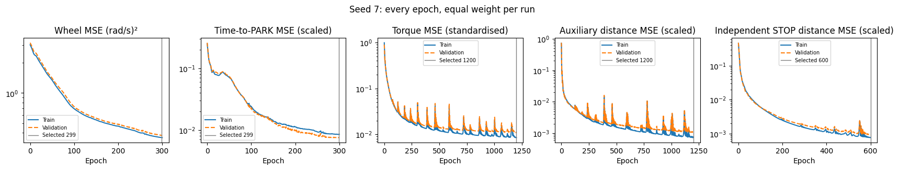

```text
All training and validation epochs. Test scores are not training losses.

```


<a id="cell-327"></a>

<details><summary>Code · original cell 327</summary>

```python
full_report=overnight.select(full_name)
full_report.outcomes(7);plt.show()
display(full_report.table(7).round(3))
```

</details>

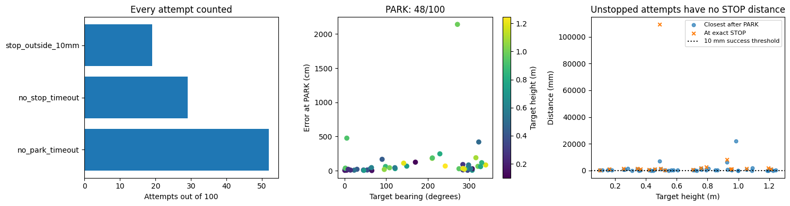

<div>

<table border="1" class="dataframe">
  <thead>
    <tr style="text-align: right;">
      <th></th>
      <th>status</th>
      <th>success</th>
      <th>parked</th>
      <th>park_s</th>
      <th>stop_s</th>
      <th>park_error_cm</th>
      <th>park_heading_error_deg</th>
      <th>at_stop_mm</th>
      <th>closest_mm</th>
      <th>end_mm</th>
      <th>post_stop_drift_mm</th>
      <th>post_park_base_drift_cm</th>
      <th>timed_out</th>
      <th>elapsed_s</th>
      <th>camera_visible_fraction</th>
      <th>target_bearing_deg</th>
      <th>target_range_m</th>
      <th>target_height_m</th>
    </tr>
    <tr>
      <th>dot</th>
      <th></th>
      <th></th>
      <th></th>
      <th></th>
      <th></th>
      <th></th>
      <th></th>
      <th></th>
      <th></th>
      <th></th>
      <th></th>
      <th></th>
      <th></th>
      <th></th>
      <th></th>
      <th></th>
      <th></th>
      <th></th>
    </tr>
  </thead>
  <tbody>
    <tr>
      <th>11</th>
      <td>no_stop_timeout</td>
      <td>False</td>
      <td>True</td>
      <td>2.067</td>
      <td>NaN</td>
      <td>3.928</td>
      <td>2.943</td>
      <td>NaN</td>
      <td>311.837</td>
      <td>8163.848</td>
      <td>NaN</td>
      <td>755.017</td>
      <td>True</td>
      <td>20.519</td>
      <td>0.347</td>
      <td>0.986</td>
      <td>1.042</td>
      <td>0.178</td>
    </tr>
    <tr>
      <th>17</th>
      <td>no_park_timeout</td>
      <td>False</td>
      <td>False</td>
      <td>NaN</td>
      <td>NaN</td>
      <td>NaN</td>
      <td>NaN</td>
      <td>NaN</td>
      <td>NaN</td>
      <td>36319.661</td>
      <td>NaN</td>
      <td>NaN</td>
      <td>True</td>
      <td>21.526</td>
      <td>0.272</td>
      <td>194.926</td>
      <td>1.095</td>
      <td>1.028</td>
    </tr>
    <tr>
      <th>33</th>
      <td>no_park_timeout</td>
      <td>False</td>
      <td>False</td>
      <td>NaN</td>
      <td>NaN</td>
      <td>NaN</td>
      <td>NaN</td>
      <td>NaN</td>
      <td>NaN</td>
      <td>248352.130</td>
      <td>NaN</td>
      <td>NaN</td>
      <td>True</td>
      <td>21.988</td>
      <td>0.024</td>
      <td>259.736</td>
      <td>1.504</td>
      <td>0.422</td>
    </tr>
    <tr>
      <th>35</th>
      <td>no_park_timeout</td>
      <td>False</td>
      <td>False</td>
      <td>NaN</td>
      <td>NaN</td>
      <td>NaN</td>
      <td>NaN</td>
      <td>NaN</td>
      <td>NaN</td>
      <td>34675.064</td>
      <td>NaN</td>
      <td>NaN</td>
      <td>True</td>
      <td>21.389</td>
      <td>0.492</td>
      <td>111.687</td>
      <td>1.257</td>
      <td>0.589</td>
    </tr>
    <tr>
      <th>40</th>
      <td>no_park_timeout</td>
      <td>False</td>
      <td>False</td>
      <td>NaN</td>
      <td>NaN</td>
      <td>NaN</td>
      <td>NaN</td>
      <td>NaN</td>
      <td>NaN</td>
      <td>10103.019</td>
      <td>NaN</td>
      <td>NaN</td>
      <td>True</td>
      <td>22.361</td>
      <td>0.024</td>
      <td>205.751</td>
      <td>1.041</td>
      <td>0.328</td>
    </tr>
    <tr>
      <th>...</th>
      <td>...</td>
      <td>...</td>
      <td>...</td>
      <td>...</td>
      <td>...</td>
      <td>...</td>
      <td>...</td>
      <td>...</td>
      <td>...</td>
      <td>...</td>
      <td>...</td>
      <td>...</td>
      <td>...</td>
      <td>...</td>
      <td>...</td>
      <td>...</td>
      <td>...</td>
      <td>...</td>
    </tr>
    <tr>
      <th>958</th>
      <td>no_park_timeout</td>
      <td>False</td>
      <td>False</td>
      <td>NaN</td>
      <td>NaN</td>
      <td>NaN</td>
      <td>NaN</td>
      <td>NaN</td>
      <td>NaN</td>
      <td>18044.343</td>
      <td>NaN</td>
      <td>NaN</td>
      <td>True</td>
      <td>21.393</td>
      <td>0.219</td>
      <td>347.116</td>
      <td>1.181</td>
      <td>0.493</td>
    </tr>
    <tr>
      <th>981</th>
      <td>no_stop_timeout</td>
      <td>False</td>
      <td>True</td>
      <td>9.800</td>
      <td>NaN</td>
      <td>83.308</td>
      <td>50.399</td>
      <td>NaN</td>
      <td>263.435</td>
      <td>8198.935</td>
      <td>NaN</td>
      <td>811.706</td>
      <td>True</td>
      <td>22.080</td>
      <td>0.417</td>
      <td>297.945</td>
      <td>1.569</td>
      <td>0.564</td>
    </tr>
    <tr>
      <th>985</th>
      <td>stop_outside_10mm</td>
      <td>False</td>
      <td>True</td>
      <td>3.400</td>
      <td>3.497</td>
      <td>31.505</td>
      <td>2.331</td>
      <td>1084.824</td>
      <td>957.245</td>
      <td>1167.679</td>
      <td>82.854</td>
      <td>105.594</td>
      <td>False</td>
      <td>10.022</td>
      <td>0.833</td>
      <td>284.446</td>
      <td>1.417</td>
      <td>1.210</td>
    </tr>
    <tr>
      <th>986</th>
      <td>no_park_timeout</td>
      <td>False</td>
      <td>False</td>
      <td>NaN</td>
      <td>NaN</td>
      <td>NaN</td>
      <td>NaN</td>
      <td>NaN</td>
      <td>NaN</td>
      <td>113704.409</td>
      <td>NaN</td>
      <td>NaN</td>
      <td>True</td>
      <td>21.420</td>
      <td>0.232</td>
      <td>98.931</td>
      <td>1.279</td>
      <td>0.179</td>
    </tr>
    <tr>
      <th>989</th>
      <td>stop_outside_10mm</td>
      <td>False</td>
      <td>True</td>
      <td>4.667</td>
      <td>5.313</td>
      <td>21.773</td>
      <td>31.697</td>
      <td>1805.620</td>
      <td>166.076</td>
      <td>5749.273</td>
      <td>3943.653</td>
      <td>714.199</td>
      <td>False</td>
      <td>12.067</td>
      <td>0.680</td>
      <td>287.737</td>
      <td>1.749</td>
      <td>1.193</td>
    </tr>
  </tbody>
</table>
<p>100 rows × 18 columns</p>
</div>


<a id="cell-328"></a>

<details><summary>Code · original cell 328</summary>

```python
overnight.holding(full_name);plt.show()
display(overnight.hold_table(full_name).round(4))
print('Learned torques are applied from reset. No expert holding or added gravity term.')
```

</details>

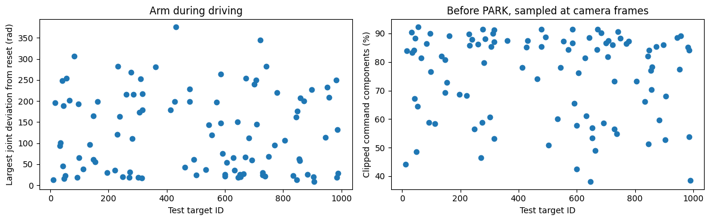

<div>

<table border="1" class="dataframe">
  <thead>
    <tr style="text-align: right;">
      <th></th>
      <th>status</th>
      <th>prepark_frames</th>
      <th>max_arm_deviation_rad</th>
      <th>maximum_command_Nm</th>
      <th>torque_clipped_fraction</th>
    </tr>
    <tr>
      <th>dot</th>
      <th></th>
      <th></th>
      <th></th>
      <th></th>
      <th></th>
    </tr>
  </thead>
  <tbody>
    <tr>
      <th>11</th>
      <td>no_stop_timeout</td>
      <td>62</td>
      <td>13.4502</td>
      <td>30.0</td>
      <td>0.4424</td>
    </tr>
    <tr>
      <th>17</th>
      <td>no_park_timeout</td>
      <td>360</td>
      <td>196.0444</td>
      <td>30.0</td>
      <td>0.8401</td>
    </tr>
    <tr>
      <th>33</th>
      <td>no_park_timeout</td>
      <td>381</td>
      <td>93.9723</td>
      <td>30.0</td>
      <td>0.9036</td>
    </tr>
    <tr>
      <th>35</th>
      <td>no_park_timeout</td>
      <td>360</td>
      <td>100.9195</td>
      <td>30.0</td>
      <td>0.8333</td>
    </tr>
    <tr>
      <th>40</th>
      <td>no_park_timeout</td>
      <td>379</td>
      <td>248.7585</td>
      <td>30.0</td>
      <td>0.8409</td>
    </tr>
    <tr>
      <th>...</th>
      <td>...</td>
      <td>...</td>
      <td>...</td>
      <td>...</td>
      <td>...</td>
    </tr>
    <tr>
      <th>958</th>
      <td>no_park_timeout</td>
      <td>360</td>
      <td>208.5496</td>
      <td>30.0</td>
      <td>0.8925</td>
    </tr>
    <tr>
      <th>981</th>
      <td>no_stop_timeout</td>
      <td>294</td>
      <td>250.4492</td>
      <td>30.0</td>
      <td>0.8513</td>
    </tr>
    <tr>
      <th>985</th>
      <td>stop_outside_10mm</td>
      <td>102</td>
      <td>18.6790</td>
      <td>30.0</td>
      <td>0.5378</td>
    </tr>
    <tr>
      <th>986</th>
      <td>no_park_timeout</td>
      <td>413</td>
      <td>131.7731</td>
      <td>30.0</td>
      <td>0.8416</td>
    </tr>
    <tr>
      <th>989</th>
      <td>stop_outside_10mm</td>
      <td>140</td>
      <td>28.0872</td>
      <td>30.0</td>
      <td>0.3847</td>
    </tr>
  </tbody>
</table>
<p>100 rows × 5 columns</p>
</div>

```text
Learned torques are applied from reset. No expert holding or added gravity term.

```


<a id="cell-329"></a>

<details><summary>Code · original cell 329</summary>

```python
full_report=overnight.select(full_name)
full_report.stopping(7);plt.show()
full_report.distances(7);plt.show()
print('Closest approach, exact STOP, and 0.5-second drift are different measurements.')
```

</details>

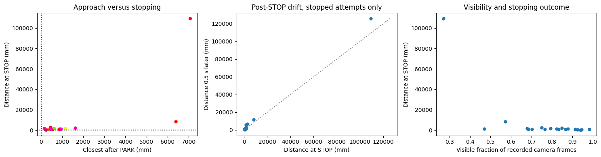

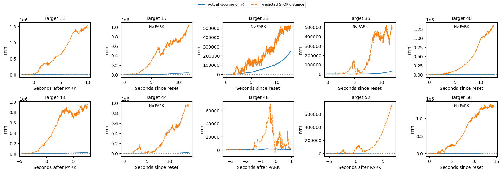

```text
Closest approach, exact STOP, and 0.5-second drift are different measurements.

```


<a id="cell-330"></a>

<details><summary>Code · original cell 330</summary>

```python
full_url=overnight.player_url(full_name)
display(lazy_player(full_url))
display(HTML(f'<a href="{full_url}" target="_blank">Open all 100 test replays</a>'))
print('Wheel encoder speeds, wheel commands, PARK and STOP values, applied arm torques, camera and ghost.')
```

</details>

[Interactive output: open original notebook, cell 330](../driving_v2/golden_dataset.ipynb).

[Interactive output: open original notebook, cell 330](../driving_v2/golden_dataset.ipynb).

```text
Wheel encoder speeds, wheel commands, PARK and STOP values, applied arm torques, camera and ghost.

```


<a id="cell-331"></a>

<details><summary>Code · original cell 331</summary>

```python
display(Markdown(overnight.reading(full_name)))
```

</details>

Both networks controlled the complete run, including learned arm torques before PARK. On validation, 47/100 parked and 0/100 met the full task criterion. On the frozen test comparison, 48/100 parked, 19/100 issued STOP, and 0/100 were within 10 mm at STOP. Median parking error among parked attempts was 34.0 cm; median distance at STOP among stopped attempts was 1143.1 mm. Median maximum pre-PARK joint deviation was 108.828 rad. The 0.5 s after STOP is observed with learned torques still active, not a frozen simulation. These are previously viewed test targets and one seed; this is a frozen subsequent comparison, not an untouched estimate of generalisation. All timeouts and failures remain in the denominator.


<a id="cell-332"></a>

### Iteration 52: DART-inspired recovery training; clean evaluation

**What changed:** Add two batches of 100 perturbed expert episodes to the original data; 199 reached successfully and contributed training rows. Fixed action-noise standard deviations: wheels 0.025 rad/s, arm 0.5 N m, held for 33 ms. Labels are clean expert commands at visited states. DART-inspired fixed noise, not the full adaptive DART algorithm.

**Type:** Recovery training. Seed 7 only; 100 validation and 100 test targets, with both learned networks controlling the complete episode. No conventional arm holding controller or extra gravity compensation is active.

**Result:** test PARK 100/100, STOP 78/100, full success 1/100; validation full success 2/100. Median parking error is 5.46 cm among 100 parked attempts. Median STOP distance is 60.9 mm among 78 stopped attempts. 0 attempts did not PARK; 22 parked without STOP. Neither is silently discarded from success.

**Comparison with iteration 43 (basics_standard):** PARK count changes by +0; STOP by -13; successes by +1. On the same 100 targets parked by both, the median paired change in parking error is -0.10 cm. On the same 71 targets stopped by both, the median paired change at STOP is -20.7 mm. Negative changes mean smaller errors. These paired subsets exclude failures, so read them alongside the counts, not as overall success rates.

**Training provenance:** selected epochs: driving 300, torque 1168, STOP 582. The curves below belong to the actual checkpoint; frozen stress tests reuse their parent training histories and do not represent new training. Driving predicts four wheel speeds and time to PARK (trigger 0.25 s). The arm predicts seven torques; its STOP network predicts distance (trigger 10 mm). Command losses are MSE, with separate auxiliary MSE terms; run weights are equal. Saved configuration and histories give scaling and exact coefficients.

**Limits:** these test targets have been viewed in earlier experiments. This is a reused-test comparison, not an untouched final estimate. One seed cannot establish seed robustness. Success requires PARK, STOP and distance at STOP ≤10 mm. Closest approach and later drift are diagnostics, not substitutes for that criterion. The complete per-target table, pre-PARK arm analysis, all loss terms, STOP/drift plots and 100-replay player follow below.

**Interpretation:** compare both approach accuracy and completion. A smaller STOP median can coexist with fewer STOPs. The six-case development scores are not estimates of performance across all 100 test targets.


<a id="cell-333"></a>

<details><summary>Code · original cell 333</summary>

```python
from pathlib import Path
import sys,json,uuid
import matplotlib.pyplot as plt
from IPython.display import display,Markdown,HTML
sys.path.insert(0,str(Path('../arm').resolve()))
import report_curriculum as overnight
def lazy_player(url,height=850):
    k=uuid.uuid4().hex[:8]
    return HTML(f"<div><button onclick=\"var f=document.getElementById('player{k}');f.src='{url}';f.style.display='block';this.style.display='none'\" style=\"padding:8px 14px\">Load the 3D player</button><iframe id=\"player{k}\" style=\"display:none;width:100%;height:{height}px;border:0\"></iframe></div>")

full_name='dart'
display(overnight.build(full_name).round(3))
print('Validation and test are distinct. No fitting occurs in these analysis cells.')
```

</details>

<div>

<table border="1" class="dataframe">
  <thead>
    <tr style="text-align: right;">
      <th></th>
      <th>seed</th>
      <th>attempts</th>
      <th>parked</th>
      <th>stopped</th>
      <th>success_10mm</th>
      <th>success_percent</th>
      <th>wilson95_low_percent</th>
      <th>wilson95_high_percent</th>
      <th>median_park_error_cm</th>
      <th>median_abs_heading_error_deg</th>
      <th>median_closest_mm</th>
      <th>median_stop_mm</th>
      <th>median_park_s</th>
      <th>median_stop_s</th>
      <th>timeouts</th>
      <th>execution_failures</th>
      <th>sum_case_wall_s</th>
      <th>median_case_wall_s</th>
    </tr>
    <tr>
      <th>split</th>
      <th></th>
      <th></th>
      <th></th>
      <th></th>
      <th></th>
      <th></th>
      <th></th>
      <th></th>
      <th></th>
      <th></th>
      <th></th>
      <th></th>
      <th></th>
      <th></th>
      <th></th>
      <th></th>
      <th></th>
      <th></th>
    </tr>
  </thead>
  <tbody>
    <tr>
      <th>val</th>
      <td>7</td>
      <td>100</td>
      <td>100</td>
      <td>77</td>
      <td>2</td>
      <td>2.0</td>
      <td>0.550</td>
      <td>7.001</td>
      <td>5.917</td>
      <td>3.731</td>
      <td>54.336</td>
      <td>81.445</td>
      <td>7.934</td>
      <td>10.850</td>
      <td>23</td>
      <td>0</td>
      <td>2099.619</td>
      <td>21.554</td>
    </tr>
    <tr>
      <th>test</th>
      <td>7</td>
      <td>100</td>
      <td>100</td>
      <td>78</td>
      <td>1</td>
      <td>1.0</td>
      <td>0.177</td>
      <td>5.449</td>
      <td>5.456</td>
      <td>2.849</td>
      <td>44.968</td>
      <td>60.933</td>
      <td>7.217</td>
      <td>10.096</td>
      <td>22</td>
      <td>0</td>
      <td>1966.107</td>
      <td>20.474</td>
    </tr>
  </tbody>
</table>
</div>

```text
Validation and test are distinct. No fitting occurs in these analysis cells.

```


<a id="cell-334"></a>

<details><summary>Code · original cell 334</summary>

```python
full_config=json.loads((overnight.ROOT/full_name/'test/config.json').read_text())
display(full_config)
for kind in ('driving','torque','stop'):
    chosen=json.loads((overnight.models(full_name)/f'{kind}_seed7_summary.json').read_text())
    print(kind, 'selected epoch',chosen['selected_epoch'],'validation loss',chosen['selected_val_loss'])
```

</details>

```text
{'cases': [11,
  17,
  33,
  35,
  40,
  43,
  44,
  48,
  52,
  56,
  65,
  83,
  92,
  97,
  98,
  113,
  136,
  147,
  148,
  154,
  162,
  196,
  221,
  229,
  232,
  239,
  248,
  260,
  271,
  274,
  277,
  281,
  285,
  302,
  306,
  311,
  315,
  316,
  317,
  361,
  413,
  427,
  432,
  463,
  478,
  479,
  492,
  502,
  534,
  545,
  554,
  571,
  585,
  586,
  592,
  599,
  600,
  605,
  628,
  632,
  642,
  646,
  652,
  653,
  664,
  669,
  671,
  683,
  693,
  700,
  707,
  708,
  722,
  729,
  730,
  738,
  741,
  750,
  770,
  779,
  806,
  834,
  845,
  846,
  848,
  854,
  857,
  859,
  872,
  883,
  898,
  903,
  905,
  945,
  952,
  958,
  981,
  985,
  986,
  989],
 'split': 'test',
 'seed': 7,
 'jobs': 4,
 'models': '/media/nm/Fast Drive/comp0245-golden11109/overnight_20261105/dart/models',
 'condition': {},
 'model_hashes': {'driving_seed7.npz': '51c0c564142a62d81102338cb38398327ec3741d54457ac479e47890d31f2ba2',
  'reaching_seed7.npz': 'a62396e366cffafd30811205b31bd32a9fe89232a461d23e21d04ab940c81ef1'},
 'native_hashes': {'/media/nm/Fast Drive/comp0245-golden11109/overnight_20261105/recovery_runtime_exportfix1/native/sensor_curriculum.cpp': '85a6236a4d1fdc0c9dc2d0e991e460cc150e12abb2e153c596f3c8b247ed60d6',
  '/media/nm/Fast Drive/comp0245-golden11109/overnight_20261105/recovery_runtime_exportfix1/native/sensor_curriculum': 'd589e24b3ac57a056801059812d64271bc83cc2d350c6a487509b6555b6ecf8d'},
 'source_hashes': {'full_run.py': 'a099cabfe4479cf25bd59665e16717b8634a7feeb1b647f1dc39df9bf674514d',
  'evaluate_curriculum.py': '7fa3b64db19e7a39b0cb3a598945fee4695e3a0dce7d037d1eee1e73a85f132c',
  'curriculum_sensors.py': '8117d6a981b4e5dd37dbcf2f4c051e11e6be80dc414dd5beac3c30cbbd523520'},
 'split_sha256': '286f578aec7e3ab0953592466e63014cc1dde7f467106fadf273b30762ac1abf',
 'renderer': 'egl',
 'arm_control': 'learned from reset, 1 kHz, no PD hold or gravity addition',
 'selection': 'checkpoints frozen on offline validation; no fitting in evaluator',
 'test_reuse': 'existing targets previously evaluated; not a fresh blind test'}
```

```text
driving selected epoch 300 validation loss 0.38786396384239197
torque selected epoch 1168 validation loss 0.012091029435396194
stop selected epoch 582 validation loss 0.0009227031259797513

```


<a id="cell-335"></a>

<details><summary>Code · original cell 335</summary>

```python
overnight.losses(full_name);plt.show()
print('All training and validation epochs. Test scores are not training losses.')
```

</details>

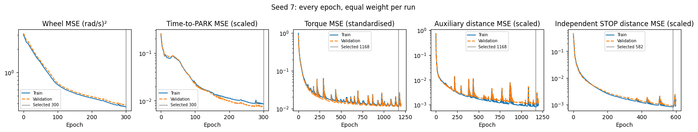

```text
All training and validation epochs. Test scores are not training losses.

```


<a id="cell-336"></a>

<details><summary>Code · original cell 336</summary>

```python
full_report=overnight.select(full_name)
full_report.outcomes(7);plt.show()
display(full_report.table(7).round(3))
```

</details>

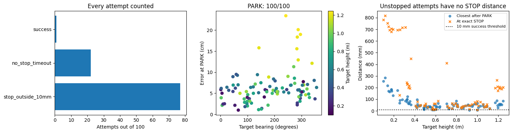

<div>

<table border="1" class="dataframe">
  <thead>
    <tr style="text-align: right;">
      <th></th>
      <th>status</th>
      <th>success</th>
      <th>parked</th>
      <th>park_s</th>
      <th>stop_s</th>
      <th>park_error_cm</th>
      <th>park_heading_error_deg</th>
      <th>at_stop_mm</th>
      <th>closest_mm</th>
      <th>end_mm</th>
      <th>post_stop_drift_mm</th>
      <th>post_park_base_drift_cm</th>
      <th>timed_out</th>
      <th>elapsed_s</th>
      <th>camera_visible_fraction</th>
      <th>target_bearing_deg</th>
      <th>target_range_m</th>
      <th>target_height_m</th>
    </tr>
    <tr>
      <th>dot</th>
      <th></th>
      <th></th>
      <th></th>
      <th></th>
      <th></th>
      <th></th>
      <th></th>
      <th></th>
      <th></th>
      <th></th>
      <th></th>
      <th></th>
      <th></th>
      <th></th>
      <th></th>
      <th></th>
      <th></th>
      <th></th>
    </tr>
  </thead>
  <tbody>
    <tr>
      <th>11</th>
      <td>stop_outside_10mm</td>
      <td>False</td>
      <td>True</td>
      <td>2.467</td>
      <td>7.612</td>
      <td>5.859</td>
      <td>6.162</td>
      <td>706.707</td>
      <td>186.008</td>
      <td>666.990</td>
      <td>-39.717</td>
      <td>1.522</td>
      <td>False</td>
      <td>14.897</td>
      <td>0.955</td>
      <td>0.986</td>
      <td>1.042</td>
      <td>0.178</td>
    </tr>
    <tr>
      <th>17</th>
      <td>stop_outside_10mm</td>
      <td>False</td>
      <td>True</td>
      <td>7.333</td>
      <td>12.123</td>
      <td>5.709</td>
      <td>-1.648</td>
      <td>75.941</td>
      <td>42.516</td>
      <td>109.573</td>
      <td>33.632</td>
      <td>1.298</td>
      <td>False</td>
      <td>22.180</td>
      <td>0.409</td>
      <td>194.926</td>
      <td>1.095</td>
      <td>1.028</td>
    </tr>
    <tr>
      <th>33</th>
      <td>no_stop_timeout</td>
      <td>False</td>
      <td>True</td>
      <td>8.300</td>
      <td>NaN</td>
      <td>6.903</td>
      <td>-3.534</td>
      <td>NaN</td>
      <td>96.135</td>
      <td>111.402</td>
      <td>NaN</td>
      <td>0.656</td>
      <td>True</td>
      <td>22.700</td>
      <td>0.568</td>
      <td>259.736</td>
      <td>1.504</td>
      <td>0.422</td>
    </tr>
    <tr>
      <th>35</th>
      <td>stop_outside_10mm</td>
      <td>False</td>
      <td>True</td>
      <td>9.467</td>
      <td>11.663</td>
      <td>6.385</td>
      <td>-4.962</td>
      <td>10.610</td>
      <td>8.073</td>
      <td>8.070</td>
      <td>-2.540</td>
      <td>0.718</td>
      <td>False</td>
      <td>21.368</td>
      <td>0.644</td>
      <td>111.687</td>
      <td>1.257</td>
      <td>0.589</td>
    </tr>
    <tr>
      <th>40</th>
      <td>stop_outside_10mm</td>
      <td>False</td>
      <td>True</td>
      <td>6.800</td>
      <td>10.198</td>
      <td>5.405</td>
      <td>-4.180</td>
      <td>228.814</td>
      <td>99.101</td>
      <td>304.708</td>
      <td>75.893</td>
      <td>0.907</td>
      <td>False</td>
      <td>18.787</td>
      <td>0.595</td>
      <td>205.751</td>
      <td>1.041</td>
      <td>0.328</td>
    </tr>
    <tr>
      <th>...</th>
      <td>...</td>
      <td>...</td>
      <td>...</td>
      <td>...</td>
      <td>...</td>
      <td>...</td>
      <td>...</td>
      <td>...</td>
      <td>...</td>
      <td>...</td>
      <td>...</td>
      <td>...</td>
      <td>...</td>
      <td>...</td>
      <td>...</td>
      <td>...</td>
      <td>...</td>
      <td>...</td>
    </tr>
    <tr>
      <th>958</th>
      <td>stop_outside_10mm</td>
      <td>False</td>
      <td>True</td>
      <td>2.800</td>
      <td>6.400</td>
      <td>8.055</td>
      <td>-0.924</td>
      <td>42.123</td>
      <td>36.659</td>
      <td>44.038</td>
      <td>1.915</td>
      <td>1.092</td>
      <td>False</td>
      <td>13.231</td>
      <td>0.942</td>
      <td>347.116</td>
      <td>1.181</td>
      <td>0.493</td>
    </tr>
    <tr>
      <th>981</th>
      <td>no_stop_timeout</td>
      <td>False</td>
      <td>True</td>
      <td>6.133</td>
      <td>NaN</td>
      <td>4.574</td>
      <td>-1.887</td>
      <td>NaN</td>
      <td>24.650</td>
      <td>76.298</td>
      <td>NaN</td>
      <td>1.129</td>
      <td>True</td>
      <td>21.308</td>
      <td>0.775</td>
      <td>297.945</td>
      <td>1.569</td>
      <td>0.564</td>
    </tr>
    <tr>
      <th>985</th>
      <td>stop_outside_10mm</td>
      <td>False</td>
      <td>True</td>
      <td>5.733</td>
      <td>8.289</td>
      <td>18.353</td>
      <td>-0.860</td>
      <td>192.679</td>
      <td>57.351</td>
      <td>208.455</td>
      <td>15.776</td>
      <td>0.715</td>
      <td>False</td>
      <td>16.741</td>
      <td>0.909</td>
      <td>284.446</td>
      <td>1.417</td>
      <td>1.210</td>
    </tr>
    <tr>
      <th>986</th>
      <td>no_stop_timeout</td>
      <td>False</td>
      <td>True</td>
      <td>9.133</td>
      <td>NaN</td>
      <td>4.010</td>
      <td>-6.880</td>
      <td>NaN</td>
      <td>171.092</td>
      <td>387.120</td>
      <td>NaN</td>
      <td>0.705</td>
      <td>True</td>
      <td>21.166</td>
      <td>0.582</td>
      <td>98.931</td>
      <td>1.279</td>
      <td>0.179</td>
    </tr>
    <tr>
      <th>989</th>
      <td>stop_outside_10mm</td>
      <td>False</td>
      <td>True</td>
      <td>7.167</td>
      <td>10.007</td>
      <td>12.919</td>
      <td>0.011</td>
      <td>207.173</td>
      <td>47.633</td>
      <td>243.175</td>
      <td>36.002</td>
      <td>0.754</td>
      <td>False</td>
      <td>19.591</td>
      <td>0.905</td>
      <td>287.737</td>
      <td>1.749</td>
      <td>1.193</td>
    </tr>
  </tbody>
</table>
<p>100 rows × 18 columns</p>
</div>


<a id="cell-337"></a>

<details><summary>Code · original cell 337</summary>

```python
overnight.holding(full_name);plt.show()
display(overnight.hold_table(full_name).round(4))
print('Learned torques are applied from reset. No expert holding or added gravity term.')
```

</details>

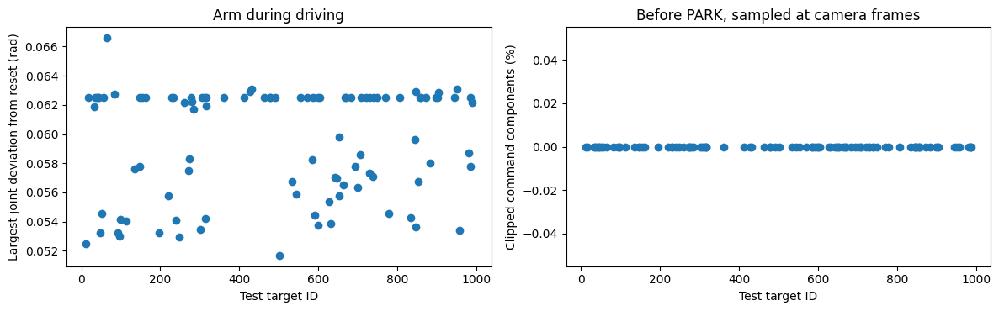

<div>

<table border="1" class="dataframe">
  <thead>
    <tr style="text-align: right;">
      <th></th>
      <th>status</th>
      <th>prepark_frames</th>
      <th>max_arm_deviation_rad</th>
      <th>maximum_command_Nm</th>
      <th>torque_clipped_fraction</th>
    </tr>
    <tr>
      <th>dot</th>
      <th></th>
      <th></th>
      <th></th>
      <th></th>
      <th></th>
    </tr>
  </thead>
  <tbody>
    <tr>
      <th>11</th>
      <td>stop_outside_10mm</td>
      <td>74</td>
      <td>0.0525</td>
      <td>20.0810</td>
      <td>0.0</td>
    </tr>
    <tr>
      <th>17</th>
      <td>stop_outside_10mm</td>
      <td>220</td>
      <td>0.0625</td>
      <td>20.3415</td>
      <td>0.0</td>
    </tr>
    <tr>
      <th>33</th>
      <td>no_stop_timeout</td>
      <td>249</td>
      <td>0.0619</td>
      <td>20.3415</td>
      <td>0.0</td>
    </tr>
    <tr>
      <th>35</th>
      <td>stop_outside_10mm</td>
      <td>284</td>
      <td>0.0625</td>
      <td>20.3415</td>
      <td>0.0</td>
    </tr>
    <tr>
      <th>40</th>
      <td>stop_outside_10mm</td>
      <td>204</td>
      <td>0.0625</td>
      <td>20.3415</td>
      <td>0.0</td>
    </tr>
    <tr>
      <th>...</th>
      <td>...</td>
      <td>...</td>
      <td>...</td>
      <td>...</td>
      <td>...</td>
    </tr>
    <tr>
      <th>958</th>
      <td>stop_outside_10mm</td>
      <td>84</td>
      <td>0.0534</td>
      <td>19.7601</td>
      <td>0.0</td>
    </tr>
    <tr>
      <th>981</th>
      <td>no_stop_timeout</td>
      <td>184</td>
      <td>0.0587</td>
      <td>20.6517</td>
      <td>0.0</td>
    </tr>
    <tr>
      <th>985</th>
      <td>stop_outside_10mm</td>
      <td>172</td>
      <td>0.0578</td>
      <td>20.5379</td>
      <td>0.0</td>
    </tr>
    <tr>
      <th>986</th>
      <td>no_stop_timeout</td>
      <td>274</td>
      <td>0.0625</td>
      <td>20.3415</td>
      <td>0.0</td>
    </tr>
    <tr>
      <th>989</th>
      <td>stop_outside_10mm</td>
      <td>215</td>
      <td>0.0621</td>
      <td>20.5328</td>
      <td>0.0</td>
    </tr>
  </tbody>
</table>
<p>100 rows × 5 columns</p>
</div>

```text
Learned torques are applied from reset. No expert holding or added gravity term.

```


<a id="cell-338"></a>

<details><summary>Code · original cell 338</summary>

```python
full_report=overnight.select(full_name)
full_report.stopping(7);plt.show()
full_report.distances(7);plt.show()
print('Closest approach, exact STOP, and 0.5-second drift are different measurements.')
```

</details>

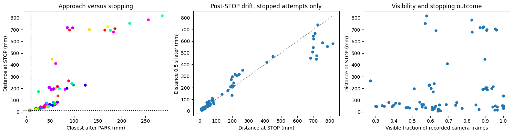

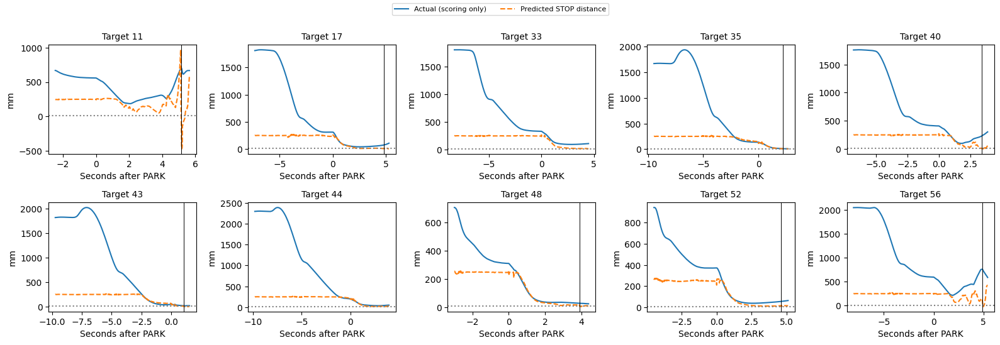

```text
Closest approach, exact STOP, and 0.5-second drift are different measurements.

```


<a id="cell-339"></a>

<details><summary>Code · original cell 339</summary>

```python
full_url=overnight.player_url(full_name)
display(lazy_player(full_url))
display(HTML(f'<a href="{full_url}" target="_blank">Open all 100 test replays</a>'))
print('Wheel encoder speeds, wheel commands, PARK and STOP values, applied arm torques, camera and ghost.')
```

</details>

[Interactive output: open original notebook, cell 339](../driving_v2/golden_dataset.ipynb).

[Interactive output: open original notebook, cell 339](../driving_v2/golden_dataset.ipynb).

```text
Wheel encoder speeds, wheel commands, PARK and STOP values, applied arm torques, camera and ghost.

```


<a id="cell-340"></a>

<details><summary>Code · original cell 340</summary>

```python
display(Markdown(overnight.reading(full_name)))
```

</details>

Both networks controlled the complete run, including learned arm torques before PARK. On validation, 100/100 parked and 2/100 met the full task criterion. On the frozen test comparison, 100/100 parked, 78/100 issued STOP, and 1/100 were within 10 mm at STOP. Median parking error among parked attempts was 5.5 cm; median distance at STOP among stopped attempts was 60.9 mm. Median maximum pre-PARK joint deviation was 0.062 rad. The 0.5 s after STOP is observed with learned torques still active, not a frozen simulation. These are previously viewed test targets and one seed; this is a frozen subsequent comparison, not an untouched estimate of generalisation. All timeouts and failures remain in the denominator.


<a id="cell-341"></a>

### Iteration 53: Frozen DART-trained networks: all five disturbances and random starts

**What changed:** Test the DART-trained model under all five disturbances and random starts. Training used action perturbations, not the full evaluation disturbance stack.

**Type:** Frozen-model stress test. Seed 7 only; 100 validation and 100 test targets, with both learned networks controlling the complete episode. No conventional arm holding controller or extra gravity compensation is active.

**Result:** test PARK 65/100, STOP 64/100, full success 0/100; validation full success 0/100. Median parking error is 19.06 cm among 65 parked attempts. Median STOP distance is 655.6 mm among 64 stopped attempts. 35 attempts did not PARK; 1 parked without STOP. Neither is silently discarded from success.

**Comparison with iteration 52 (dart):** PARK count changes by -35; STOP by -14; successes by -1. On the same 65 targets parked by both, the median paired change in parking error is +8.04 cm. On the same 51 targets stopped by both, the median paired change at STOP is +508.9 mm. Negative changes mean smaller errors. These paired subsets exclude failures, so read them alongside the counts, not as overall success rates.

**Training provenance:** selected epochs: driving 300, torque 1168, STOP 582. The curves below belong to the actual checkpoint; frozen stress tests reuse their parent training histories and do not represent new training. Driving predicts four wheel speeds and time to PARK (trigger 0.25 s). The arm predicts seven torques; its STOP network predicts distance (trigger 10 mm). Command losses are MSE, with separate auxiliary MSE terms; run weights are equal. Saved configuration and histories give scaling and exact coefficients.

**Limits:** these test targets have been viewed in earlier experiments. This is a reused-test comparison, not an untouched final estimate. One seed cannot establish seed robustness. Success requires PARK, STOP and distance at STOP ≤10 mm. Closest approach and later drift are diagnostics, not substitutes for that criterion. The complete per-target table, pre-PARK arm analysis, all loss terms, STOP/drift plots and 100-replay player follow below.


<a id="cell-342"></a>

<details><summary>Code · original cell 342</summary>

```python
from pathlib import Path
import sys,json,uuid
import matplotlib.pyplot as plt
from IPython.display import display,Markdown,HTML
sys.path.insert(0,str(Path('../arm').resolve()))
import report_curriculum as overnight
def lazy_player(url,height=850):
    k=uuid.uuid4().hex[:8]
    return HTML(f"<div><button onclick=\"var f=document.getElementById('player{k}');f.src='{url}';f.style.display='block';this.style.display='none'\" style=\"padding:8px 14px\">Load the 3D player</button><iframe id=\"player{k}\" style=\"display:none;width:100%;height:{height}px;border:0\"></iframe></div>")

full_name='dart_stack'
display(overnight.build(full_name).round(3))
print('Validation and test are distinct. No fitting occurs in these analysis cells.')
```

</details>

<div>

<table border="1" class="dataframe">
  <thead>
    <tr style="text-align: right;">
      <th></th>
      <th>seed</th>
      <th>attempts</th>
      <th>parked</th>
      <th>stopped</th>
      <th>success_10mm</th>
      <th>success_percent</th>
      <th>wilson95_low_percent</th>
      <th>wilson95_high_percent</th>
      <th>median_park_error_cm</th>
      <th>median_abs_heading_error_deg</th>
      <th>median_closest_mm</th>
      <th>median_stop_mm</th>
      <th>median_park_s</th>
      <th>median_stop_s</th>
      <th>timeouts</th>
      <th>execution_failures</th>
      <th>sum_case_wall_s</th>
      <th>median_case_wall_s</th>
    </tr>
    <tr>
      <th>split</th>
      <th></th>
      <th></th>
      <th></th>
      <th></th>
      <th></th>
      <th></th>
      <th></th>
      <th></th>
      <th></th>
      <th></th>
      <th></th>
      <th></th>
      <th></th>
      <th></th>
      <th></th>
      <th></th>
      <th></th>
      <th></th>
    </tr>
  </thead>
  <tbody>
    <tr>
      <th>val</th>
      <td>7</td>
      <td>100</td>
      <td>68</td>
      <td>65</td>
      <td>0</td>
      <td>0.0</td>
      <td>0.0</td>
      <td>3.699</td>
      <td>23.550</td>
      <td>13.851</td>
      <td>441.129</td>
      <td>665.024</td>
      <td>7.583</td>
      <td>7.909</td>
      <td>35</td>
      <td>0</td>
      <td>2047.110</td>
      <td>21.965</td>
    </tr>
    <tr>
      <th>test</th>
      <td>7</td>
      <td>100</td>
      <td>65</td>
      <td>64</td>
      <td>0</td>
      <td>0.0</td>
      <td>0.0</td>
      <td>3.699</td>
      <td>19.061</td>
      <td>9.491</td>
      <td>488.598</td>
      <td>655.600</td>
      <td>6.633</td>
      <td>7.044</td>
      <td>36</td>
      <td>0</td>
      <td>1935.231</td>
      <td>21.365</td>
    </tr>
  </tbody>
</table>
</div>

```text
Validation and test are distinct. No fitting occurs in these analysis cells.

```


<a id="cell-343"></a>

<details><summary>Code · original cell 343</summary>

```python
full_config=json.loads((overnight.ROOT/full_name/'test/config.json').read_text())
display(full_config)
for kind in ('driving','torque','stop'):
    chosen=json.loads((overnight.models(full_name)/f'{kind}_seed7_summary.json').read_text())
    print(kind, 'selected epoch',chosen['selected_epoch'],'validation loss',chosen['selected_val_loss'])
```

</details>

```text
{'cases': [11,
  17,
  33,
  35,
  40,
  43,
  44,
  48,
  52,
  56,
  65,
  83,
  92,
  97,
  98,
  113,
  136,
  147,
  148,
  154,
  162,
  196,
  221,
  229,
  232,
  239,
  248,
  260,
  271,
  274,
  277,
  281,
  285,
  302,
  306,
  311,
  315,
  316,
  317,
  361,
  413,
  427,
  432,
  463,
  478,
  479,
  492,
  502,
  534,
  545,
  554,
  571,
  585,
  586,
  592,
  599,
  600,
  605,
  628,
  632,
  642,
  646,
  652,
  653,
  664,
  669,
  671,
  683,
  693,
  700,
  707,
  708,
  722,
  729,
  730,
  738,
  741,
  750,
  770,
  779,
  806,
  834,
  845,
  846,
  848,
  854,
  857,
  859,
  872,
  883,
  898,
  903,
  905,
  945,
  952,
  958,
  981,
  985,
  986,
  989],
 'split': 'test',
 'seed': 7,
 'jobs': 4,
 'models': '/media/nm/Fast Drive/comp0245-golden11109/overnight_20261105/dart/models',
 'condition': {'encoder_noise_sd': 0.0001,
  'sensor_seed': 7,
  'damping': 1.0,
  'elasticity': 1.0,
  'inertia': 0.001,
  'delay_ms': 3},
 'model_hashes': {'driving_seed7.npz': '51c0c564142a62d81102338cb38398327ec3741d54457ac479e47890d31f2ba2',
  'reaching_seed7.npz': 'a62396e366cffafd30811205b31bd32a9fe89232a461d23e21d04ab940c81ef1'},
 'native_hashes': {'/media/nm/Fast Drive/comp0245-golden11109/overnight_20261105/recovery_runtime_exportfix1/native/sensor_curriculum.cpp': '85a6236a4d1fdc0c9dc2d0e991e460cc150e12abb2e153c596f3c8b247ed60d6',
  '/media/nm/Fast Drive/comp0245-golden11109/overnight_20261105/recovery_runtime_exportfix1/native/sensor_curriculum': 'd589e24b3ac57a056801059812d64271bc83cc2d350c6a487509b6555b6ecf8d'},
 'source_hashes': {'full_run.py': 'a099cabfe4479cf25bd59665e16717b8634a7feeb1b647f1dc39df9bf674514d',
  'evaluate_curriculum.py': '7fa3b64db19e7a39b0cb3a598945fee4695e3a0dce7d037d1eee1e73a85f132c',
  'curriculum_sensors.py': '8117d6a981b4e5dd37dbcf2f4c051e11e6be80dc414dd5beac3c30cbbd523520'},
 'split_sha256': '286f578aec7e3ab0953592466e63014cc1dde7f467106fadf273b30762ac1abf',
 'renderer': 'egl',
 'arm_control': 'learned from reset, 1 kHz, no PD hold or gravity addition',
 'selection': 'checkpoints frozen on offline validation; no fitting in evaluator',
 'test_reuse': 'existing targets previously evaluated; not a fresh blind test'}
```

```text
driving selected epoch 300 validation loss 0.38786396384239197
torque selected epoch 1168 validation loss 0.012091029435396194
stop selected epoch 582 validation loss 0.0009227031259797513

```


<a id="cell-344"></a>

<details><summary>Code · original cell 344</summary>

```python
overnight.losses(full_name);plt.show()
print('All training and validation epochs. Test scores are not training losses.')
```

</details>


```text
All training and validation epochs. Test scores are not training losses.

```


<a id="cell-345"></a>

<details><summary>Code · original cell 345</summary>

```python
full_report=overnight.select(full_name)
full_report.outcomes(7);plt.show()
display(full_report.table(7).round(3))
```

</details>


<div>

<table border="1" class="dataframe">
  <thead>
    <tr style="text-align: right;">
      <th></th>
      <th>status</th>
      <th>success</th>
      <th>parked</th>
      <th>park_s</th>
      <th>stop_s</th>
      <th>park_error_cm</th>
      <th>park_heading_error_deg</th>
      <th>at_stop_mm</th>
      <th>closest_mm</th>
      <th>end_mm</th>
      <th>post_stop_drift_mm</th>
      <th>post_park_base_drift_cm</th>
      <th>timed_out</th>
      <th>elapsed_s</th>
      <th>camera_visible_fraction</th>
      <th>target_bearing_deg</th>
      <th>target_range_m</th>
      <th>target_height_m</th>
    </tr>
    <tr>
      <th>dot</th>
      <th></th>
      <th></th>
      <th></th>
      <th></th>
      <th></th>
      <th></th>
      <th></th>
      <th></th>
      <th></th>
      <th></th>
      <th></th>
      <th></th>
      <th></th>
      <th></th>
      <th></th>
      <th></th>
      <th></th>
      <th></th>
    </tr>
  </thead>
  <tbody>
    <tr>
      <th>11</th>
      <td>stop_outside_10mm</td>
      <td>False</td>
      <td>True</td>
      <td>3.033</td>
      <td>3.449</td>
      <td>4.790</td>
      <td>8.357</td>
      <td>361.437</td>
      <td>92.113</td>
      <td>237.608</td>
      <td>-123.829</td>
      <td>29.274</td>
      <td>False</td>
      <td>9.055</td>
      <td>0.815</td>
      <td>0.986</td>
      <td>1.042</td>
      <td>0.178</td>
    </tr>
    <tr>
      <th>17</th>
      <td>no_park_timeout</td>
      <td>False</td>
      <td>False</td>
      <td>NaN</td>
      <td>NaN</td>
      <td>NaN</td>
      <td>NaN</td>
      <td>NaN</td>
      <td>NaN</td>
      <td>3678.666</td>
      <td>NaN</td>
      <td>NaN</td>
      <td>True</td>
      <td>22.373</td>
      <td>0.642</td>
      <td>194.926</td>
      <td>1.095</td>
      <td>1.028</td>
    </tr>
    <tr>
      <th>33</th>
      <td>stop_outside_10mm</td>
      <td>False</td>
      <td>True</td>
      <td>12.033</td>
      <td>12.164</td>
      <td>30.913</td>
      <td>32.048</td>
      <td>836.588</td>
      <td>441.109</td>
      <td>437.019</td>
      <td>-399.569</td>
      <td>0.663</td>
      <td>False</td>
      <td>24.084</td>
      <td>0.642</td>
      <td>259.736</td>
      <td>1.504</td>
      <td>0.422</td>
    </tr>
    <tr>
      <th>35</th>
      <td>no_park_timeout</td>
      <td>False</td>
      <td>False</td>
      <td>NaN</td>
      <td>NaN</td>
      <td>NaN</td>
      <td>NaN</td>
      <td>NaN</td>
      <td>NaN</td>
      <td>933.506</td>
      <td>NaN</td>
      <td>NaN</td>
      <td>True</td>
      <td>22.751</td>
      <td>0.719</td>
      <td>111.687</td>
      <td>1.257</td>
      <td>0.589</td>
    </tr>
    <tr>
      <th>40</th>
      <td>no_park_timeout</td>
      <td>False</td>
      <td>False</td>
      <td>NaN</td>
      <td>NaN</td>
      <td>NaN</td>
      <td>NaN</td>
      <td>NaN</td>
      <td>NaN</td>
      <td>2101.552</td>
      <td>NaN</td>
      <td>NaN</td>
      <td>True</td>
      <td>23.261</td>
      <td>0.662</td>
      <td>205.751</td>
      <td>1.041</td>
      <td>0.328</td>
    </tr>
    <tr>
      <th>...</th>
      <td>...</td>
      <td>...</td>
      <td>...</td>
      <td>...</td>
      <td>...</td>
      <td>...</td>
      <td>...</td>
      <td>...</td>
      <td>...</td>
      <td>...</td>
      <td>...</td>
      <td>...</td>
      <td>...</td>
      <td>...</td>
      <td>...</td>
      <td>...</td>
      <td>...</td>
      <td>...</td>
    </tr>
    <tr>
      <th>958</th>
      <td>stop_outside_10mm</td>
      <td>False</td>
      <td>True</td>
      <td>3.900</td>
      <td>3.906</td>
      <td>16.093</td>
      <td>-10.017</td>
      <td>445.102</td>
      <td>364.826</td>
      <td>374.790</td>
      <td>-70.312</td>
      <td>4.418</td>
      <td>False</td>
      <td>9.978</td>
      <td>0.992</td>
      <td>347.116</td>
      <td>1.181</td>
      <td>0.493</td>
    </tr>
    <tr>
      <th>981</th>
      <td>stop_outside_10mm</td>
      <td>False</td>
      <td>True</td>
      <td>6.233</td>
      <td>7.015</td>
      <td>11.465</td>
      <td>0.399</td>
      <td>116.404</td>
      <td>113.461</td>
      <td>742.007</td>
      <td>625.604</td>
      <td>0.256</td>
      <td>False</td>
      <td>15.861</td>
      <td>0.951</td>
      <td>297.945</td>
      <td>1.569</td>
      <td>0.564</td>
    </tr>
    <tr>
      <th>985</th>
      <td>stop_outside_10mm</td>
      <td>False</td>
      <td>True</td>
      <td>5.700</td>
      <td>5.705</td>
      <td>25.461</td>
      <td>-2.530</td>
      <td>586.738</td>
      <td>583.269</td>
      <td>875.697</td>
      <td>288.959</td>
      <td>1.204</td>
      <td>False</td>
      <td>13.657</td>
      <td>0.995</td>
      <td>284.446</td>
      <td>1.417</td>
      <td>1.210</td>
    </tr>
    <tr>
      <th>986</th>
      <td>stop_outside_10mm</td>
      <td>False</td>
      <td>True</td>
      <td>5.800</td>
      <td>8.997</td>
      <td>87.835</td>
      <td>-72.006</td>
      <td>9804.713</td>
      <td>1600.204</td>
      <td>9122.405</td>
      <td>-682.308</td>
      <td>810.322</td>
      <td>False</td>
      <td>16.357</td>
      <td>0.361</td>
      <td>98.931</td>
      <td>1.279</td>
      <td>0.179</td>
    </tr>
    <tr>
      <th>989</th>
      <td>stop_outside_10mm</td>
      <td>False</td>
      <td>True</td>
      <td>8.100</td>
      <td>8.100</td>
      <td>32.983</td>
      <td>-11.367</td>
      <td>1135.752</td>
      <td>1083.105</td>
      <td>1193.907</td>
      <td>58.155</td>
      <td>2.899</td>
      <td>False</td>
      <td>16.435</td>
      <td>0.977</td>
      <td>287.737</td>
      <td>1.749</td>
      <td>1.193</td>
    </tr>
  </tbody>
</table>
<p>100 rows × 18 columns</p>
</div>


<a id="cell-346"></a>

<details><summary>Code · original cell 346</summary>

```python
overnight.holding(full_name);plt.show()
display(overnight.hold_table(full_name).round(4))
print('Learned torques are applied from reset. No expert holding or added gravity term.')
```

</details>

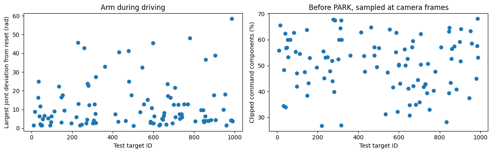

<div>

<table border="1" class="dataframe">
  <thead>
    <tr style="text-align: right;">
      <th></th>
      <th>status</th>
      <th>prepark_frames</th>
      <th>max_arm_deviation_rad</th>
      <th>maximum_command_Nm</th>
      <th>torque_clipped_fraction</th>
    </tr>
    <tr>
      <th>dot</th>
      <th></th>
      <th></th>
      <th></th>
      <th></th>
      <th></th>
    </tr>
  </thead>
  <tbody>
    <tr>
      <th>11</th>
      <td>stop_outside_10mm</td>
      <td>91</td>
      <td>1.5034</td>
      <td>30.0</td>
      <td>0.5589</td>
    </tr>
    <tr>
      <th>17</th>
      <td>no_park_timeout</td>
      <td>360</td>
      <td>8.8460</td>
      <td>30.0</td>
      <td>0.6560</td>
    </tr>
    <tr>
      <th>33</th>
      <td>stop_outside_10mm</td>
      <td>361</td>
      <td>16.4125</td>
      <td>30.0</td>
      <td>0.3451</td>
    </tr>
    <tr>
      <th>35</th>
      <td>no_park_timeout</td>
      <td>360</td>
      <td>24.9616</td>
      <td>30.0</td>
      <td>0.4833</td>
    </tr>
    <tr>
      <th>40</th>
      <td>no_park_timeout</td>
      <td>379</td>
      <td>6.3608</td>
      <td>30.0</td>
      <td>0.6231</td>
    </tr>
    <tr>
      <th>...</th>
      <td>...</td>
      <td>...</td>
      <td>...</td>
      <td>...</td>
      <td>...</td>
    </tr>
    <tr>
      <th>958</th>
      <td>stop_outside_10mm</td>
      <td>117</td>
      <td>1.4808</td>
      <td>30.0</td>
      <td>0.5861</td>
    </tr>
    <tr>
      <th>981</th>
      <td>stop_outside_10mm</td>
      <td>187</td>
      <td>4.1944</td>
      <td>30.0</td>
      <td>0.4500</td>
    </tr>
    <tr>
      <th>985</th>
      <td>stop_outside_10mm</td>
      <td>171</td>
      <td>4.2677</td>
      <td>30.0</td>
      <td>0.5764</td>
    </tr>
    <tr>
      <th>986</th>
      <td>stop_outside_10mm</td>
      <td>174</td>
      <td>58.4348</td>
      <td>30.0</td>
      <td>0.6806</td>
    </tr>
    <tr>
      <th>989</th>
      <td>stop_outside_10mm</td>
      <td>243</td>
      <td>3.8052</td>
      <td>30.0</td>
      <td>0.5309</td>
    </tr>
  </tbody>
</table>
<p>100 rows × 5 columns</p>
</div>

```text
Learned torques are applied from reset. No expert holding or added gravity term.

```


<a id="cell-347"></a>

<details><summary>Code · original cell 347</summary>

```python
full_report=overnight.select(full_name)
full_report.stopping(7);plt.show()
full_report.distances(7);plt.show()
print('Closest approach, exact STOP, and 0.5-second drift are different measurements.')
```

</details>

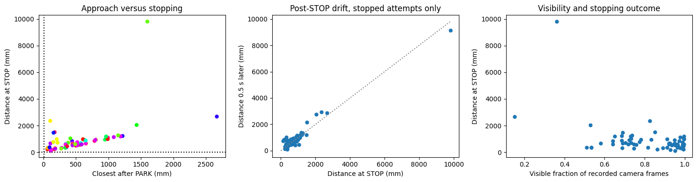

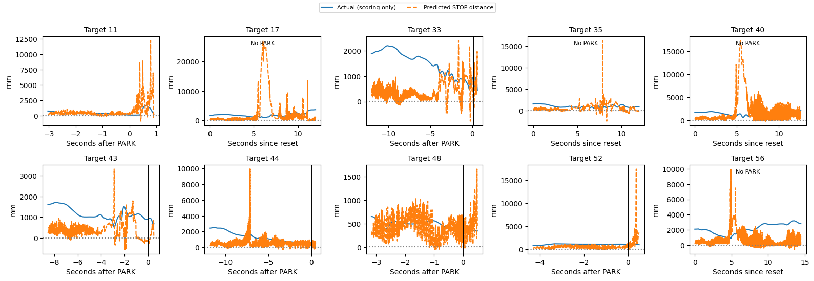

```text
Closest approach, exact STOP, and 0.5-second drift are different measurements.

```


<a id="cell-348"></a>

<details><summary>Code · original cell 348</summary>

```python
full_url=overnight.player_url(full_name)
display(lazy_player(full_url))
display(HTML(f'<a href="{full_url}" target="_blank">Open all 100 test replays</a>'))
print('Wheel encoder speeds, wheel commands, PARK and STOP values, applied arm torques, camera and ghost.')
```

</details>

[Interactive output: open original notebook, cell 348](../driving_v2/golden_dataset.ipynb).

[Interactive output: open original notebook, cell 348](../driving_v2/golden_dataset.ipynb).

```text
Wheel encoder speeds, wheel commands, PARK and STOP values, applied arm torques, camera and ghost.

```


<a id="cell-349"></a>

<details><summary>Code · original cell 349</summary>

```python
display(Markdown(overnight.reading(full_name)))
```

</details>

Both networks controlled the complete run, including learned arm torques before PARK. On validation, 68/100 parked and 0/100 met the full task criterion. On the frozen test comparison, 65/100 parked, 64/100 issued STOP, and 0/100 were within 10 mm at STOP. Median parking error among parked attempts was 19.1 cm; median distance at STOP among stopped attempts was 655.6 mm. Median maximum pre-PARK joint deviation was 7.014 rad. The 0.5 s after STOP is observed with learned torques still active, not a frozen simulation. These are previously viewed test targets and one seed; this is a frozen subsequent comparison, not an untouched estimate of generalisation. All timeouts and failures remain in the denominator.


<a id="cell-350"></a>

### Iteration 54: Three-round DAgger recovery training; clean evaluation

**What changed:** Three rounds of 100 student rollouts with stateful shadow-expert labels, retaining the original data and all earlier rounds. Round 3 was selected on six fixed validation cases before full testing. New DAgger rows train command outputs only; they do not train PARK, auxiliary distance or STOP targets.

**Type:** Recovery training. Seed 7 only; 100 validation and 100 test targets, with both learned networks controlling the complete episode. No conventional arm holding controller or extra gravity compensation is active.

**Result:** test PARK 84/100, STOP 69/100, full success 2/100; validation full success 4/100. Median parking error is 4.23 cm among 84 parked attempts. Median STOP distance is 37.0 mm among 69 stopped attempts. 16 attempts did not PARK; 15 parked without STOP. Neither is silently discarded from success.

**Comparison with iteration 43 (basics_standard):** PARK count changes by -16; STOP by -22; successes by +2. On the same 84 targets parked by both, the median paired change in parking error is -1.12 cm. On the same 66 targets stopped by both, the median paired change at STOP is -129.9 mm. Negative changes mean smaller errors. These paired subsets exclude failures, so read them alongside the counts, not as overall success rates.

**Training provenance:** selected epochs: driving 292, torque 1186, STOP 600. The curves below belong to the actual checkpoint; frozen stress tests reuse their parent training histories and do not represent new training. Driving predicts four wheel speeds and time to PARK (trigger 0.25 s). The arm predicts seven torques; its STOP network predicts distance (trigger 10 mm). Command losses are MSE, with separate auxiliary MSE terms; run weights are equal. Saved configuration and histories give scaling and exact coefficients.

**Limits:** these test targets have been viewed in earlier experiments. This is a reused-test comparison, not an untouched final estimate. One seed cannot establish seed robustness. Success requires PARK, STOP and distance at STOP ≤10 mm. Closest approach and later drift are diagnostics, not substitutes for that criterion. The complete per-target table, pre-PARK arm analysis, all loss terms, STOP/drift plots and 100-replay player follow below.

**Interpretation:** compare both approach accuracy and completion. A smaller STOP median can coexist with fewer STOPs. The six-case development scores are not estimates of performance across all 100 test targets.


<a id="cell-351"></a>

<details><summary>Code · original cell 351</summary>

```python
from pathlib import Path
import sys,json,uuid
import matplotlib.pyplot as plt
from IPython.display import display,Markdown,HTML
sys.path.insert(0,str(Path('../arm').resolve()))
import report_curriculum as overnight
def lazy_player(url,height=850):
    k=uuid.uuid4().hex[:8]
    return HTML(f"<div><button onclick=\"var f=document.getElementById('player{k}');f.src='{url}';f.style.display='block';this.style.display='none'\" style=\"padding:8px 14px\">Load the 3D player</button><iframe id=\"player{k}\" style=\"display:none;width:100%;height:{height}px;border:0\"></iframe></div>")

full_name='dagger'
display(overnight.build(full_name).round(3))
print('Validation and test are distinct. No fitting occurs in these analysis cells.')
```

</details>

<div>

<table border="1" class="dataframe">
  <thead>
    <tr style="text-align: right;">
      <th></th>
      <th>seed</th>
      <th>attempts</th>
      <th>parked</th>
      <th>stopped</th>
      <th>success_10mm</th>
      <th>success_percent</th>
      <th>wilson95_low_percent</th>
      <th>wilson95_high_percent</th>
      <th>median_park_error_cm</th>
      <th>median_abs_heading_error_deg</th>
      <th>median_closest_mm</th>
      <th>median_stop_mm</th>
      <th>median_park_s</th>
      <th>median_stop_s</th>
      <th>timeouts</th>
      <th>execution_failures</th>
      <th>sum_case_wall_s</th>
      <th>median_case_wall_s</th>
    </tr>
    <tr>
      <th>split</th>
      <th></th>
      <th></th>
      <th></th>
      <th></th>
      <th></th>
      <th></th>
      <th></th>
      <th></th>
      <th></th>
      <th></th>
      <th></th>
      <th></th>
      <th></th>
      <th></th>
      <th></th>
      <th></th>
      <th></th>
      <th></th>
    </tr>
  </thead>
  <tbody>
    <tr>
      <th>val</th>
      <td>7</td>
      <td>100</td>
      <td>89</td>
      <td>66</td>
      <td>4</td>
      <td>4.0</td>
      <td>1.566</td>
      <td>9.837</td>
      <td>3.806</td>
      <td>3.851</td>
      <td>25.339</td>
      <td>35.564</td>
      <td>8.067</td>
      <td>9.415</td>
      <td>34</td>
      <td>0</td>
      <td>2038.573</td>
      <td>21.531</td>
    </tr>
    <tr>
      <th>test</th>
      <td>7</td>
      <td>100</td>
      <td>84</td>
      <td>69</td>
      <td>2</td>
      <td>2.0</td>
      <td>0.550</td>
      <td>7.001</td>
      <td>4.230</td>
      <td>2.923</td>
      <td>27.290</td>
      <td>36.980</td>
      <td>6.183</td>
      <td>8.832</td>
      <td>31</td>
      <td>0</td>
      <td>1886.006</td>
      <td>20.214</td>
    </tr>
  </tbody>
</table>
</div>

```text
Validation and test are distinct. No fitting occurs in these analysis cells.

```


<a id="cell-352"></a>

<details><summary>Code · original cell 352</summary>

```python
full_config=json.loads((overnight.ROOT/full_name/'test/config.json').read_text())
display(full_config)
for kind in ('driving','torque','stop'):
    chosen=json.loads((overnight.models(full_name)/f'{kind}_seed7_summary.json').read_text())
    print(kind, 'selected epoch',chosen['selected_epoch'],'validation loss',chosen['selected_val_loss'])
```

</details>

```text
{'cases': [11,
  17,
  33,
  35,
  40,
  43,
  44,
  48,
  52,
  56,
  65,
  83,
  92,
  97,
  98,
  113,
  136,
  147,
  148,
  154,
  162,
  196,
  221,
  229,
  232,
  239,
  248,
  260,
  271,
  274,
  277,
  281,
  285,
  302,
  306,
  311,
  315,
  316,
  317,
  361,
  413,
  427,
  432,
  463,
  478,
  479,
  492,
  502,
  534,
  545,
  554,
  571,
  585,
  586,
  592,
  599,
  600,
  605,
  628,
  632,
  642,
  646,
  652,
  653,
  664,
  669,
  671,
  683,
  693,
  700,
  707,
  708,
  722,
  729,
  730,
  738,
  741,
  750,
  770,
  779,
  806,
  834,
  845,
  846,
  848,
  854,
  857,
  859,
  872,
  883,
  898,
  903,
  905,
  945,
  952,
  958,
  981,
  985,
  986,
  989],
 'split': 'test',
 'seed': 7,
 'jobs': 4,
 'models': '/media/nm/Fast Drive/comp0245-golden11109/overnight_20261105/dagger_round3/models',
 'condition': {},
 'model_hashes': {'driving_seed7.npz': 'ac5142423c51af0503a05a01db73f46a20f1c7d546e7a6f9debaa62a992fa389',
  'reaching_seed7.npz': '59d511132e0699c4e48e802f0013f6dc26794a2ecf9b301d425edadade472f34'},
 'native_hashes': {'/media/nm/Fast Drive/comp0245-golden11109/overnight_20261105/recovery_runtime_exportfix1/native/sensor_curriculum.cpp': '85a6236a4d1fdc0c9dc2d0e991e460cc150e12abb2e153c596f3c8b247ed60d6',
  '/media/nm/Fast Drive/comp0245-golden11109/overnight_20261105/recovery_runtime_exportfix1/native/sensor_curriculum': 'd589e24b3ac57a056801059812d64271bc83cc2d350c6a487509b6555b6ecf8d'},
 'source_hashes': {'full_run.py': 'a099cabfe4479cf25bd59665e16717b8634a7feeb1b647f1dc39df9bf674514d',
  'evaluate_curriculum.py': '7fa3b64db19e7a39b0cb3a598945fee4695e3a0dce7d037d1eee1e73a85f132c',
  'curriculum_sensors.py': '8117d6a981b4e5dd37dbcf2f4c051e11e6be80dc414dd5beac3c30cbbd523520'},
 'split_sha256': '286f578aec7e3ab0953592466e63014cc1dde7f467106fadf273b30762ac1abf',
 'renderer': 'egl',
 'arm_control': 'learned from reset, 1 kHz, no PD hold or gravity addition',
 'selection': 'checkpoints frozen on offline validation; no fitting in evaluator',
 'test_reuse': 'existing targets previously evaluated; not a fresh blind test'}
```

```text
driving selected epoch 292 validation loss 0.6960341334342957
torque selected epoch 1186 validation loss 0.041894376277923584
stop selected epoch 600 validation loss 0.0009144675568677485

```


<a id="cell-353"></a>

<details><summary>Code · original cell 353</summary>

```python
overnight.losses(full_name);plt.show()
print('All training and validation epochs. Test scores are not training losses.')
```

</details>

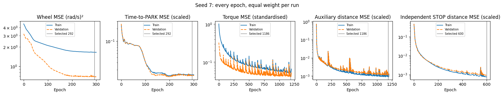

```text
All training and validation epochs. Test scores are not training losses.

```


<a id="cell-354"></a>

<details><summary>Code · original cell 354</summary>

```python
full_report=overnight.select(full_name)
full_report.outcomes(7);plt.show()
display(full_report.table(7).round(3))
```

</details>

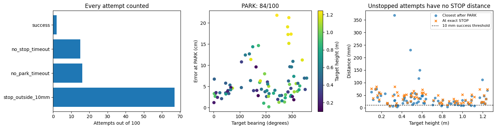

<div>

<table border="1" class="dataframe">
  <thead>
    <tr style="text-align: right;">
      <th></th>
      <th>status</th>
      <th>success</th>
      <th>parked</th>
      <th>park_s</th>
      <th>stop_s</th>
      <th>park_error_cm</th>
      <th>park_heading_error_deg</th>
      <th>at_stop_mm</th>
      <th>closest_mm</th>
      <th>end_mm</th>
      <th>post_stop_drift_mm</th>
      <th>post_park_base_drift_cm</th>
      <th>timed_out</th>
      <th>elapsed_s</th>
      <th>camera_visible_fraction</th>
      <th>target_bearing_deg</th>
      <th>target_range_m</th>
      <th>target_height_m</th>
    </tr>
    <tr>
      <th>dot</th>
      <th></th>
      <th></th>
      <th></th>
      <th></th>
      <th></th>
      <th></th>
      <th></th>
      <th></th>
      <th></th>
      <th></th>
      <th></th>
      <th></th>
      <th></th>
      <th></th>
      <th></th>
      <th></th>
      <th></th>
      <th></th>
    </tr>
  </thead>
  <tbody>
    <tr>
      <th>11</th>
      <td>stop_outside_10mm</td>
      <td>False</td>
      <td>True</td>
      <td>5.600</td>
      <td>9.225</td>
      <td>1.196</td>
      <td>1.088</td>
      <td>32.872</td>
      <td>26.203</td>
      <td>34.119</td>
      <td>1.247</td>
      <td>0.965</td>
      <td>False</td>
      <td>17.606</td>
      <td>1.000</td>
      <td>0.986</td>
      <td>1.042</td>
      <td>0.178</td>
    </tr>
    <tr>
      <th>17</th>
      <td>stop_outside_10mm</td>
      <td>False</td>
      <td>True</td>
      <td>9.133</td>
      <td>10.596</td>
      <td>7.997</td>
      <td>-7.825</td>
      <td>31.713</td>
      <td>29.039</td>
      <td>54.657</td>
      <td>22.944</td>
      <td>0.486</td>
      <td>False</td>
      <td>20.390</td>
      <td>0.351</td>
      <td>194.926</td>
      <td>1.095</td>
      <td>1.028</td>
    </tr>
    <tr>
      <th>33</th>
      <td>stop_outside_10mm</td>
      <td>False</td>
      <td>True</td>
      <td>7.967</td>
      <td>10.387</td>
      <td>2.891</td>
      <td>-2.224</td>
      <td>46.115</td>
      <td>35.977</td>
      <td>64.519</td>
      <td>18.405</td>
      <td>0.623</td>
      <td>False</td>
      <td>20.926</td>
      <td>0.789</td>
      <td>259.736</td>
      <td>1.504</td>
      <td>0.422</td>
    </tr>
    <tr>
      <th>35</th>
      <td>no_park_timeout</td>
      <td>False</td>
      <td>False</td>
      <td>NaN</td>
      <td>NaN</td>
      <td>NaN</td>
      <td>NaN</td>
      <td>NaN</td>
      <td>NaN</td>
      <td>154.204</td>
      <td>NaN</td>
      <td>NaN</td>
      <td>True</td>
      <td>21.826</td>
      <td>0.544</td>
      <td>111.687</td>
      <td>1.257</td>
      <td>0.589</td>
    </tr>
    <tr>
      <th>40</th>
      <td>no_stop_timeout</td>
      <td>False</td>
      <td>True</td>
      <td>8.900</td>
      <td>NaN</td>
      <td>6.065</td>
      <td>-10.224</td>
      <td>NaN</td>
      <td>28.475</td>
      <td>104.929</td>
      <td>NaN</td>
      <td>1.111</td>
      <td>True</td>
      <td>21.839</td>
      <td>0.456</td>
      <td>205.751</td>
      <td>1.041</td>
      <td>0.328</td>
    </tr>
    <tr>
      <th>...</th>
      <td>...</td>
      <td>...</td>
      <td>...</td>
      <td>...</td>
      <td>...</td>
      <td>...</td>
      <td>...</td>
      <td>...</td>
      <td>...</td>
      <td>...</td>
      <td>...</td>
      <td>...</td>
      <td>...</td>
      <td>...</td>
      <td>...</td>
      <td>...</td>
      <td>...</td>
      <td>...</td>
    </tr>
    <tr>
      <th>958</th>
      <td>no_stop_timeout</td>
      <td>False</td>
      <td>True</td>
      <td>3.867</td>
      <td>NaN</td>
      <td>6.970</td>
      <td>2.196</td>
      <td>NaN</td>
      <td>56.490</td>
      <td>83.666</td>
      <td>NaN</td>
      <td>1.485</td>
      <td>True</td>
      <td>20.774</td>
      <td>1.000</td>
      <td>347.116</td>
      <td>1.181</td>
      <td>0.493</td>
    </tr>
    <tr>
      <th>981</th>
      <td>stop_outside_10mm</td>
      <td>False</td>
      <td>True</td>
      <td>5.400</td>
      <td>9.327</td>
      <td>9.627</td>
      <td>-1.044</td>
      <td>36.980</td>
      <td>25.036</td>
      <td>39.048</td>
      <td>2.068</td>
      <td>1.068</td>
      <td>False</td>
      <td>17.902</td>
      <td>0.929</td>
      <td>297.945</td>
      <td>1.569</td>
      <td>0.564</td>
    </tr>
    <tr>
      <th>985</th>
      <td>stop_outside_10mm</td>
      <td>False</td>
      <td>True</td>
      <td>5.367</td>
      <td>7.587</td>
      <td>17.284</td>
      <td>-2.923</td>
      <td>22.749</td>
      <td>19.338</td>
      <td>27.396</td>
      <td>4.648</td>
      <td>0.839</td>
      <td>False</td>
      <td>15.246</td>
      <td>0.757</td>
      <td>284.446</td>
      <td>1.417</td>
      <td>1.210</td>
    </tr>
    <tr>
      <th>986</th>
      <td>no_park_timeout</td>
      <td>False</td>
      <td>False</td>
      <td>NaN</td>
      <td>NaN</td>
      <td>NaN</td>
      <td>NaN</td>
      <td>NaN</td>
      <td>NaN</td>
      <td>543.638</td>
      <td>NaN</td>
      <td>NaN</td>
      <td>True</td>
      <td>19.808</td>
      <td>0.556</td>
      <td>98.931</td>
      <td>1.279</td>
      <td>0.179</td>
    </tr>
    <tr>
      <th>989</th>
      <td>stop_outside_10mm</td>
      <td>False</td>
      <td>True</td>
      <td>6.633</td>
      <td>9.132</td>
      <td>15.177</td>
      <td>-2.477</td>
      <td>22.978</td>
      <td>22.057</td>
      <td>33.809</td>
      <td>10.830</td>
      <td>0.880</td>
      <td>False</td>
      <td>16.889</td>
      <td>0.751</td>
      <td>287.737</td>
      <td>1.749</td>
      <td>1.193</td>
    </tr>
  </tbody>
</table>
<p>100 rows × 18 columns</p>
</div>


<a id="cell-355"></a>

<details><summary>Code · original cell 355</summary>

```python
overnight.holding(full_name);plt.show()
display(overnight.hold_table(full_name).round(4))
print('Learned torques are applied from reset. No expert holding or added gravity term.')
```

</details>

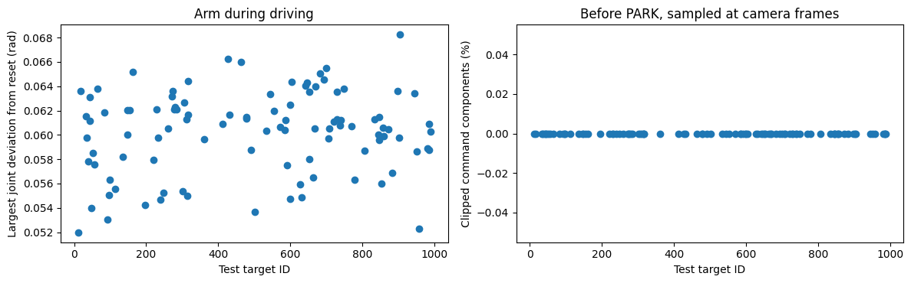

<div>

<table border="1" class="dataframe">
  <thead>
    <tr style="text-align: right;">
      <th></th>
      <th>status</th>
      <th>prepark_frames</th>
      <th>max_arm_deviation_rad</th>
      <th>maximum_command_Nm</th>
      <th>torque_clipped_fraction</th>
    </tr>
    <tr>
      <th>dot</th>
      <th></th>
      <th></th>
      <th></th>
      <th></th>
      <th></th>
    </tr>
  </thead>
  <tbody>
    <tr>
      <th>11</th>
      <td>stop_outside_10mm</td>
      <td>168</td>
      <td>0.0520</td>
      <td>19.9584</td>
      <td>0.0</td>
    </tr>
    <tr>
      <th>17</th>
      <td>stop_outside_10mm</td>
      <td>274</td>
      <td>0.0636</td>
      <td>20.4943</td>
      <td>0.0</td>
    </tr>
    <tr>
      <th>33</th>
      <td>stop_outside_10mm</td>
      <td>239</td>
      <td>0.0615</td>
      <td>20.8299</td>
      <td>0.0</td>
    </tr>
    <tr>
      <th>35</th>
      <td>no_park_timeout</td>
      <td>360</td>
      <td>0.0598</td>
      <td>20.5405</td>
      <td>0.0</td>
    </tr>
    <tr>
      <th>40</th>
      <td>no_stop_timeout</td>
      <td>267</td>
      <td>0.0578</td>
      <td>20.6460</td>
      <td>0.0</td>
    </tr>
    <tr>
      <th>...</th>
      <td>...</td>
      <td>...</td>
      <td>...</td>
      <td>...</td>
      <td>...</td>
    </tr>
    <tr>
      <th>958</th>
      <td>no_stop_timeout</td>
      <td>116</td>
      <td>0.0523</td>
      <td>20.5256</td>
      <td>0.0</td>
    </tr>
    <tr>
      <th>981</th>
      <td>stop_outside_10mm</td>
      <td>162</td>
      <td>0.0589</td>
      <td>21.1756</td>
      <td>0.0</td>
    </tr>
    <tr>
      <th>985</th>
      <td>stop_outside_10mm</td>
      <td>161</td>
      <td>0.0609</td>
      <td>20.8215</td>
      <td>0.0</td>
    </tr>
    <tr>
      <th>986</th>
      <td>no_park_timeout</td>
      <td>383</td>
      <td>0.0588</td>
      <td>20.5281</td>
      <td>0.0</td>
    </tr>
    <tr>
      <th>989</th>
      <td>stop_outside_10mm</td>
      <td>199</td>
      <td>0.0603</td>
      <td>21.0909</td>
      <td>0.0</td>
    </tr>
  </tbody>
</table>
<p>100 rows × 5 columns</p>
</div>

```text
Learned torques are applied from reset. No expert holding or added gravity term.

```


<a id="cell-356"></a>

<details><summary>Code · original cell 356</summary>

```python
full_report=overnight.select(full_name)
full_report.stopping(7);plt.show()
full_report.distances(7);plt.show()
print('Closest approach, exact STOP, and 0.5-second drift are different measurements.')
```

</details>

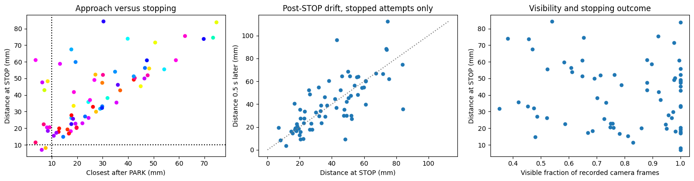

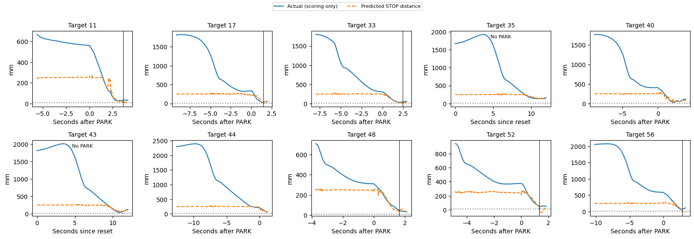

```text
Closest approach, exact STOP, and 0.5-second drift are different measurements.

```


<a id="cell-357"></a>

<details><summary>Code · original cell 357</summary>

```python
full_url=overnight.player_url(full_name)
display(lazy_player(full_url))
display(HTML(f'<a href="{full_url}" target="_blank">Open all 100 test replays</a>'))
print('Wheel encoder speeds, wheel commands, PARK and STOP values, applied arm torques, camera and ghost.')
```

</details>

[Interactive output: open original notebook, cell 357](../driving_v2/golden_dataset.ipynb).

[Interactive output: open original notebook, cell 357](../driving_v2/golden_dataset.ipynb).

```text
Wheel encoder speeds, wheel commands, PARK and STOP values, applied arm torques, camera and ghost.

```


<a id="cell-358"></a>

<details><summary>Code · original cell 358</summary>

```python
display(Markdown(overnight.reading(full_name)))
```

</details>

Both networks controlled the complete run, including learned arm torques before PARK. On validation, 89/100 parked and 4/100 met the full task criterion. On the frozen test comparison, 84/100 parked, 69/100 issued STOP, and 2/100 were within 10 mm at STOP. Median parking error among parked attempts was 4.2 cm; median distance at STOP among stopped attempts was 37.0 mm. Median maximum pre-PARK joint deviation was 0.061 rad. The 0.5 s after STOP is observed with learned torques still active, not a frozen simulation. These are previously viewed test targets and one seed; this is a frozen subsequent comparison, not an untouched estimate of generalisation. All timeouts and failures remain in the denominator.


<a id="cell-359"></a>

### Iteration 55: Frozen DAgger-trained networks: all five disturbances and random starts

**What changed:** Test the selected DAgger model under all five disturbances and random starts. This is the same checkpoint as its clean test.

**Type:** Frozen-model stress test. Seed 7 only; 100 validation and 100 test targets, with both learned networks controlling the complete episode. No conventional arm holding controller or extra gravity compensation is active.

**Result:** test PARK 64/100, STOP 61/100, full success 0/100; validation full success 0/100. Median parking error is 19.64 cm among 64 parked attempts. Median STOP distance is 495.6 mm among 61 stopped attempts. 36 attempts did not PARK; 3 parked without STOP. Neither is silently discarded from success.

**Comparison with iteration 54 (dagger):** PARK count changes by -20; STOP by -8; successes by -2. On the same 61 targets parked by both, the median paired change in parking error is +12.14 cm. On the same 50 targets stopped by both, the median paired change at STOP is +439.7 mm. Negative changes mean smaller errors. These paired subsets exclude failures, so read them alongside the counts, not as overall success rates.

**Training provenance:** selected epochs: driving 292, torque 1186, STOP 600. The curves below belong to the actual checkpoint; frozen stress tests reuse their parent training histories and do not represent new training. Driving predicts four wheel speeds and time to PARK (trigger 0.25 s). The arm predicts seven torques; its STOP network predicts distance (trigger 10 mm). Command losses are MSE, with separate auxiliary MSE terms; run weights are equal. Saved configuration and histories give scaling and exact coefficients.

**Limits:** these test targets have been viewed in earlier experiments. This is a reused-test comparison, not an untouched final estimate. One seed cannot establish seed robustness. Success requires PARK, STOP and distance at STOP ≤10 mm. Closest approach and later drift are diagnostics, not substitutes for that criterion. The complete per-target table, pre-PARK arm analysis, all loss terms, STOP/drift plots and 100-replay player follow below.


<a id="cell-360"></a>

<details><summary>Code · original cell 360</summary>

```python
from pathlib import Path
import sys,json,uuid
import matplotlib.pyplot as plt
from IPython.display import display,Markdown,HTML
sys.path.insert(0,str(Path('../arm').resolve()))
import report_curriculum as overnight
def lazy_player(url,height=850):
    k=uuid.uuid4().hex[:8]
    return HTML(f"<div><button onclick=\"var f=document.getElementById('player{k}');f.src='{url}';f.style.display='block';this.style.display='none'\" style=\"padding:8px 14px\">Load the 3D player</button><iframe id=\"player{k}\" style=\"display:none;width:100%;height:{height}px;border:0\"></iframe></div>")

full_name='dagger_stack'
display(overnight.build(full_name).round(3))
print('Validation and test are distinct. No fitting occurs in these analysis cells.')
```

</details>

<div>

<table border="1" class="dataframe">
  <thead>
    <tr style="text-align: right;">
      <th></th>
      <th>seed</th>
      <th>attempts</th>
      <th>parked</th>
      <th>stopped</th>
      <th>success_10mm</th>
      <th>success_percent</th>
      <th>wilson95_low_percent</th>
      <th>wilson95_high_percent</th>
      <th>median_park_error_cm</th>
      <th>median_abs_heading_error_deg</th>
      <th>median_closest_mm</th>
      <th>median_stop_mm</th>
      <th>median_park_s</th>
      <th>median_stop_s</th>
      <th>timeouts</th>
      <th>execution_failures</th>
      <th>sum_case_wall_s</th>
      <th>median_case_wall_s</th>
    </tr>
    <tr>
      <th>split</th>
      <th></th>
      <th></th>
      <th></th>
      <th></th>
      <th></th>
      <th></th>
      <th></th>
      <th></th>
      <th></th>
      <th></th>
      <th></th>
      <th></th>
      <th></th>
      <th></th>
      <th></th>
      <th></th>
      <th></th>
      <th></th>
    </tr>
  </thead>
  <tbody>
    <tr>
      <th>val</th>
      <td>7</td>
      <td>100</td>
      <td>66</td>
      <td>60</td>
      <td>0</td>
      <td>0.0</td>
      <td>0.0</td>
      <td>3.699</td>
      <td>33.206</td>
      <td>19.891</td>
      <td>310.719</td>
      <td>516.017</td>
      <td>7.733</td>
      <td>7.623</td>
      <td>40</td>
      <td>0</td>
      <td>2030.665</td>
      <td>21.615</td>
    </tr>
    <tr>
      <th>test</th>
      <td>7</td>
      <td>100</td>
      <td>64</td>
      <td>61</td>
      <td>0</td>
      <td>0.0</td>
      <td>0.0</td>
      <td>3.699</td>
      <td>19.642</td>
      <td>15.803</td>
      <td>279.632</td>
      <td>495.573</td>
      <td>6.666</td>
      <td>7.400</td>
      <td>39</td>
      <td>0</td>
      <td>1932.291</td>
      <td>21.306</td>
    </tr>
  </tbody>
</table>
</div>

```text
Validation and test are distinct. No fitting occurs in these analysis cells.

```


<a id="cell-361"></a>

<details><summary>Code · original cell 361</summary>

```python
full_config=json.loads((overnight.ROOT/full_name/'test/config.json').read_text())
display(full_config)
for kind in ('driving','torque','stop'):
    chosen=json.loads((overnight.models(full_name)/f'{kind}_seed7_summary.json').read_text())
    print(kind, 'selected epoch',chosen['selected_epoch'],'validation loss',chosen['selected_val_loss'])
```

</details>

```text
{'cases': [11,
  17,
  33,
  35,
  40,
  43,
  44,
  48,
  52,
  56,
  65,
  83,
  92,
  97,
  98,
  113,
  136,
  147,
  148,
  154,
  162,
  196,
  221,
  229,
  232,
  239,
  248,
  260,
  271,
  274,
  277,
  281,
  285,
  302,
  306,
  311,
  315,
  316,
  317,
  361,
  413,
  427,
  432,
  463,
  478,
  479,
  492,
  502,
  534,
  545,
  554,
  571,
  585,
  586,
  592,
  599,
  600,
  605,
  628,
  632,
  642,
  646,
  652,
  653,
  664,
  669,
  671,
  683,
  693,
  700,
  707,
  708,
  722,
  729,
  730,
  738,
  741,
  750,
  770,
  779,
  806,
  834,
  845,
  846,
  848,
  854,
  857,
  859,
  872,
  883,
  898,
  903,
  905,
  945,
  952,
  958,
  981,
  985,
  986,
  989],
 'split': 'test',
 'seed': 7,
 'jobs': 4,
 'models': '/media/nm/Fast Drive/comp0245-golden11109/overnight_20261105/dagger_round3/models',
 'condition': {'encoder_noise_sd': 0.0001,
  'sensor_seed': 7,
  'damping': 1.0,
  'elasticity': 1.0,
  'inertia': 0.001,
  'delay_ms': 3},
 'model_hashes': {'driving_seed7.npz': 'ac5142423c51af0503a05a01db73f46a20f1c7d546e7a6f9debaa62a992fa389',
  'reaching_seed7.npz': '59d511132e0699c4e48e802f0013f6dc26794a2ecf9b301d425edadade472f34'},
 'native_hashes': {'/media/nm/Fast Drive/comp0245-golden11109/overnight_20261105/recovery_runtime_exportfix1/native/sensor_curriculum.cpp': '85a6236a4d1fdc0c9dc2d0e991e460cc150e12abb2e153c596f3c8b247ed60d6',
  '/media/nm/Fast Drive/comp0245-golden11109/overnight_20261105/recovery_runtime_exportfix1/native/sensor_curriculum': 'd589e24b3ac57a056801059812d64271bc83cc2d350c6a487509b6555b6ecf8d'},
 'source_hashes': {'full_run.py': 'a099cabfe4479cf25bd59665e16717b8634a7feeb1b647f1dc39df9bf674514d',
  'evaluate_curriculum.py': '7fa3b64db19e7a39b0cb3a598945fee4695e3a0dce7d037d1eee1e73a85f132c',
  'curriculum_sensors.py': '8117d6a981b4e5dd37dbcf2f4c051e11e6be80dc414dd5beac3c30cbbd523520'},
 'split_sha256': '286f578aec7e3ab0953592466e63014cc1dde7f467106fadf273b30762ac1abf',
 'renderer': 'egl',
 'arm_control': 'learned from reset, 1 kHz, no PD hold or gravity addition',
 'selection': 'checkpoints frozen on offline validation; no fitting in evaluator',
 'test_reuse': 'existing targets previously evaluated; not a fresh blind test'}
```

```text
driving selected epoch 292 validation loss 0.6960341334342957
torque selected epoch 1186 validation loss 0.041894376277923584
stop selected epoch 600 validation loss 0.0009144675568677485

```


<a id="cell-362"></a>

<details><summary>Code · original cell 362</summary>

```python
overnight.losses(full_name);plt.show()
print('All training and validation epochs. Test scores are not training losses.')
```

</details>


```text
All training and validation epochs. Test scores are not training losses.

```


<a id="cell-363"></a>

<details><summary>Code · original cell 363</summary>

```python
full_report=overnight.select(full_name)
full_report.outcomes(7);plt.show()
display(full_report.table(7).round(3))
```

</details>

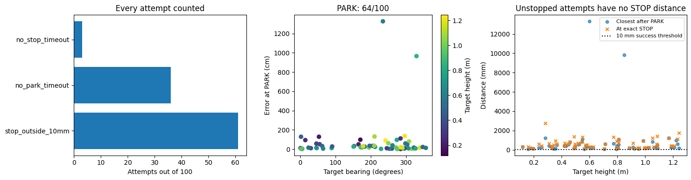

<div>

<table border="1" class="dataframe">
  <thead>
    <tr style="text-align: right;">
      <th></th>
      <th>status</th>
      <th>success</th>
      <th>parked</th>
      <th>park_s</th>
      <th>stop_s</th>
      <th>park_error_cm</th>
      <th>park_heading_error_deg</th>
      <th>at_stop_mm</th>
      <th>closest_mm</th>
      <th>end_mm</th>
      <th>post_stop_drift_mm</th>
      <th>post_park_base_drift_cm</th>
      <th>timed_out</th>
      <th>elapsed_s</th>
      <th>camera_visible_fraction</th>
      <th>target_bearing_deg</th>
      <th>target_range_m</th>
      <th>target_height_m</th>
    </tr>
    <tr>
      <th>dot</th>
      <th></th>
      <th></th>
      <th></th>
      <th></th>
      <th></th>
      <th></th>
      <th></th>
      <th></th>
      <th></th>
      <th></th>
      <th></th>
      <th></th>
      <th></th>
      <th></th>
      <th></th>
      <th></th>
      <th></th>
      <th></th>
    </tr>
  </thead>
  <tbody>
    <tr>
      <th>11</th>
      <td>stop_outside_10mm</td>
      <td>False</td>
      <td>True</td>
      <td>4.033</td>
      <td>4.033</td>
      <td>10.349</td>
      <td>2.193</td>
      <td>188.622</td>
      <td>159.094</td>
      <td>159.100</td>
      <td>-29.522</td>
      <td>1.669</td>
      <td>False</td>
      <td>10.447</td>
      <td>0.993</td>
      <td>0.986</td>
      <td>1.042</td>
      <td>0.178</td>
    </tr>
    <tr>
      <th>17</th>
      <td>stop_outside_10mm</td>
      <td>False</td>
      <td>True</td>
      <td>9.067</td>
      <td>9.095</td>
      <td>16.378</td>
      <td>-14.745</td>
      <td>261.109</td>
      <td>225.509</td>
      <td>225.314</td>
      <td>-35.795</td>
      <td>0.220</td>
      <td>False</td>
      <td>19.105</td>
      <td>0.375</td>
      <td>194.926</td>
      <td>1.095</td>
      <td>1.028</td>
    </tr>
    <tr>
      <th>33</th>
      <td>stop_outside_10mm</td>
      <td>False</td>
      <td>True</td>
      <td>8.367</td>
      <td>8.958</td>
      <td>5.728</td>
      <td>-5.459</td>
      <td>677.474</td>
      <td>390.099</td>
      <td>1140.402</td>
      <td>462.928</td>
      <td>3.273</td>
      <td>False</td>
      <td>19.027</td>
      <td>0.595</td>
      <td>259.736</td>
      <td>1.504</td>
      <td>0.422</td>
    </tr>
    <tr>
      <th>35</th>
      <td>no_park_timeout</td>
      <td>False</td>
      <td>False</td>
      <td>NaN</td>
      <td>NaN</td>
      <td>NaN</td>
      <td>NaN</td>
      <td>NaN</td>
      <td>NaN</td>
      <td>2737.393</td>
      <td>NaN</td>
      <td>NaN</td>
      <td>True</td>
      <td>22.340</td>
      <td>0.269</td>
      <td>111.687</td>
      <td>1.257</td>
      <td>0.589</td>
    </tr>
    <tr>
      <th>40</th>
      <td>stop_outside_10mm</td>
      <td>False</td>
      <td>True</td>
      <td>8.600</td>
      <td>8.600</td>
      <td>34.646</td>
      <td>-33.076</td>
      <td>331.770</td>
      <td>318.531</td>
      <td>320.966</td>
      <td>-10.804</td>
      <td>4.248</td>
      <td>False</td>
      <td>18.036</td>
      <td>0.487</td>
      <td>205.751</td>
      <td>1.041</td>
      <td>0.328</td>
    </tr>
    <tr>
      <th>...</th>
      <td>...</td>
      <td>...</td>
      <td>...</td>
      <td>...</td>
      <td>...</td>
      <td>...</td>
      <td>...</td>
      <td>...</td>
      <td>...</td>
      <td>...</td>
      <td>...</td>
      <td>...</td>
      <td>...</td>
      <td>...</td>
      <td>...</td>
      <td>...</td>
      <td>...</td>
      <td>...</td>
    </tr>
    <tr>
      <th>958</th>
      <td>stop_outside_10mm</td>
      <td>False</td>
      <td>True</td>
      <td>4.533</td>
      <td>4.533</td>
      <td>22.918</td>
      <td>-16.191</td>
      <td>344.566</td>
      <td>211.803</td>
      <td>240.902</td>
      <td>-103.664</td>
      <td>1.610</td>
      <td>False</td>
      <td>11.070</td>
      <td>0.967</td>
      <td>347.116</td>
      <td>1.181</td>
      <td>0.493</td>
    </tr>
    <tr>
      <th>981</th>
      <td>stop_outside_10mm</td>
      <td>False</td>
      <td>True</td>
      <td>5.767</td>
      <td>6.014</td>
      <td>59.355</td>
      <td>38.101</td>
      <td>121.919</td>
      <td>79.690</td>
      <td>413.459</td>
      <td>291.539</td>
      <td>15.414</td>
      <td>False</td>
      <td>13.790</td>
      <td>0.847</td>
      <td>297.945</td>
      <td>1.569</td>
      <td>0.564</td>
    </tr>
    <tr>
      <th>985</th>
      <td>stop_outside_10mm</td>
      <td>False</td>
      <td>True</td>
      <td>5.233</td>
      <td>5.236</td>
      <td>20.206</td>
      <td>-1.073</td>
      <td>396.861</td>
      <td>277.846</td>
      <td>277.531</td>
      <td>-119.329</td>
      <td>0.182</td>
      <td>False</td>
      <td>12.833</td>
      <td>0.520</td>
      <td>284.446</td>
      <td>1.417</td>
      <td>1.210</td>
    </tr>
    <tr>
      <th>986</th>
      <td>no_park_timeout</td>
      <td>False</td>
      <td>False</td>
      <td>NaN</td>
      <td>NaN</td>
      <td>NaN</td>
      <td>NaN</td>
      <td>NaN</td>
      <td>NaN</td>
      <td>1752.789</td>
      <td>NaN</td>
      <td>NaN</td>
      <td>True</td>
      <td>22.208</td>
      <td>0.528</td>
      <td>98.931</td>
      <td>1.279</td>
      <td>0.179</td>
    </tr>
    <tr>
      <th>989</th>
      <td>stop_outside_10mm</td>
      <td>False</td>
      <td>True</td>
      <td>6.000</td>
      <td>6.021</td>
      <td>16.682</td>
      <td>0.903</td>
      <td>397.055</td>
      <td>274.143</td>
      <td>273.869</td>
      <td>-123.186</td>
      <td>0.100</td>
      <td>False</td>
      <td>13.580</td>
      <td>0.735</td>
      <td>287.737</td>
      <td>1.749</td>
      <td>1.193</td>
    </tr>
  </tbody>
</table>
<p>100 rows × 18 columns</p>
</div>


<a id="cell-364"></a>

<details><summary>Code · original cell 364</summary>

```python
overnight.holding(full_name);plt.show()
display(overnight.hold_table(full_name).round(4))
print('Learned torques are applied from reset. No expert holding or added gravity term.')
```

</details>

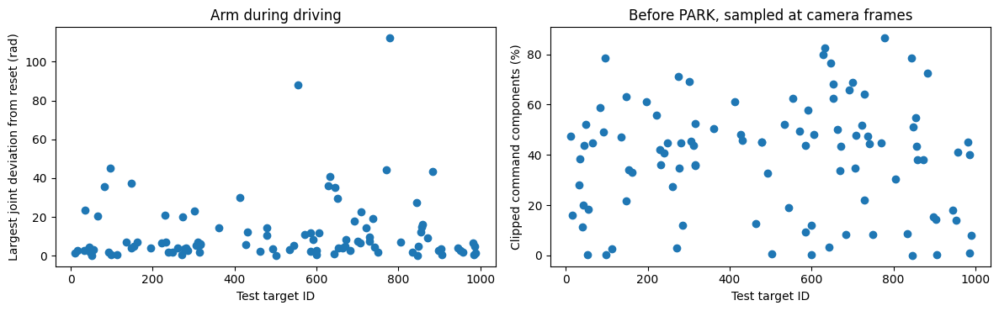

<div>

<table border="1" class="dataframe">
  <thead>
    <tr style="text-align: right;">
      <th></th>
      <th>status</th>
      <th>prepark_frames</th>
      <th>max_arm_deviation_rad</th>
      <th>maximum_command_Nm</th>
      <th>torque_clipped_fraction</th>
    </tr>
    <tr>
      <th>dot</th>
      <th></th>
      <th></th>
      <th></th>
      <th></th>
      <th></th>
    </tr>
  </thead>
  <tbody>
    <tr>
      <th>11</th>
      <td>stop_outside_10mm</td>
      <td>121</td>
      <td>1.3332</td>
      <td>30.0</td>
      <td>0.4746</td>
    </tr>
    <tr>
      <th>17</th>
      <td>stop_outside_10mm</td>
      <td>272</td>
      <td>2.7284</td>
      <td>30.0</td>
      <td>0.1586</td>
    </tr>
    <tr>
      <th>33</th>
      <td>stop_outside_10mm</td>
      <td>251</td>
      <td>2.6674</td>
      <td>30.0</td>
      <td>0.2795</td>
    </tr>
    <tr>
      <th>35</th>
      <td>no_park_timeout</td>
      <td>360</td>
      <td>23.6092</td>
      <td>30.0</td>
      <td>0.3837</td>
    </tr>
    <tr>
      <th>40</th>
      <td>stop_outside_10mm</td>
      <td>258</td>
      <td>2.9041</td>
      <td>30.0</td>
      <td>0.1146</td>
    </tr>
    <tr>
      <th>...</th>
      <td>...</td>
      <td>...</td>
      <td>...</td>
      <td>...</td>
      <td>...</td>
    </tr>
    <tr>
      <th>958</th>
      <td>stop_outside_10mm</td>
      <td>136</td>
      <td>1.7706</td>
      <td>30.0</td>
      <td>0.4118</td>
    </tr>
    <tr>
      <th>981</th>
      <td>stop_outside_10mm</td>
      <td>173</td>
      <td>6.5860</td>
      <td>30.0</td>
      <td>0.4525</td>
    </tr>
    <tr>
      <th>985</th>
      <td>stop_outside_10mm</td>
      <td>157</td>
      <td>0.3303</td>
      <td>30.0</td>
      <td>0.0082</td>
    </tr>
    <tr>
      <th>986</th>
      <td>no_park_timeout</td>
      <td>413</td>
      <td>4.8774</td>
      <td>30.0</td>
      <td>0.3999</td>
    </tr>
    <tr>
      <th>989</th>
      <td>stop_outside_10mm</td>
      <td>180</td>
      <td>1.4192</td>
      <td>30.0</td>
      <td>0.0794</td>
    </tr>
  </tbody>
</table>
<p>100 rows × 5 columns</p>
</div>

```text
Learned torques are applied from reset. No expert holding or added gravity term.

```


<a id="cell-365"></a>

<details><summary>Code · original cell 365</summary>

```python
full_report=overnight.select(full_name)
full_report.stopping(7);plt.show()
full_report.distances(7);plt.show()
print('Closest approach, exact STOP, and 0.5-second drift are different measurements.')
```

</details>

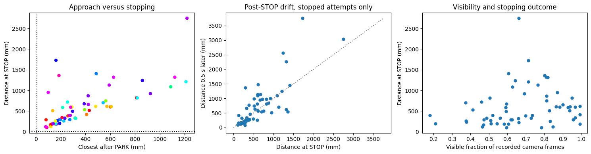

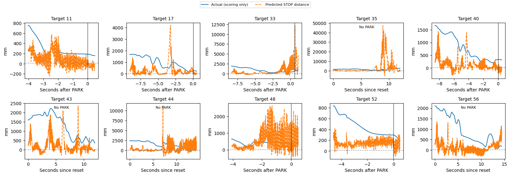

```text
Closest approach, exact STOP, and 0.5-second drift are different measurements.

```


<a id="cell-366"></a>

<details><summary>Code · original cell 366</summary>

```python
full_url=overnight.player_url(full_name)
display(lazy_player(full_url))
display(HTML(f'<a href="{full_url}" target="_blank">Open all 100 test replays</a>'))
print('Wheel encoder speeds, wheel commands, PARK and STOP values, applied arm torques, camera and ghost.')
```

</details>

[Interactive output: open original notebook, cell 366](../driving_v2/golden_dataset.ipynb).

[Interactive output: open original notebook, cell 366](../driving_v2/golden_dataset.ipynb).

```text
Wheel encoder speeds, wheel commands, PARK and STOP values, applied arm torques, camera and ghost.

```


<a id="cell-367"></a>

<details><summary>Code · original cell 367</summary>

```python
display(Markdown(overnight.reading(full_name)))
```

</details>

Both networks controlled the complete run, including learned arm torques before PARK. On validation, 66/100 parked and 0/100 met the full task criterion. On the frozen test comparison, 64/100 parked, 61/100 issued STOP, and 0/100 were within 10 mm at STOP. Median parking error among parked attempts was 19.6 cm; median distance at STOP among stopped attempts was 495.6 mm. Median maximum pre-PARK joint deviation was 5.256 rad. The 0.5 s after STOP is observed with learned torques still active, not a frozen simulation. These are previously viewed test targets and one seed; this is a frozen subsequent comparison, not an untouched estimate of generalisation. All timeouts and failures remain in the denominator.


<a id="cell-368"></a>

### Iteration 56: DART-inspired training followed by three-round DAgger; clean evaluation

**What changed:** Retain original and both DART datasets, then aggregate three rounds of 100 student rollouts with shadow-expert command labels. Round 3 was selected on the six validation cases. New DAgger rows do not train PARK or STOP. Round 2 export was repaired and rerun without loosening the numerical tolerance; the selected model is round 3.

**Type:** Recovery training. Seed 7 only; 100 validation and 100 test targets, with both learned networks controlling the complete episode. No conventional arm holding controller or extra gravity compensation is active.

**Result:** test PARK 87/100, STOP 66/100, full success 4/100; validation full success 1/100. Median parking error is 4.87 cm among 87 parked attempts. Median STOP distance is 34.5 mm among 66 stopped attempts. 13 attempts did not PARK; 21 parked without STOP. Neither is silently discarded from success.

**Comparison with iteration 52 (dart):** PARK count changes by -13; STOP by -12; successes by +3. On the same 87 targets parked by both, the median paired change in parking error is -0.38 cm. On the same 59 targets stopped by both, the median paired change at STOP is -41.3 mm. Negative changes mean smaller errors. These paired subsets exclude failures, so read them alongside the counts, not as overall success rates.

**Training provenance:** selected epochs: driving 300, torque 1187, STOP 582. The curves below belong to the actual checkpoint; frozen stress tests reuse their parent training histories and do not represent new training. Driving predicts four wheel speeds and time to PARK (trigger 0.25 s). The arm predicts seven torques; its STOP network predicts distance (trigger 10 mm). Command losses are MSE, with separate auxiliary MSE terms; run weights are equal. Saved configuration and histories give scaling and exact coefficients.

**Limits:** these test targets have been viewed in earlier experiments. This is a reused-test comparison, not an untouched final estimate. One seed cannot establish seed robustness. Success requires PARK, STOP and distance at STOP ≤10 mm. Closest approach and later drift are diagnostics, not substitutes for that criterion. The complete per-target table, pre-PARK arm analysis, all loss terms, STOP/drift plots and 100-replay player follow below.

**Interpretation:** compare both approach accuracy and completion. A smaller STOP median can coexist with fewer STOPs. The six-case development scores are not estimates of performance across all 100 test targets.


<a id="cell-369"></a>

<details><summary>Code · original cell 369</summary>

```python
from pathlib import Path
import sys,json,uuid
import matplotlib.pyplot as plt
from IPython.display import display,Markdown,HTML
sys.path.insert(0,str(Path('../arm').resolve()))
import report_curriculum as overnight
def lazy_player(url,height=850):
    k=uuid.uuid4().hex[:8]
    return HTML(f"<div><button onclick=\"var f=document.getElementById('player{k}');f.src='{url}';f.style.display='block';this.style.display='none'\" style=\"padding:8px 14px\">Load the 3D player</button><iframe id=\"player{k}\" style=\"display:none;width:100%;height:{height}px;border:0\"></iframe></div>")

full_name='dart_dagger'
display(overnight.build(full_name).round(3))
print('Validation and test are distinct. No fitting occurs in these analysis cells.')
```

</details>

<div>

<table border="1" class="dataframe">
  <thead>
    <tr style="text-align: right;">
      <th></th>
      <th>seed</th>
      <th>attempts</th>
      <th>parked</th>
      <th>stopped</th>
      <th>success_10mm</th>
      <th>success_percent</th>
      <th>wilson95_low_percent</th>
      <th>wilson95_high_percent</th>
      <th>median_park_error_cm</th>
      <th>median_abs_heading_error_deg</th>
      <th>median_closest_mm</th>
      <th>median_stop_mm</th>
      <th>median_park_s</th>
      <th>median_stop_s</th>
      <th>timeouts</th>
      <th>execution_failures</th>
      <th>sum_case_wall_s</th>
      <th>median_case_wall_s</th>
    </tr>
    <tr>
      <th>split</th>
      <th></th>
      <th></th>
      <th></th>
      <th></th>
      <th></th>
      <th></th>
      <th></th>
      <th></th>
      <th></th>
      <th></th>
      <th></th>
      <th></th>
      <th></th>
      <th></th>
      <th></th>
      <th></th>
      <th></th>
      <th></th>
    </tr>
  </thead>
  <tbody>
    <tr>
      <th>val</th>
      <td>7</td>
      <td>100</td>
      <td>93</td>
      <td>68</td>
      <td>1</td>
      <td>1.0</td>
      <td>0.177</td>
      <td>5.449</td>
      <td>4.477</td>
      <td>1.979</td>
      <td>28.592</td>
      <td>27.767</td>
      <td>7.933</td>
      <td>9.678</td>
      <td>32</td>
      <td>0</td>
      <td>2062.807</td>
      <td>21.672</td>
    </tr>
    <tr>
      <th>test</th>
      <td>7</td>
      <td>100</td>
      <td>87</td>
      <td>66</td>
      <td>4</td>
      <td>4.0</td>
      <td>1.566</td>
      <td>9.837</td>
      <td>4.865</td>
      <td>1.849</td>
      <td>30.021</td>
      <td>34.475</td>
      <td>6.733</td>
      <td>9.672</td>
      <td>34</td>
      <td>0</td>
      <td>1960.722</td>
      <td>20.525</td>
    </tr>
  </tbody>
</table>
</div>

```text
Validation and test are distinct. No fitting occurs in these analysis cells.

```


<a id="cell-370"></a>

<details><summary>Code · original cell 370</summary>

```python
full_config=json.loads((overnight.ROOT/full_name/'test/config.json').read_text())
display(full_config)
for kind in ('driving','torque','stop'):
    chosen=json.loads((overnight.models(full_name)/f'{kind}_seed7_summary.json').read_text())
    print(kind, 'selected epoch',chosen['selected_epoch'],'validation loss',chosen['selected_val_loss'])
```

</details>

```text
{'cases': [11,
  17,
  33,
  35,
  40,
  43,
  44,
  48,
  52,
  56,
  65,
  83,
  92,
  97,
  98,
  113,
  136,
  147,
  148,
  154,
  162,
  196,
  221,
  229,
  232,
  239,
  248,
  260,
  271,
  274,
  277,
  281,
  285,
  302,
  306,
  311,
  315,
  316,
  317,
  361,
  413,
  427,
  432,
  463,
  478,
  479,
  492,
  502,
  534,
  545,
  554,
  571,
  585,
  586,
  592,
  599,
  600,
  605,
  628,
  632,
  642,
  646,
  652,
  653,
  664,
  669,
  671,
  683,
  693,
  700,
  707,
  708,
  722,
  729,
  730,
  738,
  741,
  750,
  770,
  779,
  806,
  834,
  845,
  846,
  848,
  854,
  857,
  859,
  872,
  883,
  898,
  903,
  905,
  945,
  952,
  958,
  981,
  985,
  986,
  989],
 'split': 'test',
 'seed': 7,
 'jobs': 4,
 'models': '/media/nm/Fast Drive/comp0245-golden11109/overnight_20261105/dart_dagger_round3/models',
 'condition': {},
 'model_hashes': {'driving_seed7.npz': '1fe7edaa505eb346a2e1746ab18c8bdc768b4bab4fac96b213b879f0196425da',
  'reaching_seed7.npz': '2b501ed2f44cd8f25343298daa1b7f1e837faf64b6e9c187c7c1f1de247b8633'},
 'native_hashes': {'/media/nm/Fast Drive/comp0245-golden11109/overnight_20261105/recovery_runtime_exportfix1/native/sensor_curriculum.cpp': '85a6236a4d1fdc0c9dc2d0e991e460cc150e12abb2e153c596f3c8b247ed60d6',
  '/media/nm/Fast Drive/comp0245-golden11109/overnight_20261105/recovery_runtime_exportfix1/native/sensor_curriculum': 'd589e24b3ac57a056801059812d64271bc83cc2d350c6a487509b6555b6ecf8d'},
 'source_hashes': {'full_run.py': 'a099cabfe4479cf25bd59665e16717b8634a7feeb1b647f1dc39df9bf674514d',
  'evaluate_curriculum.py': '7fa3b64db19e7a39b0cb3a598945fee4695e3a0dce7d037d1eee1e73a85f132c',
  'curriculum_sensors.py': '8117d6a981b4e5dd37dbcf2f4c051e11e6be80dc414dd5beac3c30cbbd523520'},
 'split_sha256': '286f578aec7e3ab0953592466e63014cc1dde7f467106fadf273b30762ac1abf',
 'renderer': 'egl',
 'arm_control': 'learned from reset, 1 kHz, no PD hold or gravity addition',
 'selection': 'checkpoints frozen on offline validation; no fitting in evaluator',
 'test_reuse': 'existing targets previously evaluated; not a fresh blind test'}
```

```text
driving selected epoch 300 validation loss 0.4867059290409088
torque selected epoch 1187 validation loss 0.03249802440404892
stop selected epoch 582 validation loss 0.0009227031259797513

```


<a id="cell-371"></a>

<details><summary>Code · original cell 371</summary>

```python
overnight.losses(full_name);plt.show()
print('All training and validation epochs. Test scores are not training losses.')
```

</details>

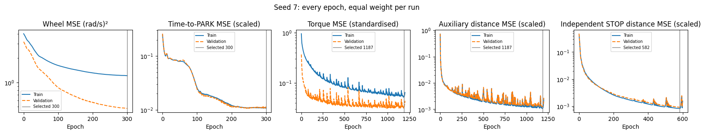

```text
All training and validation epochs. Test scores are not training losses.

```


<a id="cell-372"></a>

<details><summary>Code · original cell 372</summary>

```python
full_report=overnight.select(full_name)
full_report.outcomes(7);plt.show()
display(full_report.table(7).round(3))
```

</details>

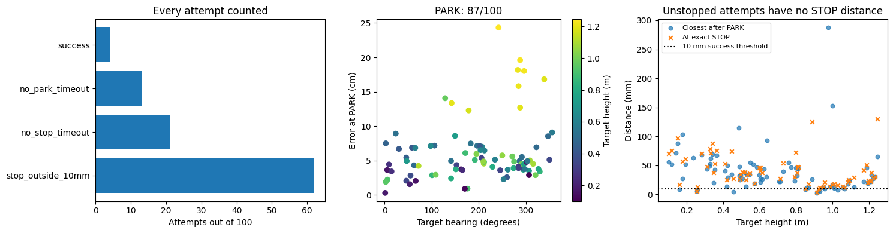

<div>

<table border="1" class="dataframe">
  <thead>
    <tr style="text-align: right;">
      <th></th>
      <th>status</th>
      <th>success</th>
      <th>parked</th>
      <th>park_s</th>
      <th>stop_s</th>
      <th>park_error_cm</th>
      <th>park_heading_error_deg</th>
      <th>at_stop_mm</th>
      <th>closest_mm</th>
      <th>end_mm</th>
      <th>post_stop_drift_mm</th>
      <th>post_park_base_drift_cm</th>
      <th>timed_out</th>
      <th>elapsed_s</th>
      <th>camera_visible_fraction</th>
      <th>target_bearing_deg</th>
      <th>target_range_m</th>
      <th>target_height_m</th>
    </tr>
    <tr>
      <th>dot</th>
      <th></th>
      <th></th>
      <th></th>
      <th></th>
      <th></th>
      <th></th>
      <th></th>
      <th></th>
      <th></th>
      <th></th>
      <th></th>
      <th></th>
      <th></th>
      <th></th>
      <th></th>
      <th></th>
      <th></th>
      <th></th>
    </tr>
  </thead>
  <tbody>
    <tr>
      <th>11</th>
      <td>stop_outside_10mm</td>
      <td>False</td>
      <td>True</td>
      <td>1.967</td>
      <td>4.897</td>
      <td>0.301</td>
      <td>-1.671</td>
      <td>56.840</td>
      <td>26.776</td>
      <td>26.890</td>
      <td>-29.950</td>
      <td>0.786</td>
      <td>False</td>
      <td>10.687</td>
      <td>1.000</td>
      <td>0.986</td>
      <td>1.042</td>
      <td>0.178</td>
    </tr>
    <tr>
      <th>17</th>
      <td>stop_outside_10mm</td>
      <td>False</td>
      <td>True</td>
      <td>8.533</td>
      <td>10.843</td>
      <td>5.984</td>
      <td>-0.755</td>
      <td>15.315</td>
      <td>7.859</td>
      <td>7.850</td>
      <td>-7.465</td>
      <td>0.412</td>
      <td>False</td>
      <td>20.189</td>
      <td>0.460</td>
      <td>194.926</td>
      <td>1.095</td>
      <td>1.028</td>
    </tr>
    <tr>
      <th>33</th>
      <td>no_stop_timeout</td>
      <td>False</td>
      <td>True</td>
      <td>7.567</td>
      <td>NaN</td>
      <td>2.574</td>
      <td>-1.012</td>
      <td>NaN</td>
      <td>49.971</td>
      <td>55.014</td>
      <td>NaN</td>
      <td>0.879</td>
      <td>True</td>
      <td>22.571</td>
      <td>0.854</td>
      <td>259.736</td>
      <td>1.504</td>
      <td>0.422</td>
    </tr>
    <tr>
      <th>35</th>
      <td>no_park_timeout</td>
      <td>False</td>
      <td>False</td>
      <td>NaN</td>
      <td>NaN</td>
      <td>NaN</td>
      <td>NaN</td>
      <td>NaN</td>
      <td>NaN</td>
      <td>142.097</td>
      <td>NaN</td>
      <td>NaN</td>
      <td>True</td>
      <td>21.236</td>
      <td>0.594</td>
      <td>111.687</td>
      <td>1.257</td>
      <td>0.589</td>
    </tr>
    <tr>
      <th>40</th>
      <td>stop_outside_10mm</td>
      <td>False</td>
      <td>True</td>
      <td>8.833</td>
      <td>11.098</td>
      <td>5.379</td>
      <td>-0.433</td>
      <td>78.702</td>
      <td>53.169</td>
      <td>53.096</td>
      <td>-25.606</td>
      <td>0.103</td>
      <td>False</td>
      <td>19.933</td>
      <td>0.690</td>
      <td>205.751</td>
      <td>1.041</td>
      <td>0.328</td>
    </tr>
    <tr>
      <th>...</th>
      <td>...</td>
      <td>...</td>
      <td>...</td>
      <td>...</td>
      <td>...</td>
      <td>...</td>
      <td>...</td>
      <td>...</td>
      <td>...</td>
      <td>...</td>
      <td>...</td>
      <td>...</td>
      <td>...</td>
      <td>...</td>
      <td>...</td>
      <td>...</td>
      <td>...</td>
      <td>...</td>
    </tr>
    <tr>
      <th>958</th>
      <td>stop_outside_10mm</td>
      <td>False</td>
      <td>True</td>
      <td>2.933</td>
      <td>5.022</td>
      <td>8.532</td>
      <td>-0.223</td>
      <td>26.196</td>
      <td>24.705</td>
      <td>35.546</td>
      <td>9.351</td>
      <td>0.704</td>
      <td>False</td>
      <td>11.196</td>
      <td>0.976</td>
      <td>347.116</td>
      <td>1.181</td>
      <td>0.493</td>
    </tr>
    <tr>
      <th>981</th>
      <td>no_stop_timeout</td>
      <td>False</td>
      <td>True</td>
      <td>6.067</td>
      <td>NaN</td>
      <td>3.751</td>
      <td>-1.627</td>
      <td>NaN</td>
      <td>51.787</td>
      <td>51.786</td>
      <td>NaN</td>
      <td>1.420</td>
      <td>True</td>
      <td>21.338</td>
      <td>0.900</td>
      <td>297.945</td>
      <td>1.569</td>
      <td>0.564</td>
    </tr>
    <tr>
      <th>985</th>
      <td>stop_outside_10mm</td>
      <td>False</td>
      <td>True</td>
      <td>6.300</td>
      <td>8.700</td>
      <td>15.816</td>
      <td>-0.579</td>
      <td>22.164</td>
      <td>22.155</td>
      <td>31.834</td>
      <td>9.670</td>
      <td>0.424</td>
      <td>False</td>
      <td>17.091</td>
      <td>0.457</td>
      <td>284.446</td>
      <td>1.417</td>
      <td>1.210</td>
    </tr>
    <tr>
      <th>986</th>
      <td>no_park_timeout</td>
      <td>False</td>
      <td>False</td>
      <td>NaN</td>
      <td>NaN</td>
      <td>NaN</td>
      <td>NaN</td>
      <td>NaN</td>
      <td>NaN</td>
      <td>544.863</td>
      <td>NaN</td>
      <td>NaN</td>
      <td>True</td>
      <td>20.494</td>
      <td>0.629</td>
      <td>98.931</td>
      <td>1.279</td>
      <td>0.179</td>
    </tr>
    <tr>
      <th>989</th>
      <td>stop_outside_10mm</td>
      <td>False</td>
      <td>True</td>
      <td>7.000</td>
      <td>9.511</td>
      <td>12.700</td>
      <td>-0.322</td>
      <td>19.390</td>
      <td>18.496</td>
      <td>24.708</td>
      <td>5.317</td>
      <td>0.915</td>
      <td>False</td>
      <td>18.035</td>
      <td>0.638</td>
      <td>287.737</td>
      <td>1.749</td>
      <td>1.193</td>
    </tr>
  </tbody>
</table>
<p>100 rows × 18 columns</p>
</div>


<a id="cell-373"></a>

<details><summary>Code · original cell 373</summary>

```python
overnight.holding(full_name);plt.show()
display(overnight.hold_table(full_name).round(4))
print('Learned torques are applied from reset. No expert holding or added gravity term.')
```

</details>

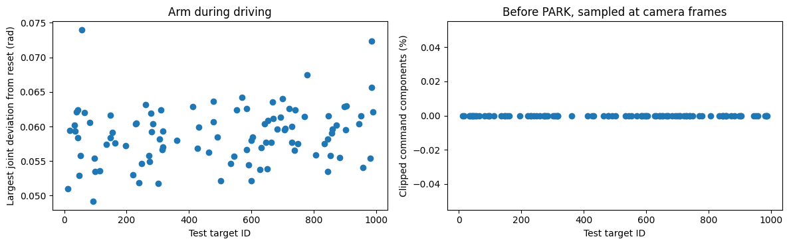

<div>

<table border="1" class="dataframe">
  <thead>
    <tr style="text-align: right;">
      <th></th>
      <th>status</th>
      <th>prepark_frames</th>
      <th>max_arm_deviation_rad</th>
      <th>maximum_command_Nm</th>
      <th>torque_clipped_fraction</th>
    </tr>
    <tr>
      <th>dot</th>
      <th></th>
      <th></th>
      <th></th>
      <th></th>
      <th></th>
    </tr>
  </thead>
  <tbody>
    <tr>
      <th>11</th>
      <td>stop_outside_10mm</td>
      <td>59</td>
      <td>0.0510</td>
      <td>18.7068</td>
      <td>0.0</td>
    </tr>
    <tr>
      <th>17</th>
      <td>stop_outside_10mm</td>
      <td>256</td>
      <td>0.0595</td>
      <td>20.3385</td>
      <td>0.0</td>
    </tr>
    <tr>
      <th>33</th>
      <td>no_stop_timeout</td>
      <td>227</td>
      <td>0.0602</td>
      <td>20.5220</td>
      <td>0.0</td>
    </tr>
    <tr>
      <th>35</th>
      <td>no_park_timeout</td>
      <td>360</td>
      <td>0.0593</td>
      <td>20.5707</td>
      <td>0.0</td>
    </tr>
    <tr>
      <th>40</th>
      <td>stop_outside_10mm</td>
      <td>265</td>
      <td>0.0622</td>
      <td>20.0794</td>
      <td>0.0</td>
    </tr>
    <tr>
      <th>...</th>
      <td>...</td>
      <td>...</td>
      <td>...</td>
      <td>...</td>
      <td>...</td>
    </tr>
    <tr>
      <th>958</th>
      <td>stop_outside_10mm</td>
      <td>88</td>
      <td>0.0541</td>
      <td>19.9577</td>
      <td>0.0</td>
    </tr>
    <tr>
      <th>981</th>
      <td>no_stop_timeout</td>
      <td>182</td>
      <td>0.0554</td>
      <td>21.4625</td>
      <td>0.0</td>
    </tr>
    <tr>
      <th>985</th>
      <td>stop_outside_10mm</td>
      <td>189</td>
      <td>0.0656</td>
      <td>20.2899</td>
      <td>0.0</td>
    </tr>
    <tr>
      <th>986</th>
      <td>no_park_timeout</td>
      <td>383</td>
      <td>0.0723</td>
      <td>20.1621</td>
      <td>0.0</td>
    </tr>
    <tr>
      <th>989</th>
      <td>stop_outside_10mm</td>
      <td>210</td>
      <td>0.0621</td>
      <td>20.7392</td>
      <td>0.0</td>
    </tr>
  </tbody>
</table>
<p>100 rows × 5 columns</p>
</div>

```text
Learned torques are applied from reset. No expert holding or added gravity term.

```


<a id="cell-374"></a>

<details><summary>Code · original cell 374</summary>

```python
full_report=overnight.select(full_name)
full_report.stopping(7);plt.show()
full_report.distances(7);plt.show()
print('Closest approach, exact STOP, and 0.5-second drift are different measurements.')
```

</details>

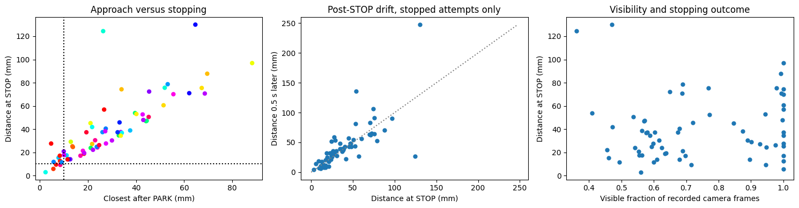

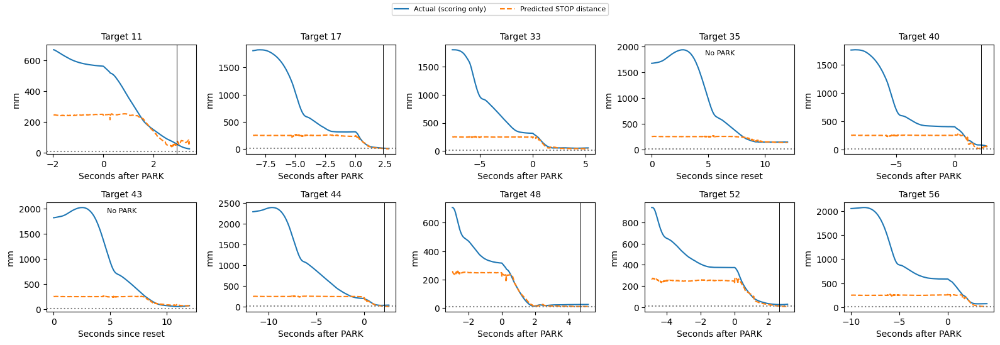

```text
Closest approach, exact STOP, and 0.5-second drift are different measurements.

```


<a id="cell-375"></a>

<details><summary>Code · original cell 375</summary>

```python
full_url=overnight.player_url(full_name)
display(lazy_player(full_url))
display(HTML(f'<a href="{full_url}" target="_blank">Open all 100 test replays</a>'))
print('Wheel encoder speeds, wheel commands, PARK and STOP values, applied arm torques, camera and ghost.')
```

</details>

[Interactive output: open original notebook, cell 375](../driving_v2/golden_dataset.ipynb).

[Interactive output: open original notebook, cell 375](../driving_v2/golden_dataset.ipynb).

```text
Wheel encoder speeds, wheel commands, PARK and STOP values, applied arm torques, camera and ghost.

```


<a id="cell-376"></a>

<details><summary>Code · original cell 376</summary>

```python
display(Markdown(overnight.reading(full_name)))
```

</details>

Both networks controlled the complete run, including learned arm torques before PARK. On validation, 93/100 parked and 1/100 met the full task criterion. On the frozen test comparison, 87/100 parked, 66/100 issued STOP, and 4/100 were within 10 mm at STOP. Median parking error among parked attempts was 4.9 cm; median distance at STOP among stopped attempts was 34.5 mm. Median maximum pre-PARK joint deviation was 0.059 rad. The 0.5 s after STOP is observed with learned torques still active, not a frozen simulation. These are previously viewed test targets and one seed; this is a frozen subsequent comparison, not an untouched estimate of generalisation. All timeouts and failures remain in the denominator.


<a id="cell-377"></a>

### Iteration 57: Frozen DART+DAgger networks: all five disturbances and random starts

**What changed:** Test the selected combined model under all five disturbances and random starts. No bursty-packet loss, occlusion or direct weight perturbation is included.

**Type:** Frozen-model stress test. Seed 7 only; 100 validation and 100 test targets, with both learned networks controlling the complete episode. No conventional arm holding controller or extra gravity compensation is active.

**Result:** test PARK 87/100, STOP 86/100, full success 0/100; validation full success 0/100. Median parking error is 19.59 cm among 87 parked attempts. Median STOP distance is 321.9 mm among 86 stopped attempts. 13 attempts did not PARK; 1 parked without STOP. Neither is silently discarded from success.

**Comparison with iteration 56 (dart_dagger):** PARK count changes by +0; STOP by +20; successes by -4. On the same 80 targets parked by both, the median paired change in parking error is +12.43 cm. On the same 61 targets stopped by both, the median paired change at STOP is +289.9 mm. Negative changes mean smaller errors. These paired subsets exclude failures, so read them alongside the counts, not as overall success rates.

**Training provenance:** selected epochs: driving 300, torque 1187, STOP 582. The curves below belong to the actual checkpoint; frozen stress tests reuse their parent training histories and do not represent new training. Driving predicts four wheel speeds and time to PARK (trigger 0.25 s). The arm predicts seven torques; its STOP network predicts distance (trigger 10 mm). Command losses are MSE, with separate auxiliary MSE terms; run weights are equal. Saved configuration and histories give scaling and exact coefficients.

**Limits:** these test targets have been viewed in earlier experiments. This is a reused-test comparison, not an untouched final estimate. One seed cannot establish seed robustness. Success requires PARK, STOP and distance at STOP ≤10 mm. Closest approach and later drift are diagnostics, not substitutes for that criterion. The complete per-target table, pre-PARK arm analysis, all loss terms, STOP/drift plots and 100-replay player follow below.


<a id="cell-378"></a>

<details><summary>Code · original cell 378</summary>

```python
from pathlib import Path
import sys,json,uuid
import matplotlib.pyplot as plt
from IPython.display import display,Markdown,HTML
sys.path.insert(0,str(Path('../arm').resolve()))
import report_curriculum as overnight
def lazy_player(url,height=850):
    k=uuid.uuid4().hex[:8]
    return HTML(f"<div><button onclick=\"var f=document.getElementById('player{k}');f.src='{url}';f.style.display='block';this.style.display='none'\" style=\"padding:8px 14px\">Load the 3D player</button><iframe id=\"player{k}\" style=\"display:none;width:100%;height:{height}px;border:0\"></iframe></div>")

full_name='dart_dagger_stack'
display(overnight.build(full_name).round(3))
print('Validation and test are distinct. No fitting occurs in these analysis cells.')
```

</details>

<div>

<table border="1" class="dataframe">
  <thead>
    <tr style="text-align: right;">
      <th></th>
      <th>seed</th>
      <th>attempts</th>
      <th>parked</th>
      <th>stopped</th>
      <th>success_10mm</th>
      <th>success_percent</th>
      <th>wilson95_low_percent</th>
      <th>wilson95_high_percent</th>
      <th>median_park_error_cm</th>
      <th>median_abs_heading_error_deg</th>
      <th>median_closest_mm</th>
      <th>median_stop_mm</th>
      <th>median_park_s</th>
      <th>median_stop_s</th>
      <th>timeouts</th>
      <th>execution_failures</th>
      <th>sum_case_wall_s</th>
      <th>median_case_wall_s</th>
    </tr>
    <tr>
      <th>split</th>
      <th></th>
      <th></th>
      <th></th>
      <th></th>
      <th></th>
      <th></th>
      <th></th>
      <th></th>
      <th></th>
      <th></th>
      <th></th>
      <th></th>
      <th></th>
      <th></th>
      <th></th>
      <th></th>
      <th></th>
      <th></th>
    </tr>
  </thead>
  <tbody>
    <tr>
      <th>val</th>
      <td>7</td>
      <td>100</td>
      <td>88</td>
      <td>85</td>
      <td>0</td>
      <td>0.0</td>
      <td>0.0</td>
      <td>3.699</td>
      <td>23.886</td>
      <td>14.242</td>
      <td>242.808</td>
      <td>335.546</td>
      <td>8.8</td>
      <td>8.549</td>
      <td>15</td>
      <td>0</td>
      <td>1945.676</td>
      <td>20.420</td>
    </tr>
    <tr>
      <th>test</th>
      <td>7</td>
      <td>100</td>
      <td>87</td>
      <td>86</td>
      <td>0</td>
      <td>0.0</td>
      <td>0.0</td>
      <td>3.699</td>
      <td>19.595</td>
      <td>12.010</td>
      <td>240.908</td>
      <td>321.948</td>
      <td>8.0</td>
      <td>7.551</td>
      <td>14</td>
      <td>0</td>
      <td>1802.547</td>
      <td>18.523</td>
    </tr>
  </tbody>
</table>
</div>

```text
Validation and test are distinct. No fitting occurs in these analysis cells.

```


<a id="cell-379"></a>

<details><summary>Code · original cell 379</summary>

```python
full_config=json.loads((overnight.ROOT/full_name/'test/config.json').read_text())
display(full_config)
for kind in ('driving','torque','stop'):
    chosen=json.loads((overnight.models(full_name)/f'{kind}_seed7_summary.json').read_text())
    print(kind, 'selected epoch',chosen['selected_epoch'],'validation loss',chosen['selected_val_loss'])
```

</details>

```text
{'cases': [11,
  17,
  33,
  35,
  40,
  43,
  44,
  48,
  52,
  56,
  65,
  83,
  92,
  97,
  98,
  113,
  136,
  147,
  148,
  154,
  162,
  196,
  221,
  229,
  232,
  239,
  248,
  260,
  271,
  274,
  277,
  281,
  285,
  302,
  306,
  311,
  315,
  316,
  317,
  361,
  413,
  427,
  432,
  463,
  478,
  479,
  492,
  502,
  534,
  545,
  554,
  571,
  585,
  586,
  592,
  599,
  600,
  605,
  628,
  632,
  642,
  646,
  652,
  653,
  664,
  669,
  671,
  683,
  693,
  700,
  707,
  708,
  722,
  729,
  730,
  738,
  741,
  750,
  770,
  779,
  806,
  834,
  845,
  846,
  848,
  854,
  857,
  859,
  872,
  883,
  898,
  903,
  905,
  945,
  952,
  958,
  981,
  985,
  986,
  989],
 'split': 'test',
 'seed': 7,
 'jobs': 4,
 'models': '/media/nm/Fast Drive/comp0245-golden11109/overnight_20261105/dart_dagger_round3/models',
 'condition': {'encoder_noise_sd': 0.0001,
  'sensor_seed': 7,
  'damping': 1.0,
  'elasticity': 1.0,
  'inertia': 0.001,
  'delay_ms': 3},
 'model_hashes': {'driving_seed7.npz': '1fe7edaa505eb346a2e1746ab18c8bdc768b4bab4fac96b213b879f0196425da',
  'reaching_seed7.npz': '2b501ed2f44cd8f25343298daa1b7f1e837faf64b6e9c187c7c1f1de247b8633'},
 'native_hashes': {'/media/nm/Fast Drive/comp0245-golden11109/overnight_20261105/recovery_runtime_exportfix1/native/sensor_curriculum.cpp': '85a6236a4d1fdc0c9dc2d0e991e460cc150e12abb2e153c596f3c8b247ed60d6',
  '/media/nm/Fast Drive/comp0245-golden11109/overnight_20261105/recovery_runtime_exportfix1/native/sensor_curriculum': 'd589e24b3ac57a056801059812d64271bc83cc2d350c6a487509b6555b6ecf8d'},
 'source_hashes': {'full_run.py': 'a099cabfe4479cf25bd59665e16717b8634a7feeb1b647f1dc39df9bf674514d',
  'evaluate_curriculum.py': '7fa3b64db19e7a39b0cb3a598945fee4695e3a0dce7d037d1eee1e73a85f132c',
  'curriculum_sensors.py': '8117d6a981b4e5dd37dbcf2f4c051e11e6be80dc414dd5beac3c30cbbd523520'},
 'split_sha256': '286f578aec7e3ab0953592466e63014cc1dde7f467106fadf273b30762ac1abf',
 'renderer': 'egl',
 'arm_control': 'learned from reset, 1 kHz, no PD hold or gravity addition',
 'selection': 'checkpoints frozen on offline validation; no fitting in evaluator',
 'test_reuse': 'existing targets previously evaluated; not a fresh blind test'}
```

```text
driving selected epoch 300 validation loss 0.4867059290409088
torque selected epoch 1187 validation loss 0.03249802440404892
stop selected epoch 582 validation loss 0.0009227031259797513

```


<a id="cell-380"></a>

<details><summary>Code · original cell 380</summary>

```python
overnight.losses(full_name);plt.show()
print('All training and validation epochs. Test scores are not training losses.')
```

</details>


```text
All training and validation epochs. Test scores are not training losses.

```


<a id="cell-381"></a>

<details><summary>Code · original cell 381</summary>

```python
full_report=overnight.select(full_name)
full_report.outcomes(7);plt.show()
display(full_report.table(7).round(3))
```

</details>

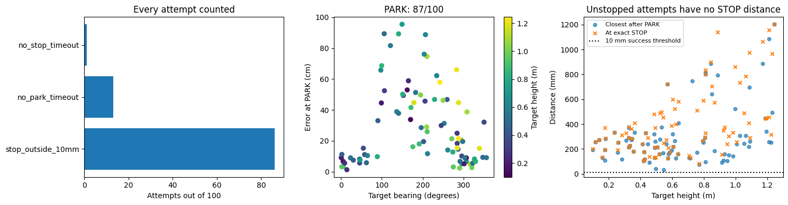

<div>

<table border="1" class="dataframe">
  <thead>
    <tr style="text-align: right;">
      <th></th>
      <th>status</th>
      <th>success</th>
      <th>parked</th>
      <th>park_s</th>
      <th>stop_s</th>
      <th>park_error_cm</th>
      <th>park_heading_error_deg</th>
      <th>at_stop_mm</th>
      <th>closest_mm</th>
      <th>end_mm</th>
      <th>post_stop_drift_mm</th>
      <th>post_park_base_drift_cm</th>
      <th>timed_out</th>
      <th>elapsed_s</th>
      <th>camera_visible_fraction</th>
      <th>target_bearing_deg</th>
      <th>target_range_m</th>
      <th>target_height_m</th>
    </tr>
    <tr>
      <th>dot</th>
      <th></th>
      <th></th>
      <th></th>
      <th></th>
      <th></th>
      <th></th>
      <th></th>
      <th></th>
      <th></th>
      <th></th>
      <th></th>
      <th></th>
      <th></th>
      <th></th>
      <th></th>
      <th></th>
      <th></th>
      <th></th>
    </tr>
  </thead>
  <tbody>
    <tr>
      <th>11</th>
      <td>stop_outside_10mm</td>
      <td>False</td>
      <td>True</td>
      <td>2.167</td>
      <td>2.175</td>
      <td>9.151</td>
      <td>-0.789</td>
      <td>192.369</td>
      <td>191.666</td>
      <td>237.970</td>
      <td>45.601</td>
      <td>0.330</td>
      <td>False</td>
      <td>7.152</td>
      <td>0.802</td>
      <td>0.986</td>
      <td>1.042</td>
      <td>0.178</td>
    </tr>
    <tr>
      <th>17</th>
      <td>stop_outside_10mm</td>
      <td>False</td>
      <td>True</td>
      <td>9.633</td>
      <td>9.633</td>
      <td>49.669</td>
      <td>-40.872</td>
      <td>733.921</td>
      <td>308.650</td>
      <td>308.409</td>
      <td>-425.512</td>
      <td>4.290</td>
      <td>False</td>
      <td>19.818</td>
      <td>0.641</td>
      <td>194.926</td>
      <td>1.095</td>
      <td>1.028</td>
    </tr>
    <tr>
      <th>33</th>
      <td>stop_outside_10mm</td>
      <td>False</td>
      <td>True</td>
      <td>8.367</td>
      <td>8.367</td>
      <td>46.747</td>
      <td>-29.112</td>
      <td>177.214</td>
      <td>177.214</td>
      <td>336.476</td>
      <td>159.262</td>
      <td>8.055</td>
      <td>False</td>
      <td>18.145</td>
      <td>0.556</td>
      <td>259.736</td>
      <td>1.504</td>
      <td>0.422</td>
    </tr>
    <tr>
      <th>35</th>
      <td>no_park_timeout</td>
      <td>False</td>
      <td>False</td>
      <td>NaN</td>
      <td>NaN</td>
      <td>NaN</td>
      <td>NaN</td>
      <td>NaN</td>
      <td>NaN</td>
      <td>133.605</td>
      <td>NaN</td>
      <td>NaN</td>
      <td>True</td>
      <td>22.717</td>
      <td>0.581</td>
      <td>111.687</td>
      <td>1.257</td>
      <td>0.589</td>
    </tr>
    <tr>
      <th>40</th>
      <td>stop_outside_10mm</td>
      <td>False</td>
      <td>True</td>
      <td>8.333</td>
      <td>8.333</td>
      <td>45.696</td>
      <td>-32.473</td>
      <td>215.459</td>
      <td>215.459</td>
      <td>353.023</td>
      <td>137.564</td>
      <td>2.438</td>
      <td>False</td>
      <td>17.201</td>
      <td>0.442</td>
      <td>205.751</td>
      <td>1.041</td>
      <td>0.328</td>
    </tr>
    <tr>
      <th>...</th>
      <td>...</td>
      <td>...</td>
      <td>...</td>
      <td>...</td>
      <td>...</td>
      <td>...</td>
      <td>...</td>
      <td>...</td>
      <td>...</td>
      <td>...</td>
      <td>...</td>
      <td>...</td>
      <td>...</td>
      <td>...</td>
      <td>...</td>
      <td>...</td>
      <td>...</td>
      <td>...</td>
    </tr>
    <tr>
      <th>958</th>
      <td>stop_outside_10mm</td>
      <td>False</td>
      <td>True</td>
      <td>3.933</td>
      <td>3.934</td>
      <td>9.358</td>
      <td>-7.592</td>
      <td>369.046</td>
      <td>259.812</td>
      <td>259.635</td>
      <td>-109.411</td>
      <td>0.305</td>
      <td>False</td>
      <td>10.225</td>
      <td>0.866</td>
      <td>347.116</td>
      <td>1.181</td>
      <td>0.493</td>
    </tr>
    <tr>
      <th>981</th>
      <td>stop_outside_10mm</td>
      <td>False</td>
      <td>True</td>
      <td>6.600</td>
      <td>6.600</td>
      <td>19.595</td>
      <td>9.994</td>
      <td>275.171</td>
      <td>239.810</td>
      <td>239.720</td>
      <td>-35.451</td>
      <td>1.052</td>
      <td>False</td>
      <td>15.320</td>
      <td>0.779</td>
      <td>297.945</td>
      <td>1.569</td>
      <td>0.564</td>
    </tr>
    <tr>
      <th>985</th>
      <td>stop_outside_10mm</td>
      <td>False</td>
      <td>True</td>
      <td>5.300</td>
      <td>6.936</td>
      <td>15.438</td>
      <td>-1.531</td>
      <td>455.979</td>
      <td>254.981</td>
      <td>473.730</td>
      <td>17.751</td>
      <td>0.083</td>
      <td>False</td>
      <td>15.575</td>
      <td>0.688</td>
      <td>284.446</td>
      <td>1.417</td>
      <td>1.210</td>
    </tr>
    <tr>
      <th>986</th>
      <td>stop_outside_10mm</td>
      <td>False</td>
      <td>True</td>
      <td>11.100</td>
      <td>11.104</td>
      <td>44.523</td>
      <td>-20.626</td>
      <td>284.008</td>
      <td>282.779</td>
      <td>358.628</td>
      <td>74.620</td>
      <td>3.355</td>
      <td>False</td>
      <td>20.054</td>
      <td>0.447</td>
      <td>98.931</td>
      <td>1.279</td>
      <td>0.179</td>
    </tr>
    <tr>
      <th>989</th>
      <td>stop_outside_10mm</td>
      <td>False</td>
      <td>True</td>
      <td>8.400</td>
      <td>10.155</td>
      <td>44.751</td>
      <td>35.871</td>
      <td>448.408</td>
      <td>342.841</td>
      <td>399.437</td>
      <td>-48.971</td>
      <td>12.374</td>
      <td>False</td>
      <td>19.142</td>
      <td>0.662</td>
      <td>287.737</td>
      <td>1.749</td>
      <td>1.193</td>
    </tr>
  </tbody>
</table>
<p>100 rows × 18 columns</p>
</div>


<a id="cell-382"></a>

<details><summary>Code · original cell 382</summary>

```python
overnight.holding(full_name);plt.show()
display(overnight.hold_table(full_name).round(4))
print('Learned torques are applied from reset. No expert holding or added gravity term.')
```

</details>

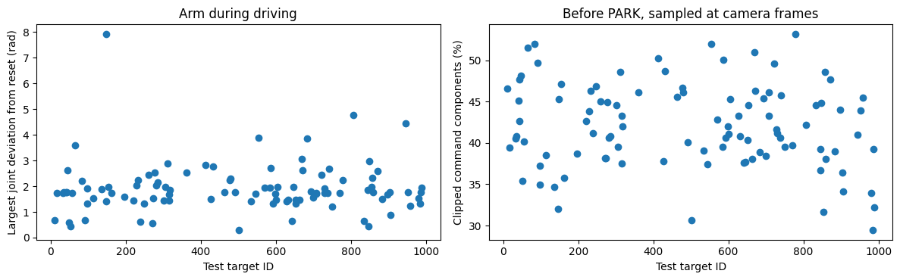

<div>

<table border="1" class="dataframe">
  <thead>
    <tr style="text-align: right;">
      <th></th>
      <th>status</th>
      <th>prepark_frames</th>
      <th>max_arm_deviation_rad</th>
      <th>maximum_command_Nm</th>
      <th>torque_clipped_fraction</th>
    </tr>
    <tr>
      <th>dot</th>
      <th></th>
      <th></th>
      <th></th>
      <th></th>
      <th></th>
    </tr>
  </thead>
  <tbody>
    <tr>
      <th>11</th>
      <td>stop_outside_10mm</td>
      <td>65</td>
      <td>0.6878</td>
      <td>30.0</td>
      <td>0.4659</td>
    </tr>
    <tr>
      <th>17</th>
      <td>stop_outside_10mm</td>
      <td>289</td>
      <td>1.7452</td>
      <td>30.0</td>
      <td>0.3945</td>
    </tr>
    <tr>
      <th>33</th>
      <td>stop_outside_10mm</td>
      <td>251</td>
      <td>1.7415</td>
      <td>30.0</td>
      <td>0.4052</td>
    </tr>
    <tr>
      <th>35</th>
      <td>no_park_timeout</td>
      <td>360</td>
      <td>1.7681</td>
      <td>30.0</td>
      <td>0.4083</td>
    </tr>
    <tr>
      <th>40</th>
      <td>stop_outside_10mm</td>
      <td>250</td>
      <td>1.7547</td>
      <td>30.0</td>
      <td>0.4509</td>
    </tr>
    <tr>
      <th>...</th>
      <td>...</td>
      <td>...</td>
      <td>...</td>
      <td>...</td>
      <td>...</td>
    </tr>
    <tr>
      <th>958</th>
      <td>stop_outside_10mm</td>
      <td>118</td>
      <td>1.2455</td>
      <td>30.0</td>
      <td>0.4552</td>
    </tr>
    <tr>
      <th>981</th>
      <td>stop_outside_10mm</td>
      <td>198</td>
      <td>1.5380</td>
      <td>30.0</td>
      <td>0.3398</td>
    </tr>
    <tr>
      <th>985</th>
      <td>stop_outside_10mm</td>
      <td>159</td>
      <td>1.3317</td>
      <td>30.0</td>
      <td>0.2947</td>
    </tr>
    <tr>
      <th>986</th>
      <td>stop_outside_10mm</td>
      <td>333</td>
      <td>1.7591</td>
      <td>30.0</td>
      <td>0.3921</td>
    </tr>
    <tr>
      <th>989</th>
      <td>stop_outside_10mm</td>
      <td>252</td>
      <td>1.9302</td>
      <td>30.0</td>
      <td>0.3220</td>
    </tr>
  </tbody>
</table>
<p>100 rows × 5 columns</p>
</div>

```text
Learned torques are applied from reset. No expert holding or added gravity term.

```


<a id="cell-383"></a>

<details><summary>Code · original cell 383</summary>

```python
full_report=overnight.select(full_name)
full_report.stopping(7);plt.show()
full_report.distances(7);plt.show()
print('Closest approach, exact STOP, and 0.5-second drift are different measurements.')
```

</details>

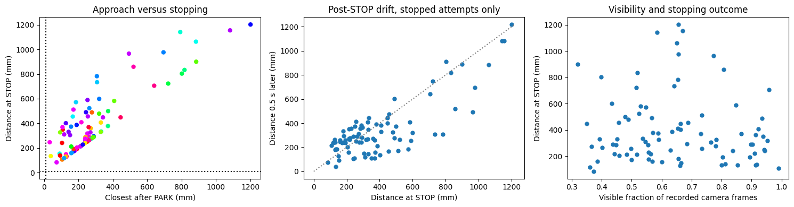

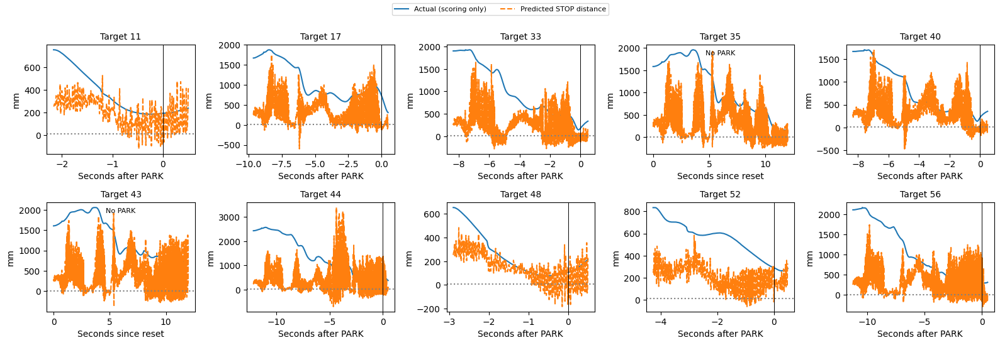

```text
Closest approach, exact STOP, and 0.5-second drift are different measurements.

```


<a id="cell-384"></a>

<details><summary>Code · original cell 384</summary>

```python
full_url=overnight.player_url(full_name)
display(lazy_player(full_url))
display(HTML(f'<a href="{full_url}" target="_blank">Open all 100 test replays</a>'))
print('Wheel encoder speeds, wheel commands, PARK and STOP values, applied arm torques, camera and ghost.')
```

</details>

[Interactive output: open original notebook, cell 384](../driving_v2/golden_dataset.ipynb).

[Interactive output: open original notebook, cell 384](../driving_v2/golden_dataset.ipynb).

```text
Wheel encoder speeds, wheel commands, PARK and STOP values, applied arm torques, camera and ghost.

```


<a id="cell-385"></a>

<details><summary>Code · original cell 385</summary>

```python
display(Markdown(overnight.reading(full_name)))
```

</details>

Both networks controlled the complete run, including learned arm torques before PARK. On validation, 88/100 parked and 0/100 met the full task criterion. On the frozen test comparison, 87/100 parked, 86/100 issued STOP, and 0/100 were within 10 mm at STOP. Median parking error among parked attempts was 19.6 cm; median distance at STOP among stopped attempts was 321.9 mm. Median maximum pre-PARK joint deviation was 1.755 rad. The 0.5 s after STOP is observed with learned torques still active, not a frozen simulation. These are previously viewed test targets and one seed; this is a frozen subsequent comparison, not an untouched estimate of generalisation. All timeouts and failures remain in the denominator.


<a id="cell-386"></a>

### Training and frozen-network evaluations: comparison and interpretation

Iterations 41–57 are completed 100-test-target evaluations. Each also has a separate completed 100-target validation evaluation. No additional validation simulation is needed for publication. Six-case recovery checks remain development records only.

The noise ladder starts from iteration 41, not the standardised iteration 43. The stack includes encoder noise, damping, elasticity, inertia, 3 ms delay and random starts. It does not include bursty packets or occlusion. Recovery models were trained with added recovery data, then tested separately on clean conditions and on the full stack.

All results use seed 7. Test targets have been reused; subsequent design decisions cannot be presented as blind final-test selection.


<a id="cell-387"></a>

<details><summary>Code · original cell 387</summary>

```python
import publish_curriculum as publication
publication_data=publication.manifest()
display(publication_data[['iteration','name','role','split','attempts','parked','stopped','success_10mm','median_park_error_cm','median_closest_mm','median_stop_mm','execution_failures']].round(2))
```

</details>

<div>

<table border="1" class="dataframe">
  <thead>
    <tr style="text-align: right;">
      <th></th>
      <th>iteration</th>
      <th>name</th>
      <th>role</th>
      <th>split</th>
      <th>attempts</th>
      <th>parked</th>
      <th>stopped</th>
      <th>success_10mm</th>
      <th>median_park_error_cm</th>
      <th>median_closest_mm</th>
      <th>median_stop_mm</th>
      <th>execution_failures</th>
    </tr>
  </thead>
  <tbody>
    <tr>
      <th>0</th>
      <td>41</td>
      <td>baseline</td>
      <td>New training</td>
      <td>test</td>
      <td>100</td>
      <td>100</td>
      <td>84</td>
      <td>0</td>
      <td>5.47</td>
      <td>184.48</td>
      <td>272.66</td>
      <td>0</td>
    </tr>
    <tr>
      <th>1</th>
      <td>41</td>
      <td>baseline</td>
      <td>New training</td>
      <td>val</td>
      <td>100</td>
      <td>100</td>
      <td>90</td>
      <td>0</td>
      <td>5.54</td>
      <td>210.97</td>
      <td>363.32</td>
      <td>0</td>
    </tr>
    <tr>
      <th>2</th>
      <td>42</td>
      <td>encoder_noise</td>
      <td>Frozen-model stress test</td>
      <td>test</td>
      <td>100</td>
      <td>99</td>
      <td>91</td>
      <td>0</td>
      <td>6.17</td>
      <td>573.88</td>
      <td>755.03</td>
      <td>0</td>
    </tr>
    <tr>
      <th>3</th>
      <td>42</td>
      <td>encoder_noise</td>
      <td>Frozen-model stress test</td>
      <td>val</td>
      <td>100</td>
      <td>99</td>
      <td>90</td>
      <td>0</td>
      <td>6.50</td>
      <td>585.95</td>
      <td>739.56</td>
      <td>0</td>
    </tr>
    <tr>
      <th>4</th>
      <td>43</td>
      <td>basics_standard</td>
      <td>New training</td>
      <td>test</td>
      <td>100</td>
      <td>100</td>
      <td>91</td>
      <td>0</td>
      <td>5.35</td>
      <td>75.07</td>
      <td>168.81</td>
      <td>0</td>
    </tr>
    <tr>
      <th>5</th>
      <td>43</td>
      <td>basics_standard</td>
      <td>New training</td>
      <td>val</td>
      <td>100</td>
      <td>100</td>
      <td>92</td>
      <td>0</td>
      <td>5.54</td>
      <td>92.04</td>
      <td>183.00</td>
      <td>0</td>
    </tr>
    <tr>
      <th>6</th>
      <td>44</td>
      <td>damping</td>
      <td>Frozen-model stress test</td>
      <td>test</td>
      <td>100</td>
      <td>100</td>
      <td>88</td>
      <td>0</td>
      <td>6.25</td>
      <td>556.16</td>
      <td>707.46</td>
      <td>0</td>
    </tr>
    <tr>
      <th>7</th>
      <td>44</td>
      <td>damping</td>
      <td>Frozen-model stress test</td>
      <td>val</td>
      <td>100</td>
      <td>98</td>
      <td>81</td>
      <td>0</td>
      <td>6.66</td>
      <td>536.34</td>
      <td>783.11</td>
      <td>0</td>
    </tr>
    <tr>
      <th>8</th>
      <td>45</td>
      <td>elasticity</td>
      <td>Frozen-model stress test</td>
      <td>test</td>
      <td>100</td>
      <td>99</td>
      <td>93</td>
      <td>0</td>
      <td>6.04</td>
      <td>661.99</td>
      <td>790.49</td>
      <td>0</td>
    </tr>
    <tr>
      <th>9</th>
      <td>45</td>
      <td>elasticity</td>
      <td>Frozen-model stress test</td>
      <td>val</td>
      <td>100</td>
      <td>97</td>
      <td>93</td>
      <td>0</td>
      <td>5.82</td>
      <td>656.22</td>
      <td>811.28</td>
      <td>0</td>
    </tr>
    <tr>
      <th>10</th>
      <td>46</td>
      <td>inertia</td>
      <td>Frozen-model stress test</td>
      <td>test</td>
      <td>100</td>
      <td>100</td>
      <td>94</td>
      <td>0</td>
      <td>7.17</td>
      <td>640.60</td>
      <td>779.27</td>
      <td>0</td>
    </tr>
    <tr>
      <th>11</th>
      <td>46</td>
      <td>inertia</td>
      <td>Frozen-model stress test</td>
      <td>val</td>
      <td>100</td>
      <td>96</td>
      <td>95</td>
      <td>0</td>
      <td>7.09</td>
      <td>687.51</td>
      <td>758.51</td>
      <td>0</td>
    </tr>
    <tr>
      <th>12</th>
      <td>47</td>
      <td>delay</td>
      <td>Frozen-model stress test</td>
      <td>test</td>
      <td>100</td>
      <td>91</td>
      <td>91</td>
      <td>0</td>
      <td>7.15</td>
      <td>764.13</td>
      <td>825.93</td>
      <td>0</td>
    </tr>
    <tr>
      <th>13</th>
      <td>47</td>
      <td>delay</td>
      <td>Frozen-model stress test</td>
      <td>val</td>
      <td>100</td>
      <td>89</td>
      <td>89</td>
      <td>0</td>
      <td>6.04</td>
      <td>761.87</td>
      <td>855.07</td>
      <td>0</td>
    </tr>
    <tr>
      <th>14</th>
      <td>48</td>
      <td>random_start_fixed</td>
      <td>Frozen-model stress test</td>
      <td>test</td>
      <td>100</td>
      <td>89</td>
      <td>89</td>
      <td>0</td>
      <td>7.80</td>
      <td>860.13</td>
      <td>899.35</td>
      <td>0</td>
    </tr>
    <tr>
      <th>15</th>
      <td>48</td>
      <td>random_start_fixed</td>
      <td>Frozen-model stress test</td>
      <td>val</td>
      <td>100</td>
      <td>88</td>
      <td>88</td>
      <td>0</td>
      <td>8.13</td>
      <td>902.17</td>
      <td>943.17</td>
      <td>0</td>
    </tr>
    <tr>
      <th>16</th>
      <td>49</td>
      <td>random_start_retrained</td>
      <td>New training</td>
      <td>test</td>
      <td>100</td>
      <td>85</td>
      <td>85</td>
      <td>0</td>
      <td>29.51</td>
      <td>801.26</td>
      <td>801.26</td>
      <td>0</td>
    </tr>
    <tr>
      <th>17</th>
      <td>49</td>
      <td>random_start_retrained</td>
      <td>New training</td>
      <td>val</td>
      <td>100</td>
      <td>84</td>
      <td>84</td>
      <td>0</td>
      <td>28.24</td>
      <td>784.27</td>
      <td>791.14</td>
      <td>0</td>
    </tr>
    <tr>
      <th>18</th>
      <td>50</td>
      <td>random_start_retention</td>
      <td>Retention test</td>
      <td>test</td>
      <td>100</td>
      <td>100</td>
      <td>93</td>
      <td>0</td>
      <td>5.86</td>
      <td>158.46</td>
      <td>806.55</td>
      <td>0</td>
    </tr>
    <tr>
      <th>19</th>
      <td>50</td>
      <td>random_start_retention</td>
      <td>Retention test</td>
      <td>val</td>
      <td>100</td>
      <td>100</td>
      <td>89</td>
      <td>0</td>
      <td>5.79</td>
      <td>192.35</td>
      <td>811.11</td>
      <td>0</td>
    </tr>
    <tr>
      <th>20</th>
      <td>51</td>
      <td>standard_stack</td>
      <td>Frozen-model stress test</td>
      <td>test</td>
      <td>100</td>
      <td>48</td>
      <td>19</td>
      <td>0</td>
      <td>33.98</td>
      <td>386.66</td>
      <td>1143.08</td>
      <td>0</td>
    </tr>
    <tr>
      <th>21</th>
      <td>51</td>
      <td>standard_stack</td>
      <td>Frozen-model stress test</td>
      <td>val</td>
      <td>100</td>
      <td>47</td>
      <td>8</td>
      <td>0</td>
      <td>41.95</td>
      <td>389.00</td>
      <td>1147.20</td>
      <td>0</td>
    </tr>
    <tr>
      <th>22</th>
      <td>52</td>
      <td>dart</td>
      <td>Recovery training</td>
      <td>test</td>
      <td>100</td>
      <td>100</td>
      <td>78</td>
      <td>1</td>
      <td>5.46</td>
      <td>44.97</td>
      <td>60.93</td>
      <td>0</td>
    </tr>
    <tr>
      <th>23</th>
      <td>52</td>
      <td>dart</td>
      <td>Recovery training</td>
      <td>val</td>
      <td>100</td>
      <td>100</td>
      <td>77</td>
      <td>2</td>
      <td>5.92</td>
      <td>54.34</td>
      <td>81.45</td>
      <td>0</td>
    </tr>
    <tr>
      <th>24</th>
      <td>53</td>
      <td>dart_stack</td>
      <td>Frozen-model stress test</td>
      <td>test</td>
      <td>100</td>
      <td>65</td>
      <td>64</td>
      <td>0</td>
      <td>19.06</td>
      <td>488.60</td>
      <td>655.60</td>
      <td>0</td>
    </tr>
    <tr>
      <th>25</th>
      <td>53</td>
      <td>dart_stack</td>
      <td>Frozen-model stress test</td>
      <td>val</td>
      <td>100</td>
      <td>68</td>
      <td>65</td>
      <td>0</td>
      <td>23.55</td>
      <td>441.13</td>
      <td>665.02</td>
      <td>0</td>
    </tr>
    <tr>
      <th>26</th>
      <td>54</td>
      <td>dagger</td>
      <td>Recovery training</td>
      <td>test</td>
      <td>100</td>
      <td>84</td>
      <td>69</td>
      <td>2</td>
      <td>4.23</td>
      <td>27.29</td>
      <td>36.98</td>
      <td>0</td>
    </tr>
    <tr>
      <th>27</th>
      <td>54</td>
      <td>dagger</td>
      <td>Recovery training</td>
      <td>val</td>
      <td>100</td>
      <td>89</td>
      <td>66</td>
      <td>4</td>
      <td>3.81</td>
      <td>25.34</td>
      <td>35.56</td>
      <td>0</td>
    </tr>
    <tr>
      <th>28</th>
      <td>55</td>
      <td>dagger_stack</td>
      <td>Frozen-model stress test</td>
      <td>test</td>
      <td>100</td>
      <td>64</td>
      <td>61</td>
      <td>0</td>
      <td>19.64</td>
      <td>279.63</td>
      <td>495.57</td>
      <td>0</td>
    </tr>
    <tr>
      <th>29</th>
      <td>55</td>
      <td>dagger_stack</td>
      <td>Frozen-model stress test</td>
      <td>val</td>
      <td>100</td>
      <td>66</td>
      <td>60</td>
      <td>0</td>
      <td>33.21</td>
      <td>310.72</td>
      <td>516.02</td>
      <td>0</td>
    </tr>
    <tr>
      <th>30</th>
      <td>56</td>
      <td>dart_dagger</td>
      <td>Recovery training</td>
      <td>test</td>
      <td>100</td>
      <td>87</td>
      <td>66</td>
      <td>4</td>
      <td>4.87</td>
      <td>30.02</td>
      <td>34.47</td>
      <td>0</td>
    </tr>
    <tr>
      <th>31</th>
      <td>56</td>
      <td>dart_dagger</td>
      <td>Recovery training</td>
      <td>val</td>
      <td>100</td>
      <td>93</td>
      <td>68</td>
      <td>1</td>
      <td>4.48</td>
      <td>28.59</td>
      <td>27.77</td>
      <td>0</td>
    </tr>
    <tr>
      <th>32</th>
      <td>57</td>
      <td>dart_dagger_stack</td>
      <td>Frozen-model stress test</td>
      <td>test</td>
      <td>100</td>
      <td>87</td>
      <td>86</td>
      <td>0</td>
      <td>19.59</td>
      <td>240.91</td>
      <td>321.95</td>
      <td>0</td>
    </tr>
    <tr>
      <th>33</th>
      <td>57</td>
      <td>dart_dagger_stack</td>
      <td>Frozen-model stress test</td>
      <td>val</td>
      <td>100</td>
      <td>88</td>
      <td>85</td>
      <td>0</td>
      <td>23.89</td>
      <td>242.81</td>
      <td>335.55</td>
      <td>0</td>
    </tr>
  </tbody>
</table>
</div>


<a id="cell-388"></a>

<details><summary>Code · original cell 388</summary>

```python
publication.overview_plot();plt.show()
```

</details>

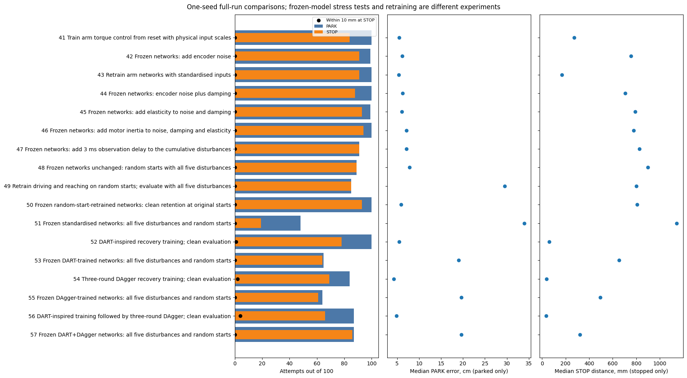


<a id="cell-389"></a>

<details><summary>Code · original cell 389</summary>

```python
publication.threshold_plot();plt.show()
```

</details>

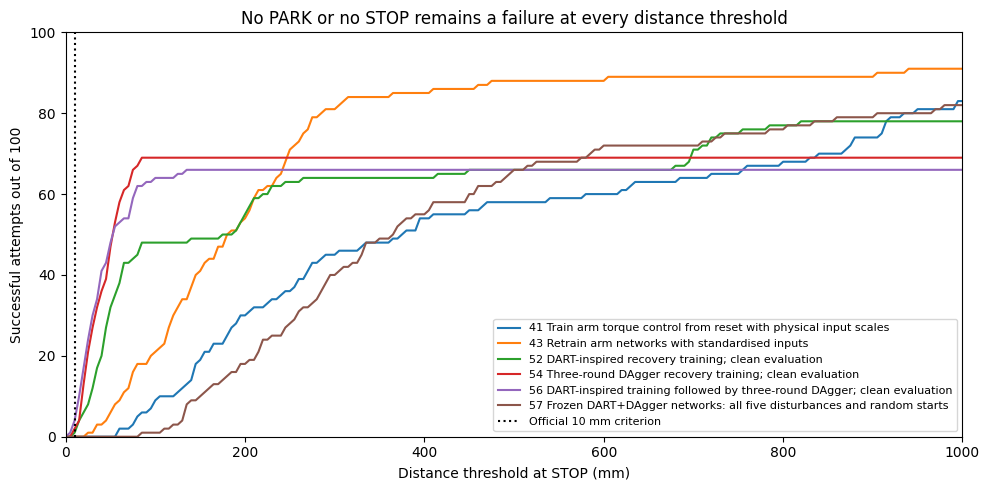


<a id="cell-390"></a>

<details><summary>Code · original cell 390</summary>

```python
display(publication.smoke_table().round(2))
print('Six fixed validation targets only. No official iteration or MLflow run. Selection score includes missing PARK/STOP with a 1 m penalty; STOP median alone excludes them.')
```

</details>

<div>

<table border="1" class="dataframe">
  <thead>
    <tr style="text-align: right;">
      <th></th>
      <th>check</th>
      <th>attempts</th>
      <th>parked</th>
      <th>stopped</th>
      <th>success_10mm</th>
      <th>median_stop_mm</th>
      <th>selection_score_mm</th>
    </tr>
  </thead>
  <tbody>
    <tr>
      <th>0</th>
      <td>dart_smoke</td>
      <td>6</td>
      <td>6</td>
      <td>4</td>
      <td>0</td>
      <td>266.85</td>
      <td>487.26</td>
    </tr>
    <tr>
      <th>1</th>
      <td>dagger_round1_smoke</td>
      <td>6</td>
      <td>6</td>
      <td>6</td>
      <td>0</td>
      <td>48.08</td>
      <td>48.08</td>
    </tr>
    <tr>
      <th>2</th>
      <td>dagger_round2_smoke</td>
      <td>6</td>
      <td>6</td>
      <td>5</td>
      <td>0</td>
      <td>51.35</td>
      <td>64.94</td>
    </tr>
    <tr>
      <th>3</th>
      <td>dagger_round3_smoke</td>
      <td>6</td>
      <td>6</td>
      <td>5</td>
      <td>1</td>
      <td>29.27</td>
      <td>37.81</td>
    </tr>
    <tr>
      <th>4</th>
      <td>dart_dagger_round1_smoke</td>
      <td>6</td>
      <td>6</td>
      <td>6</td>
      <td>0</td>
      <td>49.16</td>
      <td>49.16</td>
    </tr>
    <tr>
      <th>5</th>
      <td>dart_dagger_round2_smoke</td>
      <td>6</td>
      <td>6</td>
      <td>6</td>
      <td>0</td>
      <td>49.55</td>
      <td>49.55</td>
    </tr>
    <tr>
      <th>6</th>
      <td>dart_dagger_round3_smoke</td>
      <td>6</td>
      <td>6</td>
      <td>6</td>
      <td>0</td>
      <td>39.35</td>
      <td>39.35</td>
    </tr>
  </tbody>
</table>
</div>

```text
Six fixed validation targets only. No official iteration or MLflow run. Selection score includes missing PARK/STOP with a 1 m penalty; STOP median alone excludes them.

```


<a id="cell-391"></a>

**Evaluation summary.** Keep the fixed 10 mm criterion and show the full error distribution beside it. Standardisation improves clean reaching, but the frozen noise ladder is a different model, so it cannot tell us that standardisation fixes noise sensitivity. Recovery data improves the distances at STOP; the combined clean model still completes only 66/100 STOPs and succeeds on 4/100 targets. Inspect missing PARK/STOP cases and joint-speed noise before declaring the arm stable.

**Challenge:** could the lower median simply come from dropping hard cases? The plots above retain every attempt in the success denominator, and each run reports paired comparisons and completion counts. **Decision:** publish the completed comparisons with these limits; do not call the system solved. Keep bursty-packet collection outstanding.

**Next questions, not new experiments authorised by this publication:** which failures are missed transitions versus poor reaching; how much of noise sensitivity comes from finite-difference joint velocity; whether recovery labels should also cover PARK and STOP; and whether a new seed preserves the gain. Keep original recordings and failed exports for provenance.


<a id="cell-392"></a>

### Validation pilots: torque-only output and STOP recovery labels

These two preliminary comparisons use seed 7 and validation targets 6, 16, 23, 45, 55 and 80. Each episode starts from reset and tests learned driving and reaching together. The arm network acts at 1 kHz; driving and camera updates run at 30 Hz. STOP is actionable only after PARK and remains latched, with the existing post-STOP behaviour preserved. No new data or reserved test targets are used. These are validation checks, without official iteration numbers, MLflow runs or animations.

**Pilot A: remove the auxiliary distance output.** Start from the selected DAgger-only reference. Train a torque-only 18 → 128 → 128 → 7 ReLU FP32 network on the same original and DAgger training rows, using the reference training settings (1,200 epochs, seed 7, training-fitted input scaling and validation epoch selection). Remove both the auxiliary output and its objective. First verify deletion-only export parity. Freeze the existing driving network and independent STOP network. This checks whether removing the redundant objective changes torque learning and validation behaviour; no numerical gain is assumed. Compare saved losses and the same six episodes with the exact reference when its model, harness and physics match.

**Pilot B: train STOP on existing recovery distance labels.** Keep Pilot A torque weights and the existing driving network fixed. Audit alignment of the existing `arm_distance_m` labels before training the independent 18 → 32 → 16 → 1 STOP network (ReLU FP32, 600 epochs, seed 7). Use valid original and DAgger recovery-distance training rows, fit STOP scaling on training rows and choose the epoch on validation. Exclude PARK labels where counterfactual timing is unknown; do not enable every auxiliary mask. Preserve the STOP input contract and export metadata. Compare A plus existing STOP against A plus retrained STOP on the same six validation targets. This checks whether existing recovery labels improve STOP behaviour; unchanged or worse distances and success would refute that expectation.

Both pilots retain local configurations, source and data hashes, scaling, selected epochs and complete training/validation loss histories. Results will distinguish sensor-driven behaviour from diagnostic simulator state.


<a id="cell-393"></a>

### Validation pilots: saved results

These are six fixed validation targets with seed 7, starting from reset with learned driving and reaching. The comparison keeps the original driving network fixed. Pilot A changes only torque learning by removing the distance head and its objective; Pilot B adds a retrained independent STOP network using existing recovery-distance labels. The 10 mm threshold is unchanged. No test evaluation, new data, official iteration, MLflow run or animation was created.

The table retains all six targets per model, including missing STOP. Medians at STOP describe only attempts that stopped; success retains all six in its denominator. The simulation outcomes are sensor-driven; simulator distances and pre-PARK joint deviation are outcome diagnostics.

<a id="cell-394"></a>

<details><summary>Code · original cell 394</summary>

```python
import json
from pathlib import Path
import pandas as pd
import numpy as np
import report_curriculum as validation_report
pilot_root=validation_report.ROOT
pilot_a=pilot_root/'pilot_torque_only_20261105'
pilot_b=pilot_root/'pilot_stop_recovery_20261105'
a_rows=pd.read_csv(pilot_a/'comparison.csv')
b_record=json.loads((pilot_b/'validation_comparison.json').read_text())
b_rows=pd.DataFrame(b_record['rows'])
b_new=b_rows[b_rows.model=='recovery_stop'].rename(columns={'at_network_stop_mm':'stop_mm','min_mm':'closest_mm','end_mm':'final_mm'})
comparison=pd.concat([a_rows,b_new],ignore_index=True)
comparison['model']=comparison['model'].replace({'reference':'Reference: DAgger torque + existing STOP','torque_only':'A: torque only + existing STOP','recovery_stop':'B: torque only + recovery-trained STOP'})
expected={6,16,23,45,55,80}
metrics=[]
for label,rows in comparison.groupby('model',sort=False):
    assert len(rows)==6 and set(rows["dot"])==expected
    assert not (rows.status=='execution_failure').any()
    stopped=rows.stop_mm.dropna()
    metrics.append(dict(model=label,attempts=6,PARK=int(rows.parked.sum()),STOP=len(stopped),success_10mm=int(rows.success.sum()),median_STOP_mm=stopped.median(),median_closest_mm=rows.closest_mm.median()))
display(pd.DataFrame(metrics).set_index('model').round(3))
display(comparison[['model','dot','status','parked','stop_s','stop_mm','closest_mm','final_mm','success']].round(3))
print('Six validation targets only; no test results. Missing STOP remains in the success denominator.')
```

</details>

<div>

<table border="1" class="dataframe">
  <thead>
    <tr style="text-align: right;">
      <th></th>
      <th>attempts</th>
      <th>PARK</th>
      <th>STOP</th>
      <th>success_10mm</th>
      <th>median_STOP_mm</th>
      <th>median_closest_mm</th>
    </tr>
    <tr>
      <th>model</th>
      <th></th>
      <th></th>
      <th></th>
      <th></th>
      <th></th>
      <th></th>
    </tr>
  </thead>
  <tbody>
    <tr>
      <th>Reference: DAgger torque + existing STOP</th>
      <td>6</td>
      <td>6</td>
      <td>5</td>
      <td>1</td>
      <td>29.272</td>
      <td>30.858</td>
    </tr>
    <tr>
      <th>A: torque only + existing STOP</th>
      <td>6</td>
      <td>6</td>
      <td>5</td>
      <td>1</td>
      <td>20.397</td>
      <td>20.800</td>
    </tr>
    <tr>
      <th>B: torque only + recovery-trained STOP</th>
      <td>6</td>
      <td>6</td>
      <td>2</td>
      <td>0</td>
      <td>27.759</td>
      <td>20.695</td>
    </tr>
  </tbody>
</table>
</div>

<div>

<table border="1" class="dataframe">
  <thead>
    <tr style="text-align: right;">
      <th></th>
      <th>model</th>
      <th>dot</th>
      <th>status</th>
      <th>parked</th>
      <th>stop_s</th>
      <th>stop_mm</th>
      <th>closest_mm</th>
      <th>final_mm</th>
      <th>success</th>
    </tr>
  </thead>
  <tbody>
    <tr>
      <th>0</th>
      <td>Reference: DAgger torque + existing STOP</td>
      <td>6</td>
      <td>stop_outside_10mm</td>
      <td>True</td>
      <td>11.211</td>
      <td>15.573</td>
      <td>15.568</td>
      <td>21.246</td>
      <td>False</td>
    </tr>
    <tr>
      <th>1</th>
      <td>Reference: DAgger torque + existing STOP</td>
      <td>16</td>
      <td>stop_outside_10mm</td>
      <td>True</td>
      <td>6.893</td>
      <td>29.272</td>
      <td>23.637</td>
      <td>32.789</td>
      <td>False</td>
    </tr>
    <tr>
      <th>2</th>
      <td>Reference: DAgger torque + existing STOP</td>
      <td>23</td>
      <td>stop_outside_10mm</td>
      <td>True</td>
      <td>13.091</td>
      <td>77.518</td>
      <td>68.865</td>
      <td>99.137</td>
      <td>False</td>
    </tr>
    <tr>
      <th>3</th>
      <td>Reference: DAgger torque + existing STOP</td>
      <td>45</td>
      <td>stop_outside_10mm</td>
      <td>True</td>
      <td>8.074</td>
      <td>46.357</td>
      <td>38.078</td>
      <td>62.779</td>
      <td>False</td>
    </tr>
    <tr>
      <th>4</th>
      <td>Reference: DAgger torque + existing STOP</td>
      <td>55</td>
      <td>no_stop_timeout</td>
      <td>True</td>
      <td>NaN</td>
      <td>NaN</td>
      <td>48.663</td>
      <td>59.816</td>
      <td>False</td>
    </tr>
    <tr>
      <th>5</th>
      <td>Reference: DAgger torque + existing STOP</td>
      <td>80</td>
      <td>success</td>
      <td>True</td>
      <td>8.755</td>
      <td>7.230</td>
      <td>7.113</td>
      <td>8.922</td>
      <td>True</td>
    </tr>
    <tr>
      <th>6</th>
      <td>A: torque only + existing STOP</td>
      <td>6</td>
      <td>success</td>
      <td>True</td>
      <td>11.530</td>
      <td>9.711</td>
      <td>7.687</td>
      <td>18.759</td>
      <td>True</td>
    </tr>
    <tr>
      <th>7</th>
      <td>A: torque only + existing STOP</td>
      <td>16</td>
      <td>stop_outside_10mm</td>
      <td>True</td>
      <td>7.879</td>
      <td>38.661</td>
      <td>22.722</td>
      <td>40.372</td>
      <td>False</td>
    </tr>
    <tr>
      <th>8</th>
      <td>A: torque only + existing STOP</td>
      <td>23</td>
      <td>stop_outside_10mm</td>
      <td>True</td>
      <td>13.415</td>
      <td>40.271</td>
      <td>39.926</td>
      <td>46.668</td>
      <td>False</td>
    </tr>
    <tr>
      <th>9</th>
      <td>A: torque only + existing STOP</td>
      <td>45</td>
      <td>stop_outside_10mm</td>
      <td>True</td>
      <td>8.616</td>
      <td>17.821</td>
      <td>16.060</td>
      <td>41.541</td>
      <td>False</td>
    </tr>
    <tr>
      <th>10</th>
      <td>A: torque only + existing STOP</td>
      <td>55</td>
      <td>no_stop_timeout</td>
      <td>True</td>
      <td>NaN</td>
      <td>NaN</td>
      <td>56.042</td>
      <td>71.893</td>
      <td>False</td>
    </tr>
    <tr>
      <th>11</th>
      <td>A: torque only + existing STOP</td>
      <td>80</td>
      <td>stop_outside_10mm</td>
      <td>True</td>
      <td>8.316</td>
      <td>20.397</td>
      <td>18.878</td>
      <td>18.876</td>
      <td>False</td>
    </tr>
    <tr>
      <th>12</th>
      <td>B: torque only + recovery-trained STOP</td>
      <td>6</td>
      <td>no_stop_timeout</td>
      <td>True</td>
      <td>NaN</td>
      <td>NaN</td>
      <td>7.687</td>
      <td>24.877</td>
      <td>False</td>
    </tr>
    <tr>
      <th>13</th>
      <td>B: torque only + recovery-trained STOP</td>
      <td>16</td>
      <td>stop_outside_10mm</td>
      <td>True</td>
      <td>7.577</td>
      <td>29.384</td>
      <td>22.722</td>
      <td>40.695</td>
      <td>False</td>
    </tr>
    <tr>
      <th>14</th>
      <td>B: torque only + recovery-trained STOP</td>
      <td>23</td>
      <td>no_stop_timeout</td>
      <td>True</td>
      <td>NaN</td>
      <td>NaN</td>
      <td>30.656</td>
      <td>62.831</td>
      <td>False</td>
    </tr>
    <tr>
      <th>15</th>
      <td>B: torque only + recovery-trained STOP</td>
      <td>45</td>
      <td>stop_outside_10mm</td>
      <td>True</td>
      <td>8.528</td>
      <td>26.134</td>
      <td>16.060</td>
      <td>38.469</td>
      <td>False</td>
    </tr>
    <tr>
      <th>16</th>
      <td>B: torque only + recovery-trained STOP</td>
      <td>55</td>
      <td>no_stop_timeout</td>
      <td>True</td>
      <td>NaN</td>
      <td>NaN</td>
      <td>56.042</td>
      <td>71.893</td>
      <td>False</td>
    </tr>
    <tr>
      <th>17</th>
      <td>B: torque only + recovery-trained STOP</td>
      <td>80</td>
      <td>no_stop_timeout</td>
      <td>True</td>
      <td>NaN</td>
      <td>NaN</td>
      <td>18.667</td>
      <td>22.992</td>
      <td>False</td>
    </tr>
  </tbody>
</table>
</div>

```text
Six validation targets only; no test results. Missing STOP remains in the success denominator.

```


<a id="cell-395"></a>

<details><summary>Code · original cell 395</summary>

```python
import matplotlib.pyplot as plt
reference_history=pd.DataFrame(json.loads((pilot_a/'reference_torque_seed7_history.json').read_text()))
a_history=pd.DataFrame(json.loads((pilot_a/'models/torque_seed7_history.json').read_text()))
b_history=pd.DataFrame(json.loads((pilot_b/'models/stop_seed7_history.json').read_text()))
assert len(reference_history)==len(a_history)==1201 and len(b_history)==601
assert (a_history[['train_aux','val_aux']]==0).all().all()
fig,axes=plt.subplots(1,3,figsize=(15,4))
for label,history,colour in [('Reference',reference_history,'C0'),('A torque only',a_history,'C1')]:
    axes[0].plot(history.epoch,history.train_command,label=label+' train',color=colour)
    axes[0].plot(history.epoch,history.val_command,label=label+' validation',color=colour,linestyle='--')
axes[0].set(title='Torque command MSE',xlabel='Epoch',ylabel='Saved scaled MSE')
for key,style in [('train_aux','-'),('val_aux','--')]:axes[1].plot(reference_history.epoch,reference_history[key],style,label=key)
axes[1].set(title='Reference distance auxiliary MSE',xlabel='Epoch',ylabel='Saved scaled MSE')
for key,style in [('train_command','-'),('val_command','--')]:axes[2].plot(b_history.epoch,b_history[key],style,label=key)
axes[2].set(title='B independent STOP distance MSE',xlabel='Epoch',ylabel='Saved scaled MSE')
for ax in axes:ax.set_yscale('log');ax.grid(alpha=.2);ax.legend(fontsize=8)
fig.tight_layout();plt.show()
a_selection=json.loads((pilot_a/'models/torque_seed7_summary.json').read_text())
b_selection=json.loads((pilot_b/'models/stop_seed7_summary.json').read_text())
display(pd.DataFrame([dict(network='A torque only',selected_epoch=a_selection['selected_epoch'],selected_validation_MSE=a_selection['selected_val_loss']),dict(network='B independent STOP',selected_epoch=b_selection['selected_epoch'],selected_validation_MSE=b_selection['selected_val_loss'])]))
print('Command loss is compared with command loss. The reference auxiliary objective is shown separately; removing it changes total loss.')
```

</details>

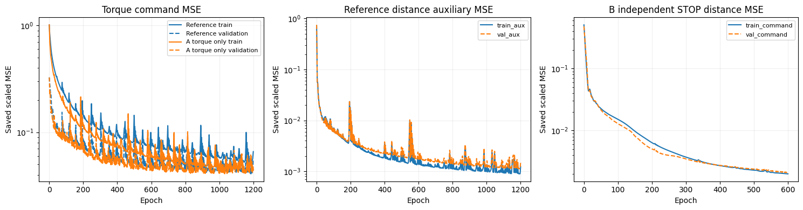

<div>

<table border="1" class="dataframe">
  <thead>
    <tr style="text-align: right;">
      <th></th>
      <th>network</th>
      <th>selected_epoch</th>
      <th>selected_validation_MSE</th>
    </tr>
  </thead>
  <tbody>
    <tr>
      <th>0</th>
      <td>A torque only</td>
      <td>1030</td>
      <td>0.040848</td>
    </tr>
    <tr>
      <th>1</th>
      <td>B independent STOP</td>
      <td>600</td>
      <td>0.002079</td>
    </tr>
  </tbody>
</table>
</div>

```text
Command loss is compared with command loss. The reference auxiliary objective is shown separately; removing it changes total loss.

```


<a id="cell-396"></a>

<details><summary>Code · original cell 396</summary>

```python
offline=json.loads((pilot_b/'models/offline_summary.json').read_text())
audit_rows=[]
for version in ('before','after'):
    for group,label in [('recovery_train','Recovery training states'),('validation','Original validation states')]:
        values=offline[version][group]
        audit_rows.append(dict(STOP=version,states=label,runs=values['runs'],rows=values['rows'],equal_episode_clipped_MAE_mm=values['equal_run_clipped_label_mae_mm'],near20mm_MAE_mm=values['near20_equal_run_mae_mm'],first_crossings=values['first_crossings'],median_true_mm_at_first_crossing=values['median_true_mm_at_first_crossing']))
display(pd.DataFrame(audit_rows).round(3))
alignment=offline['distance_alignment']
print('Distance-label alignment:',alignment['events'],'independently logged STOP events; maximum difference',alignment['max_difference_m'],'m.')
print('Offline rows are labelled states, not additional live validation episodes. No threshold was tuned.')
```

</details>

<div>

<table border="1" class="dataframe">
  <thead>
    <tr style="text-align: right;">
      <th></th>
      <th>STOP</th>
      <th>states</th>
      <th>runs</th>
      <th>rows</th>
      <th>equal_episode_clipped_MAE_mm</th>
      <th>near20mm_MAE_mm</th>
      <th>first_crossings</th>
      <th>median_true_mm_at_first_crossing</th>
    </tr>
  </thead>
  <tbody>
    <tr>
      <th>0</th>
      <td>before</td>
      <td>Recovery training states</td>
      <td>300</td>
      <td>3051720</td>
      <td>22.049</td>
      <td>35.718</td>
      <td>244</td>
      <td>65.185</td>
    </tr>
    <tr>
      <th>1</th>
      <td>before</td>
      <td>Original validation states</td>
      <td>100</td>
      <td>897417</td>
      <td>4.527</td>
      <td>3.163</td>
      <td>49</td>
      <td>10.532</td>
    </tr>
    <tr>
      <th>2</th>
      <td>after</td>
      <td>Recovery training states</td>
      <td>300</td>
      <td>3051720</td>
      <td>7.080</td>
      <td>14.491</td>
      <td>26</td>
      <td>23.907</td>
    </tr>
    <tr>
      <th>3</th>
      <td>after</td>
      <td>Original validation states</td>
      <td>100</td>
      <td>897417</td>
      <td>7.156</td>
      <td>9.782</td>
      <td>38</td>
      <td>12.985</td>
    </tr>
  </tbody>
</table>
</div>

```text
Distance-label alignment: 244 independently logged STOP events; maximum difference 2.814507749082651e-08 m.
Offline rows are labelled states, not additional live validation episodes. No threshold was tuned.

```


<a id="cell-397"></a>

**Reading the validation results.** Removing the auxiliary torque-network distance head changes where the model succeeds, without increasing completion: the reference and A both PARK on 6/6 targets, STOP on 5/6 and succeed on 1/6. Target 6 becomes a success and target 80 loses success. The median distance among stopped attempts decreases from 29.272 to 20.397 mm, while selected validation torque-command MSE is slightly higher (0.040848 versus 0.040762). The largest sampled pre-PARK joint deviation decreases from 0.06963 to 0.05741 rad. These six targets support a mixed result, not a general improvement claim.

Adding recovery-trained STOP makes this six-target comparison worse: B still PARKs on 6/6, but issues STOP on 2/6 rather than 5/6 and succeeds on 0/6 rather than 1/6. Its STOP median is 27.759 mm among those two stopped attempts. The offline fit improves on recovery training states while worsening on original validation states. Better recovery-label fit therefore does not establish better episode behaviour. The independent STOP training does not support replacing the existing STOP model on this evidence.

A selects epoch 1030 from 1,200 torque-training epochs; B selects epoch 600 from 600 STOP-training epochs. Training and validation scaling, selected checkpoints, source/data hashes, export parity and the complete per-target records are retained with the saved pilot records. Both completed comparisons have zero execution failures. No further experiment or model promotion follows from these checks.
